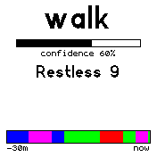
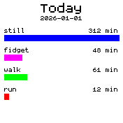

# Activity classifier (`actcls`)

Classifies what the wearer is doing from the accelerometer alone, with
hand-written rules: **still**, **fidget**, **walk**, **run** (or
**unknown**), plus a restlessness score for rest periods. Tutorial:
[07 — What am I doing?](../../tutorials/07-activity-classifier.md).

 

- **Main page:** current class (debounced: a new class must show up in 2
  windows in a row), confidence bar for the latest window, restlessness
  0–100 over the last 5 min of rest windows (`--` if there were none), and a
  30 min timeline coloured by class (blue still, magenta fidget, green walk,
  red run, black unknown).
- **Swipe left/right:** summary page with minutes per class today.
- **Button:** back to the launcher.

Restlessness is a relative indicator for comparing your own rest periods,
not a medical measure.

## How it works

The accelerometer runs at 12.5 Hz (`Bangle.setPollInterval(80)`, which also
turns off the firmware's automatic power-save rate switching). Samples go
into `Float32Array` ring buffers. Every 2 s the last 4 s (50 samples) are
turned into features and classified:

| Feature | Meaning |
|---|---|
| `meanMag` | mean of \|a\|, about 1 g at rest |
| `sdMag` | standard deviation of \|a\| |
| `p2p` | max − min of \|a\| |
| `zeroX` | crossings of the window mean by \|a\| (leaving a ±0.01 g band), scaled to a full 4 s window |
| `orient` | angle between the mean gravity vectors of this and the previous window, degrees |
| `steps` | firmware `step` events in the window |

| Class | Rule (checked in this order) |
|---|---|
| still | `sdMag < 0.01` and `orient < 5°` |
| run | `sdMag ≥ 0.35` and `zeroX ≥ 10` |
| walk | `0.08 ≤ sdMag < 0.35` and `zeroX` 6–20, or `steps ≥ 3` |
| fidget | `sdMag < 0.08` and `steps == 0` |
| unknown | anything else, or fewer than 80 % of the expected samples |

Confidence is the smallest relative distance of the features to a boundary
of the matching rule; 50 % or more away gives confidence 1.

The sample rate is measured per window (median interval), so a poll interval
changed by another app keeps `zeroX` on the same scale, and gaps in the data
show up as low coverage (`unknown`). Perfect stillness (`sdMag < 0.002`) for
more than 2 min sets an `off wrist?` hint.

## Files

| File | What it is |
|---|---|
| `actcls.lib.js` | Logic module, stored as `actcls`: features, rules, debounce, restlessness, timeline, daily summary, replay of prototype-06 logs, confusion matrix |
| `actcls.app.js` | UI and sensor wiring; `feed(a, t)` is the testable entry point |
| `icon-src.js` | Icon source for `node tools/make-icon.js actcls` |
| `tests/*.test.js` | Emulator tests (features, replay, stream, whole app) |
| `tests/fixtures/log.*` | Synthetic labelled recordings in the prototype-06 log format |
| `tools/make-fixtures.js` | Regenerates the fixtures (seeded, deterministic) |
| `tools/evaluate.js` | PC: replays real recordings and prints a confusion matrix |
| `HW-TESTS.md` | Checks on a real watch |

## Data

- `actcls.json`: `{"v":1,"day":"2026-11-23","min":{"still":312,"fidget":48,"walk":61,"run":0}}`,
  minutes per class for the current day, reset at the first window after
  midnight. Nothing else is stored and nothing is sent anywhere.
- With `DEBUG = true` each window is printed as one JSON line:
  `{"evt":"win","t":…,"meanMag":1.01,"sdMag":0.004,"p2p":0.02,"zeroX":3,"orient":1.2,"steps":0,"cls":"still","conf":0.9,"hz":12.5,"n":50}`,
  plus `show` (displayed class changed), `save` and `page` events.

## Tests

`npm test -- actcls` (34 tests in 4 files). The emulator has no
accelerometer data, so the tests call `feed()` / the module with synthetic
signals and replay the fixtures.
