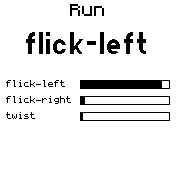
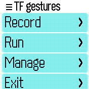

# TF wrist gestures (`tfgest`)

Record wrist gestures on the watch, train a tiny neural network on a PC,
convert it to TensorFlow Lite and run it on the watch with Espruino's
built-in TensorFlow Lite Micro. Gestures: `flick-left`, `flick-right`,
`twist`, `raise`, `shake`, plus `none`. Tutorial:
[08 — Machine learning on your wrist](../../tutorials/08-tflite-wrist-gestures.md).

 

## On the watch

Main menu:

- **Record:** pick a label (the count of saved recordings is shown), then
  **tap** to arm. The watch buzzes once; the next movement (|a| leaves
  1 g ± 0.3 g) starts a 1.5 s window (19 samples at 12.5 Hz, including 3
  samples before the movement). If nothing moves for 3 s it records anyway;
  `none` records at once. Two buzzes = saved. Button: back to the menu.
- **Run:** loads the model and classifies every movement window. A gesture
  with probability above `thresh` (0.7) is shown large with one buzz; then 1 s
  of refractory time. The top-3 probabilities are shown underneath. `none` is
  never an event. Shows `no model`, or the error (label/output mismatch,
  other sample rate, `create()` failure) instead of crashing. Button: back to
  the menu, which frees the interpreter.
- **Manage:** model size, input shape and quantisation, labels, number of
  recordings, **Test windows** (runs the 5 stored test windows through the
  model, compares with the PC's answer and shows the slowest inference
  time), **Delete recordings** (asks first).
- **Exit:** back to the launcher.

The app uses its own motion-onset detector (the *app-driven path* of the
spec), not the firmware's `gesture`/`aiGesture` events: the firmware's
gesture windows have a variable length and a different scale (raw >> 7,
about 64 per g), while this model needs a fixed 19 × 3 input.

## Files on the watch

| Storage file | Written by | Content |
|---|---|---|
| `gest.<label>` | Record mode (StorageFile, append) | one recording per line: `{"v":1,"label":"twist","hz":12.5,"n":19,"t":…,"xyz":[x0,y0,z0,…]}`, xyz = g × 100 as int8 |
| `.tfmodel` | `tfgest-model.js` | the `.tflite` flatbuffer |
| `gestmodel.json` | `tfgest-model.js` | `{"v":1,"labels":[…],"n":19,"hz":12.5,"scale":0.01,"quant":"int8","io":"float32","thresh":0.7,"arena":8000,"bytes":4888}` |
| `tfgest.tw.json` | `tfgest-model.js` | 5 test windows with the PC's float and int8 answers |

With `DEBUG = true` the app logs JSON events: `arm`, `rec`, `run`
(`err` if it can't run), `infer` (`ms`, top-3), `detect`, `selftest`, `deleted`.

## On the PC (`pc/`)

```sh
python3 -m venv .venv && . .venv/bin/activate
pip install -r apps/tfgest/pc/requirements.txt
python3 apps/tfgest/pc/make_dataset.py          # synthetic sample dataset -> pc/sample-data/
python3 apps/tfgest/pc/train.py                 # train, evaluate, convert -> model/
python3 apps/tfgest/pc/train.py --data <dir with your gest.* files>
```

`train.py` splits by recording session (a gap of more than 10 min starts a
new one), augments (time shift, amplitude, noise, small rotations), trains
the reference CNN, prints confusion matrices for Keras, TFLite float and
TFLite int8, checks the op list against Espruino's TFLM build and the 20 KB
budget, and exits 1 if accuracy < 85 %, the model is too big or an op is
unsupported. It writes `model/tfgest-model.js` (upload it with the Web IDE),
a float variant `tfgest-model-float.js`, the `.tflite` files and
`gestmodel.json`. `model/train-report.txt` is the output for the sample
dataset (100 % test accuracy, 4888 bytes int8).

## Files

| File | What it is |
|---|---|
| `tfgest.lib.js` | Logic module, stored as `tfgest`: format, onset detector, model checks, normalisation, top-3, decisions |
| `tfgest.app.js` | Menu, Record / Run / Manage modes, TensorFlow calls |
| `pc/` | Dataset generator, training script, requirements, sample dataset |
| `model/` | Trained sample model and the upload file |
| `tests/` | Emulator tests; `fixtures/tfgest-model.js` is a copy of the upload file |
| `HW-TESTS.md` | Checks on a real watch (TensorFlow, timing, live gestures) |

## Tests

`npm test -- tfgest` (24 tests in 3 files). The emulator has neither
accelerometer data nor `require("tensorflow")`, so tests feed synthetic
samples to `feed(a, t)` and replace `require("tensorflow")` with a fake
interpreter for Run mode. Real inference is checked in `HW-TESTS.md`.
