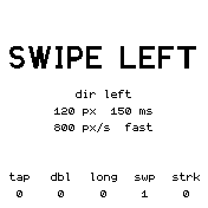
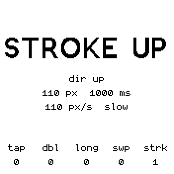

# 01 — Reading the touchscreen properly

The Bangle.js 2 touchscreen gives you a stream of raw points. In this tutorial
you turn that stream into a small, reliable set of gestures: tap, double tap,
long press, swipes in four directions with a speed, and slow strokes. The
result is a reusable module, `gestures`, that later tutorials (the haptic
player and the compass) use for "tap to stop" and "long press".



## What you need

- A Bangle.js 2, or just the [Espruino Web IDE](https://www.espruino.com/ide/) with its Bangle.js 2 emulator.
- Parts that need a real watch: tuning the thresholds for real fingers, and taps
  near the edge of the screen.
- Earlier tutorials this one reuses: none.

The finished app is in [`apps/touchgest`](../apps/touchgest): the recognizer
is `gestures.lib.js`, the demo screen is `touchgest.app.js`.

## 1. What the touchscreen gives you

Bangle.js 2 has three touch events:

- `touch` `(button, xy)`: fires once for a short press, with `xy = {x, y, type}`.
- `drag` `({x, y, dx, dy, b})`: fires while the finger moves and once on release.
  `b` is 1 while touching and 0 on release.
- `swipe` `(lr, ud)`: the firmware's own swipe detector, −1/0/1 per axis. No
  speed, no distance.

Paste this into the left-hand side of the Web IDE and touch the screen:

```js
Bangle.setLocked(false); // the touchscreen is ignored while the watch is locked
Bangle.on("touch", function (button, xy) { print("touch", button, JSON.stringify(xy)); });
Bangle.on("drag", function (e) { print("drag", JSON.stringify(e), Math.round(getTime() * 1000) % 100000); });
Bangle.on("swipe", function (lr, ud) { print("swipe", lr, ud); });
```

Things to notice in the console:

- `drag` events don't arrive at a fixed rate. A fast swipe may give only two
  or three of them, a slow one dozens.
- The release is a `drag` with `b:0`.
- Near the edge, `x` and `y` in `drag` can be below 0 or above 175 (the touch
  panel is bigger than the display); `touch` coordinates are clipped.

To stop the printing, run `reset()` (or `Bangle.removeAllListeners("drag")`
and the same for `touch` and `swipe`).

**You learned:** the shape of the three touch events, and that `drag` with the
`b` flag is the one to build on.

## 2. From points to strokes

A gesture starts when `b` goes to 1, collects points, and ends when `b` goes
back to 0. Keep the start point, the last point, the path length and the
times. That is a tiny state machine driven by events.

```js
var stroke = null;
function feed(p) {               // p = {x, y, b, t}, t in ms
  if (p.b && !stroke) {          // finger down: start
    stroke = { x0: p.x, y0: p.y, t0: p.t, x: p.x, y: p.y, path: 0 };
  } else if (p.b) {              // finger moving
    stroke.path += Math.sqrt(Math.pow(p.x - stroke.x, 2) + Math.pow(p.y - stroke.y, 2));
    stroke.x = p.x; stroke.y = p.y;
  } else if (stroke) {           // finger up: report and forget
    var dx = stroke.x - stroke.x0, dy = stroke.y - stroke.y0;
    print("stroke", { dx: dx, dy: dy, path: Math.round(stroke.path), dur: p.t - stroke.t0 });
    stroke = null;
  }
}
Bangle.setLocked(false);
Bangle.on("drag", function (e) { feed({ x: e.x, y: e.y, b: e.b, t: getTime() * 1000 }); });
```

Notice that `feed` never looks at `Bangle` or the clock: it gets everything,
including the time, in the object you pass in. That will make it testable in
step 6.

**You learned:** how to turn an event stream into "one thing per touch" with a
small state object.

## 3. Tap vs double tap vs long press

With a stroke in hand, the press-like gestures are rules on movement and time.
The defaults in the module are:

| Gesture | Rule |
|---|---|
| Tap | moved < 12 px from the start, released within 300 ms |
| Double tap | a second tap that starts < 350 ms after the first release, within 30 px |
| Long press | moved < 12 px, held ≥ 600 ms; fires *while still held* |

Two of these need timers:

- **Long press** must fire while the finger is still down, so start a
  `setTimeout` when the finger goes down and cancel it when the finger moves
  too far or lifts.
- **Tap** can't be reported on release, because the user might be halfway
  through a double tap. Hold it for the 350 ms double-tap window and cancel
  that timer if a second press arrives.

```js
var TAP_MOVE = 12, TAP_MS = 300, DOUBLE_MS = 350, LONG_MS = 600;
var down = null, pendingTap = null, tapTimer, longTimer;

function emit(type) { print(type); }

function press(p) {
  down = { x0: p.x, y0: p.y, t0: p.t, moved: 0, long: false };
  if (pendingTap && p.t - pendingTap.t < DOUBLE_MS) { clearTimeout(tapTimer); down.second = true; }
  longTimer = setTimeout(function () { down.long = true; emit("longpress"); }, LONG_MS);
}
function move(p) {
  down.moved = Math.max(down.moved, Math.sqrt(Math.pow(p.x - down.x0, 2) + Math.pow(p.y - down.y0, 2)));
  if (down.moved >= TAP_MOVE) clearTimeout(longTimer);
}
function release(p) {
  clearTimeout(longTimer);
  var d = down; down = null;
  if (d.long || d.moved >= TAP_MOVE || p.t - d.t0 >= TAP_MS) return;
  if (d.second) { pendingTap = null; emit("doubletap"); return; }
  pendingTap = { t: p.t };
  tapTimer = setTimeout(function () { pendingTap = null; emit("tap"); }, DOUBLE_MS);
}
function feed(p) {
  if (p.b && !down) press(p); else if (p.b) move(p); else if (down) release(p);
}
Bangle.setLocked(false);
Bangle.on("drag", function (e) { feed({ x: e.x, y: e.y, b: e.b, t: getTime() * 1000 }); });
```

Try it: a single tap prints `tap` about a third of a second after you lift
your finger. That delay is the price of having double taps. If your app has
no double tap, report taps at once; the module has an option for a middle
way, `instantTap: true`, which reports `tap` at once and then `doubletap` as
an extra event when a second tap follows.

 

**You learned:** `setTimeout`/`clearTimeout` for "fire later unless something
happens first", and why recognizing more gestures adds latency.

## 4. Swipes with speed

A swipe is a movement of at least 40 px that takes at most 600 ms. Its
direction is the dominant axis of the total displacement (ties go
horizontal), and its speed is distance ÷ duration:

```js
function direction(dx, dy) {
  if (Math.abs(dx) >= Math.abs(dy)) return dx < 0 ? "left" : "right";
  return dy < 0 ? "up" : "down";       // screen y grows downwards
}
function speedClass(pxPerS) {
  return pxPerS < 150 ? "slow" : pxPerS > 600 ? "fast" : "normal";
}
function describe(x0, y0, t0, x1, y1, t1) {
  var dx = x1 - x0, dy = y1 - y0;
  var dist = Math.sqrt(dx * dx + dy * dy);
  var dur = Math.max(1, t1 - t0);       // same timestamp: count as 1 ms, never divide by 0
  var speed = Math.round(dist * 1000 / dur);
  return { dir: direction(dx, dy), dist: Math.round(dist), dur: dur, speed: speed, speedClass: speedClass(speed) };
}
print(describe(138, 88, 0, 38, 88, 150));
// {"dir":"left","dist":100,"dur":150,"speed":667,"speedClass":"fast"}
```

Use the straight-line distance from start to end, not the path length, for
speed: it is what the user meant. Because only the first and last point are
needed, a very fast swipe that produced just two `drag` events still gets a
correct speed.

**You learned:** a little geometry, and how to pick thresholds that you can
tune later in one place.

## 5. Slow strokes and straightness

A movement of 40 px or more that takes longer than 600 ms is a *stroke*: a
slow, deliberate drag. Slow movements are also what a resting or wobbling
finger produces, so only accept them if the path was mostly in one direction:

```
straightness = straight-line distance ÷ path length
```

A ruler-straight drag has straightness 1.0. A zig-zag that ends 100 px to the
left but travelled 335 px has 0.3. The module accepts strokes with
straightness ≥ 0.8 and ignores the rest.

```js
function straightness(points) {        // points = [[x,y], ...]
  var path = 0;
  for (var i = 1; i < points.length; i++)
    path += Math.sqrt(Math.pow(points[i][0] - points[i - 1][0], 2) + Math.pow(points[i][1] - points[i - 1][1], 2));
  var a = points[0], b = points[points.length - 1];
  var dist = Math.sqrt(Math.pow(b[0] - a[0], 2) + Math.pow(b[1] - a[1], 2));
  return path ? dist / path : 1;
}
print(straightness([[150, 88], [100, 88], [50, 88]]).toFixed(2));               // 1.00
print(straightness([[150, 88], [125, 128], [100, 88], [75, 128], [50, 88]]).toFixed(2)); // 0.53
```



**You learned:** a single feature (straightness) is often enough to separate
intent from noise.

## 6. Make it testable

All the logic above lives in one function, `feed({x, y, b, t})`, that gets its
time from the caller. In the app, the `drag` handler only forwards events
(this needs the module on the watch, see below):

```js
var rec = require("gestures").create();
rec.on("gesture", function (ev) { print(ev.type); });
Bangle.setLocked(false);
Bangle.on("drag", function (e) { rec.feed({ x: e.x, y: e.y, b: e.b, t: getTime() * 1000 }); });
```

In a test you call `feed` yourself with made-up points and exact timestamps,
so you can check a 150 ms swipe without a finger and without a stopwatch.
This runs in the Web IDE once the module is on the watch (upload
`apps/touchgest/gestures.lib.js` to Storage as `gestures`):

```js
var G = require("gestures");
var r = G.create();
r.on("gesture", function (ev) { print(JSON.stringify(ev)); });
// 100 px to the left in 150 ms
r.feed({ x: 138, y: 88, b: 1, t: 0 });
r.feed({ x: 88, y: 88, b: 1, t: 75 });
r.feed({ x: 38, y: 88, b: 0, t: 150 });
// {"type":"swipe","dir":"left","dist":100,"dur":150,"speed":667,"speedClass":"fast","x0":138,...}
```

The repo's tests do exactly this, see [Test it in the emulator](#test-it-in-the-emulator).

**You learned:** separating input from logic, so the logic can be tested
with data instead of fingers.

## 7. Make it a module

The finished recognizer is a Storage module. Any app can use it:

```js
var G = require("gestures");
var r = G.create({ instantTap: false });     // or { instantTap: true, LONG_MS: 800 }
r.on("gesture", function (ev) {
  print(ev.type, ev.dir || "", ev.speedClass);
});
Bangle.setUI({
  mode: "custom",
  drag: function (e) { r.feed({ x: e.x, y: e.y, b: e.b, t: getTime() * 1000 }); },
  btn: function () { load(); }
});
Bangle.on("lock", function (locked) { if (locked) r.reset(); }); // drop half-done gestures
```

Events look like this (`dir` only for `swipe` and `stroke`):

```json
{"type":"swipe","dir":"left","dist":92,"dur":140,"speed":657,"speedClass":"fast",
 "x0":150,"y0":88,"x1":58,"y1":95,"t":123456}
```

`Bangle.setUI` etiquette:

- Claim touch handlers with `Bangle.setUI({mode:"custom", drag:…, btn:…})`
  rather than `Bangle.on("drag")`. When your app calls `setUI` again or exits,
  the handlers are removed cleanly, and the launcher's handlers don't fire
  inside your app.
- Always give the button a way out (`btn: function () { load(); }`).
- The touchscreen does nothing while the watch is locked. The demo sets
  `Bangle.setOptions({lockTimeout: 0})` and `Bangle.setLocked(false)` and puts
  the old timeout back in `E.on("kill", …)`. An app that only needs the odd tap
  should leave locking alone.
- If the watch locks in the middle of a gesture, call `r.reset()`: the half
  gesture is dropped, not reported.

To use the module from another app in this repo, list it in that app's
`metadata.json` storage: `{"name":"gestures","url":"../touchgest/gestures.lib.js"}`.

All thresholds are at the top of `gestures.lib.js` (`TAP_MOVE`, `TAP_MS`,
`DOUBLE_MS`, `DOUBLE_DIST`, `LONG_MS`, `SWIPE_MIN`, `SWIPE_MS`,
`STRAIGHT_MIN`, `SLOW_SPEED`, `FAST_SPEED`), and any of them can be
overridden per recognizer in `G.create({...})`.

**You learned:** packaging logic as a module and sharing the touchscreen
politely with the rest of the system.

## Test it in the emulator

The tests run in the real Bangle.js 2 firmware, headless, in virtual time:

```sh
npm test -- touchgest
```

- [`apps/touchgest/tests/gestures.test.js`](../apps/touchgest/tests/gestures.test.js)
  drives the module through `feed()` with synthetic points: tap after the
  double-tap window, double tap, the 667 px/s swipe, the 1000 ms stroke, long
  press before release, the rejected zig-zag, edge cases (2-point swipes, zero
  duration, reset while locked) and a table of 26 scripted gestures.
- [`apps/touchgest/tests/app.test.js`](../apps/touchgest/tests/app.test.js)
  runs the whole app with touchscreen input through the firmware (`T.swipe`,
  `T.tap`, `T.touch`) and checks the on-screen label for all four directions.

One of the tests (`T` is the harness's test API, so this runs under `npm test`, not in the IDE):

```js
T.test("3: 100 px left over 150 ms is a fast swipe at ~667 px/s", function () {
  var r = recorder();
  line(r, 138, 88, 38, 88, 0, 150);       // press, 5 moves, release at t=150
  var e = r.got[0];
  T.eq(e.type, "swipe"); T.eq(e.dir, "left"); T.eq(e.speedClass, "fast");
  T.near(e.speed, 667, 667 * 0.05, "speed");
});
```

You can also try it by hand in the Web IDE emulator: upload the app, drag the
mouse across the screen, and watch the label and the trail.


## Try it on the watch

The emulator can't tell you whether the thresholds suit real fingers. The
hardware checks in [`apps/touchgest/HW-TESTS.md`](../apps/touchgest/HW-TESTS.md)
ask a tester to do 20 deliberate swipes per direction (18 must be recognized)
and to tap near all four edges. If a check fails, change the constants at the
top of `gestures.lib.js`, not the logic, and record the new values.

## Going further

- Add "flick" detection: a swipe whose last segment is much
  faster than its average.
- Recognize an "L" or circle by splitting a stroke into segments and checking
  their directions.
- Use `speedClass` to scroll a list by one item for a normal swipe and by a page
  for a fast one.
- Compare the module's swipes with the firmware's own `swipe` event and see
  where they disagree.
