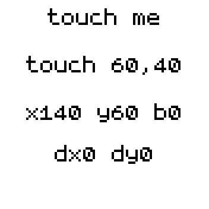
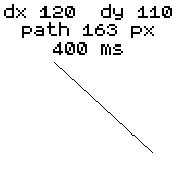
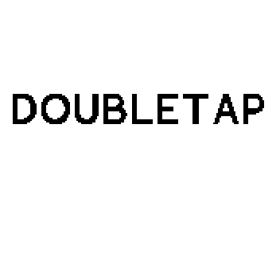
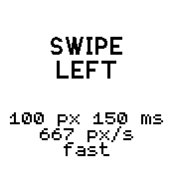
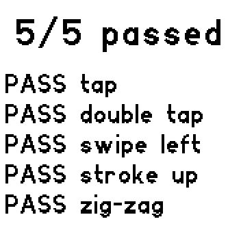
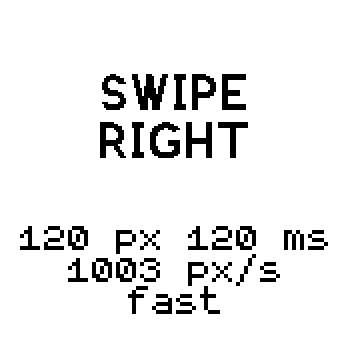

# 01 — Reading the touchscreen properly

The Bangle.js 2 touchscreen gives you a stream of raw points. In this tutorial
you turn that stream into a small, reliable set of gestures: tap, double tap,
long press, swipes in four directions with a speed, and slow strokes. The
result is a reusable module, `gestures`, that later tutorials (the haptic
player and the compass) use for "tap to stop" and "long press".


## What you need

- A Bangle.js 2, or just the [Espruino Web IDE](https://www.espruino.com/ide/) with its Bangle.js 2 emulator.
- Parts that need a real watch: tuning the thresholds for real fingers, and taps
  near the edge of the screen.
- Earlier tutorials this one reuses: none.

The finished app is in [`apps/touchgest`](../apps/touchgest): the recognizer
is `gestures.lib.js`, the demo screen is `touchgest.app.js`.

## 1. What the touchscreen gives you

Bangle.js 2 has three touch events:

- `touch` `(button, xy)`: fires once for a short press, with `xy = {x, y, type}`.
- `drag` `({x, y, dx, dy, b})`: fires while the finger moves and once on release.
  `b` is 1 while touching and 0 on release.
- `swipe` `(lr, ud)`: the firmware's own swipe detector, −1/0/1 per axis. No
  speed, no distance.

Paste this into the left-hand side of the Web IDE and touch the screen:

```js
Bangle.setLocked(false); // the touchscreen is ignored while the watch is locked
Bangle.on("touch", function (button, xy) { print("touch", button, JSON.stringify(xy)); });
Bangle.on("drag", function (e) { print("drag", JSON.stringify(e), Math.round(getTime() * 1000) % 100000); });
Bangle.on("swipe", function (lr, ud) { print("swipe", lr, ud); });
```

Things to notice in the console:

- `drag` events don't arrive at a fixed rate. A fast swipe may give only two
  or three of them, a slow one dozens.
- The release is a `drag` with `b:0`.
- Near the edge, `x` and `y` in `drag` can be below 0 or above 175 (the touch
  panel is bigger than the display); `touch` coordinates are clipped.

To stop the printing, run `reset()` (or `Bangle.removeAllListeners("drag")`
and the same for `touch` and `swipe`).



*What to look for: the "touch" line shows the clipped tap position, and the last drag line has b0 (the release) with dx0 dy0. The top line changes to "swipe" when the firmware recognizes a fast swipe.*

**Your app so far** (22 lines, also in [`tutorials/code/01/step1.js`](code/01/step1.js)). It prints the same events as above and also writes the latest of each kind on the screen, so you can watch them without the console. The button goes back to the launcher.

<details><summary>Show the code</summary>

```js
// Step 1: show the raw touch events (console and screen)
Bangle.setLocked(false); // the touchscreen is ignored while the watch is locked
g.clear();
function show(y, text) {
  g.reset().clearRect(0, y, 175, y + 30);
  g.setFont("6x8", 2).setFontAlign(0, 0).drawString(text, 88, y + 15);
}
show(0, "touch me");
Bangle.on("touch", function (button, xy) {
  print("touch", button, JSON.stringify(xy));
  show(40, "touch " + xy.x + "," + xy.y);
});
Bangle.on("drag", function (e) {
  print("drag", JSON.stringify(e), Math.round(getTime() * 1000) % 100000);
  show(80, "x" + e.x + " y" + e.y + " b" + e.b);
  show(115, "dx" + e.dx + " dy" + e.dy);
});
Bangle.on("swipe", function (lr, ud) {
  print("swipe", lr, ud);
  show(0, "swipe " + lr + " " + ud);
});
setWatch(function () { load(); }, BTN1); // button: back to the launcher
```

</details>

**You learned:** the shape of the three touch events, and that `drag` with the
`b` flag is the one to build on.

## 2. From points to strokes

A gesture starts when `b` goes to 1, collects points, and ends when `b` goes
back to 0. Keep the start point, the last point, the path length and the
times. That is a tiny state machine driven by events.

```js
var stroke = null;
function feed(p) {               // p = {x, y, b, t}, t in ms
  if (p.b && !stroke) {          // finger down: start
    stroke = { x0: p.x, y0: p.y, t0: p.t, x: p.x, y: p.y, path: 0 };
  } else if (p.b) {              // finger moving
    stroke.path += Math.sqrt(Math.pow(p.x - stroke.x, 2) + Math.pow(p.y - stroke.y, 2));
    stroke.x = p.x; stroke.y = p.y;
  } else if (stroke) {           // finger up: report and forget
    var dx = stroke.x - stroke.x0, dy = stroke.y - stroke.y0;
    print("stroke", { dx: dx, dy: dy, path: Math.round(stroke.path), dur: p.t - stroke.t0 });
    stroke = null;
  }
}
Bangle.setLocked(false);
Bangle.on("drag", function (e) { feed({ x: e.x, y: e.y, b: e.b, t: getTime() * 1000 }); });
```

Notice that `feed` never looks at `Bangle` or the clock: it gets everything,
including the time, in the object you pass in. That will make it testable in
step 6.



*What to look for: the line follows your finger, and on release the top shows dx/dy (end minus start), the path length and the duration. For a straight drag the path is close to the straight-line distance (here √(120² + 110²) ≈ 163).*

**Your app so far** (32 lines, also in [`tutorials/code/01/step2.js`](code/01/step2.js)). From here on the app claims the touchscreen with `Bangle.setUI` instead of `Bangle.on("drag")`; step 7 explains why.

<details><summary>Show the code</summary>

```js
// Step 2: one stroke per touch: start, end, path length, duration
var stroke = null;

function show(lines) {
  g.reset().clearRect(0, 0, 175, 60).setFont("6x8", 2).setFontAlign(0, 0);
  lines.forEach(function (l, i) { g.drawString(l, 88, 12 + i * 18); });
}

function feed(p) {               // p = {x, y, b, t}, t in ms
  if (p.b && !stroke) {          // finger down: start
    g.clear();
    stroke = { x0: p.x, y0: p.y, t0: p.t, x: p.x, y: p.y, path: 0 };
  } else if (p.b) {              // finger moving
    g.reset().drawLine(stroke.x, stroke.y, p.x, p.y);
    stroke.path += Math.sqrt(Math.pow(p.x - stroke.x, 2) + Math.pow(p.y - stroke.y, 2));
    stroke.x = p.x; stroke.y = p.y;
  } else if (stroke) {           // finger up: report and forget
    var s = stroke, dx = s.x - s.x0, dy = s.y - s.y0, dur = p.t - s.t0;
    stroke = null;
    print("stroke", { dx: dx, dy: dy, path: Math.round(s.path), dur: dur });
    show(["dx " + dx + "  dy " + dy, "path " + Math.round(s.path) + " px", Math.round(dur) + " ms"]);
  }
}

Bangle.setLocked(false);
Bangle.setUI({
  mode: "custom",
  drag: function (e) { feed({ x: e.x, y: e.y, b: e.b, t: getTime() * 1000 }); },
  btn: function () { load(); }
});
g.clear();
show(["drag a finger"]);
```

</details>

**You learned:** how to turn an event stream into "one thing per touch" with a
small state object.

## 3. Tap vs double tap vs long press

With a stroke in hand, the press-like gestures are rules on movement and time.
The defaults in the module are:

| Gesture | Rule |
|---|---|
| Tap | moved < 12 px from the start, released within 300 ms |
| Double tap | a second tap that starts < 350 ms after the first release, within 30 px |
| Long press | moved < 12 px, held ≥ 600 ms; fires *while still held* |

Two of these need timers:

- **Long press** must fire while the finger is still down, so start a
  `setTimeout` when the finger goes down and cancel it when the finger moves
  too far or lifts.
- **Tap** can't be reported on release, because the user might be halfway
  through a double tap. Hold it for the 350 ms double-tap window and cancel
  that timer if a second press arrives.

```js
var TAP_MOVE = 12, TAP_MS = 300, DOUBLE_MS = 350, LONG_MS = 600;
var down = null, pendingTap = null, tapTimer, longTimer;

function emit(type) { print(type); }

function press(p) {
  down = { x0: p.x, y0: p.y, t0: p.t, moved: 0, long: false };
  if (pendingTap && p.t - pendingTap.t < DOUBLE_MS) { clearTimeout(tapTimer); down.second = true; }
  longTimer = setTimeout(function () { down.long = true; emit("longpress"); }, LONG_MS);
}
function move(p) {
  down.moved = Math.max(down.moved, Math.sqrt(Math.pow(p.x - down.x0, 2) + Math.pow(p.y - down.y0, 2)));
  if (down.moved >= TAP_MOVE) clearTimeout(longTimer);
}
function release(p) {
  clearTimeout(longTimer);
  var d = down; down = null;
  if (d.long || d.moved >= TAP_MOVE || p.t - d.t0 >= TAP_MS) return;
  if (d.second) { pendingTap = null; emit("doubletap"); return; }
  pendingTap = { t: p.t };
  tapTimer = setTimeout(function () { pendingTap = null; emit("tap"); }, DOUBLE_MS);
}
function feed(p) {
  if (p.b && !down) press(p); else if (p.b) move(p); else if (down) release(p);
}
Bangle.setLocked(false);
Bangle.on("drag", function (e) { feed({ x: e.x, y: e.y, b: e.b, t: getTime() * 1000 }); });
```

Try it: a single tap prints `tap` about a third of a second after you lift
your finger. That delay is the price of having double taps. If your app has
no double tap, report taps at once; the module has an option for a middle
way, `instantTap: true`, which reports `tap` at once and then `doubletap` as
an extra event when a second tap follows.



*What to look for: two quick taps show DOUBLETAP and never a TAP first, because the first tap waited out the double-tap window.*


*What to look for: LONGPRESS appears 600 ms after the finger went down, while it is still down. Lifting the finger afterwards reports nothing more.*

**Your app so far** (51 lines, also in [`tutorials/code/01/step3.js`](code/01/step3.js)). It is the snippet above plus a screen label and two details the module also has: it keeps the path length (for step 5), and a long press that starts as the second press of a double tap first reports the pending tap.

<details><summary>Show the code</summary>

```js
// Step 3: tap, double tap and long press, with timers
var TAP_MOVE = 12, TAP_MS = 300, DOUBLE_MS = 350, LONG_MS = 600;
var down = null, pendingTap = null, tapTimer, longTimer;

function emit(ev) {
  print(JSON.stringify(ev));
  g.reset().clear().setFont("Vector", 26).setFontAlign(0, 0);
  g.drawString(ev.type.toUpperCase(), 88, 70);
}
function dist(ax, ay, bx, by) { return Math.sqrt((bx - ax) * (bx - ax) + (by - ay) * (by - ay)); }

function press(p) {
  down = { x0: p.x, y0: p.y, t0: p.t, x: p.x, y: p.y, path: 0, moved: 0, long: false };
  if (pendingTap && p.t - pendingTap.t < DOUBLE_MS) { clearTimeout(tapTimer); down.second = true; }
  longTimer = setTimeout(function () {
    if (down.second) { pendingTap = null; emit({ type: "tap" }); } // the first tap was a tap after all
    down.long = true;
    emit({ type: "longpress" });
  }, LONG_MS);
}
function move(p) {
  down.path += dist(down.x, down.y, p.x, p.y);
  down.x = p.x; down.y = p.y;
  down.moved = Math.max(down.moved, dist(down.x0, down.y0, p.x, p.y));
  if (down.moved >= TAP_MOVE) clearTimeout(longTimer);   // moved too far for a long press
}
function release(p) {
  clearTimeout(longTimer);
  var d = down; down = null;
  if (d.long) return;                                     // already reported while held
  if (d.moved < TAP_MOVE && p.t - d.t0 < TAP_MS) {
    if (d.second) { pendingTap = null; emit({ type: "doubletap" }); return; }
    pendingTap = { t: p.t };                              // wait: a second tap may follow
    tapTimer = setTimeout(function () { pendingTap = null; emit({ type: "tap" }); }, DOUBLE_MS);
    return;
  }
  if (d.second) { pendingTap = null; emit({ type: "tap" }); }
}
function feed(p) {                                        // p = {x, y, b, t}, t in ms
  if (p.b && !down) press(p);
  else if (p.b) move(p);
  else if (down) release(p);
}

Bangle.setLocked(false);
Bangle.setUI({
  mode: "custom",
  drag: function (e) { feed({ x: e.x, y: e.y, b: e.b, t: getTime() * 1000 }); },
  btn: function () { load(); }
});
g.clear().setFont("6x8", 2).setFontAlign(0, 0).drawString("tap, double tap\nor hold", 88, 88);
```

</details>

**You learned:** `setTimeout`/`clearTimeout` for "fire later unless something
happens first", and why recognizing more gestures adds latency.

## 4. Swipes with speed

A swipe is a movement of at least 40 px that takes at most 600 ms. Its
direction is the dominant axis of the total displacement (ties go
horizontal), and its speed is distance ÷ duration:

```js
function direction(dx, dy) {
  if (Math.abs(dx) >= Math.abs(dy)) return dx < 0 ? "left" : "right";
  return dy < 0 ? "up" : "down";       // screen y grows downwards
}
function speedClass(pxPerS) {
  return pxPerS < 150 ? "slow" : pxPerS > 600 ? "fast" : "normal";
}
function describe(x0, y0, t0, x1, y1, t1) {
  var dx = x1 - x0, dy = y1 - y0;
  var dist = Math.sqrt(dx * dx + dy * dy);
  var dur = Math.max(1, t1 - t0);       // same timestamp: count as 1 ms, never divide by 0
  var speed = Math.round(dist * 1000 / dur);
  return { dir: direction(dx, dy), dist: Math.round(dist), dur: dur, speed: speed, speedClass: speedClass(speed) };
}
print(describe(138, 88, 0, 38, 88, 150));
// {"dir":"left","dist":100,"dur":150,"speed":667,"speedClass":"fast"}
```

Use the straight-line distance from start to end, not the path length, for
speed: it is what the user meant. Because only the first and last point are
needed, a very fast swipe that produced just two `drag` events still gets a
correct speed.



*What to look for: the direction, the straight-line distance, the duration and the speed. 100 px in 150 ms is 667 px/s, which is above the 600 px/s "fast" threshold.*

**Your app so far** (67 lines, also in [`tutorials/code/01/step4.js`](code/01/step4.js)). It adds `direction` and `describe` to the step 3 app. `release` now also feeds the release point to `move`, because the last point of a fast swipe may only come with the release.

<details><summary>Show the code</summary>

```js
// Step 4: swipes with direction and speed
var TAP_MOVE = 12, TAP_MS = 300, DOUBLE_MS = 350, LONG_MS = 600;
var SWIPE_MIN = 40, SWIPE_MS = 600, SLOW = 150, FAST = 600;
var down = null, pendingTap = null, tapTimer, longTimer;

function emit(ev) {
  print(JSON.stringify(ev));
  g.reset().clear().setFont("Vector", 24).setFontAlign(0, 0);
  g.drawString(ev.type.toUpperCase() + (ev.dir ? "\n" + ev.dir.toUpperCase() : ""), 88, 60);
  if (ev.speed !== undefined) g.setFont("6x8", 2).drawString(ev.dist + " px " + ev.dur + " ms\n" +
    ev.speed + " px/s\n" + ev.speedClass, 88, 135);
}
function dist(ax, ay, bx, by) { return Math.sqrt((bx - ax) * (bx - ax) + (by - ay) * (by - ay)); }
function direction(dx, dy) {
  if (Math.abs(dx) >= Math.abs(dy)) return dx < 0 ? "left" : "right";  // ties go horizontal
  return dy < 0 ? "up" : "down";                                        // screen y grows downwards
}
function describe(d, t1) {
  var dur = Math.max(1, Math.round(t1 - d.t0));            // same timestamp: 1 ms, never divide by 0
  var dd = dist(d.x0, d.y0, d.x, d.y), speed = Math.round(dd * 1000 / dur);
  return { dir: direction(d.x - d.x0, d.y - d.y0), dist: Math.round(dd), dur: dur, speed: speed,
    speedClass: speed < SLOW ? "slow" : speed > FAST ? "fast" : "normal" };
}

function press(p) {
  down = { x0: p.x, y0: p.y, t0: p.t, x: p.x, y: p.y, path: 0, moved: 0, long: false };
  if (pendingTap && p.t - pendingTap.t < DOUBLE_MS) { clearTimeout(tapTimer); down.second = true; }
  longTimer = setTimeout(function () {
    if (down.second) { pendingTap = null; emit({ type: "tap" }); }
    down.long = true;
    emit({ type: "longpress" });
  }, LONG_MS);
}
function move(p) {
  down.path += dist(down.x, down.y, p.x, p.y);
  down.x = p.x; down.y = p.y;
  down.moved = Math.max(down.moved, dist(down.x0, down.y0, p.x, p.y));
  if (down.moved >= TAP_MOVE) clearTimeout(longTimer);
}
function release(p) {
  if (p.x !== down.x || p.y !== down.y) move(p);          // the release may carry the last point
  clearTimeout(longTimer);
  var d = down; down = null;
  if (d.long) return;
  if (d.moved < TAP_MOVE && p.t - d.t0 < TAP_MS) {
    if (d.second) { pendingTap = null; emit({ type: "doubletap" }); return; }
    pendingTap = { t: p.t };
    tapTimer = setTimeout(function () { pendingTap = null; emit({ type: "tap" }); }, DOUBLE_MS);
    return;
  }
  if (d.second) { pendingTap = null; emit({ type: "tap" }); }
  var ev = describe(d, p.t);
  if (ev.dist >= SWIPE_MIN && ev.dur <= SWIPE_MS) { ev.type = "swipe"; emit(ev); }
}
function feed(p) {
  if (p.b && !down) press(p);
  else if (p.b) move(p);
  else if (down) release(p);
}

Bangle.setLocked(false);
Bangle.setUI({
  mode: "custom",
  drag: function (e) { feed({ x: e.x, y: e.y, b: e.b, t: getTime() * 1000 }); },
  btn: function () { load(); }
});
g.clear().setFont("6x8", 2).setFontAlign(0, 0).drawString("swipe in any\ndirection", 88, 88);
```

</details>

**You learned:** a little geometry, and how to pick thresholds that you can
tune later in one place.

## 5. Slow strokes and straightness

A movement of 40 px or more that takes longer than 600 ms is a *stroke*: a
slow, deliberate drag. Slow movements are also what a resting or wobbling
finger produces, so only accept them if the path was mostly in one direction:

```
straightness = straight-line distance ÷ path length
```

A ruler-straight drag has straightness 1.0. A zig-zag that ends 100 px to the
left but travelled 335 px has 0.3. The module accepts strokes with
straightness ≥ 0.8 and ignores the rest.

```js
function straightness(points) {        // points = [[x,y], ...]
  var path = 0;
  for (var i = 1; i < points.length; i++)
    path += Math.sqrt(Math.pow(points[i][0] - points[i - 1][0], 2) + Math.pow(points[i][1] - points[i - 1][1], 2));
  var a = points[0], b = points[points.length - 1];
  var dist = Math.sqrt(Math.pow(b[0] - a[0], 2) + Math.pow(b[1] - a[1], 2));
  return path ? dist / path : 1;
}
print(straightness([[150, 88], [100, 88], [50, 88]]).toFixed(2));               // 1.00
print(straightness([[150, 88], [125, 128], [100, 88], [75, 128], [50, 88]]).toFixed(2)); // 0.53
```


*What to look for: STROKE instead of SWIPE because the drag took 1000 ms (more than 600 ms), and the speed class "slow". A wobbly slow drag shows nothing on screen and prints "ignored: straightness …" in the console.*

**Your app so far** (71 lines, also in [`tutorials/code/01/step5.js`](code/01/step5.js)). Compared with step 4 only the end of `release` changed: anything 40 px or longer is a swipe if it was quick, a stroke if it was slow and straight, and ignored otherwise.

<details><summary>Show the code</summary>

```js
// Step 5: slow strokes, if the path is straight enough
var TAP_MOVE = 12, TAP_MS = 300, DOUBLE_MS = 350, LONG_MS = 600;
var SWIPE_MIN = 40, SWIPE_MS = 600, SLOW = 150, FAST = 600, STRAIGHT_MIN = 0.8;
var down = null, pendingTap = null, tapTimer, longTimer;

function emit(ev) {
  print(JSON.stringify(ev));
  g.reset().clear().setFont("Vector", 24).setFontAlign(0, 0);
  g.drawString(ev.type.toUpperCase() + (ev.dir ? "\n" + ev.dir.toUpperCase() : ""), 88, 60);
  if (ev.speed !== undefined) g.setFont("6x8", 2).drawString(ev.dist + " px " + ev.dur + " ms\n" +
    ev.speed + " px/s\n" + ev.speedClass, 88, 135);
}
function dist(ax, ay, bx, by) { return Math.sqrt((bx - ax) * (bx - ax) + (by - ay) * (by - ay)); }
function direction(dx, dy) {
  if (Math.abs(dx) >= Math.abs(dy)) return dx < 0 ? "left" : "right";  // ties go horizontal
  return dy < 0 ? "up" : "down";                                        // screen y grows downwards
}
function describe(d, t1) {
  var dur = Math.max(1, Math.round(t1 - d.t0));            // same timestamp: 1 ms, never divide by 0
  var dd = dist(d.x0, d.y0, d.x, d.y), speed = Math.round(dd * 1000 / dur);
  return { dir: direction(d.x - d.x0, d.y - d.y0), dist: Math.round(dd), dur: dur, speed: speed,
    speedClass: speed < SLOW ? "slow" : speed > FAST ? "fast" : "normal" };
}

function press(p) {
  down = { x0: p.x, y0: p.y, t0: p.t, x: p.x, y: p.y, path: 0, moved: 0, long: false };
  if (pendingTap && p.t - pendingTap.t < DOUBLE_MS) { clearTimeout(tapTimer); down.second = true; }
  longTimer = setTimeout(function () {
    if (down.second) { pendingTap = null; emit({ type: "tap" }); }
    down.long = true;
    emit({ type: "longpress" });
  }, LONG_MS);
}
function move(p) {
  down.path += dist(down.x, down.y, p.x, p.y);
  down.x = p.x; down.y = p.y;
  down.moved = Math.max(down.moved, dist(down.x0, down.y0, p.x, p.y));
  if (down.moved >= TAP_MOVE) clearTimeout(longTimer);
}
function release(p) {
  if (p.x !== down.x || p.y !== down.y) move(p);          // the release may carry the last point
  clearTimeout(longTimer);
  var d = down; down = null;
  if (d.long) return;
  if (d.moved < TAP_MOVE && p.t - d.t0 < TAP_MS) {
    if (d.second) { pendingTap = null; emit({ type: "doubletap" }); return; }
    pendingTap = { t: p.t };
    tapTimer = setTimeout(function () { pendingTap = null; emit({ type: "tap" }); }, DOUBLE_MS);
    return;
  }
  if (d.second) { pendingTap = null; emit({ type: "tap" }); }
  var ev = describe(d, p.t);
  if (ev.dist < SWIPE_MIN) return;                        // too short for a swipe or stroke
  var straight = d.path ? ev.dist / d.path : 1;           // 1.0 = ruler-straight
  if (ev.dur <= SWIPE_MS) { ev.type = "swipe"; emit(ev); }
  else if (straight >= STRAIGHT_MIN) { ev.type = "stroke"; emit(ev); }
  else print("ignored: straightness " + straight.toFixed(2));
}
function feed(p) {
  if (p.b && !down) press(p);
  else if (p.b) move(p);
  else if (down) release(p);
}

Bangle.setLocked(false);
Bangle.setUI({
  mode: "custom",
  drag: function (e) { feed({ x: e.x, y: e.y, b: e.b, t: getTime() * 1000 }); },
  btn: function () { load(); }
});
g.clear().setFont("6x8", 2).setFontAlign(0, 0).drawString("swipe, or drag\nslowly", 88, 88);
```

</details>

**You learned:** a single feature (straightness) is often enough to separate
intent from noise.

## 6. Make it testable

All the logic above lives in one function, `feed({x, y, b, t})`, that gets its
time from the caller. In the app, the `drag` handler only forwards events
(this needs the module on the watch, see below):

```js
var rec = require("gestures").create();
rec.on("gesture", function (ev) { print(ev.type); });
Bangle.setLocked(false);
Bangle.on("drag", function (e) { rec.feed({ x: e.x, y: e.y, b: e.b, t: getTime() * 1000 }); });
```

In a test you call `feed` yourself with made-up points and exact timestamps,
so you can check a 150 ms swipe without a finger and without a stopwatch.
This runs in the Web IDE once the module is on the watch (upload
`apps/touchgest/gestures.lib.js` to Storage as `gestures`):

```js
var G = require("gestures");
var r = G.create();
r.on("gesture", function (ev) { print(JSON.stringify(ev)); });
// 100 px to the left in 150 ms
r.feed({ x: 138, y: 88, b: 1, t: 0 });
r.feed({ x: 88, y: 88, b: 1, t: 75 });
r.feed({ x: 38, y: 88, b: 0, t: 150 });
// {"type":"swipe","dir":"left","dist":100,"dur":150,"speed":667,"speedClass":"fast","x0":138,...}
```

The repo's tests do exactly this, see [Test it in the emulator](#test-it-in-the-emulator).



*What to look for: "5/5 passed" and one PASS line per case. A FAIL line means `feed` reported something else for that case; the console shows what it got. After the test the app works with your finger again.*

**Your app so far** (a marked change: the step 5 app with the block below added at the end; the complete file is [`tutorials/code/01/step6.js`](code/01/step6.js)). It tests the step 5 code without the module: it swaps `emit` for a recorder, drives `feed` with made-up points, and shows the results.

<details><summary>Show the code to add</summary>

```js
// --- Step 6: a scripted test that drives feed() with made-up points ---
var got = [], results = [];
var showOnScreen = emit;                          // keep the screen version for later
emit = function (ev) { got.push(ev.type + (ev.dir ? " " + ev.dir : "")); };
function tap(x, y, t) { feed({ x: x, y: y, b: 1, t: t }); feed({ x: x, y: y, b: 0, t: t + 80 }); }
function line(x0, y0, x1, y1, t, ms, n) {        // press, n moves, release
  feed({ x: x0, y: y0, b: 1, t: t });
  for (var i = 1; i <= n; i++) feed({ x: x0 + (x1 - x0) * i / n, y: y0 + (y1 - y0) * i / n, b: 1, t: t + ms * i / n });
  feed({ x: x1, y: y1, b: 0, t: t + ms });
}
var cases = [
  ["tap", function (t) { tap(88, 88, t); }, ["tap"]],
  ["double tap", function (t) { tap(88, 88, t); tap(90, 90, t + 200); }, ["doubletap"]],
  ["swipe left", function (t) { line(138, 88, 38, 88, t, 150, 5); }, ["swipe left"]],
  ["stroke up", function (t) { line(88, 150, 88, 40, t, 1000, 10); }, ["stroke up"]],
  ["zig-zag", function (t) {
    [[150, 88], [125, 128], [100, 88], [75, 128], [50, 88]].forEach(function (q, i) {
      feed({ x: q[0], y: q[1], b: 1, t: t + i * 250 });
    });
    feed({ x: 50, y: 88, b: 0, t: t + 1000 });
  }, []]
];
var k = 0;
function next() {
  if (k >= cases.length) {                        // all done: show the results, use the app again
    emit = showOnScreen;
    var passed = results.filter(function (r) { return r.charAt(0) === "P"; }).length;
    g.reset().clear().setFont("Vector", 26).setFontAlign(0, 0).drawString(passed + "/" + cases.length + " passed", 88, 25);
    g.setFont("Vector", 18).setFontAlign(-1, 0);
    results.forEach(function (r, i) { g.drawString(r, 4, 62 + i * 22); });
    return;
  }
  var c = cases[k++];
  got = [];
  c[1](getTime() * 1000);
  setTimeout(function () {                        // wait out the double-tap window
    var ok = JSON.stringify(got) === JSON.stringify(c[2]);
    results.push((ok ? "PASS " : "FAIL ") + c[0]);
    print(results[results.length - 1], JSON.stringify(got));
    next();
  }, 500);
}
next();
```

</details>

**You learned:** separating input from logic, so the logic can be tested
with data instead of fingers.

## 7. Make it a module

The finished recognizer is a Storage module. Any app can use it:

```js
var G = require("gestures");
var r = G.create({ instantTap: false });     // or { instantTap: true, LONG_MS: 800 }
r.on("gesture", function (ev) {
  print(ev.type, ev.dir || "", ev.speedClass);
});
Bangle.setUI({
  mode: "custom",
  drag: function (e) { r.feed({ x: e.x, y: e.y, b: e.b, t: getTime() * 1000 }); },
  btn: function () { load(); }
});
Bangle.on("lock", function (locked) { if (locked) r.reset(); }); // drop half-done gestures
```

Events look like this (`dir` only for `swipe` and `stroke`):

```json
{"type":"swipe","dir":"left","dist":92,"dur":140,"speed":657,"speedClass":"fast",
 "x0":150,"y0":88,"x1":58,"y1":95,"t":123456}
```

`Bangle.setUI` etiquette:

- Claim touch handlers with `Bangle.setUI({mode:"custom", drag:…, btn:…})`
  rather than `Bangle.on("drag")`. When your app calls `setUI` again or exits,
  the handlers are removed cleanly, and the launcher's handlers don't fire
  inside your app.
- Always give the button a way out (`btn: function () { load(); }`).
- The touchscreen does nothing while the watch is locked. The demo sets
  `Bangle.setOptions({lockTimeout: 0})` and `Bangle.setLocked(false)` and puts
  the old timeout back in `E.on("kill", …)`. An app that only needs the odd tap
  should leave locking alone.
- If the watch locks in the middle of a gesture, call `r.reset()`: the half
  gesture is dropped, not reported.

To use the module from another app in this repo, list it in that app's
`metadata.json` storage: `{"name":"gestures","url":"../touchgest/gestures.lib.js"}`.

All thresholds are at the top of `gestures.lib.js` (`TAP_MOVE`, `TAP_MS`,
`DOUBLE_MS`, `DOUBLE_DIST`, `LONG_MS`, `SWIPE_MIN`, `SWIPE_MS`,
`STRAIGHT_MIN`, `SLOW_SPEED`, `FAST_SPEED`), and any of them can be
overridden per recognizer in `G.create({...})`.



*What to look for: the same screen as in step 5, but now every number comes from the module's event, which also carries the start and end points and a timestamp (see the console).*

**Your app so far** (28 lines, also in [`tutorials/code/01/step7.js`](code/01/step7.js)). This is the final app in a simplified form: all the gesture logic now lives in the `gestures` module, so upload `apps/touchgest/gestures.lib.js` to Storage as `gestures` first.

<details><summary>Show the code</summary>

```js
// Step 7: the gesture module in a small app (a cut-down touchgest.app.js)
var G = require("gestures");
var rec = G.create();                       // or G.create({ instantTap: true, LONG_MS: 800 })
var savedLockTimeout = Bangle.getOptions().lockTimeout;

function show(ev) {
  g.reset().clear().setFont("Vector", 24).setFontAlign(0, 0);
  g.drawString(ev.type.toUpperCase() + (ev.dir ? "\n" + ev.dir.toUpperCase() : ""), 88, 60);
  if (ev.speed !== undefined) g.setFont("6x8", 2).drawString(ev.dist + " px " + ev.dur + " ms\n" +
    ev.speed + " px/s\n" + ev.speedClass, 88, 135);
}
rec.on("gesture", function (ev) { print(JSON.stringify(ev)); show(ev); });

function onLock(locked) { if (locked) rec.reset(); }   // drop a half-done gesture
E.on("kill", function () {                               // leaving the app: put things back
  Bangle.removeListener("lock", onLock);
  Bangle.setOptions({ lockTimeout: savedLockTimeout });
});

Bangle.setOptions({ lockTimeout: 0 });                   // the touchscreen is off while locked
Bangle.setLocked(false);
Bangle.on("lock", onLock);
Bangle.setUI({
  mode: "custom",
  drag: function (e) { rec.feed({ x: e.x, y: e.y, b: e.b, t: getTime() * 1000 }); },
  btn: function () { load(); }
});
g.clear().setFont("6x8", 2).setFontAlign(0, 0).drawString("tap, hold\nor swipe", 88, 88);
```

</details>

The real demo, [`apps/touchgest/touchgest.app.js`](../apps/touchgest/touchgest.app.js), uses the same module and lock handling and adds:

- a trail that follows the finger and disappears 500 ms after release (at most 100 points);
- a counter for each gesture type along the bottom;
- a label that shrinks its font until it fits;
- `G.create({ unknown: true })`, so rejected strokes can be logged when `DEBUG` is on;
- cleanup on lock and on exit that also clears the trail and its timer.


*What to look for: the label, the numbers under it, and the counters (tap, dbl, long, swp, strk) along the bottom.*

**You learned:** packaging logic as a module and sharing the touchscreen
politely with the rest of the system.

## Test it in the emulator

The tests run in the real Bangle.js 2 firmware, headless, in virtual time:

```sh
npm test -- touchgest
```

- [`apps/touchgest/tests/gestures.test.js`](../apps/touchgest/tests/gestures.test.js)
  drives the module through `feed()` with synthetic points: tap after the
  double-tap window, double tap, the 667 px/s swipe, the 1000 ms stroke, long
  press before release, the rejected zig-zag, edge cases (2-point swipes, zero
  duration, reset while locked) and a table of 26 scripted gestures.
- [`apps/touchgest/tests/app.test.js`](../apps/touchgest/tests/app.test.js)
  runs the whole app with touchscreen input through the firmware (`T.swipe`,
  `T.tap`, `T.touch`) and checks the on-screen label for all four directions.

One of the tests (`T` is the harness's test API, so this runs under `npm test`, not in the IDE):

```js
T.test("3: 100 px left over 150 ms is a fast swipe at ~667 px/s", function () {
  var r = recorder();
  line(r, 138, 88, 38, 88, 0, 150);       // press, 5 moves, release at t=150
  var e = r.got[0];
  T.eq(e.type, "swipe"); T.eq(e.dir, "left"); T.eq(e.speedClass, "fast");
  T.near(e.speed, 667, 667 * 0.05, "speed");
});
```

You can also try it by hand in the Web IDE emulator: upload the app, drag the
mouse across the screen, and watch the label and the trail.


*What to look for: the line drawn under the finger while it moves; it disappears half a second after you lift the finger.*

## Try it on the watch

The emulator can't tell you whether the thresholds suit real fingers. The
hardware checks in [`apps/touchgest/HW-TESTS.md`](../apps/touchgest/HW-TESTS.md)
ask a tester to do 20 deliberate swipes per direction (18 must be recognized)
and to tap near all four edges. If a check fails, change the constants at the
top of `gestures.lib.js`, not the logic, and record the new values.

## Going further

- Add "flick" detection: a swipe whose last segment is much
  faster than its average.
- Recognize an "L" or circle by splitting a stroke into segments and checking
  their directions.
- Use `speedClass` to scroll a list by one item for a normal swipe and by a page
  for a fast one.
- Compare the module's swipes with the firmware's own `swipe` event and see
  where they disagree.
