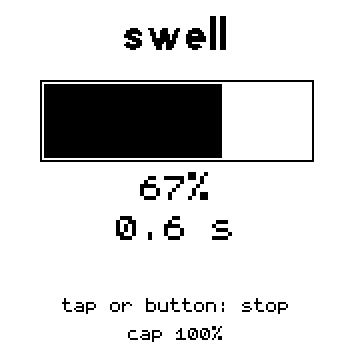
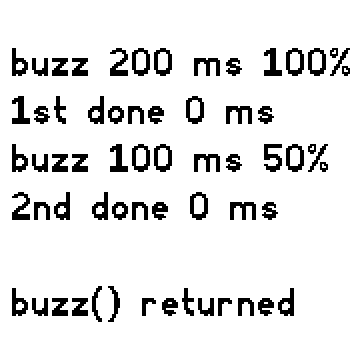
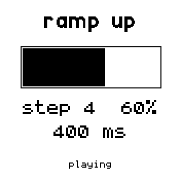
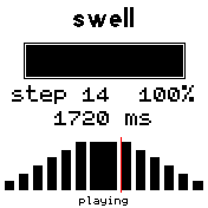
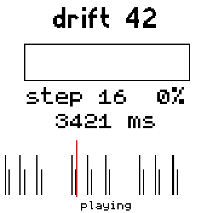
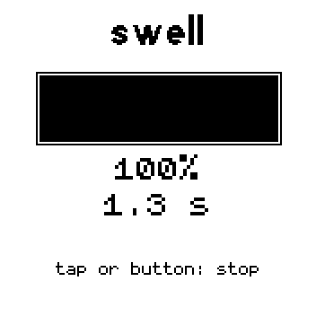
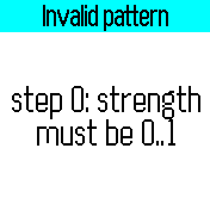

# 02 — Designing vibration patterns

The Bangle.js 2 has one small vibration motor and no speaker, so buzzing is
how it gets your attention. In this tutorial you describe vibration patterns
as data (pulses, ramps, swells, rhythms that drift), play them with a tiny
player that keeps accurate time, and put safety limits in one place so a bad
pattern can't run the motor flat-out forever. Tapping the screen stops
playback, using the gesture module from tutorial 01.



## What you need

- A Bangle.js 2, or just the [Espruino Web IDE](https://www.espruino.com/ide/) with its Bangle.js 2 emulator.
- Parts that need a real watch: **feeling** the patterns. The emulator accepts
  every `Bangle.buzz()` call but there is no motor, so you check timing and
  strengths from a log instead.
- Earlier tutorials this one reuses: [01 — Reading the touchscreen properly](01-touch-gestures.md) (tap to stop).

The finished app is in [`apps/hapticpat`](../apps/hapticpat): the patterns,
limits and player are in `haptic.lib.js`, the menu and screens in
`hapticpat.app.js`.

## 1. One buzz

`Bangle.buzz(time, strength)` runs the motor for `time` ms at `strength`
(0–1, default 1) and returns a Promise that resolves when it has finished:

```js
Bangle.buzz(200, 1).then(function () {
  print("first buzz done");
  return Bangle.buzz(100, 0.5);
}).then(function () { print("second buzz done"); });
print("this prints first: buzz() does not block");
```

Things worth knowing, checked against the Espruino source
(`libs/banglejs/jswrap_bangle.c`) and the emulator:

- `buzz()` returns at once; your code keeps running while the motor runs.
  That is asynchronous code on Espruino: Promises and timers, no threads.
- `time` is clamped to 1–5000 ms, and **`time` 0 means the default 200 ms**, so
  `Bangle.buzz(0)` is a buzz, not "stop".
- If you call `buzz()` while a buzz is still running, the firmware queues the
  new one after the current one (the Promises are chained). Calls never
  overlap, but a "stop" sent as a buzz would wait in the queue.
- Strength drives the motor's PWM duty cycle as `0.4 + 0.6 × strength`, so any
  strength above 0 gives at least 40 % duty. How weak a step you can still feel
  is a question for a real watch.
- In the emulator the Promise resolves immediately whatever `time` is. Code
  that waits for the Promise to time its steps would run far too fast there,
  so the player in this tutorial keeps its own time.

To switch the motor off immediately, drive its pin low:
`digitalWrite(VIBRATE, 0)`. Any buzz still queued finishes (silently) on its own.



*What to look for: "buzz() returned" is drawn right away, before either buzz has finished. In the emulator both buzzes report "done" after 0 ms because its Promise resolves at once; on a watch the first one takes about 200 ms.*

**Your app so far** (20 lines, also in [`tutorials/code/02/step1.js`](code/02/step1.js)). It runs the two chained buzzes from above and writes each event on the screen as it happens. Tap the screen to run it again; the button goes back to the launcher.

<details><summary>Show the code</summary>

```js
// Step 1: one buzz, then another; tap the screen to run it again
function line(i, text) {
  g.reset().clearRect(0, 20 + i * 24, 175, 43 + i * 24);
  g.setFont("Vector", 18).setFontAlign(-1, 0).drawString(text, 6, 32 + i * 24);
}
function run() {
  var t0 = Date.now();
  function ms() { return Math.round(Date.now() - t0) + " ms"; }
  g.clear();
  line(0, "buzz 200 ms 100%");
  Bangle.buzz(200, 1).then(function () {
    line(1, "1st done " + ms());
    line(2, "buzz 100 ms 50%");
    return Bangle.buzz(100, 0.5);
  }).then(function () { line(3, "2nd done " + ms()); });
  line(5, "buzz() returned");        // drawn before either buzz has finished
  print("this prints first: buzz() does not block");
}
Bangle.setUI({ mode: "custom", touch: run, btn: function () { load(); } });
run();
```

</details>

**You learned:** `Bangle.buzz` is asynchronous and returns a Promise, and a
few of its edge cases.

## 2. Patterns as data

A pattern is a list of steps, each `[durationMs, strength]`; strength 0 is a
pause:

```json
{"name":"ramp up","repeat":1,
 "steps":[[150,0.2],[50,0],[150,0.4],[50,0],[150,0.6],[50,0],[150,0.8],[50,0],[300,1.0]]}
```

A tiny player walks the list. The trick is to schedule every step from the
**start time**, not by chaining "wait for the last one, then wait some
more": small delays in each timer would otherwise add up, and a 60 s pattern
would end noticeably late.

```js
function playSteps(steps) {
  var start = Date.now(), at = 0, i = 0;
  function next() {
    if (i >= steps.length) { print("done after", Date.now() - start, "ms"); return; }
    var st = steps[i++];
    if (st[1] > 0) Bangle.buzz(st[0], st[1]);
    print("step", i - 1, st[0], "ms at", st[1]);
    at += st[0];
    setTimeout(next, Math.max(0, start + at - Date.now()));   // absolute time, no drift
  }
  next();
}
playSteps([[150, 0.2], [50, 0], [150, 0.4], [50, 0], [150, 0.6], [50, 0], [150, 0.8], [50, 0], [300, 1.0]]);
```

Data is easier to change, store, send and check than code full of nested
`setTimeout`s. It also means every safety rule can live in the player,
whatever pattern you feed it.



*What to look for: the bar shows the current step's strength (step 4 is 60 %), and the time is the step's planned start, 400 ms. The times stay on the plan (0, 150, 200, 350, 400 ms …) because each step is scheduled from the start time.*

**Your app so far** (31 lines, also in [`tutorials/code/02/step2.js`](code/02/step2.js)). It plays `ramp up` with the `playSteps` player from above and shows the current step. Tap to replay.

<details><summary>Show the code</summary>

```js
// Step 2: a pattern as data, played from a fixed start time
var RAMP = { name: "ramp up", steps: [[150, 0.2], [50, 0], [150, 0.4], [50, 0], [150, 0.6], [50, 0], [150, 0.8], [50, 0], [300, 1.0]] };
var timer;

function draw(name, i, s, t, note) {
  g.reset().clear().setFontAlign(0, 0).setFont("Vector", 22).drawString(name, 88, 20);
  g.drawRect(20, 45, 156, 85);
  if (s > 0) g.fillRect(22, 47, 22 + Math.round(132 * s), 83);
  g.setFont("6x8", 2).drawString("step " + i + "  " + Math.round(s * 100) + "%", 88, 105);
  g.drawString(t + " ms", 88, 128);
  g.setFont("6x8", 1).drawString(note, 88, 160);
}

function playSteps(p) {
  if (timer) clearTimeout(timer);
  var steps = p.steps, start = Date.now(), at = 0, i = 0;
  function next() {
    var t = Math.round(Date.now() - start);
    if (i >= steps.length) { timer = undefined; draw(p.name, i, 0, t, "done, tap to replay"); return; }
    var st = steps[i++];
    if (st[1] > 0) Bangle.buzz(st[0], st[1]);
    print("step", i - 1, st[0], "ms at", st[1], "t", t);
    draw(p.name, i - 1, st[1], t, "playing");
    at += st[0];
    timer = setTimeout(next, Math.max(0, start + at - Date.now()));   // absolute time, no drift
  }
  next();
}

Bangle.setUI({ mode: "custom", touch: function () { playSteps(RAMP); }, btn: function () { load(); } });
playSteps(RAMP);
```

</details>

**You learned:** separate the pattern (data) from playback (code), and
schedule from a fixed start time.

## 3. Strength envelopes

A ramp raises strength step by step. A *swell* ramps up, holds and ramps
down. The small motor reacts slowly, so back-to-back steps of different
strength blur into one buzz. A short gap between steps lets each level be felt
on its own:

```js
function swell(levels, stepMs, gapMs, holdMs) {
  var steps = [], k;
  for (k = 1; k <= levels; k++) steps.push([stepMs, Math.round(k / levels * 100) / 100], [gapMs, 0]);
  steps.push([holdMs, 1], [gapMs, 0]);
  for (k = levels; k >= 1; k--) steps.push([stepMs, Math.round(k / levels * 100) / 100], [gapMs, 0]);
  steps.pop();                         // no gap at the very end
  return steps;
}
print(JSON.stringify(swell(6, 150, 60, 400)));
```

That is the app's built-in `swell`: six levels up (0.17 … 1.0), a 400 ms hold,
six levels down, 60 ms gaps. Whether a tester can tell all six levels apart
is one of the hardware checks.



*What to look for: the envelope along the bottom, one bar per step with its height set by strength, and the red line at the current time. The gaps between the bars are the 60 ms pauses that let you feel each level.*

**Your app so far** (52 lines, also in [`tutorials/code/02/step3.js`](code/02/step3.js)). It adds the `swell` generator and draws the whole envelope of the pattern that is playing. Tap the left half for `ramp up`, the right half for `swell`.

<details><summary>Show the code</summary>

```js
// Step 3: generated envelopes; tap the left half for "ramp up", the right half for "swell"
function swell(levels, stepMs, gapMs, holdMs) {
  var steps = [], k;
  for (k = 1; k <= levels; k++) steps.push([stepMs, Math.round(k / levels * 100) / 100], [gapMs, 0]);
  steps.push([holdMs, 1], [gapMs, 0]);
  for (k = levels; k >= 1; k--) steps.push([stepMs, Math.round(k / levels * 100) / 100], [gapMs, 0]);
  steps.pop();                         // no gap at the very end
  return steps;
}
var RAMP = { name: "ramp up", steps: [[150, 0.2], [50, 0], [150, 0.4], [50, 0], [150, 0.6], [50, 0], [150, 0.8], [50, 0], [300, 1.0]] };
var SWELL = { name: "swell", steps: swell(6, 150, 60, 400) };
var timer;

function draw(p, i, s, t, note) {
  g.reset().clear().setFontAlign(0, 0).setFont("Vector", 22).drawString(p.name, 88, 16);
  g.drawRect(20, 36, 156, 66);
  if (s > 0) g.fillRect(22, 38, 22 + Math.round(132 * s), 64);
  g.setFont("6x8", 2).drawString("step " + i + "  " + Math.round(s * 100) + "%", 88, 80);
  g.drawString(t + " ms", 88, 100);
  var total = 0, x = 4;
  p.steps.forEach(function (st) { total += st[0]; });
  p.steps.forEach(function (st) {      // the envelope: one bar per step, height = strength
    var w = st[0] * 168 / total;
    if (st[1] > 0) g.fillRect(x, 160 - Math.round(st[1] * 40), x + w - 1, 160);
    x += w;
  });
  var mx = 4 + Math.min(t, total) * 168 / total;
  g.setColor("#f00").drawLine(mx, 116, mx, 162);
  g.setColor(g.theme.fg).setFont("6x8", 1).drawString(note, 88, 170);
}

function playSteps(p) {
  if (timer) clearTimeout(timer);
  var steps = p.steps, start = Date.now(), at = 0, i = 0;
  function next() {
    var t = Math.round(Date.now() - start);
    if (i >= steps.length) { timer = undefined; draw(p, i, 0, t, "done: tap left or right"); return; }
    var st = steps[i++];
    if (st[1] > 0) Bangle.buzz(st[0], st[1]);
    draw(p, i - 1, st[1], t, "playing");
    at += st[0];
    timer = setTimeout(next, Math.max(0, start + at - Date.now()));   // absolute time, no drift
  }
  next();
}

Bangle.setUI({
  mode: "custom",
  touch: function (btn, xy) { playSteps(xy.x < 88 ? RAMP : SWELL); },
  btn: function () { load(); }
});
playSteps(SWELL);
```

</details>

**You learned:** envelopes are just generated step lists, and gaps make steps
distinguishable on a small motor.

## 4. Rhythm and variation

A steady beat is a short step list repeated. The app's `rhythm` is
`[[80,0.8],[120,0],[60,0.5],[540,0]]` (a strong and a weak tap, 800 ms per
beat, 75 per minute) with `"repeat": 10`.

To make a beat feel alive, vary it: change each cycle's pause by up to
±15 %, and every 4th beat skip it or play it twice. Use a **seeded** random
generator rather than `Math.random()`, so the same seed always gives the same
pattern and a test can check it:

```js
function random(seed) {            // Park-Miller: exact in doubles, same on every device
  var s = seed % 2147483647 || 1;
  return function () { s = (s * 16807) % 2147483647; return (s - 1) / 2147483646; };
}
function drifting(seed) {
  var rnd = random(seed), steps = [];
  for (var c = 0; c < 12; c++) {
    var pause = Math.round(540 * (1 + (rnd() * 2 - 1) * 0.15));
    var odd = c % 4 === 3, how = odd ? (rnd() < 0.5 ? "skip" : "double") : "";
    if (how === "skip") { steps.push([800, 0]); continue; }
    if (how === "double") steps.push([80, 0.8], [120, 0], [60, 0.5], [120, 0]);
    steps.push([80, 0.8], [120, 0], [60, 0.5], [pause, 0]);
  }
  return steps;
}
print(JSON.stringify(drifting(42)) === JSON.stringify(drifting(42)));  // true
print(JSON.stringify(drifting(42)) === JSON.stringify(drifting(7)));   // false
```

In the app, patterns may have a `gen(seed)` function instead of `steps`; the
`drifting rhythm` built-in works that way, and the app uses a new seed each
time you play it.



*What to look for: pairs of strong and weak taps with pauses that differ slightly, and every 4th beat skipped or doubled. Seed 42 always draws exactly this picture; tapping the right third plays seeds 1, 2, 3 … and each looks different.*

**Your app so far** (72 lines, also in [`tutorials/code/02/step4.js`](code/02/step4.js)). It adds the seeded `random` and `drifting` functions from above. Tap left for `ramp up`, the middle for `swell`, the right for a drifting rhythm with a new seed.

<details><summary>Show the code</summary>

```js
// Step 4: a seeded, drifting rhythm; tap left: "ramp up", middle: "swell", right: drifting rhythm
function swell(levels, stepMs, gapMs, holdMs) {
  var steps = [], k;
  for (k = 1; k <= levels; k++) steps.push([stepMs, Math.round(k / levels * 100) / 100], [gapMs, 0]);
  steps.push([holdMs, 1], [gapMs, 0]);
  for (k = levels; k >= 1; k--) steps.push([stepMs, Math.round(k / levels * 100) / 100], [gapMs, 0]);
  steps.pop();                         // no gap at the very end
  return steps;
}
function random(seed) {            // Park-Miller: exact in doubles, same on every device
  var s = seed % 2147483647 || 1;
  return function () { s = (s * 16807) % 2147483647; return (s - 1) / 2147483646; };
}
function drifting(seed) {
  var rnd = random(seed), steps = [];
  for (var c = 0; c < 12; c++) {
    var pause = Math.round(540 * (1 + (rnd() * 2 - 1) * 0.15));
    var odd = c % 4 === 3, how = odd ? (rnd() < 0.5 ? "skip" : "double") : "";
    if (how === "skip") { steps.push([800, 0]); continue; }
    if (how === "double") steps.push([80, 0.8], [120, 0], [60, 0.5], [120, 0]);
    steps.push([80, 0.8], [120, 0], [60, 0.5], [pause, 0]);
  }
  return steps;
}
var seed = 1;
var RAMP = { name: "ramp up", steps: [[150, 0.2], [50, 0], [150, 0.4], [50, 0], [150, 0.6], [50, 0], [150, 0.8], [50, 0], [300, 1.0]] };
var SWELL = { name: "swell", steps: swell(6, 150, 60, 400) };
var timer;

function draw(p, i, s, t, note) {
  g.reset().clear().setFontAlign(0, 0).setFont("Vector", 22).drawString(p.name, 88, 16);
  g.drawRect(20, 36, 156, 66);
  if (s > 0) g.fillRect(22, 38, 22 + Math.round(132 * s), 64);
  g.setFont("6x8", 2).drawString("step " + i + "  " + Math.round(s * 100) + "%", 88, 80);
  g.drawString(t + " ms", 88, 100);
  var total = 0, x = 4;
  p.steps.forEach(function (st) { total += st[0]; });
  p.steps.forEach(function (st) {      // the envelope: one bar per step, height = strength
    var w = st[0] * 168 / total;
    if (st[1] > 0) g.fillRect(x, 160 - Math.round(st[1] * 40), x + w - 1, 160);
    x += w;
  });
  var mx = 4 + Math.min(t, total) * 168 / total;
  g.setColor("#f00").drawLine(mx, 116, mx, 162);
  g.setColor(g.theme.fg).setFont("6x8", 1).drawString(note, 88, 170);
}

function playSteps(p) {
  if (timer) clearTimeout(timer);
  var steps = p.steps, start = Date.now(), at = 0, i = 0;
  function next() {
    var t = Math.round(Date.now() - start);
    if (i >= steps.length) { timer = undefined; draw(p, i, 0, t, "done: tap left, middle, right"); return; }
    var st = steps[i++];
    if (st[1] > 0) Bangle.buzz(st[0], st[1]);
    draw(p, i - 1, st[1], t, "playing");
    at += st[0];
    timer = setTimeout(next, Math.max(0, start + at - Date.now()));   // absolute time, no drift
  }
  next();
}

Bangle.setUI({
  mode: "custom",
  touch: function (btn, xy) {
    if (xy.x < 58) playSteps(RAMP);
    else if (xy.x < 118) playSteps(SWELL);
    else { playSteps({ name: "drift " + seed, steps: drifting(seed) }); seed++; }  // new seed each time
  },
  btn: function () { load(); }
});
playSteps({ name: "drift 42", steps: drifting(42) });
```

</details>

**You learned:** deterministic randomness: variety for the user,
repeatability for tests.

## 5. Safety first

Patterns come from anywhere (a file, a phone, a typo), so the **player**
enforces the limits, not the patterns:

| Limit | Rule |
|---|---|
| Strength cap | every strength × the user's cap (25 / 50 / 75 / 100 %, in the menu) |
| Max on-time | no single "on" step longer than 1000 ms; longer ones are clamped |
| Duty cycle | in any rolling 10 s window the motor is on at most 60 % of the time; the player inserts pauses |
| Total time | 60 s per play, then stop with `done:limit` |
| Low battery | `E.getBattery() < 15`: strength capped at 0.5 and a note on screen |
| Stop | tap or button: motor off at once (`digitalWrite(VIBRATE, 0)`) |

The module applies all of them in one function, `planner()`, that turns a
pattern into the steps actually played, one at a time (so a long pattern
never sits in memory as a whole). With `haptic.lib.js` uploaded to Storage as
`haptic`:

```js
var H = require("haptic");
var p = H.plan({ name: "flat out", repeat: 20, steps: [[3000, 1]] }, { cap: 0.5, battery: 80 });
p.steps.slice(0, 9).forEach(function (s) { print(JSON.stringify(s)); });
print("ends at", p.end, "ms, limited:", p.limited);
```

You'll see each 3000 ms step clamped to 1000 ms (`clamped: 3000`), strength
0.5 instead of 1, and after six seconds of buzzing a `{pause: …, reason: "duty"}`
step, because a 10 s window may hold at most 6 s of motor time.

The duty rule only has to look at windows that **end** where an "on" step
ends: while the motor is on, the on-time in a trailing window can only grow,
so the end of each step is where a window is fullest. Before each on step the
planner checks that window and delays the step just enough.

Stopping is the one thing that must never wait. `player.stop()` clears the
timer and drives the motor pin low in the same call. In the app, tapping the
screen goes through the gesture module from tutorial 01 with `instantTap: true`,
so the tap is reported on release instead of after the double-tap window.
With both modules on the watch (`haptic`, and `gestures` from
`apps/touchgest/gestures.lib.js`), this plays `rhythm` until you tap:

```js
var H = require("haptic");
var player = H.createPlayer({
  motor: { on: function (ms, s) { return Bangle.buzz(ms, s); },
           off: function () { digitalWrite(VIBRATE, 0); } },
  log: function (o) { print(JSON.stringify(o)); }
});
var G = require("gestures");
var rec = G.create({ instantTap: true });
rec.on("gesture", function () { if (player.isPlaying()) player.stop(); });
Bangle.setUI({
  mode: "custom",
  drag: function (e) { rec.feed({ x: e.x, y: e.y, b: e.b, t: getTime() * 1000 }); },
  btn: function () { player.stop(); }
});
player.play(H.BUILTINS[4], { cap: 1, battery: E.getBattery() });
```



*What to look for: the bar and percentage show the strength after the limits (sEff) and the time keeps counting. Pick a pattern from the Haptics menu to get here.*


*What to look for: "stopped: stop" and 0 % straight after the tap: the player cleared its timer and drove the motor pin low in the same call. A second later the menu comes back.*


*What to look for: the hold step of `swell` shows 50 %, not 100 %, and the note "Low battery: max 50%". The emulator reports a battery level of 0, so you see this there unless you stub `E.getBattery`.*

**Your app so far** (61 lines, also in [`tutorials/code/02/step5.js`](code/02/step5.js)). The app now uses the `haptic` and `gestures` modules (upload `apps/hapticpat/haptic.lib.js` as `haptic` and `apps/touchgest/gestures.lib.js` as `gestures`), shows the built-in patterns in a menu, and stops on a tap or the button.

<details><summary>Show the code</summary>

```js
// Step 5: the "haptic" module plays with all safety limits; tap or button stops
var H = require("haptic");
var G = require("gestures");
var CAP = 1;            // the real app lets you pick 25/50/75/100 % in the menu
var playing = null;     // {name, step, started, lowBattery} for the play screen
var menuTimer;

function motorOff() { digitalWrite(VIBRATE, 0); }   // stop at once, don't queue a buzz

function drawPlay() {
  var s = playing.step ? playing.step.sEff : 0;     // strength after cap and battery rules
  g.reset().clear().setFontAlign(0, 0).setFont("Vector", 22).drawString(playing.name, 88, 18);
  g.drawRect(20, 40, 156, 80);
  if (s > 0) g.fillRect(22, 42, 22 + Math.round(132 * s), 78);
  g.setFont("6x8", 2).drawString(Math.round(s * 100) + "%", 88, 94);
  g.drawString(((playing.done ? playing.elapsed : Date.now() - playing.started) / 1000).toFixed(1) + " s", 88, 114);
  g.setFont("6x8", 1).drawString(!playing.done ? "tap or button: stop" : playing.done === "end" ? "done" : "stopped: " + playing.done, 88, 150);
  if (playing.lowBattery) g.drawString("Low battery: max 50%", 88, 164);
}

var player = H.createPlayer({
  motor: { on: function (ms, s) { return Bangle.buzz(ms, s); }, off: motorOff },
  onStep: function (st) { if (playing) { playing.step = st; drawPlay(); } },
  onDone: function (reason) {
    if (!playing) return;
    playing.done = reason; playing.step = null; playing.elapsed = Date.now() - playing.started;
    drawPlay();
    menuTimer = setTimeout(showMenu, 1000);              // back to the menu after a second
  }
});

var rec = G.create({ instantTap: true });              // tap reported on release, no waiting
rec.on("gesture", function () { if (player.isPlaying()) player.stop(); });

function play(p) {
  if (menuTimer) clearTimeout(menuTimer);
  var battery = E.getBattery();
  E.showMenu();                                        // close the menu and free its handlers
  playing = { name: p.name, step: null, started: Date.now(), lowBattery: battery < H.LIMITS.LOW_BATTERY };
  Bangle.setUI({
    mode: "custom",
    drag: function (e) { rec.feed({ x: e.x, y: e.y, b: e.b, t: getTime() * 1000 }); },
    btn: function () { if (player.isPlaying()) player.stop(); else showMenu(); }
  });
  rec.reset();
  drawPlay();
  player.play(p, { cap: CAP, battery: battery, seed: Math.round(Math.random() * 1e6) });
}

function showMenu() {
  if (player.isPlaying()) player.stop();
  if (menuTimer) clearTimeout(menuTimer);
  menuTimer = undefined;
  playing = null;
  var m = { "": { title: "Haptics", back: function () { load(); } } };
  H.BUILTINS.forEach(function (p) { m[p.name] = function () { play(p); }; });
  E.showMenu(m);
}

E.on("kill", function () { if (player.isPlaying()) player.stop(); motorOff(); });
showMenu();
```

</details>

**You learned:** enforce limits in one place, between the data and the motor.

## 6. Testing without feeling

The emulator can't vibrate, and its `Bangle.buzz` Promise resolves at once.
What it *can* do is run the player in real firmware and log what it would
do. With `DEBUG` on, the player prints one JSON line per step and one at the
end:

```json
{"evt":"buzz","i":3,"ms":150,"s":0.6,"sEff":0.45,"t":1234}
{"evt":"done","reason":"end","t":1100}
```

`sEff` is the strength after the cap and battery rules, `t` the time since
the start. Tests in the repo give the player a fake motor and check the log
in virtual time, so a 60 s limit takes milliseconds to test:

```js
var H = require("haptic");
var log = [];
var player = H.createPlayer({
  motor: { on: function (ms, s) { return new Promise(function (res) { setTimeout(res, ms); }); },
           off: function () {} },
  log: function (o) { log.push(o); print(JSON.stringify(o)); }
});
player.play(H.BUILTINS[2], { cap: 0.5, battery: 80 });   // "ramp up" at 50 %
```

Invalid patterns are rejected before anything plays:

```js
var H = require("haptic");
print(JSON.stringify(H.parse('{"name":"bad","steps":[[100,-1]]}')));  // {"error":"step 0: strength must be 0..1"}
print(JSON.stringify(H.parse("{not json")));                           // {"error":"not valid JSON"}
```

What the log can show: step order, durations, strengths after limits, timing
against the plan (±100 ms over a 60 s pattern), and that stop turns the motor
off within 50 ms. What it can't: whether the steps *feel* different, whether
a drifting rhythm still feels like a beat, and how fast the real motor spins
down. Those are hardware checks.



*What to look for: the reason the pattern was rejected, from `H.parse`. Nothing was played. Tap or press the button to go back to the menu.*

**Your app so far** (78 lines, also in [`tutorials/code/02/step6.js`](code/02/step6.js)). It is the step 5 app with `DEBUG` on, so every step prints a JSON line in the console, plus `playJSON` and the error screen. Run `playJSON('{"name":"bad","steps":[[100,-1]]}')` in the console to see the error screen, or `playJSON('{"name":"x","steps":[[100,1]]}')` to play your own pattern.

<details><summary>Show the code</summary>

```js
// Step 6: the step 5 app plus a JSON log of every step and checked pattern JSON
var DEBUG = true;       // one JSON line per step in the console
var H = require("haptic");
var G = require("gestures");
var CAP = 1;            // the real app lets you pick 25/50/75/100 % in the menu
var playing = null;     // {name, step, started, lowBattery} for the play screen
var menuTimer;

function log(o) { if (DEBUG) print(JSON.stringify(o)); }
function motorOff() { digitalWrite(VIBRATE, 0); }   // stop at once, don't queue a buzz

function drawPlay() {
  var s = playing.step ? playing.step.sEff : 0;     // strength after cap and battery rules
  g.reset().clear().setFontAlign(0, 0).setFont("Vector", 22).drawString(playing.name, 88, 18);
  g.drawRect(20, 40, 156, 80);
  if (s > 0) g.fillRect(22, 42, 22 + Math.round(132 * s), 78);
  g.setFont("6x8", 2).drawString(Math.round(s * 100) + "%", 88, 94);
  g.drawString(((playing.done ? playing.elapsed : Date.now() - playing.started) / 1000).toFixed(1) + " s", 88, 114);
  g.setFont("6x8", 1).drawString(!playing.done ? "tap or button: stop" : playing.done === "end" ? "done" : "stopped: " + playing.done, 88, 150);
  if (playing.lowBattery) g.drawString("Low battery: max 50%", 88, 164);
}

var player = H.createPlayer({
  motor: { on: function (ms, s) { return Bangle.buzz(ms, s); }, off: motorOff },
  log: log,
  onStep: function (st) { if (playing) { playing.step = st; drawPlay(); } },
  onDone: function (reason) {
    if (!playing) return;
    playing.done = reason; playing.step = null; playing.elapsed = Date.now() - playing.started;
    drawPlay();
    menuTimer = setTimeout(showMenu, 1000);              // back to the menu after a second
  }
});

var rec = G.create({ instantTap: true });              // tap reported on release, no waiting
rec.on("gesture", function () { if (player.isPlaying()) player.stop(); });

function play(p) {
  if (menuTimer) clearTimeout(menuTimer);
  var battery = E.getBattery();
  E.showMenu();                                        // close the menu and free its handlers
  playing = { name: p.name, step: null, started: Date.now(), lowBattery: battery < H.LIMITS.LOW_BATTERY };
  Bangle.setUI({
    mode: "custom",
    drag: function (e) { rec.feed({ x: e.x, y: e.y, b: e.b, t: getTime() * 1000 }); },
    btn: function () { if (player.isPlaying()) player.stop(); else showMenu(); }
  });
  rec.reset();
  drawPlay();
  var err = player.play(p, { cap: CAP, battery: battery, seed: Math.round(Math.random() * 1e6) });
  if (err) showError(err);
}

function showError(msg) {
  playing = null;
  E.showMessage(msg, "Invalid pattern");
  Bangle.setUI({ mode: "custom", btn: showMenu, touch: showMenu });
}

// Play pattern JSON text from the IDE: playJSON('{"name":"x","steps":[[100,1]]}')
function playJSON(text) {
  var r = H.parse(text);
  if (r.error) { log({ evt: "error", msg: r.error }); showError(r.error); return r.error; }
  play(r.pattern);
}

function showMenu() {
  if (player.isPlaying()) player.stop();
  if (menuTimer) clearTimeout(menuTimer);
  menuTimer = undefined;
  playing = null;
  var m = { "": { title: "Haptics", back: function () { load(); } } };
  H.BUILTINS.forEach(function (p) { m[p.name] = function () { play(p); }; });
  E.showMenu(m);
}

E.on("kill", function () { if (player.isPlaying()) player.stop(); motorOff(); });
showMenu();
```

</details>

This is the finished app in a simplified form. The real [`apps/hapticpat/hapticpat.app.js`](../apps/hapticpat/hapticpat.app.js) uses the same modules, player and screens, and adds:

- a "Strength cap" item in the menu (25 / 50 / 75 / 100 %), saved in `hapticpat.json`;
- a "custom" item that plays pattern JSON uploaded as `hapticpat.pat.json`;
- widgets, with the play screen laid out inside `Bangle.appRect`;
- a redraw every 200 ms, so the time also counts during pauses, and "stopped: 60 s limit" when the total-time limit ends a pattern;
- `DEBUG` off by default and a seed that counts up instead of `Math.random()`.


*What to look for: the same play screen as in step 5, with "cap 100%" at the bottom: the strength cap from the menu, which applies to every pattern. 67 % is the fourth of the six swell levels.*

**You learned:** what can be verified off-device (everything about timing and
limits) and what can't (perception).

## Test it in the emulator

```sh
npm test -- hapticpat
```

- [`apps/hapticpat/tests/haptic.test.js`](../apps/hapticpat/tests/haptic.test.js):
  the module with a fake motor: the 9 `ramp up` steps, the cap on every
  built-in, the 1000 ms clamp, the duty cycle over 20 s of 100 % on, the 60 s
  limit, drift over a 59 s pattern, seeded drifting rhythm, invalid patterns,
  empty patterns, never-overlapping motor calls.
- [`apps/hapticpat/tests/app.test.js`](../apps/hapticpat/tests/app.test.js):
  the whole app with `Bangle.buzz` spied: playback, a real touchscreen tap
  stopping the motor within 50 ms, the button, low battery, kill, the error
  screen, the saved cap.

One of the tests (`T` is the harness's test API, so this runs under `npm test`):

```js
T.test("4: 20 s of 100 % on gets pauses so no 10 s window is over 60 % on", function (done) {
  var r = rig();
  r.player.play({ name: "flat out", repeat: 20, steps: [[1000, 1]] }, { battery: 80 });
  setTimeout(function () {
    T.ok(r.of("pause").length > 0, "pauses inserted");
    T.ok(maxDuty(r.of("buzz")) <= 6000 + 1, "worst 10 s window");
    done();
  }, 60000);
}, { timeout: 120000 });
```

In the emulator, `E.getBattery()` returns 0, so the app shows the low-battery
note; the tests stub it.

## Try it on the watch

[`apps/hapticpat/HW-TESTS.md`](../apps/hapticpat/HW-TESTS.md) lists the checks
that need a wrist: telling the six `swell` levels apart, whether `drifting
rhythm` feels irregular but still like a beat, how fast the motor stops, and
the lowest strength you can still feel.


*What to look for: the built-in patterns. Scroll down for the rest, "custom" (only when a pattern file is uploaded) and the strength cap.*

## Going further

- Add patterns from a phone: send the pattern JSON over Bluetooth and play it
  with `playJSON()`; the limits still apply.
- Use patterns as notifications: a different rhythm per contact or app.
- Make a metronome whose tempo you set with swipes (tutorial 01).
- Measure the motor: log `E.getPowerUsage()` or battery drop during a long
  pattern at different strengths.
