# 03 — Building a compass you can trust

The Bangle.js 2 has a magnetometer, so a compass app looks like a ten-line job:
read the field, take an angle, done. In practice the raw readings are
off-centre, the angle jumps between 359° and 0°, and the heading swings as
soon as you tilt your wrist. In this tutorial you build a compass that deals
with all three, then use it to follow a bearing ("turn 30° left"). The
finished app is [`apps/compasscal`](../apps/compasscal).

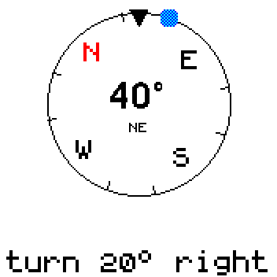

*The finished app: the rose turns so that the black pointer at the top shows
where the watch points (40°, NE). The blue dot is the locked target at 60°,
and the bottom line says how to get there.*

## What you need

- A Bangle.js 2, or just the [Espruino Web IDE](https://www.espruino.com/ide/) with its Bangle.js 2 emulator.
- Parts that need a real watch: real magnetometer data (the emulator has no
  compass and no accelerometer data, so every step shows how to feed fake
  samples instead), checking the axis signs, and comparing against a phone
  compass.
- Earlier tutorials this one reuses: [01 — Reading the touchscreen properly](01-touch-gestures.md):
  its `gestures` module gives the tap and long press.

## How the checkpoints work

After every step, **Your app so far** shows the whole app up to that point,
called `mycompass`. Paste it into the right-hand side of the Web IDE and click
**Upload** (or save it to Storage as `mycompass.app.js`). Each checkpoint ends
with an `emulator only` block that fakes the sensors. From step 2 on it fakes
one slow turn, then the watch is turned over once (so the z axis gets calibrated too), then it is held
still at `fakeH` degrees and `fakeT` degrees of tilt. In the emulator you can
type `fakeH = 0` or `fakeT = 40` in the left-hand console to move the fake
watch. On a real watch, delete that block.

## 1. Reading the magnetometer

Switch the magnetometer on with an app id, and listen to `mag` events:

```js
Bangle.setCompassPower(1, "mytest");
Bangle.on("mag", function (m) {
  print(m.x, m.y, m.z, m.dx, m.dy, m.dz, m.heading);
});
// later: Bangle.setCompassPower(0, "mytest");
```

Each event is `{x, y, z, dx, dy, dz, heading}`:

- `x/y/z` are raw readings in sensor counts.
- `dx/dy/dz` are the raw readings minus the middle of the min/max range the
  firmware has seen **since the magnetometer was turned on** (its own simple
  hard-iron calibration).
- `heading` is the firmware's heading from `dx/dy`, `NaN` until the watch has
  been rotated enough.

Now plot `x` against `y` while you turn the watch slowly, face up, on a
table:

```js
g.clear();
g.setColor(0.5, 0.5, 0.5).drawLine(0, 88, 175, 88).drawLine(88, 24, 88, 175);
function plot(m) {
  g.setColor(0, 0, 1).fillRect(88 + m.x / 4 - 1, 88 + m.y / 4 - 1, 88 + m.x / 4 + 1, 88 + m.y / 4 + 1);
}
Bangle.on("mag", plot);
// Emulator: no magnetometer, so draw a fake off-centre circle instead
for (var a = 0; a < 6.28; a += 0.15) plot({ x: 150 * Math.cos(a) + 120, y: 170 * Math.sin(a) - 90, z: 0 });
```

The points form a circle (often a slightly squashed one), but its centre is
not at (0, 0), where the grey lines cross (see the screenshot of checkpoint 1
below). Metal and magnets inside the watch add a constant field
that turns with the watch: the **hard-iron offset**. If you took `atan2` of
the raw values, the heading would be badly wrong in some directions.

### Your app so far

The plot as a small app: it switches the magnetometer on with an app id,
switches it off again when you leave the app (`E.on("kill", …)`), and the
button exits (step 6 explains `Bangle.setUI`). The fake turn draws the same
off-centre circle as the snippet.

```js
// mycompass, step 1: plot the raw magnetometer x/y readings
var APP = "mycompass", K = 0.4;   // K: plot scale in pixels per count
g.clear().setColor(0.5, 0.5, 0.5).drawLine(0, 88, 175, 88).drawLine(88, 0, 88, 175);
function plot(m) {
  g.setColor(0, 0, 1).fillRect(88 + m.x * K - 1, 88 + m.y * K - 1, 88 + m.x * K + 1, 88 + m.y * K + 1);
}
Bangle.setUI({ mode: "custom", btn: function () { load(); } });   // button: exit
Bangle.setCompassPower(1, APP);
Bangle.on("mag", plot);
E.on("kill", function () { Bangle.setCompassPower(0, APP); });

// ---- emulator only (delete on a real watch): fake one slow turn ----
var fakeN = 0;
var fake = setInterval(function () {
  var a = fakeN++ * Math.PI / 16;
  Bangle.emit("mag", { x: 50 + 125 * Math.cos(a), y: -40 + 125 * Math.sin(a), z: 135 });
  if (fakeN === 32) clearInterval(fake);
}, 100);
```

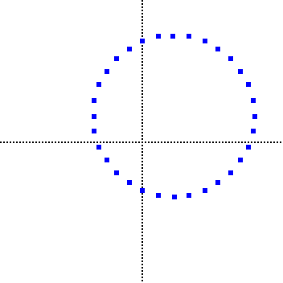

*Look for: a ring of blue dots whose centre is to the right of and above the
point where the grey axes cross. That gap is the hard-iron offset.*

**You learned:** what raw magnetometer data looks like, and why it is off-centre.

## 2. Hard-iron calibration

The fix is to find the centre: keep the minimum and maximum of each axis
while the user rotates the watch in all directions, and subtract the middle.
While you are at it, the different ranges per axis tell you how squashed the
circle is (**soft-iron** distortion); scaling each axis to the average range
makes it round again.

```js
var mn = [Infinity, Infinity, Infinity], mx = [-Infinity, -Infinity, -Infinity];
function addSample(m) {
  var v = [m.x, m.y, m.z];
  for (var i = 0; i < 3; i++) { mn[i] = Math.min(mn[i], v[i]); mx[i] = Math.max(mx[i], v[i]); }
}
function result() {
  var r = [mx[0] - mn[0], mx[1] - mn[1], mx[2] - mn[2]], avg = (r[0] + r[1] + r[2]) / 3;
  return {
    v: 1,
    offset: [0, 1, 2].map(function (i) { return (mx[i] + mn[i]) / 2; }),
    scale: [0, 1, 2].map(function (i) { return r[i] ? avg / r[i] : 1; }),
    norm: avg / 2   // expected field strength after correction
  };
}
// Emulator: six fake extremes, one per axis direction
[[162.5,-40,3],[-137.5,-40,3],[12.5,120,3],[12.5,-200,3],[12.5,-40,143],[12.5,-40,-137]]
  .forEach(function (v) { addSample({ x: v[0], y: v[1], z: v[2] }); });
print(JSON.stringify(result()));
// {"v":1,"offset":[12.5,-40,3],"scale":[1,0.9375,1.07142857142],"norm":150}
```

The app shows a progress ring while it collects samples. Progress is the
average over the three axes of `range / MIN_RANGE` (capped at 1), and the
calibration is done when every axis covers `MIN_RANGE` counts, or after 20 s
if every axis covers at least a quarter of it. The result goes to
`compass.json` with `require("Storage").writeJSON(...)`, so the next start
skips calibration. If the file is missing or corrupt
(`require("Storage").readJSON("compass.json", 1)` returns `undefined` for
broken JSON instead of throwing), the app checks every field and opens the
calibration screen again.

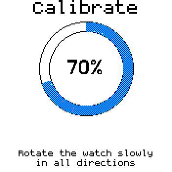

*The real app's calibration screen: the blue ring fills up as the axes are
covered, here at 70 %. The checkpoint below shows the same progress as a
number over the plot instead.*

Why not just use `dx/dy/dz` or `Bangle.resetCompass()`? The firmware's
calibration restarts every time the magnetometer is switched on and doesn't
correct soft-iron distortion. Doing it in the app makes the behaviour
predictable, and testable with synthetic numbers.

### Your app so far

The plot from step 1 now feeds the calibration. The progress is shown at the
top, and at 100 % the app saves the result to `mycompass.json`, marks the
centre it found in red and prints the offset.

```js
// mycompass, step 2: hard- and soft-iron calibration
var APP = "mycompass", K = 0.4, MIN_RANGE = 120;
var S = require("Storage");
var mn = [Infinity, Infinity, Infinity], mx = [-Infinity, -Infinity, -Infinity], cal;
function addSample(m) {
  var v = [m.x, m.y, m.z];
  for (var i = 0; i < 3; i++) { mn[i] = Math.min(mn[i], v[i]); mx[i] = Math.max(mx[i], v[i]); }
}
function progress() {   // average over the axes of range / MIN_RANGE, each capped at 1
  var p = 0;
  for (var i = 0; i < 3; i++) p += Math.min(1, (mx[i] - mn[i]) / MIN_RANGE);
  return p / 3;
}
function result() {
  var r = [mx[0] - mn[0], mx[1] - mn[1], mx[2] - mn[2]], avg = (r[0] + r[1] + r[2]) / 3;
  return {
    v: 1,
    offset: [0, 1, 2].map(function (i) { return (mx[i] + mn[i]) / 2; }),
    scale: [0, 1, 2].map(function (i) { return r[i] ? avg / r[i] : 1; }),
    norm: avg / 2
  };
}
function onMag(m) {
  if (cal) return;
  addSample(m);
  g.setColor(0, 0, 1).fillRect(88 + m.x * K - 1, 88 + m.y * K - 1, 88 + m.x * K + 1, 88 + m.y * K + 1);
  var p = progress();
  g.reset().clearRect(0, 0, 175, 14).setFont("6x8", 2).setFontAlign(0, -1).drawString(Math.round(p * 100) + "%", 88, 0);
  if (p < 1) return;
  cal = result();
  S.writeJSON(APP + ".json", cal);
  g.setColor(1, 0, 0).fillCircle(88 + cal.offset[0] * K, 88 + cal.offset[1] * K, 4);
  g.reset().setFont("6x8").setFontAlign(0, 1).drawString("offset " + cal.offset.join(", "), 88, 175);
}
g.clear().setColor(0.5, 0.5, 0.5).drawLine(0, 88, 175, 88).drawLine(88, 0, 88, 175);
Bangle.setUI({ mode: "custom", btn: function () { load(); } });
Bangle.setCompassPower(1, APP);
Bangle.on("mag", onMag);
E.on("kill", function () { Bangle.setCompassPower(0, APP); });

// ---- emulator only (delete on a real watch): fake a turn, a flip, then hold still ----
var fakeN = 0, fakeH = 135, fakeT = 0, fakeJ = [-2, -1, 1, 2];  // fakeH/fakeT: heading/tilt in degrees
setInterval(function () {
  var a = fakeN * Math.PI / 16, h = (fakeH + fakeJ[fakeN % 4]) / 57.29578, t = fakeT / 57.29578, m;
  if (fakeN < 32) m = [125 * Math.cos(a), 125 * Math.sin(a), 125];   // one turn, face up
  else if (fakeN === 32) m = [0, 0, -125];                            // turned over once
  else m = [-62.5 * Math.sin(h), 62.5 * Math.cos(h), -108];          // held still, field dips 60°
  fakeN++;
  var c = Math.cos(t), s = Math.sin(t);                               // tilt about the x axis
  Bangle.emit("accel", { x: 0, y: s, z: -c });
  Bangle.emit("mag", { x: 50 + m[0], y: -40 + m[1] * c - m[2] * s, z: 10 + m[1] * s + m[2] * c });
}, 100);
```

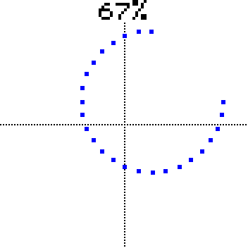

*Look for: 67 % at the top. The turn so far covers x and y, but z has not
changed yet, so one axis in three is missing.*

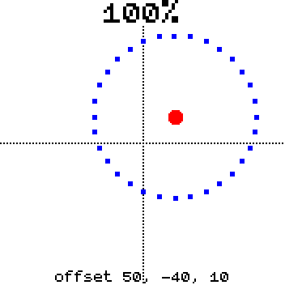

*Look for: the red dot in the middle of the ring and `offset 50, -40, 10` at
the bottom, the same centre the fake data was built around.*

**You learned:** the basics of sensor calibration: offsets from min/max, scales from ranges.

## 3. From vector to degrees

With the corrected vector `(x, y, z)` and the watch flat, the heading is an
`atan2` of the two horizontal axes. Which axes and which signs depends on how
the chip is mounted. The Bangle.js 2 firmware computes its own heading as
`360 - atan2(dx, dy)`, which is the same as `atan2(-x, y)`:

```js
function heading(x, y) {
  var h = Math.atan2(-x, y) * 180 / Math.PI;
  return h < 0 ? h + 360 : h;
}
var POINTS = ["N","NNE","NE","ENE","E","ESE","SE","SSE","S","SSW","SW","WSW","W","WNW","NW","NNW"];
function cardinal(deg) { return POINTS[Math.round(deg / 22.5) % 16]; }
print(heading(-106, -106), cardinal(heading(-106, -106)));   // 135 SE
```

The app keeps a `MAG_SIGN` constant in the module so the axis signs can be
fixed after checking on a real watch (point it north, east, south, west and
check that the heading goes up clockwise; that is `HW-0` in the
[hardware tests](../apps/compasscal/HW-TESTS.md)). Declination (the angle
between magnetic and true north where you are) is a setting, `decl`, default
0°, so the app shows **magnetic** north.

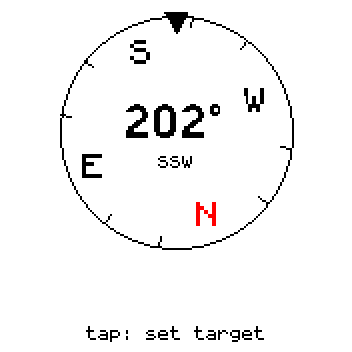

*The real app pointing at 202°: `SSW` under the number, and the rose turned
so that the red N is behind you, at the bottom left.*

**Needs a real watch:** confirming the axis orientation and signs.

### Your app so far

Calibration now runs only when `mycompass.json` is missing or broken. After
that, every sample is corrected with the saved offset and scale and shown as
degrees and a compass point.

```js
// mycompass, step 3: heading in degrees and compass points
var APP = "mycompass", K = 0.4, MIN_RANGE = 120;
var POINTS = ["N","NNE","NE","ENE","E","ESE","SE","SSE","S","SSW","SW","WSW","W","WNW","NW","NNW"];
var S = require("Storage");
var mn, mx, cal = S.readJSON(APP + ".json", 1);   // undefined if missing or broken
function startCal() {
  mn = [Infinity, Infinity, Infinity]; mx = [-Infinity, -Infinity, -Infinity]; cal = undefined;
  g.clear().setColor(0.5, 0.5, 0.5).drawLine(0, 88, 175, 88).drawLine(88, 0, 88, 175);
}
function addSample(m) {
  var v = [m.x, m.y, m.z];
  for (var i = 0; i < 3; i++) { mn[i] = Math.min(mn[i], v[i]); mx[i] = Math.max(mx[i], v[i]); }
}
function progress() {
  var p = 0;
  for (var i = 0; i < 3; i++) p += Math.min(1, (mx[i] - mn[i]) / MIN_RANGE);
  return p / 3;
}
function result() {
  var r = [mx[0] - mn[0], mx[1] - mn[1], mx[2] - mn[2]], avg = (r[0] + r[1] + r[2]) / 3;
  return {
    v: 1,
    offset: [0, 1, 2].map(function (i) { return (mx[i] + mn[i]) / 2; }),
    scale: [0, 1, 2].map(function (i) { return r[i] ? avg / r[i] : 1; }),
    norm: avg / 2
  };
}
function calSample(m) {   // calibration: plot, show progress, finish at 100 %
  addSample(m);
  g.setColor(0, 0, 1).fillRect(88 + m.x * K - 1, 88 + m.y * K - 1, 88 + m.x * K + 1, 88 + m.y * K + 1);
  var p = progress();
  g.reset().clearRect(0, 0, 175, 14).setFont("6x8", 2).setFontAlign(0, -1).drawString(Math.round(p * 100) + "%", 88, 0);
  if (p < 1) return;
  cal = result();
  S.writeJSON(APP + ".json", cal);
}
function correct(m) {
  return [0, 1, 2].map(function (i) { return ([m.x, m.y, m.z][i] - cal.offset[i]) * cal.scale[i]; });
}
function heading(x, y) {
  var h = Math.atan2(-x, y) * 180 / Math.PI;
  return h < 0 ? h + 360 : h;
}
function cardinal(deg) { return POINTS[Math.round(deg / 22.5) % 16]; }
function show(big, small, status) {
  g.reset().clear().setFontAlign(0, 0).setFont("Vector", 40).drawString(big, 88, 70);
  g.setFont("6x8", 2).drawString(small, 88, 110).setFont("6x8").drawString(status || "", 88, 160);
}
function onMag(m) {
  if (!cal || !cal.offset) return calSample(m);
  var v = correct(m), h = Math.round(heading(v[0], v[1])) % 360;
  show(h + "\xB0", cardinal(h));
}
Bangle.setUI({ mode: "custom", btn: function () { load(); } });
Bangle.setCompassPower(1, APP);
Bangle.on("mag", onMag);
E.on("kill", function () { Bangle.setCompassPower(0, APP); });
if (!cal || !cal.offset) startCal();
// ---- emulator only (delete on a real watch): fake a turn, a flip, then hold still ----
var fakeN = 0, fakeH = 135, fakeT = 0, fakeJ = [-2, -1, 1, 2];  // fakeH/fakeT: heading/tilt in degrees
setInterval(function () {
  var a = fakeN * Math.PI / 16, h = (fakeH + fakeJ[fakeN % 4]) / 57.29578, t = fakeT / 57.29578, m;
  if (fakeN < 32) m = [125 * Math.cos(a), 125 * Math.sin(a), 125];   // one turn, face up
  else if (fakeN === 32) m = [0, 0, -125];                            // turned over once
  else m = [-62.5 * Math.sin(h), 62.5 * Math.cos(h), -108];          // held still, field dips 60°
  fakeN++;
  var c = Math.cos(t), s = Math.sin(t);                               // tilt about the x axis
  Bangle.emit("accel", { x: 0, y: s, z: -c });
  Bangle.emit("mag", { x: 50 + m[0], y: -40 + m[1] * c - m[2] * s, z: 10 + m[1] * s + m[2] * c });
}, 100);
```

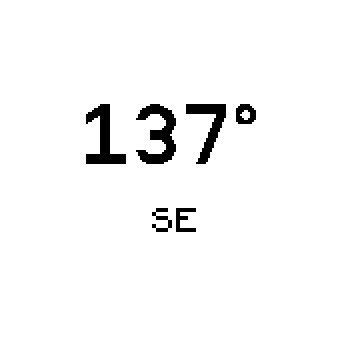

*Look for: a heading of about 135° and `SE`. Watch it for a few seconds: the
number jumps between 133° and 137°, because the fake adds ±2° of noise to
every sample. Step 4 fixes that.*

**You learned:** turning a vector into a heading, and naming 16 compass points.

## 4. Smoothing angles correctly

Raw headings jitter by a few degrees, so you average the last 5. The obvious
way is wrong:

```js
var hs = [358, 359, 1, 2];
print(hs.reduce(function (a, b) { return a + b; }) / hs.length);   // 180 — due south!
```

Angles wrap around. Average them as unit vectors instead: sum the sines and
cosines, then take `atan2` of the sums (the **circular mean**):

```js
function circularMean(degs) {
  var s = 0, c = 0;
  degs.forEach(function (d) { s += Math.sin(d * Math.PI / 180); c += Math.cos(d * Math.PI / 180); });
  var m = Math.atan2(s, c) * 180 / Math.PI;
  return m < 0 ? m + 360 : m;
}
print(Math.round(circularMean([358, 359, 1, 2])) % 360);   // 0
```

In the app, `createSmoother(5)` keeps the last 5 angles and returns their
circular mean each time you add one.

### Your app so far

`smooth()` keeps the last 5 headings and returns their circular mean;
`onMag` shows the smoothed value large and the raw one at the bottom.

```js
// mycompass, step 4: smoothing angles with a circular mean
var APP = "mycompass", K = 0.4, MIN_RANGE = 120;
var POINTS = ["N","NNE","NE","ENE","E","ESE","SE","SSE","S","SSW","SW","WSW","W","WNW","NW","NNW"];
var S = require("Storage");
var mn, mx, cal = S.readJSON(APP + ".json", 1);   // undefined if missing or broken
function startCal() {
  mn = [Infinity, Infinity, Infinity]; mx = [-Infinity, -Infinity, -Infinity]; cal = undefined;
  g.clear().setColor(0.5, 0.5, 0.5).drawLine(0, 88, 175, 88).drawLine(88, 0, 88, 175);
}
function addSample(m) {
  var v = [m.x, m.y, m.z];
  for (var i = 0; i < 3; i++) { mn[i] = Math.min(mn[i], v[i]); mx[i] = Math.max(mx[i], v[i]); }
}
function progress() {
  var p = 0;
  for (var i = 0; i < 3; i++) p += Math.min(1, (mx[i] - mn[i]) / MIN_RANGE);
  return p / 3;
}
function result() {
  var r = [mx[0] - mn[0], mx[1] - mn[1], mx[2] - mn[2]], avg = (r[0] + r[1] + r[2]) / 3;
  return {
    v: 1,
    offset: [0, 1, 2].map(function (i) { return (mx[i] + mn[i]) / 2; }),
    scale: [0, 1, 2].map(function (i) { return r[i] ? avg / r[i] : 1; }),
    norm: avg / 2
  };
}
function calSample(m) {   // calibration: plot, show progress, finish at 100 %
  addSample(m);
  g.setColor(0, 0, 1).fillRect(88 + m.x * K - 1, 88 + m.y * K - 1, 88 + m.x * K + 1, 88 + m.y * K + 1);
  var p = progress();
  g.reset().clearRect(0, 0, 175, 14).setFont("6x8", 2).setFontAlign(0, -1).drawString(Math.round(p * 100) + "%", 88, 0);
  if (p < 1) return;
  cal = result();
  S.writeJSON(APP + ".json", cal);
}
function correct(m) {
  return [0, 1, 2].map(function (i) { return ([m.x, m.y, m.z][i] - cal.offset[i]) * cal.scale[i]; });
}
function heading(x, y) {
  var h = Math.atan2(-x, y) * 180 / Math.PI;
  return h < 0 ? h + 360 : h;
}
function cardinal(deg) { return POINTS[Math.round(deg / 22.5) % 16]; }
function show(big, small, status) {
  g.reset().clear().setFontAlign(0, 0).setFont("Vector", 40).drawString(big, 88, 70);
  g.setFont("6x8", 2).drawString(small, 88, 110).setFont("6x8").drawString(status || "", 88, 160);
}
var recent = [];
function smooth(d) {   // circular mean of the last 5 headings
  recent.push(d);
  if (recent.length > 5) recent.shift();
  var s = 0, c = 0;
  recent.forEach(function (x) { s += Math.sin(x * Math.PI / 180); c += Math.cos(x * Math.PI / 180); });
  var m = Math.atan2(s, c) * 180 / Math.PI;
  return m < 0 ? m + 360 : m;
}
function onMag(m) {
  if (!cal || !cal.offset) return calSample(m);
  var v = correct(m), raw = heading(v[0], v[1]), h = Math.round(smooth(raw)) % 360;
  show(h + "\xB0", cardinal(h), "raw " + Math.round(raw) + "\xB0");
}
Bangle.setUI({ mode: "custom", btn: function () { load(); } });
Bangle.setCompassPower(1, APP);
Bangle.on("mag", onMag);
E.on("kill", function () { Bangle.setCompassPower(0, APP); });
if (!cal || !cal.offset) startCal();
// ---- emulator only (delete on a real watch): fake a turn, a flip, then hold still ----
var fakeN = 0, fakeH = 135, fakeT = 0, fakeJ = [-2, -1, 1, 2];  // fakeH/fakeT: heading/tilt in degrees
setInterval(function () {
  var a = fakeN * Math.PI / 16, h = (fakeH + fakeJ[fakeN % 4]) / 57.29578, t = fakeT / 57.29578, m;
  if (fakeN < 32) m = [125 * Math.cos(a), 125 * Math.sin(a), 125];   // one turn, face up
  else if (fakeN === 32) m = [0, 0, -125];                            // turned over once
  else m = [-62.5 * Math.sin(h), 62.5 * Math.cos(h), -108];          // held still, field dips 60°
  fakeN++;
  var c = Math.cos(t), s = Math.sin(t);                               // tilt about the x axis
  Bangle.emit("accel", { x: 0, y: s, z: -c });
  Bangle.emit("mag", { x: 50 + m[0], y: -40 + m[1] * c - m[2] * s, z: 10 + m[1] * s + m[2] * c });
}, 100);
```

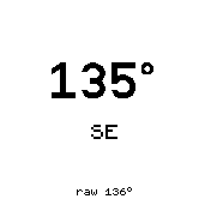

*Look for: the large number stays at 135° while the `raw` value at the
bottom keeps changing.*

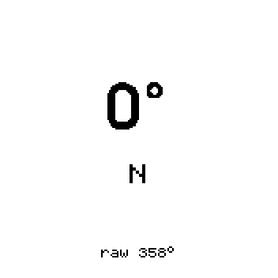

*Look for: `0°` and `N`, not `180°`, while the raw samples jump between 358°
and 2°. This is the wraparound case the plain average gets wrong.*

**You learned:** the wraparound trap and how to average angles.

## 5. Tilt compensation

The flat formula only uses `x` and `y`. On your wrist the watch is rarely
flat, and the Earth's field points steeply into the ground in most places
(about 65° down in Europe), so a tilt of 30° can move the heading by tens of
degrees. The accelerometer tells you which way is down. Bangle.js 2 reads
about `{x:0, y:0, z:-1}` lying face up, so "up" in watch coordinates is
`u = -a / |a|`. Project the watch's 12 o'clock axis onto the horizontal plane
(`f`), take the horizontal axis at right angles to it (`s = u × f`), and
measure the field along both:

```js
function tiltHeading(m, a) {   // m: corrected [x,y,z], a: accel {x,y,z}
  var n = Math.sqrt(a.x * a.x + a.y * a.y + a.z * a.z);
  var ux = -a.x / n, uy = -a.y / n, uz = -a.z / n;
  var fx = -uy * ux, fy = 1 - uy * uy, fz = -uy * uz;          // y axis minus its vertical part
  var sx = uy * fz - uz * fy, sy = uz * fx - ux * fz, sz = ux * fy - uy * fx;  // u x f
  var h = Math.atan2(m[0] * sx + m[1] * sy + m[2] * sz, m[0] * fx + m[1] * fy + m[2] * fz) * 180 / Math.PI;
  return h < 0 ? h + 360 : h;
}
// Flat, the result is exactly atan2(-x, y):
print(tiltHeading([-106, -106, -260], { x: 0, y: 0, z: -1 }));   // 135
```

When the watch is flat, `f = (0,1,0)` and `s = (-1,0,0)`, so this gives the
same result as step 3; the vector form needs no pitch/roll angle conventions.
The tilt angle itself is `acos(-a.z / |a|)`. The app shows `tilted - hold flat`
above 25° when compensation is off (and above 70° even with it on, where the
maths breaks down) and `upside down?` when the face points down.

```js
Bangle.on("accel", function (a) {
  var tilt = Math.acos(-a.z / Math.sqrt(a.x * a.x + a.y * a.y + a.z * a.z)) * 180 / Math.PI;
  print(tilt.toFixed(0) + " deg from flat");
});
```

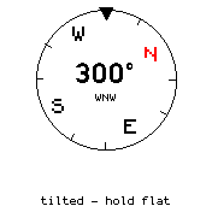

*The real app with `tiltComp` switched off and the watch tilted by 40°: the
heading is still shown, but the bottom line warns that it can't be trusted.*

One more check uses the calibration's `norm`: if the corrected field is more
than ±40 % stronger or weaker than during calibration, something magnetic is
nearby, and the app shows `interference` instead of a heading.

**Needs a real watch:** that the accelerometer and magnetometer axes line up
(`HW-2` checks that a 30° wrist tilt changes the heading by less than 10°).

### Your app so far

This checkpoint is longer than 80 lines, so here are only the changes to
checkpoint 4: the accelerometer listener, the two functions from this step,
and an `onMag` that uses `tiltHeading` and shows the tilt. Lines starting with
`+` are new, lines starting with `-` are removed.

```diff
--- step4.js
+++ step5.js
@@ -1,4 +1,4 @@
-// mycompass, step 4: smoothing angles with a circular mean
+// mycompass, step 5: tilt compensation
 var APP = "mycompass", K = 0.4, MIN_RANGE = 120;
 var POINTS = ["N","NNE","NE","ENE","E","ESE","SE","SSE","S","SSW","SW","WSW","W","WNW","NW","NNW"];
 var S = require("Storage");
@@ -55,14 +55,28 @@
   var m = Math.atan2(s, c) * 180 / Math.PI;
   return m < 0 ? m + 360 : m;
 }
+var accel = { x: 0, y: 0, z: -1 };   // last accelerometer sample; flat until the first one
+function tiltHeading(m, a) {   // m: corrected [x,y,z], a: accel {x,y,z}
+  var n = Math.sqrt(a.x * a.x + a.y * a.y + a.z * a.z);
+  var ux = -a.x / n, uy = -a.y / n, uz = -a.z / n;
+  var fx = -uy * ux, fy = 1 - uy * uy, fz = -uy * uz;
+  var sx = uy * fz - uz * fy, sy = uz * fx - ux * fz, sz = ux * fy - uy * fx;
+  var h = Math.atan2(m[0] * sx + m[1] * sy + m[2] * sz, m[0] * fx + m[1] * fy + m[2] * fz) * 180 / Math.PI;
+  return h < 0 ? h + 360 : h;
+}
+function tilt(a) { return Math.acos(-a.z / Math.sqrt(a.x * a.x + a.y * a.y + a.z * a.z)) * 180 / Math.PI; }
 function onMag(m) {
   if (!cal || !cal.offset) return calSample(m);
-  var v = correct(m), raw = heading(v[0], v[1]), h = Math.round(smooth(raw)) % 360;
-  show(h + "\xB0", cardinal(h), "raw " + Math.round(raw) + "\xB0");
+  var v = correct(m), raw = tiltHeading(v, accel), h = Math.round(smooth(raw)) % 360, t = tilt(accel);
+  var status = "tilt " + Math.round(t) + "\xB0, flat formula " + Math.round(heading(v[0], v[1])) + "\xB0";
+  if (t > 90) status = "upside down?";
+  else if (t > 70) status = "tilted - hold flat";
+  show(h + "\xB0", cardinal(h), status);
 }
 Bangle.setUI({ mode: "custom", btn: function () { load(); } });
 Bangle.setCompassPower(1, APP);
 Bangle.on("mag", onMag);
+Bangle.on("accel", function (a) { accel = a; });
 E.on("kill", function () { Bangle.setCompassPower(0, APP); });
 if (!cal || !cal.offset) startCal();
 // ---- emulator only (delete on a real watch): fake a turn, a flip, then hold still ----
```

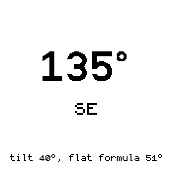

*Look for: the heading stays at 135° when the fake watch is tilted by 40°,
while the bottom line shows that the flat formula from step 3 would say 51°.*

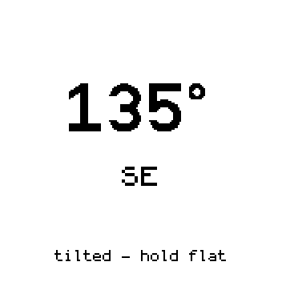

*Look for: `tilted - hold flat` once the tilt passes 70°, where even tilt
compensation is unreliable.*

**You learned:** combining two sensors to correct one with the other.

## 6. A bearing to follow

Tap to lock the current heading as a target. The turn to get back to it is
the difference of two angles, wrapped into −180…180:

```js
function diff(target, heading) {
  var d = ((target - heading) % 360 + 360) % 360;
  return d > 180 ? d - 360 : d;          // + = turn right, - = turn left
}
print(diff(350, 10));   // -20: turn 20° left, not 340° right
print(diff(10, 350));   // 20: turn 20° right
```

The app turns that into `turn 20° left`, `turn 20° right` or `on target`
(within 3°), and draws a blue dot on the rose at the target.

Tap and long press come from the gesture recognizer you built in tutorial 01.
The app ships it as the Storage module `gestures` (in `metadata.json`:
`{"name":"gestures","url":"../touchgest/gestures.lib.js"}`) and forwards
`drag` events to it. The compass has no double tap, so `instantTap: true`
reports taps at once instead of waiting 350 ms for a possible second tap:

```js
var G = require("gestures");
var press = G.create({ instantTap: true });
press.on("gesture", function (ev) {
  if (ev.type === "tap") lockTarget();            // lock the current heading
  else if (ev.type === "longpress") startCal();   // held 600 ms, fires while held
});
Bangle.setUI({
  mode: "custom",
  drag: function (e) { press.feed({ x: e.x, y: e.y, b: e.b, t: Date.now() }); },
  btn: function () { load(); }
});
```

`Bangle.setUI({mode:"custom", …})` claims the touchscreen and makes the
button exit. To try the snippet on its own, upload `apps/touchgest/gestures.lib.js`
to Storage as `gestures` and define `lockTarget`/`startCal` (e.g. as `print`).

Two more details make the app well-behaved:

- **Redraw only what changed.** The compass samples slowly, so the app
  remembers what is on screen and only redraws the rose when the rounded
  heading or target changes, and the status line when its text changes.
- **Power.** `Bangle.setCompassPower(1, "compasscal")` at start, and
  `Bangle.setCompassPower(0, "compasscal")` in `E.on("kill", …)`.

### Your app so far

This is the whole app, simplified. To run it, first upload
`apps/touchgest/gestures.lib.js` to Storage as `gestures` with the Web IDE's
Storage menu.

```js
// mycompass, step 6: a bearing to follow (the whole simplified app)
// Tap: lock the heading as target. Long press: calibrate again. Button: exit.
var APP = "mycompass", K = 0.4, MIN_RANGE = 120;
var POINTS = ["N","NNE","NE","ENE","E","ESE","SE","SSE","S","SSW","SW","WSW","W","WNW","NW","NNW"];
var S = require("Storage");
var mn, mx, cal = S.readJSON(APP + ".json", 1);   // undefined if missing or broken
function startCal() {
  mn = [Infinity, Infinity, Infinity]; mx = [-Infinity, -Infinity, -Infinity]; cal = undefined;
  g.clear().setColor(0.5, 0.5, 0.5).drawLine(0, 88, 175, 88).drawLine(88, 0, 88, 175);
}
function addSample(m) {
  var v = [m.x, m.y, m.z];
  for (var i = 0; i < 3; i++) { mn[i] = Math.min(mn[i], v[i]); mx[i] = Math.max(mx[i], v[i]); }
}
function progress() {
  var p = 0;
  for (var i = 0; i < 3; i++) p += Math.min(1, (mx[i] - mn[i]) / MIN_RANGE);
  return p / 3;
}
function result() {
  var r = [mx[0] - mn[0], mx[1] - mn[1], mx[2] - mn[2]], avg = (r[0] + r[1] + r[2]) / 3;
  return {
    v: 1,
    offset: [0, 1, 2].map(function (i) { return (mx[i] + mn[i]) / 2; }),
    scale: [0, 1, 2].map(function (i) { return r[i] ? avg / r[i] : 1; }),
    norm: avg / 2
  };
}
function calSample(m) {   // calibration: plot, show progress, finish at 100 %
  addSample(m);
  g.setColor(0, 0, 1).fillRect(88 + m.x * K - 1, 88 + m.y * K - 1, 88 + m.x * K + 1, 88 + m.y * K + 1);
  var p = progress();
  g.reset().clearRect(0, 0, 175, 14).setFont("6x8", 2).setFontAlign(0, -1).drawString(Math.round(p * 100) + "%", 88, 0);
  if (p < 1) return;
  cal = result();
  S.writeJSON(APP + ".json", cal);
}
function correct(m) {
  return [0, 1, 2].map(function (i) { return ([m.x, m.y, m.z][i] - cal.offset[i]) * cal.scale[i]; });
}
function heading(x, y) {
  var h = Math.atan2(-x, y) * 180 / Math.PI;
  return h < 0 ? h + 360 : h;
}
function cardinal(deg) { return POINTS[Math.round(deg / 22.5) % 16]; }
function show(big, small, status) {
  g.reset().clear().setFontAlign(0, 0).setFont("Vector", 40).drawString(big, 88, 70);
  g.setFont("6x8", 2).drawString(small, 88, 110).setFont("6x8").drawString(status || "", 88, 160);
}
var recent = [];
function smooth(d) {   // circular mean of the last 5 headings
  recent.push(d);
  if (recent.length > 5) recent.shift();
  var s = 0, c = 0;
  recent.forEach(function (x) { s += Math.sin(x * Math.PI / 180); c += Math.cos(x * Math.PI / 180); });
  var m = Math.atan2(s, c) * 180 / Math.PI;
  return m < 0 ? m + 360 : m;
}
var accel = { x: 0, y: 0, z: -1 };   // last accelerometer sample; flat until the first one
function tiltHeading(m, a) {   // m: corrected [x,y,z], a: accel {x,y,z}
  var n = Math.sqrt(a.x * a.x + a.y * a.y + a.z * a.z);
  var ux = -a.x / n, uy = -a.y / n, uz = -a.z / n;
  var fx = -uy * ux, fy = 1 - uy * uy, fz = -uy * uz;
  var sx = uy * fz - uz * fy, sy = uz * fx - ux * fz, sz = ux * fy - uy * fx;
  var h = Math.atan2(m[0] * sx + m[1] * sy + m[2] * sz, m[0] * fx + m[1] * fy + m[2] * fz) * 180 / Math.PI;
  return h < 0 ? h + 360 : h;
}
function tilt(a) { return Math.acos(-a.z / Math.sqrt(a.x * a.x + a.y * a.y + a.z * a.z)) * 180 / Math.PI; }
var G = require("gestures"), press = G.create({ instantTap: true });
var target, shownH;   // locked bearing, and the heading on screen
function diff(target, heading) {
  var d = ((target - heading) % 360 + 360) % 360;
  return d > 180 ? d - 360 : d;          // + = turn right, - = turn left
}
function turnText(d) {
  var a = Math.round(Math.abs(d));
  return a < 3 ? "on target" : "turn " + a + "\xB0 " + (d > 0 ? "right" : "left");
}
press.on("gesture", function (ev) {
  if (ev.type === "tap" && cal && shownH !== undefined) target = shownH;   // lock the heading
  else if (ev.type === "longpress") { target = undefined; startCal(); }  // held 600 ms
});function onMag(m) {
  if (!cal || !cal.offset) return calSample(m);
  var v = correct(m), h = Math.round(smooth(tiltHeading(v, accel))) % 360, t = tilt(accel);
  var status = target === undefined ? "tap: set target" : turnText(diff(target, h));
  if (t > 90) status = "upside down?";
  else if (t > 70) status = "tilted - hold flat";
  shownH = h;
  show(h + "\xB0", cardinal(h), status);
}
Bangle.setUI({
  mode: "custom",
  drag: function (e) { press.feed({ x: e.x, y: e.y, b: e.b, t: Date.now() }); },
  btn: function () { load(); }
});
Bangle.setCompassPower(1, APP);
Bangle.on("mag", onMag);
Bangle.on("accel", function (a) { accel = a; });
E.on("kill", function () { Bangle.setCompassPower(0, APP); });
if (!cal || !cal.offset) startCal();
// ---- emulator only (delete on a real watch): fake a turn, a flip, then hold still ----
var fakeN = 0, fakeH = 135, fakeT = 0, fakeJ = [-2, -1, 1, 2];  // fakeH/fakeT: heading/tilt in degrees
setInterval(function () {
  var a = fakeN * Math.PI / 16, h = (fakeH + fakeJ[fakeN % 4]) / 57.29578, t = fakeT / 57.29578, m;
  if (fakeN < 32) m = [125 * Math.cos(a), 125 * Math.sin(a), 125];   // one turn, face up
  else if (fakeN === 32) m = [0, 0, -125];                            // turned over once
  else m = [-62.5 * Math.sin(h), 62.5 * Math.cos(h), -108];          // held still, field dips 60°
  fakeN++;
  var c = Math.cos(t), s = Math.sin(t);                               // tilt about the x axis
  Bangle.emit("accel", { x: 0, y: s, z: -c });
  Bangle.emit("mag", { x: 50 + m[0], y: -40 + m[1] * c - m[2] * s, z: 10 + m[1] * s + m[2] * c });
}, 100);
```

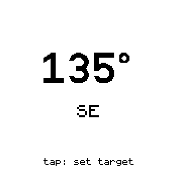

*Look for: `tap: set target` at the bottom. Tap the screen to lock 135°.*

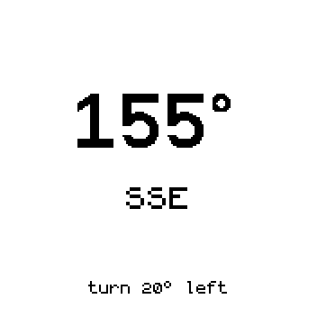

*Look for: `turn 20° left`: the target is 135° and the watch now points to
155°, so the shorter way back is 20° to the left.*

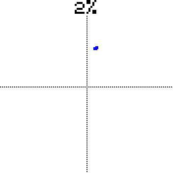

*Look for: the calibration plot and its percentage again after holding a
finger on the screen for 600 ms.*

The real app in [`apps/compasscal`](../apps/compasscal) works the same way and
adds:

- the logic in a Storage module (`require("compasscal")`) so the tests can
  check it without the UI, and a `DEBUG` log the tests read;
- a compass rose that turns with the heading, a blue dot for the target and a
  progress ring during calibration, redrawing only the parts that changed;
- a 20 s calibration timeout, a stricter check of `compass.json`, the
  interference check, and the `decl`/`tiltComp` settings in `compasscal.json`;
- the `MAG_SIGN` constant for the axis signs, and the widgets.

**You learned:** angle differences with wraparound, and building a small UI around them.

## Test it in the emulator

The emulator has no magnetometer or accelerometer data, so the app keeps all
sensor handling behind two plain functions, `onMag({x,y,z})` and
`onAccel({x,y,z})`, and the tests call them (or `Bangle.emit` the event) with
synthetic vectors. The logic itself lives in a Storage module
(`require("compasscal")`) so it can be tested without the UI. See
[`apps/compasscal/tests/`](../apps/compasscal/tests); run them with
`npm test -- compasscal`.

```js
T.test("criterion 2: smoothing across 358, 359, 1, 2 gives about 0, not 180", function () {
  var s = C.createSmoother(5), out;
  [358, 359, 1, 2].forEach(function (d) { out = s.add(d); });
  T.ok(Math.abs(C.diff(out, 0)) < 0.5, "smoothed " + out);
});
```

The tests cover: headings around a full circle after a synthetic calibration
(within ±1°), circular smoothing, a 14-case bearing table, calibration writing
`compass.json` and a restart loading it, a corrupt file opening calibration,
the tilt hint at 40°, tilt compensation keeping the heading for rotated
synthetic vectors, interference, tap/long press and the button.

## Try it on the watch

Install the app, calibrate it away from metal and compare against a phone
compass. The [hardware tests](../apps/compasscal/HW-TESTS.md) list the checks
the emulator can't do: axis signs, accuracy within ±10°, heading change under
10° for a 30° tilt, the compass switching off after exit
(`Bangle.isCompassOn()`), and real interference.

## Going further

- Read the declination for your location from a setting or from GPS.
- Store several targets and cycle through them with swipes.
- Fit an ellipsoid to all calibration samples instead of min/max, which is
  more robust to one bad sample.
- Use more of the gesture module from tutorial 01: swipe to cycle targets, double tap to clear one.
