# 04 — Air pressure, altitude and an honest thermometer

The Bangle.js 2 has a barometer: a pressure sensor so sensitive that it notices
you walking up one flight of stairs. In this tutorial you turn its readings
into a relative altimeter and a floor counter that ignores noise, door slams
and the weather, and you find out why its thermometer always seems to think
you have a fever. The finished app is [`apps/baroalt`](../apps/baroalt).


*The finished app after a 9.5 m climb: relative altitude, 3 floors up, the
sensor temperature with its label, and the climb in the sparkline at the
bottom.*

## What you need

- A Bangle.js 2, or just the [Espruino Web IDE](https://www.espruino.com/ide/) with its Bangle.js 2 emulator.
- Parts that need a real watch: real pressure data (the emulator has no
  barometer: `Bangle.getPressure()` returns `undefined` and no `pressure`
  events arrive, so the snippets show how to feed fake readings), climbing
  real stairs, riding a lift, and comparing the temperature with a room
  thermometer.
- Earlier tutorials this one reuses: none. (Tap and long press use the same
  thresholds as [tutorial 01](01-touch-gestures.md).)

## How the checkpoints work

After every step, **Your app so far** shows the whole app up to that point,
called `myalt`. Paste it into the right-hand side of the Web IDE and click
**Upload** (or save it to Storage as `myalt.app.js`). Each checkpoint ends
with an `emulator only` block: a fake barometer that sends 4 readings a second
at 1010 hPa with ±0.04 hPa of noise and a sensor temperature of 31.5 °C. In
the emulator, type `fakeTo = 9.5` in the left-hand console to make the fake
watch climb to 9.5 m at 0.16 m/s (about 60 s), or `fakeSpike = 3` to add one
3 hPa spike. On a real watch, delete that block.

## 1. What the barometer measures

There are two ways to read it. `Bangle.getPressure()` powers the sensor
briefly and returns a Promise for one reading. For a continuous stream, switch
it on with an app id and listen to `pressure` events:

```js
var p = Bangle.getPressure();          // undefined in the emulator (no sensor)
if (p) p.then(function (d) { print(d); });   // {temperature, pressure, altitude}

Bangle.setBarometerPower(1, "mytest");
Bangle.on("pressure", function (d) {
  print(d.pressure.toFixed(2) + " hPa", d.temperature.toFixed(1) + " C", d.altitude.toFixed(1) + " m");
});
// later: Bangle.setBarometerPower(0, "mytest");
```

Each reading is `{temperature, pressure, altitude}`: pressure in hPa,
temperature in °C, and an altitude in metres computed by the firmware from a
sea-level reference of 1013.25 hPa (changeable with
`Bangle.setOptions({seaLevelPressure: …})` on a real watch).

How often do events arrive? The firmware polls the barometer on the same
timer as the accelerometer, so expect several per second normally and fewer
when the watch is idle and in power-save mode. Measure it on your watch
(`HW-0` in the [hardware tests](../apps/baroalt/HW-TESTS.md)); the app does
not depend on it because it averages everything into one value per second.

### Your app so far

The stream as a small app: it switches the barometer on with an app id, off
again when you leave the app (`E.on("kill", …)`), and the button exits.

```js
// myalt, step 1: show the barometer readings
var APP = "myalt";
function onPressure(d) {
  g.reset().clear().setFontAlign(0, 0).setFont("6x8", 2);
  g.drawString(d.pressure.toFixed(2) + " hPa", 88, 50);
  g.drawString(d.temperature.toFixed(1) + " C", 88, 88);
  g.drawString(d.altitude.toFixed(1) + " m", 88, 126);
}
g.clear().setFontAlign(0, 0).setFont("6x8", 2).drawString("Waiting for", 88, 78).drawString("barometer...", 88, 98);
Bangle.setUI({ mode: "custom", btn: function () { load(); } });   // button: exit
Bangle.setBarometerPower(1, APP);
Bangle.on("pressure", onPressure);
E.on("kill", function () { Bangle.setBarometerPower(0, APP); });
// ---- emulator only (delete on a real watch): a fake barometer, 4 readings a second ----
// In the console: fakeTo = 9.5 climbs to 9.5 m at 0.16 m/s; fakeSpike = 3 adds one 3 hPa spike.
var fakeAlt = 0, fakeTo = 0, fakeSpike = 0, fakeN = 0;
setInterval(function () {
  fakeAlt += Math.max(-0.04, Math.min(0.04, fakeTo - fakeAlt));
  var p = 1010 * Math.pow(1 - fakeAlt / 44330, 5.255) + 0.04 * Math.sin(fakeN++ * 2.4) + fakeSpike;
  fakeSpike = 0;
  Bangle.emit("pressure", { pressure: p, temperature: 31.5, altitude: 44330 * (1 - Math.pow(p / 1013.25, 1 / 5.255)) });
}, 250);
```

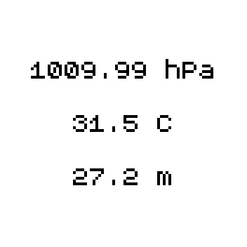

*Look for: about 1010 hPa, 31.5 C and 27 m. The 27 m is the firmware's
altitude for 1010 hPa against its fixed 1013.25 hPa reference, not a real
height. On a real watch, the last decimals of the pressure change all the
time.*

**You learned:** `getPressure()` for one reading, the `pressure` event for a stream, and always switching the sensor on and off with an app id.

## 2. Altitude from pressure

Air pressure drops by about 0.12 hPa per metre near sea level. The standard
barometric formula turns pressure into height above the level where the
pressure is `p0`:

```js
function altitude(p, p0) { return 44330 * (1 - Math.pow(p / p0, 1 / 5.255)); }
print(altitude(1013.25, 1013.25));   // 0
print(altitude(900, 1013.25));       // 988.6…
print(altitude(1012.05, 1013.25));   // ≈ 10 m: one hPa is about 8 m
```

The catch is `p0`. Sea-level pressure changes with the weather by tens of
hPa, so the *absolute* altitude is only as good as the reference you give it
(the app lets you set it with a long press, from your local weather report's
QNH). The *relative* altitude, the difference between two readings a few
minutes apart, barely depends on `p0` at all, and that is what the floor
counter uses.

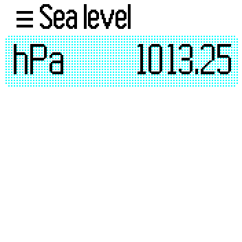

*The real app's menu after a long press: the reference `p0` in hPa, which
only changes the absolute altitude.*

### Your app so far

The first reading becomes the zero for the relative altitude (`zero`), and the
absolute altitude uses the reference `P0`.

```js
// myalt, step 2: relative and absolute altitude
var APP = "myalt", P0 = 1013.25;   // sea-level reference for the absolute altitude
var zero;                          // absolute altitude of the first reading = relative 0
function altitude(p, p0) { return 44330 * (1 - Math.pow(p / p0, 1 / 5.255)); }
function signed(n) { n = Math.round(n * 10) / 10; return (n >= 0 ? "+" : "") + n.toFixed(1); }   // never "-0.0"
function show(p, rel, abs, extra) {
  g.reset().clear().setFontAlign(0, -1);
  g.setFont("6x8", 2).drawString(p.toFixed(1) + " hPa", 88, 20);
  g.setFont("Vector", 30).drawString(signed(rel) + " m", 88, 42);
  g.setFont("6x8").drawString("abs ~" + Math.round(abs) + " m @ " + P0.toFixed(0) + " hPa", 88, 76);
  if (extra) g.drawString(extra, 88, 92);
}
function onPressure(d) {
  var abs = altitude(d.pressure, P0);
  if (zero === undefined) zero = abs;
  show(d.pressure, abs - zero, abs);
}
g.clear().setFontAlign(0, 0).setFont("6x8", 2).drawString("Waiting for", 88, 78).drawString("barometer...", 88, 98);
Bangle.setUI({ mode: "custom", btn: function () { load(); } });
Bangle.setBarometerPower(1, APP);
Bangle.on("pressure", onPressure);
E.on("kill", function () { Bangle.setBarometerPower(0, APP); });
// ---- emulator only (delete on a real watch): a fake barometer, 4 readings a second ----
// In the console: fakeTo = 9.5 climbs to 9.5 m at 0.16 m/s; fakeSpike = 3 adds one 3 hPa spike.
var fakeAlt = 0, fakeTo = 0, fakeSpike = 0, fakeN = 0;
setInterval(function () {
  fakeAlt += Math.max(-0.04, Math.min(0.04, fakeTo - fakeAlt));
  var p = 1010 * Math.pow(1 - fakeAlt / 44330, 5.255) + 0.04 * Math.sin(fakeN++ * 2.4) + fakeSpike;
  fakeSpike = 0;
  Bangle.emit("pressure", { pressure: p, temperature: 31.5, altitude: 44330 * (1 - Math.pow(p / 1013.25, 1 / 5.255)) });
}, 250);
```

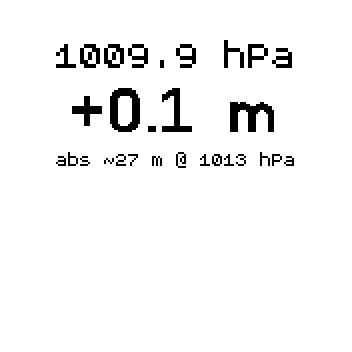

*Look for: the relative altitude near +0.0 m, while `abs` says about 27 m for
the same pressure. Watch it for a few seconds: noise alone moves it by about
±0.3 m.*

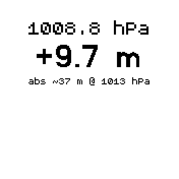

*Look for: about +9.5 m after the fake climb (here +9.7 m, the rest is noise),
and the pressure down by about 1.2 hPa.*

**You learned:** relative vs absolute altitude, and why absolute needs a reference.

## 3. Noise and weather

Raw readings jitter, occasionally jump (pressing the case, a door closing,
wind), and drift slowly with the weather. Three tools deal with these:

```js
var TC = 4, pS, lastT;
function smooth(p, t) {                    // t in seconds
  if (pS === undefined) { pS = p; lastT = t; return pS; }
  if (Math.abs(p - pS) > 1) return pS;     // spike: > 1 hPa from the average
  pS += (p - pS) * (1 - Math.exp(-(t - lastT) / TC));   // EMA, time constant 4 s
  lastT = t;
  return pS;
}
[1010, 1010.1, 1009.9, 1007, 1010.05].forEach(function (p, i) { print(smooth(p, i).toFixed(2)); });
// 1010.00 1010.02 1009.99 1009.99 1010.02 — the 1007 spike is ignored
```

- **Exponential moving average (EMA):** each new value pulls the average
  `1 − e^(−dt/TC)` of the way towards it. Because it uses the real time step
  `dt`, it works at any sample rate.
- **Outlier rejection:** a sample more than 1 hPa (≈ 8 m) from the average is
  dropped. The app accepts the new level if the jump lasts 3 s or more, so a
  fast lift doesn't lock the filter out for ever.
- **Weather drift:** a typical weather change is about 1 hPa per hour, which
  looks like climbing 8 m in an hour. That is far slower than walking up
  stairs (0.2–0.5 m/s), so the floor counter ignores changes slower than
  0.05 m/s. More on that in the next step.

The app also throws away the first 2 s after switching the sensor on and
averages all samples within each second before smoothing.

### Your app so far

`feed()` takes every raw reading: it drops the first 2 s, rejects spikes,
averages each second and smooths the averages. The display now changes once
a second, and the bottom line shows the raw value of that second and how many
samples were rejected.

```js
// myalt, step 3: spikes, per-second averages and smoothing
var APP = "myalt", P0 = 1013.25;   // sea-level reference for the absolute altitude
var zero;                          // absolute altitude of the first reading = relative 0
function altitude(p, p0) { return 44330 * (1 - Math.pow(p / p0, 1 / 5.255)); }
function signed(n) { n = Math.round(n * 10) / 10; return (n >= 0 ? "+" : "") + n.toFixed(1); }   // never "-0.0"
function show(p, rel, abs, extra) {
  g.reset().clear().setFontAlign(0, -1);
  g.setFont("6x8", 2).drawString(p.toFixed(1) + " hPa", 88, 20);
  g.setFont("Vector", 30).drawString(signed(rel) + " m", 88, 42);
  g.setFont("6x8").drawString("abs ~" + Math.round(abs) + " m @ " + P0.toFixed(0) + " hPa", 88, 76);
  if (extra) g.drawString(extra, 88, 92);
}
var TC = 4, SPIKE = 1, tOn = Date.now(), pS, rejSince, sec, sum = 0, n = 0, rejected = 0;
function feed(p, t) {           // one raw reading, t in ms; returns the average of a finished second
  if (t - tOn < 2000) return;   // the first 2 s after power-on are still settling
  if (pS !== undefined && Math.abs(p - pS) > SPIKE) {   // a spike...
    if (rejSince === undefined) rejSince = t;
    if (t - rejSince < 3000) { rejected++; return; }
    pS = p;                                              // ...unless it lasts 3 s
  }
  rejSince = undefined;
  var s = Math.floor(t / 1000), avg;
  if (sec !== undefined && s !== sec && n) {             // a second is complete
    avg = sum / n;
    pS = pS === undefined ? avg : pS + (avg - pS) * (1 - Math.exp(-(s - sec) / TC));
  }
  if (s !== sec) { sec = s; sum = 0; n = 0; }
  sum += p; n++;
  return avg;
}
function onPressure(d) {
  var avg = feed(d.pressure, Date.now());
  if (avg === undefined) return;
  var abs = altitude(pS, P0);
  if (zero === undefined) zero = abs;
  show(avg, abs - zero, abs, "raw " + signed(altitude(avg, P0) - zero) + " m, rejected " + rejected);
}
g.clear().setFontAlign(0, 0).setFont("6x8", 2).drawString("Waiting for", 88, 78).drawString("barometer...", 88, 98);
Bangle.setUI({ mode: "custom", btn: function () { load(); } });
Bangle.setBarometerPower(1, APP);
Bangle.on("pressure", onPressure);
E.on("kill", function () { Bangle.setBarometerPower(0, APP); });
// ---- emulator only (delete on a real watch): a fake barometer, 4 readings a second ----
// In the console: fakeTo = 9.5 climbs to 9.5 m at 0.16 m/s; fakeSpike = 3 adds one 3 hPa spike.
var fakeAlt = 0, fakeTo = 0, fakeSpike = 0, fakeN = 0;
setInterval(function () {
  fakeAlt += Math.max(-0.04, Math.min(0.04, fakeTo - fakeAlt));
  var p = 1010 * Math.pow(1 - fakeAlt / 44330, 5.255) + 0.04 * Math.sin(fakeN++ * 2.4) + fakeSpike;
  fakeSpike = 0;
  Bangle.emit("pressure", { pressure: p, temperature: 31.5, altitude: 44330 * (1 - Math.pow(p / 1013.25, 1 / 5.255)) });
}, 250);
```

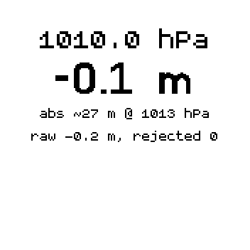

*Look for: the large number stays within a tenth of a metre of zero while the
`raw` value still moves.*

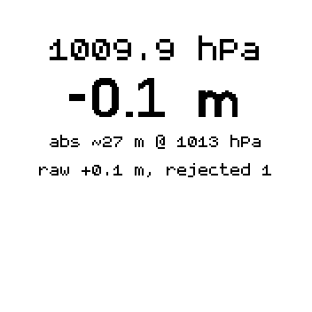

*Look for: `rejected 1` and an altitude that did not move. Without the spike
check, a 3 hPa jump would read as about 25 m.*

**You learned:** EMA smoothing with real time steps and simple outlier rejection.

## 4. Counting floors

A floor is about 3 m. Counting "every time the altitude passes a multiple of
3 m" fails: noise around 3.0 m would count the same floor many times. Use an
**anchor** and hysteresis instead: count a floor only when the altitude is a
full floor away from the anchor, then move the anchor by one floor.

```js
var FLOOR = 3.0, anchor = 0, up = 0, down = 0;
function floors(alt) {
  while (alt - anchor >= FLOOR) { anchor += FLOOR; up++; }
  while (anchor - alt >= FLOOR) { anchor -= FLOOR; down++; }
}
[0, 1.5, 2.9, 3.1, 2.8, 3.2, 6.4, 9.5, 7.0, 5.9].forEach(floors);
print("up", up, "down", down);   // up 3 down 1
```

Noise between 2.8 and 3.2 m counts once, not three times. Now the weather:
let the anchor follow any change that is slower than 0.05 m/s, so slow drift
never builds up to a whole floor. The rate has to be measured over a window,
and the window is the tricky part. If you only look backwards, the first
seconds of every climb look slow and the anchor creeps up with you, so a
9.5 m climb can end up as 2 floors. The app judges every one-second change
8 s later, by the rate over a 16 s window centred on it:

```js
var D = 8, ring = [], pend = [], lvl = 0, prev;
function gate(sec, altS) {          // once per second
  ring.push([sec, altS]);
  while (sec - ring[0][0] > 2 * D) ring.shift();
  if (prev !== undefined) pend.push([sec, altS - prev]);
  prev = altS;
  var span = sec - ring[0][0], rate = span ? (altS - ring[0][1]) / span : 0;
  while (pend.length && pend[0][0] <= sec - D) {
    var inc = pend.shift()[1];
    lvl += inc;
    if (Math.abs(rate) < 0.05) anchor += inc;   // slow: drift, follow silently
    floors(lvl);
  }
}
```

The price is that floors appear about 8 s after you reach them. In return a
climb counts in full, and weather drift, even with noise on top, counts
nothing. A reset (tap) sets the relative altitude, the anchor and both
counters back to zero, so it can never produce a negative count.

To tell stairs from a lift, the app can also require steps: with
`"stepCheck": true` in `baroalt.json` it listens to `Bangle.on("step", …)`
and only counts a floor if at least 4 steps happened in the last 15 s.

**Needs a real watch:** walking up real stairs (`HW-1`) and riding a lift (`HW-2`).

### Your app so far

`gate()` runs once a second with the smoothed relative altitude and counts
floors on the delayed level `lvl`.

```js
// myalt, step 4: counting floors
var APP = "myalt", P0 = 1013.25;   // sea-level reference for the absolute altitude
var zero;                          // absolute altitude of the first reading = relative 0
function altitude(p, p0) { return 44330 * (1 - Math.pow(p / p0, 1 / 5.255)); }
function signed(n) { n = Math.round(n * 10) / 10; return (n >= 0 ? "+" : "") + n.toFixed(1); }   // never "-0.0"
function show(p, rel, abs, extra) {
  g.reset().clear().setFontAlign(0, -1);
  g.setFont("6x8", 2).drawString(p.toFixed(1) + " hPa", 88, 20);
  g.setFont("Vector", 30).drawString(signed(rel) + " m", 88, 42);
  g.setFont("6x8").drawString("abs ~" + Math.round(abs) + " m @ " + P0.toFixed(0) + " hPa", 88, 76);
  if (extra) g.setFont("6x8", 2).drawString(extra, 88, 92);
}
var TC = 4, SPIKE = 1, tOn = Date.now(), pS, rejSince, sec, sum = 0, n = 0, rejected = 0;
function feed(p, t) {           // one raw reading, t in ms; returns the average of a finished second
  if (t - tOn < 2000) return;   // the first 2 s after power-on are still settling
  if (pS !== undefined && Math.abs(p - pS) > SPIKE) {   // a spike...
    if (rejSince === undefined) rejSince = t;
    if (t - rejSince < 3000) { rejected++; return; }
    pS = p;                                              // ...unless it lasts 3 s
  }
  rejSince = undefined;
  var s = Math.floor(t / 1000), avg;
  if (sec !== undefined && s !== sec && n) {             // a second is complete
    avg = sum / n;
    pS = pS === undefined ? avg : pS + (avg - pS) * (1 - Math.exp(-(s - sec) / TC));
  }
  if (s !== sec) { sec = s; sum = 0; n = 0; }
  sum += p; n++;
  return avg;
}
var FLOOR = 3.0, D = 8, anchor = 0, lvl = 0, up = 0, down = 0, ring = [], pend = [], prev;
function gate(s, altS) {        // once per second: rate gate, then floors with hysteresis
  ring.push([s, altS]);
  while (s - ring[0][0] > 2 * D) ring.shift();
  if (prev !== undefined) pend.push([s, altS - prev]);
  prev = altS;
  var span = s - ring[0][0], rate = span ? (altS - ring[0][1]) / span : 0;
  while (pend.length && pend[0][0] <= s - D) {   // judge each change D seconds later
    var inc = pend.shift()[1];
    lvl += inc;
    if (Math.abs(rate) < 0.05) anchor += inc;   // slow: weather drift, follow silently
    while (lvl - anchor >= FLOOR) { anchor += FLOOR; up++; }
    while (anchor - lvl >= FLOOR) { anchor -= FLOOR; down++; }
  }
}
function onPressure(d) {
  var avg = feed(d.pressure, Date.now());
  if (avg === undefined) return;
  var abs = altitude(pS, P0);
  if (zero === undefined) zero = abs;
  gate(sec, abs - zero);
  show(avg, abs - zero, abs, "up " + up + "  down " + down);
}
g.clear().setFontAlign(0, 0).setFont("6x8", 2).drawString("Waiting for", 88, 78).drawString("barometer...", 88, 98);
Bangle.setUI({ mode: "custom", btn: function () { load(); } });
Bangle.setBarometerPower(1, APP);
Bangle.on("pressure", onPressure);
E.on("kill", function () { Bangle.setBarometerPower(0, APP); });
// ---- emulator only (delete on a real watch): a fake barometer, 4 readings a second ----
// In the console: fakeTo = 9.5 climbs to 9.5 m at 0.16 m/s; fakeSpike = 3 adds one 3 hPa spike.
var fakeAlt = 0, fakeTo = 0, fakeSpike = 0, fakeN = 0;
setInterval(function () {
  fakeAlt += Math.max(-0.04, Math.min(0.04, fakeTo - fakeAlt));
  var p = 1010 * Math.pow(1 - fakeAlt / 44330, 5.255) + 0.04 * Math.sin(fakeN++ * 2.4) + fakeSpike;
  fakeSpike = 0;
  Bangle.emit("pressure", { pressure: p, temperature: 31.5, altitude: 44330 * (1 - Math.pow(p / 1013.25, 1 / 5.255)) });
}, 250);
```

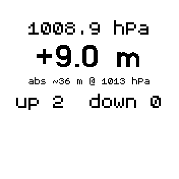

*Look for: `up 2` although the altitude already reads +9.0 m. The third floor
is still waiting in the 8 s delay of the rate gate.*

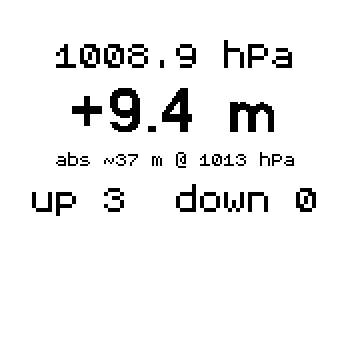

*Look for: `up 3 down 0`: the whole 9.5 m climb counted once the delay has
passed.*

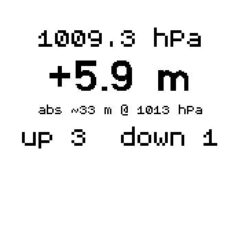

*Look for: `up 3 down 1` after the fake watch went down 3.5 m to +5.9 m.*

**You learned:** a robust event detector for a noisy signal: hysteresis plus a rate gate.

## 5. Why the temperature reads warm

The barometer has a temperature sensor of its own (it needs it to correct the
pressure). It sits inside the case, against your wrist, so it measures
something between your skin and the case temperature, not the air. Worn, it
typically reads several degrees above the room; taken off, it slowly sinks
towards the room temperature.

The app doesn't pretend otherwise: the reading is always labelled
`sensor temp`, and a swipe shows why.

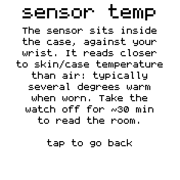

*The real app's explanation screen, one swipe away from the main screen.*

```js
Bangle.on("pressure", function (d) {
  g.clearRect(0, 140, 175, 175).setFont("6x8", 2).setFontAlign(0, 0);
  g.drawString(d.temperature.toFixed(1) + "C sensor temp", 88, 158);
});
```

**Needs a real watch:** comparing worn and off-wrist readings with a room
thermometer (`HW-3`).

### Your app so far

The main screen gets the labelled temperature, and a swipe switches to the
explanation and back.

```js
// myalt, step 5: an honest thermometer
var APP = "myalt", P0 = 1013.25;   // sea-level reference for the absolute altitude
var zero;                          // absolute altitude of the first reading = relative 0
var temp, mode = "main";            // last sensor temperature; "main" or "hint"
function altitude(p, p0) { return 44330 * (1 - Math.pow(p / p0, 1 / 5.255)); }
function signed(n) { n = Math.round(n * 10) / 10; return (n >= 0 ? "+" : "") + n.toFixed(1); }   // never "-0.0"
function show(p, rel, abs, extra) {
  g.reset().clear().setFontAlign(0, -1);
  g.setFont("6x8", 2).drawString(p.toFixed(1) + " hPa", 88, 20);
  g.setFont("Vector", 30).drawString(signed(rel) + " m", 88, 42);
  g.setFont("6x8").drawString("abs ~" + Math.round(abs) + " m @ " + P0.toFixed(0) + " hPa", 88, 76);
  if (extra) g.setFont("6x8", 2).drawString(extra, 88, 92);
  g.setFont("6x8", 2).setFontAlign(1, -1).drawString(temp.toFixed(1) + "\xB0C", 96, 118);
  g.setFont("6x8").setFontAlign(-1, -1).drawString("sensor temp", 100, 122);
  g.setFontAlign(0, -1).drawString("reads warm when worn - swipe", 88, 140);
}
var TC = 4, SPIKE = 1, tOn = Date.now(), pS, rejSince, sec, sum = 0, n = 0, rejected = 0;
function feed(p, t) {           // one raw reading, t in ms; returns the average of a finished second
  if (t - tOn < 2000) return;   // the first 2 s after power-on are still settling
  if (pS !== undefined && Math.abs(p - pS) > SPIKE) {   // a spike...
    if (rejSince === undefined) rejSince = t;
    if (t - rejSince < 3000) { rejected++; return; }
    pS = p;                                              // ...unless it lasts 3 s
  }
  rejSince = undefined;
  var s = Math.floor(t / 1000), avg;
  if (sec !== undefined && s !== sec && n) {             // a second is complete
    avg = sum / n;
    pS = pS === undefined ? avg : pS + (avg - pS) * (1 - Math.exp(-(s - sec) / TC));
  }
  if (s !== sec) { sec = s; sum = 0; n = 0; }
  sum += p; n++;
  return avg;
}
var FLOOR = 3.0, D = 8, anchor = 0, lvl = 0, up = 0, down = 0, ring = [], pend = [], prev;
function gate(s, altS) {        // once per second: rate gate, then floors with hysteresis
  ring.push([s, altS]);
  while (s - ring[0][0] > 2 * D) ring.shift();
  if (prev !== undefined) pend.push([s, altS - prev]);
  prev = altS;
  var span = s - ring[0][0], rate = span ? (altS - ring[0][1]) / span : 0;
  while (pend.length && pend[0][0] <= s - D) {   // judge each change D seconds later
    var inc = pend.shift()[1];
    lvl += inc;
    if (Math.abs(rate) < 0.05) anchor += inc;   // slow: weather drift, follow silently
    while (lvl - anchor >= FLOOR) { anchor += FLOOR; up++; }
    while (anchor - lvl >= FLOOR) { anchor -= FLOOR; down++; }
  }
}
function showHint() {
  mode = "hint";
  g.reset().clear().setFontAlign(0, -1).setFont("6x8", 2).drawString("sensor temp", 88, 4).setFont("6x8");
  ["The sensor sits inside", "the case, against your", "wrist. It reads closer", "to skin/case temperature",
   "than air: typically", "several degrees warm", "when worn. Take the", "watch off for ~30 min",
   "to read the room.", "", "swipe to go back"].forEach(function (l, i) { g.drawString(l, 88, 26 + i * 11); });
}
function onPressure(d) {
  temp = d.temperature;
  var avg = feed(d.pressure, Date.now());
  if (avg === undefined) return;
  var abs = altitude(pS, P0);
  if (zero === undefined) zero = abs;
  gate(sec, abs - zero);
  if (mode === "main") show(avg, abs - zero, abs, "up " + up + "  down " + down);
}
g.clear().setFontAlign(0, 0).setFont("6x8", 2).drawString("Waiting for", 88, 78).drawString("barometer...", 88, 98);
Bangle.setUI({
  mode: "custom",
  swipe: function () { if (mode === "main") showHint(); else mode = "main"; },   // back: next second redraws
  btn: function () { load(); }
});
Bangle.setBarometerPower(1, APP);
Bangle.on("pressure", onPressure);
E.on("kill", function () { Bangle.setBarometerPower(0, APP); });
// ---- emulator only (delete on a real watch): a fake barometer, 4 readings a second ----
// In the console: fakeTo = 9.5 climbs to 9.5 m at 0.16 m/s; fakeSpike = 3 adds one 3 hPa spike.
var fakeAlt = 0, fakeTo = 0, fakeSpike = 0, fakeN = 0;
setInterval(function () {
  fakeAlt += Math.max(-0.04, Math.min(0.04, fakeTo - fakeAlt));
  var p = 1010 * Math.pow(1 - fakeAlt / 44330, 5.255) + 0.04 * Math.sin(fakeN++ * 2.4) + fakeSpike;
  fakeSpike = 0;
  Bangle.emit("pressure", { pressure: p, temperature: 31.5, altitude: 44330 * (1 - Math.pow(p / 1013.25, 1 / 5.255)) });
}, 250);
```

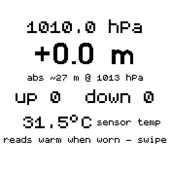

*Look for: the temperature with `sensor temp` next to it, and the hint line
under it. The fake sends 31.5 °C, warmer than most rooms, as a worn watch
would.*

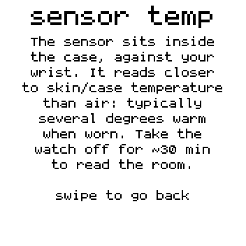

*Look for: the explanation screen. Swipe again, and the main screen is back
within a second.*

**You learned:** to read sensor data critically and label it honestly.

## 6. Testing with recorded data

The emulator has no barometer, so the app keeps all sensor handling behind
one function, `onPressure({pressure, temperature})`, and the logic in a
Storage module (`require("baroalt")`) whose `feed({p, temp, t})` takes plain
numbers. Tests either emit synthetic `pressure` events or feed numbers
directly, in virtual time, so an hour of drift takes seconds.

To replay a real climb, record one on the watch:

```js
var f = require("Storage").open("baroclimb.csv", "w"), t0 = Date.now();
f.write("t,p,temp\n");
Bangle.setBarometerPower(1, "rec");
var last = 0;
Bangle.on("pressure", function (d) {
  var t = Date.now() - t0;
  if (t - last < 1000) return;           // 1 line per second is plenty
  last = t;
  f.write(Math.round(t) + "," + d.pressure.toFixed(2) + "," + d.temperature.toFixed(1) + "\n");
});
// walk up some stairs, then: Bangle.setBarometerPower(0, "rec");
```

Download the file from the Web IDE's storage view, save it as
`apps/baroalt/tests/fixtures/<name>.csv`, and replay it in a test. The
repository's own fixture, `baroclimb.csv`, is synthetic (made by
`tests/gen-baroclimb.js`): a 9.6 m climb in 60 s, a pause, then 3.6 m down,
with ±0.04 hPa noise.

```js
var B = require("baroalt");
T.test("recorded climb: 3 floors up, 1 down", function () {
  var lines = require("Storage").read("baroclimb.csv").split("\n"), tr = B.create(), last;
  for (var i = 1; i < lines.length; i++) {
    var f = lines[i].split(",");
    if (f.length < 3) continue;
    var r = tr.feed({ t: Number(f[0]), p: Number(f[1]), temp: Number(f[2]) });
    if (r) last = r;
  }
  T.eq(last.up, 3);
  T.eq(last.down, 1);
});
```

### Your app so far

This step adds no new screen output of its own, so the last checkpoint
finishes the UI: tap to reset, and long press for the sea-level reference,
saved to `myalt.json`. This is the whole app, simplified:

```js
// myalt, step 6: the whole simplified app
// Tap: reset. Long press: sea-level reference. Swipe: why the temperature reads warm. Button: exit.
var APP = "myalt", S = require("Storage");
var P0 = (S.readJSON(APP + ".json", 1) || {}).p0 || 1013.25;   // sea-level reference
var zero;                          // absolute altitude of the first reading = relative 0
var temp, mode = "main";            // last sensor temperature; "main", "hint" or "menu"
function altitude(p, p0) { return 44330 * (1 - Math.pow(p / p0, 1 / 5.255)); }
function signed(n) { n = Math.round(n * 10) / 10; return (n >= 0 ? "+" : "") + n.toFixed(1); }   // never "-0.0"
function show(p, rel, abs, extra) {
  g.reset().clear().setFontAlign(0, -1);
  g.setFont("6x8", 2).drawString(p.toFixed(1) + " hPa", 88, 20);
  g.setFont("Vector", 30).drawString(signed(rel) + " m", 88, 42);
  g.setFont("6x8").drawString("abs ~" + Math.round(abs) + " m @ " + P0.toFixed(0) + " hPa", 88, 76);
  if (extra) g.setFont("6x8", 2).drawString(extra, 88, 92);
  g.setFont("6x8", 2).setFontAlign(1, -1).drawString(temp.toFixed(1) + "\xB0C", 96, 118);
  g.setFont("6x8").setFontAlign(-1, -1).drawString("sensor temp", 100, 122);
  g.setFontAlign(0, -1).drawString("reads warm when worn - swipe", 88, 140);
}
var TC = 4, SPIKE = 1, tOn = Date.now(), pS, rejSince, sec, sum = 0, n = 0, rejected = 0;
function feed(p, t) {           // one raw reading, t in ms; returns the average of a finished second
  if (t - tOn < 2000) return;   // the first 2 s after power-on are still settling
  if (pS !== undefined && Math.abs(p - pS) > SPIKE) {   // a spike...
    if (rejSince === undefined) rejSince = t;
    if (t - rejSince < 3000) { rejected++; return; }
    pS = p;                                              // ...unless it lasts 3 s
  }
  rejSince = undefined;
  var s = Math.floor(t / 1000), avg;
  if (sec !== undefined && s !== sec && n) {             // a second is complete
    avg = sum / n;
    pS = pS === undefined ? avg : pS + (avg - pS) * (1 - Math.exp(-(s - sec) / TC));
  }
  if (s !== sec) { sec = s; sum = 0; n = 0; }
  sum += p; n++;
  return avg;
}
var FLOOR = 3.0, D = 8, anchor = 0, lvl = 0, up = 0, down = 0, ring = [], pend = [], prev;
function gate(s, altS) {        // once per second: rate gate, then floors with hysteresis
  ring.push([s, altS]);
  while (s - ring[0][0] > 2 * D) ring.shift();
  if (prev !== undefined) pend.push([s, altS - prev]);
  prev = altS;
  var span = s - ring[0][0], rate = span ? (altS - ring[0][1]) / span : 0;
  while (pend.length && pend[0][0] <= s - D) {   // judge each change D seconds later
    var inc = pend.shift()[1];
    lvl += inc;
    if (Math.abs(rate) < 0.05) anchor += inc;   // slow: weather drift, follow silently
    while (lvl - anchor >= FLOOR) { anchor += FLOOR; up++; }
    while (anchor - lvl >= FLOOR) { anchor -= FLOOR; down++; }
  }
}
function showHint() {
  mode = "hint";
  g.reset().clear().setFontAlign(0, -1).setFont("6x8", 2).drawString("sensor temp", 88, 4).setFont("6x8");
  ["The sensor sits inside", "the case, against your", "wrist. It reads closer", "to skin/case temperature",
   "than air: typically", "several degrees warm", "when worn. Take the", "watch off for ~30 min",
   "to read the room.", "", "swipe to go back"].forEach(function (l, i) { g.drawString(l, 88, 26 + i * 11); });
}
function onPressure(d) {
  temp = d.temperature;
  var avg = feed(d.pressure, Date.now());
  if (avg === undefined) return;
  var abs = altitude(pS, P0);
  if (zero === undefined) zero = abs;
  gate(sec, abs - zero);
  if (mode === "main") show(avg, abs - zero, abs, "up " + up + "  down " + down);
}
g.clear().setFontAlign(0, 0).setFont("6x8", 2).drawString("Waiting for", 88, 78).drawString("barometer...", 88, 98);
function reset() {   // relative altitude and floors back to zero; smoothing carries on
  zero = pS === undefined ? undefined : altitude(pS, P0);
  anchor = 0; lvl = 0; up = 0; down = 0; ring = []; pend = []; prev = 0;
}
function showMenu() {
  mode = "menu";
  E.showMenu({
    "": { title: "Sea level", back: function () { S.writeJSON(APP + ".json", { p0: P0 }); setupUI(); mode = "main"; } },
    "hPa": {
      value: P0, min: 850, max: 1100, step: 1,
      format: function (v) { return v.toFixed(2); },
      onchange: function (v) { if (zero !== undefined) zero += altitude(pS, v) - altitude(pS, P0); P0 = v; }
    }
  });
}
var touch, longT;   // tap: moved < 12 px, up within 300 ms; long press: held still for 600 ms
function drag(e) {
  if (e.b && !touch) {
    touch = { x: e.x, y: e.y, t: Date.now() };
    longT = setTimeout(function () { longT = undefined; touch.long = true; if (mode === "main") showMenu(); }, 600);
  } else if (e.b && (Math.abs(e.x - touch.x) >= 12 || Math.abs(e.y - touch.y) >= 12)) {
    touch.moved = true;
    if (longT) longT = clearTimeout(longT);
  } else if (!e.b && touch) {
    if (longT) longT = clearTimeout(longT);
    if (!touch.long && !touch.moved && Date.now() - touch.t < 300) {
      if (mode === "main") reset(); else if (mode === "hint") mode = "main";
    }
    touch = undefined;
  }
}
function setupUI() {
  Bangle.setUI({
    mode: "custom",
    drag: drag,
    swipe: function () { if (mode === "main") showHint(); else if (mode === "hint") mode = "main"; },
    btn: function () { load(); }
  });
}
setupUI();
Bangle.setBarometerPower(1, APP);
Bangle.on("pressure", onPressure);
E.on("kill", function () { Bangle.setBarometerPower(0, APP); });
// ---- emulator only (delete on a real watch): a fake barometer, 4 readings a second ----
// In the console: fakeTo = 9.5 climbs to 9.5 m at 0.16 m/s; fakeSpike = 3 adds one 3 hPa spike.
var fakeAlt = 0, fakeTo = 0, fakeSpike = 0, fakeN = 0;
setInterval(function () {
  fakeAlt += Math.max(-0.04, Math.min(0.04, fakeTo - fakeAlt));
  var p = 1010 * Math.pow(1 - fakeAlt / 44330, 5.255) + 0.04 * Math.sin(fakeN++ * 2.4) + fakeSpike;
  fakeSpike = 0;
  Bangle.emit("pressure", { pressure: p, temperature: 31.5, altitude: 44330 * (1 - Math.pow(p / 1013.25, 1 / 5.255)) });
}, 250);
```

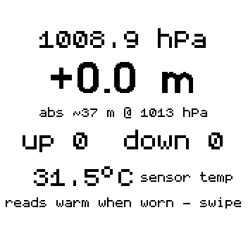

*Look for: `+0.0 m` and `up 0 down 0` right after the tap, although the fake
watch is still at 9.5 m.*

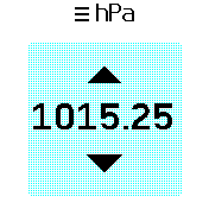

*Look for: the value editor of `E.showMenu`, here moved up to 1015.25 hPa.*

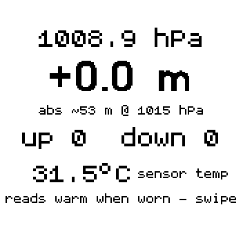

*Look for: `abs ~53 m @ 1015 hPa`. A different reference moves the absolute
altitude by about 16 m, but the relative altitude and the floors stay as they
were.*

The real app in [`apps/baroalt`](../apps/baroalt) works the same way and adds:

- the logic in a Storage module (`require("baroalt")`) with `feed({p, temp, t})`
  so the tests can replay recordings, and a `DEBUG` log the tests read;
- a sparkline of the last 10 minutes and the widgets;
- the optional step cross-check (`stepCheck`) and a configurable floor height
  in `baroalt.json`;
- the tap and long press detector as a small reusable object, and a tap to
  leave the explanation screen.

**You learned:** separating sensor input from logic, so recorded data can drive the tests.

## Test it in the emulator

All tests are in [`apps/baroalt/tests/`](../apps/baroalt/tests); run them with
`npm test -- baroalt`. They check the spec's acceptance criteria with
synthetic traces at 1 Hz and 10 Hz:

| Criterion | Test |
|---|---|
| 9.5 m over 60 s → exactly 3 floors up | logic (1 Hz, 10 Hz, 0.5 Hz) and app (emitted events) |
| ±0.1 hPa noise for 10 min → 0 floors | logic |
| 1 hPa drift over 1 h → 0 floors | logic, also with noise and in the other direction |
| single 3 hPa spike rejected | logic and app |
| 3 up then 2 down → up 3, down 2, ≈ +3 m | logic and app (4 Hz) |
| formula: 1013.25 hPa → 0 m, 900 hPa → ≈ 988 m | logic |
| label always `sensor temp`, hint one swipe away | app (spies on `g.drawString`, real swipe) |

One tip if you write long replays: code loaded from Storage runs much slower
in the emulator than code in RAM, so `tests/logic.test.js` loads a RAM copy
of the module with `T.requireRAM("baroalt")` before feeding it an hour of
samples.

## Try it on the watch

Install the app and work through the [hardware tests](../apps/baroalt/HW-TESTS.md):
the real sample rate, 3 floors of stairs (±1), a lift with the step
cross-check on, worn vs room temperature, an hour on the table, spikes from
pressing the case, the barometer switching off after exit, and an absolute
altitude check with your local sea-level pressure.

## Going further

- Learn the floor height from the first flight you climb instead of assuming 3 m.
- Use GPS altitude now and then to recalibrate `p0` automatically.
- Log floors per day to Storage and show a weekly chart.
- Detect a lift from the climb rate alone (lifts are steadier and faster than legs).
