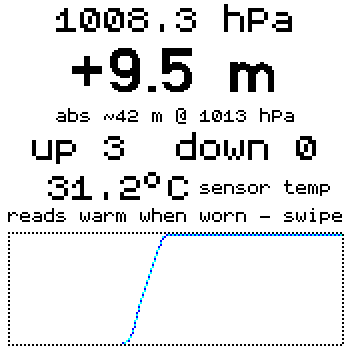

# 04 — Air pressure, altitude and an honest thermometer

The Bangle.js 2 has a barometer: a pressure sensor so sensitive that it notices
you walking up one flight of stairs. In this tutorial you turn its readings
into a relative altimeter and a floor counter that ignores noise, door slams
and the weather, and you find out why its thermometer always seems to think
you have a fever. The finished app is [`apps/baroalt`](../apps/baroalt).



## What you need

- A Bangle.js 2, or just the [Espruino Web IDE](https://www.espruino.com/ide/) with its Bangle.js 2 emulator.
- Parts that need a real watch: real pressure data (the emulator has no
  barometer: `Bangle.getPressure()` returns `undefined` and no `pressure`
  events arrive, so the snippets show how to feed fake readings), climbing
  real stairs, riding a lift, and comparing the temperature with a room
  thermometer.
- Earlier tutorials this one reuses: none. (Tap and long press use the same
  thresholds as [tutorial 01](01-touch-gestures.md).)

## 1. What the barometer measures

There are two ways to read it. `Bangle.getPressure()` powers the sensor
briefly and returns a Promise for one reading. For a continuous stream, switch
it on with an app id and listen to `pressure` events:

```js
var p = Bangle.getPressure();          // undefined in the emulator (no sensor)
if (p) p.then(function (d) { print(d); });   // {temperature, pressure, altitude}

Bangle.setBarometerPower(1, "mytest");
Bangle.on("pressure", function (d) {
  print(d.pressure.toFixed(2) + " hPa", d.temperature.toFixed(1) + " C", d.altitude.toFixed(1) + " m");
});
// later: Bangle.setBarometerPower(0, "mytest");
```

Each reading is `{temperature, pressure, altitude}`: pressure in hPa,
temperature in °C, and an altitude in metres computed by the firmware from a
sea-level reference of 1013.25 hPa (changeable with
`Bangle.setOptions({seaLevelPressure: …})` on a real watch).

How often do events arrive? The firmware polls the barometer on the same
timer as the accelerometer, so expect several per second normally and fewer
when the watch is idle and in power-save mode. Measure it on your watch
(`HW-0` in the [hardware tests](../apps/baroalt/HW-TESTS.md)); the app does
not depend on it because it averages everything into one value per second.

**You learned:** `getPressure()` for one reading, the `pressure` event for a stream, and always switching the sensor on and off with an app id.

## 2. Altitude from pressure

Air pressure drops by about 0.12 hPa per metre near sea level. The standard
barometric formula turns pressure into height above the level where the
pressure is `p0`:

```js
function altitude(p, p0) { return 44330 * (1 - Math.pow(p / p0, 1 / 5.255)); }
print(altitude(1013.25, 1013.25));   // 0
print(altitude(900, 1013.25));       // 988.6…
print(altitude(1012.05, 1013.25));   // ≈ 10 m: one hPa is about 8 m
```

The catch is `p0`. Sea-level pressure changes with the weather by tens of
hPa, so the *absolute* altitude is only as good as the reference you give it
(the app lets you set it with a long press, from your local weather report's
QNH). The *relative* altitude, the difference between two readings a few
minutes apart, barely depends on `p0` at all, and that is what the floor
counter uses.


**You learned:** relative vs absolute altitude, and why absolute needs a reference.

## 3. Noise and weather

Raw readings jitter, occasionally jump (pressing the case, a door closing,
wind), and drift slowly with the weather. Three tools deal with these:

```js
var TC = 4, pS, lastT;
function smooth(p, t) {                    // t in seconds
  if (pS === undefined) { pS = p; lastT = t; return pS; }
  if (Math.abs(p - pS) > 1) return pS;     // spike: > 1 hPa from the average
  pS += (p - pS) * (1 - Math.exp(-(t - lastT) / TC));   // EMA, time constant 4 s
  lastT = t;
  return pS;
}
[1010, 1010.1, 1009.9, 1007, 1010.05].forEach(function (p, i) { print(smooth(p, i).toFixed(2)); });
// 1010.00 1010.02 1009.99 1009.99 1010.02 — the 1007 spike is ignored
```

- **Exponential moving average (EMA):** each new value pulls the average
  `1 − e^(−dt/TC)` of the way towards it. Because it uses the real time step
  `dt`, it works at any sample rate.
- **Outlier rejection:** a sample more than 1 hPa (≈ 8 m) from the average is
  dropped. The app accepts the new level if the jump lasts 3 s or more, so a
  fast lift doesn't lock the filter out for ever.
- **Weather drift:** a typical weather change is about 1 hPa per hour, which
  looks like climbing 8 m in an hour. That is far slower than walking up
  stairs (0.2–0.5 m/s), so the floor counter ignores changes slower than
  0.05 m/s. More on that in the next step.

The app also throws away the first 2 s after switching the sensor on and
averages all samples within each second before smoothing.

**You learned:** EMA smoothing with real time steps and simple outlier rejection.

## 4. Counting floors

A floor is about 3 m. Counting "every time the altitude passes a multiple of
3 m" fails: noise around 3.0 m would count the same floor many times. Use an
**anchor** and hysteresis instead: count a floor only when the altitude is a
full floor away from the anchor, then move the anchor by one floor.

```js
var FLOOR = 3.0, anchor = 0, up = 0, down = 0;
function floors(alt) {
  while (alt - anchor >= FLOOR) { anchor += FLOOR; up++; }
  while (anchor - alt >= FLOOR) { anchor -= FLOOR; down++; }
}
[0, 1.5, 2.9, 3.1, 2.8, 3.2, 6.4, 9.5, 7.0, 5.9].forEach(floors);
print("up", up, "down", down);   // up 3 down 1
```

Noise between 2.8 and 3.2 m counts once, not three times. Now the weather:
let the anchor follow any change that is slower than 0.05 m/s, so slow drift
never builds up to a whole floor. The rate has to be measured over a window,
and the window is the tricky part. If you only look backwards, the first
seconds of every climb look slow and the anchor creeps up with you, so a
9.5 m climb can end up as 2 floors. The app judges every one-second change
8 s later, by the rate over a 16 s window centred on it:

```js
var D = 8, ring = [], pend = [], lvl = 0, prev;
function gate(sec, altS) {          // once per second
  ring.push([sec, altS]);
  while (sec - ring[0][0] > 2 * D) ring.shift();
  if (prev !== undefined) pend.push([sec, altS - prev]);
  prev = altS;
  var span = sec - ring[0][0], rate = span ? (altS - ring[0][1]) / span : 0;
  while (pend.length && pend[0][0] <= sec - D) {
    var inc = pend.shift()[1];
    lvl += inc;
    if (Math.abs(rate) < 0.05) anchor += inc;   // slow: drift, follow silently
    floors(lvl);
  }
}
```

The price is that floors appear about 8 s after you reach them. In return a
climb counts in full, and weather drift, even with noise on top, counts
nothing. A reset (tap) sets the relative altitude, the anchor and both
counters back to zero, so it can never produce a negative count.

To tell stairs from a lift, the app can also require steps: with
`"stepCheck": true` in `baroalt.json` it listens to `Bangle.on("step", …)`
and only counts a floor if at least 4 steps happened in the last 15 s.

**Needs a real watch:** walking up real stairs (`HW-1`) and riding a lift (`HW-2`).

**You learned:** a robust event detector for a noisy signal: hysteresis plus a rate gate.

## 5. Why the temperature reads warm

The barometer has a temperature sensor of its own (it needs it to correct the
pressure). It sits inside the case, against your wrist, so it measures
something between your skin and the case temperature, not the air. Worn, it
typically reads several degrees above the room; taken off, it slowly sinks
towards the room temperature.

The app doesn't pretend otherwise: the reading is always labelled
`sensor temp`, and a swipe shows why.


```js
Bangle.on("pressure", function (d) {
  g.clearRect(0, 140, 175, 175).setFont("6x8", 2).setFontAlign(0, 0);
  g.drawString(d.temperature.toFixed(1) + "C sensor temp", 88, 158);
});
```

**Needs a real watch:** comparing worn and off-wrist readings with a room
thermometer (`HW-3`).

**You learned:** to read sensor data critically and label it honestly.

## 6. Testing with recorded data

The emulator has no barometer, so the app keeps all sensor handling behind
one function, `onPressure({pressure, temperature})`, and the logic in a
Storage module (`require("baroalt")`) whose `feed({p, temp, t})` takes plain
numbers. Tests either emit synthetic `pressure` events or feed numbers
directly, in virtual time, so an hour of drift takes seconds.

To replay a real climb, record one on the watch:

```js
var f = require("Storage").open("baroclimb.csv", "w"), t0 = Date.now();
f.write("t,p,temp\n");
Bangle.setBarometerPower(1, "rec");
var last = 0;
Bangle.on("pressure", function (d) {
  var t = Date.now() - t0;
  if (t - last < 1000) return;           // 1 line per second is plenty
  last = t;
  f.write(Math.round(t) + "," + d.pressure.toFixed(2) + "," + d.temperature.toFixed(1) + "\n");
});
// walk up some stairs, then: Bangle.setBarometerPower(0, "rec");
```

Download the file from the Web IDE's storage view, save it as
`apps/baroalt/tests/fixtures/<name>.csv`, and replay it in a test. The
repository's own fixture, `baroclimb.csv`, is synthetic (made by
`tests/gen-baroclimb.js`): a 9.6 m climb in 60 s, a pause, then 3.6 m down,
with ±0.04 hPa noise.

```js
var B = require("baroalt");
T.test("recorded climb: 3 floors up, 1 down", function () {
  var lines = require("Storage").read("baroclimb.csv").split("\n"), tr = B.create(), last;
  for (var i = 1; i < lines.length; i++) {
    var f = lines[i].split(",");
    if (f.length < 3) continue;
    var r = tr.feed({ t: Number(f[0]), p: Number(f[1]), temp: Number(f[2]) });
    if (r) last = r;
  }
  T.eq(last.up, 3);
  T.eq(last.down, 1);
});
```

**You learned:** separating sensor input from logic, so recorded data can drive the tests.

## Test it in the emulator

All tests are in [`apps/baroalt/tests/`](../apps/baroalt/tests); run them with
`npm test -- baroalt`. They check the spec's acceptance criteria with
synthetic traces at 1 Hz and 10 Hz:

| Criterion | Test |
|---|---|
| 9.5 m over 60 s → exactly 3 floors up | logic (1 Hz, 10 Hz, 0.5 Hz) and app (emitted events) |
| ±0.1 hPa noise for 10 min → 0 floors | logic |
| 1 hPa drift over 1 h → 0 floors | logic, also with noise and in the other direction |
| single 3 hPa spike rejected | logic and app |
| 3 up then 2 down → up 3, down 2, ≈ +3 m | logic and app (4 Hz) |
| formula: 1013.25 hPa → 0 m, 900 hPa → ≈ 988 m | logic |
| label always `sensor temp`, hint one swipe away | app (spies on `g.drawString`, real swipe) |

One tip if you write long replays: code loaded from Storage runs much slower
in the emulator than code in RAM, so `tests/logic.test.js` loads a RAM copy
of the module with `T.requireRAM("baroalt")` before feeding it an hour of
samples.

## Try it on the watch

Install the app and work through the [hardware tests](../apps/baroalt/HW-TESTS.md):
the real sample rate, 3 floors of stairs (±1), a lift with the step
cross-check on, worn vs room temperature, an hour on the table, spikes from
pressing the case, the barometer switching off after exit, and an absolute
altitude check with your local sea-level pressure.

## Going further

- Learn the floor height from the first flight you climb instead of assuming 3 m.
- Use GPS altitude now and then to recalibrate `p0` automatically.
- Log floors per day to Storage and show a weekly chart.
- Detect a lift from the climb rate alone (lifts are steadier and faster than legs).
