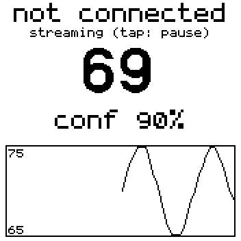
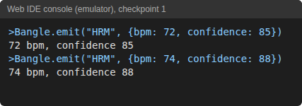
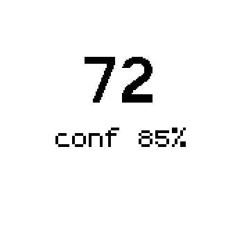
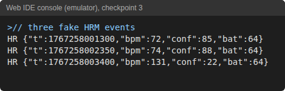
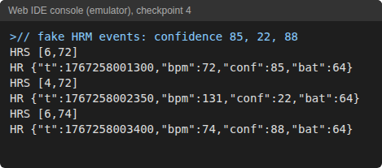
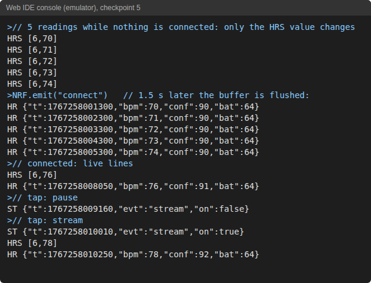
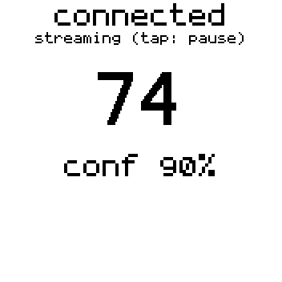
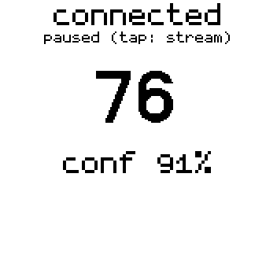
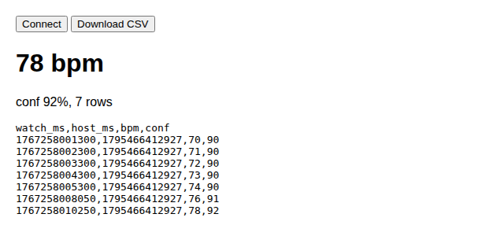
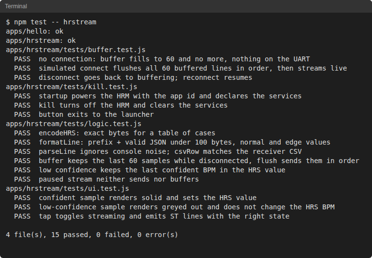

# 05 — Streaming heart rate to your computer

Bangle.js 2 has an optical heart-rate sensor. In this tutorial you read it,
learn what its confidence value means, and stream it live over Bluetooth LE in
two ways at once: as the standard Heart Rate Service that phone fitness apps
already understand, and as simple JSON lines that a small web page turns into
a chart and a CSV file. Along the way you make the encoding testable without a
radio, so the emulator can check every byte.



## What you need

- A Bangle.js 2, or just the [Espruino Web IDE](https://www.espruino.com/ide/) with its Bangle.js 2 emulator.
- Parts that need a real watch: the heart-rate sensor itself (the emulator has none) and Bluetooth to a phone or PC.
  For the receiver page: desktop Chrome or Edge (Web Bluetooth).
- Earlier tutorials this one reuses: none.

The finished app is in [`apps/hrstream`](../apps/hrstream): `hrstream.lib.js` holds the logic,
`hrstream.app.js` the UI and Bluetooth, `receiver.html` the web page.

### How the checkpoints work

Each step ends with **Your app so far**: the complete code of a single-file app, `hrdemo.app.js`,
at that point. It is a simplified version of the finished app that grows step by step; the last
step shows what the real app adds and ends with exactly the code in `apps/hrstream`.

To run a checkpoint, paste it into the right-hand editor of the Web IDE and either click
**Send to RAM**, or save it to Storage as `hrdemo.app.js` (the upload button's menu) and type
`load("hrdemo.app.js")` in the console. Every checkpoint was run in the emulator, and the
screenshots show what it printed or drew.

## 1. Turning on the HRM

The sensor is off until an app asks for it. `Bangle.setHRMPower(on, appId)`
takes an **app id**: the firmware keeps the sensor on while *any* app id still
wants it, so your app only ever switches off its own request and never another
app's (a widget may be using the HRM too).

```js
Bangle.setHRMPower(1, "hrdemo");
Bangle.on("HRM", function (h) {
  print(h.bpm, "bpm, confidence", h.confidence);
});
E.on("kill", function () { Bangle.setHRMPower(0, "hrdemo"); });
```

The `HRM` event arrives about once a second with `{bpm, confidence, raw}`;
`confidence` is 0–100. Note that `kill` is an event on `E`, not `Bangle`: it
runs just before `load()`, `reset()` or a reboot, but not after a hard reset
or a watchdog reset.

In the emulator `setHRMPower` returns `false` and no events arrive. You can
still try the handler by faking an event:

```js
Bangle.emit("HRM", { bpm: 72, confidence: 85 });
```

For the raw optical signal there is also `Bangle.on("HRM-raw", r)` with
`{raw, filt, bpm, confidence}` (checked against the Espruino reference); this
app doesn't stream it.

### Your app so far

```js
// hrdemo.app.js, checkpoint 1: switch the HRM on and print every reading
var APP = "hrdemo";

Bangle.on("HRM", function (h) {
  print(h.bpm, "bpm, confidence", h.confidence);
});
Bangle.setHRMPower(1, APP);
E.on("kill", function () { Bangle.setHRMPower(0, APP); });
```

The screen stays blank for now. Fake two readings in the console:

```js
Bangle.emit("HRM", { bpm: 72, confidence: 85 });
Bangle.emit("HRM", { bpm: 74, confidence: 88 });
```



*Each fake `HRM` event prints one line with the BPM and its confidence.*

**You learned:** sensors are switched on per app id and switched off again in a `kill` handler.

## 2. What confidence means

An optical sensor shines green light into your skin and watches the reflection
change with each pulse. Movement, a loose strap, cold hands or tattoos all
make that signal noisy, and the algorithm then still produces a BPM, but with
low confidence. Off the wrist it reports junk.

So the app treats a reading as real only when `confidence >= 50`, and draws
the number grey otherwise. The Bangle.js 2 screen has 3-bit colour, so a grey
`setColor` is drawn as a dithered checkerboard, which reads well as "greyed out":

```js
function show(h) {
  var ok = h.confidence >= 50 && h.bpm > 0;
  g.clear().setFontAlign(0, 0).setFont("Vector", 44);
  if (!ok) g.setColor(0.5, 0.5, 0.5);
  g.drawString(h.bpm, 88, 70);
  g.setColor(g.theme.fg).setFont("6x8", 2).drawString(ok ? "conf " + h.confidence + "%" : "no reading", 88, 110);
}
show({ bpm: 131, confidence: 22 });
```

Wear tips for good readings: strap snug, one finger above the wrist bone, keep
still for 10–20 s after putting it on.

### Your app so far

The `print` from step 1 is replaced by `show`, which now draws every reading below the widget bar.

```js
// hrdemo.app.js, checkpoint 2: show the BPM, grey when confidence is low
var APP = "hrdemo";
var THRESHOLD = 50;

function show(h) {
  var r = Bangle.appRect, cx = r.x + r.w / 2;
  var ok = h.confidence >= THRESHOLD && h.bpm > 0;
  g.reset().clearRect(r).setFontAlign(0, 0).setFont("Vector", 44);
  if (!ok) g.setColor(0.5, 0.5, 0.5); // dithered grey on the 3-bit screen
  g.drawString(h.bpm, cx, r.y + 60);
  g.setColor(g.theme.fg).setFont("6x8", 2);
  g.drawString(ok ? "conf " + h.confidence + "%" : "no reading", cx, r.y + 100);
}

Bangle.on("HRM", show);
Bangle.setHRMPower(1, APP);
E.on("kill", function () { Bangle.setHRMPower(0, APP); });
Bangle.loadWidgets();
Bangle.drawWidgets();
show({ bpm: "--", confidence: 0 });
```

Try it with a good and a poor reading:

```js
Bangle.emit("HRM", { bpm: 72, confidence: 85 });
Bangle.emit("HRM", { bpm: 131, confidence: 22 });
```

 

*Left: confidence 85, solid black digits and "conf 85%". Right: confidence 22, the digits are a grey checkerboard and the line below says "no reading".*

**You learned:** a BPM without its confidence is not a measurement; show the difference.

## 3. The easy way: UART + JSON

Every Bangle advertises the **Nordic UART** service. It is a serial line over
Bluetooth, and it is also where the Espruino console (REPL) lives. Anything you
`Bluetooth.println()` goes to the connected client, mixed with console output.
That is why every data line carries a prefix:

```
HR {"t":1732000000123,"bpm":72,"conf":85,"bat":64}
ST {"t":1732000000123,"evt":"stream","on":true}
```

One JSON object per line, `\n` terminated, always under 100 bytes. The
receiver ignores any line without `HR ` or `ST `.

```js
function formatLine(s) {
  return "HR " + JSON.stringify({ t: Math.round(s.t), bpm: s.bpm, conf: s.conf, bat: s.bat });
}
Bangle.on("HRM", function (h) {
  Bluetooth.println(formatLine({ t: Date.now(), bpm: h.bpm, conf: h.confidence, bat: E.getBattery() }));
});
```

The real `formatLine` in `hrstream.lib.js` also clamps every number (BPM 0–255,
confidence and battery 0–100) so that no input can make the line invalid or too long.

On the PC side, a few lines of Web Bluetooth subscribe to the UART's
"RX" characteristic (the watch → PC direction):

```js
// in a page served from localhost, after a button click:
var NUS = "6e400001-b5a3-f393-e0a9-e50e24dcca9e";
navigator.bluetooth.requestDevice({ filters: [{ namePrefix: "Bangle" }], optionalServices: [NUS] })
  .then(function (d) { return d.gatt.connect(); })
  .then(function (s) { return s.getPrimaryService(NUS); })
  .then(function (svc) { return svc.getCharacteristic("6e400003-b5a3-f393-e0a9-e50e24dcca9e"); })
  .then(function (ch) {
    ch.addEventListener("characteristicvaluechanged", function (e) {
      console.log(new TextDecoder().decode(e.target.value));
    });
    return ch.startNotifications();
  });
```

Notifications arrive in chunks of about 20 bytes, so the page has to glue them
back together into lines (step 6).

### Your app so far

The screen works as in step 2. New: `formatLine`, `send` and an `onHRM` handler that does both.
The emulator has no `Bluetooth.println`, so `send` falls back to `print` there; on the watch the
line goes to whatever is connected over Bluetooth.

```js
// hrdemo.app.js, checkpoint 3: also send every reading as an "HR {...}" line
var APP = "hrdemo";
var THRESHOLD = 50;

function show(h) {
  var r = Bangle.appRect, cx = r.x + r.w / 2;
  var ok = h.confidence >= THRESHOLD && h.bpm > 0;
  g.reset().clearRect(r).setFontAlign(0, 0).setFont("Vector", 44);
  if (!ok) g.setColor(0.5, 0.5, 0.5); // dithered grey on the 3-bit screen
  g.drawString(h.bpm, cx, r.y + 60);
  g.setColor(g.theme.fg).setFont("6x8", 2);
  g.drawString(ok ? "conf " + h.confidence + "%" : "no reading", cx, r.y + 100);
}

function formatLine(s) {
  return "HR " + JSON.stringify({ t: Math.round(s.t), bpm: s.bpm, conf: s.conf, bat: s.bat });
}

// The emulator has no Bluetooth.println, so there the line goes to the console.
function send(line) {
  try { Bluetooth.println(line); } catch (e) { print(line); }
}

function onHRM(h) {
  show(h);
  send(formatLine({ t: Date.now(), bpm: h.bpm, conf: h.confidence, bat: E.getBattery() }));
}

Bangle.on("HRM", onHRM);
Bangle.setHRMPower(1, APP);
E.on("kill", function () { Bangle.setHRMPower(0, APP); });
Bangle.loadWidgets();
Bangle.drawWidgets();
show({ bpm: "--", confidence: 0 });
```



*Three fake readings give three `HR` lines: each one is valid JSON after the `HR ` prefix, with the watch time `t` in ms and the battery (stubbed to 64 % here, because the emulator reports 0).*

**You learned:** the UART is a shared text channel; frame your data with a prefix and one line per message.

## 4. The standard way: Heart Rate Service

Bluetooth SIG defines a Heart Rate Service (`0x180D`) whose Heart Rate
Measurement characteristic (`0x2A37`) any fitness app can read. Its value is a
flags byte followed by the BPM:

| Byte | Meaning |
|---|---|
| 0 | flags: bit 0 = 0 means "BPM is uint8"; bits 1–2 = sensor contact (`0x04` supported but no contact, `0x06` contact detected) |
| 1 | BPM, 0–255 |

```js
function encodeHRS(bpm, contact) {
  var flags = contact === true ? 0x06 : (contact === false ? 0x04 : 0x00);
  bpm = Math.round(bpm);
  return [flags, bpm > 255 ? 255 : (bpm > 0 ? bpm : 0)];
}

NRF.setServices({
  0x180D: {
    0x2A37: { value: [0, 0], maxLen: 2, readable: true, notify: true },
    0x2A38: { value: 2, readable: true } // body sensor location: wrist
  }
}, { advertise: ["180D"], uart: true });

Bangle.on("HRM", function (h) {
  NRF.updateServices({ 0x180D: { 0x2A37: { value: encodeHRS(h.bpm, h.confidence >= 50), notify: true } } });
});
```

Two rules from the Espruino reference matter here:

- Services can only change while **nothing is connected** (the Bluetooth stack
  restarts). If the Web IDE is connected when the app starts, the new service
  appears after you disconnect. So the app calls `setServices` once, at start.
- `uart: true` keeps the console. Without it you lock yourself out of the IDE.

When the confidence is low the app keeps sending the **last confident** BPM
(0 if there was none yet) and clears the "contact detected" bit, so a phone
app's display doesn't jump to junk values. On exit the app calls
`NRF.setServices({}, {uart: true})` in its `kill` handler to remove the
service again.

Phones cache the GATT table of a device. If your phone app doesn't see the
Heart Rate Service, **forget the device** in the phone's Bluetooth settings
and connect again.

### Your app so far

New: `encodeHRS`, `updateHRS`, the remembered `lastGood` BPM, `NRF.setServices` at start and the
clean-up in `kill`. As with `send`, `updateHRS` prints the bytes in the emulator, which has no
`NRF.updateServices`.

```js
// hrdemo.app.js, checkpoint 4: add the standard Heart Rate Service
var APP = "hrdemo";
var THRESHOLD = 50;
var lastGood = 0; // last confident BPM, sent while the reading is poor

function show(h) {
  var r = Bangle.appRect, cx = r.x + r.w / 2;
  var ok = h.confidence >= THRESHOLD && h.bpm > 0;
  g.reset().clearRect(r).setFontAlign(0, 0).setFont("Vector", 44);
  if (!ok) g.setColor(0.5, 0.5, 0.5); // dithered grey on the 3-bit screen
  g.drawString(h.bpm, cx, r.y + 60);
  g.setColor(g.theme.fg).setFont("6x8", 2);
  g.drawString(ok ? "conf " + h.confidence + "%" : "no reading", cx, r.y + 100);
}

function formatLine(s) {
  return "HR " + JSON.stringify({ t: Math.round(s.t), bpm: s.bpm, conf: s.conf, bat: s.bat });
}

// The emulator has no Bluetooth.println, so there the line goes to the console.
function send(line) {
  try { Bluetooth.println(line); } catch (e) { print(line); }
}

function encodeHRS(bpm, contact) {
  var flags = contact === true ? 0x06 : (contact === false ? 0x04 : 0x00);
  bpm = Math.round(bpm);
  return [flags, bpm > 255 ? 255 : (bpm > 0 ? bpm : 0)];
}

// The emulator has no NRF.updateServices either: print the bytes instead.
function updateHRS(v) {
  try { NRF.updateServices({ 0x180D: { 0x2A37: { value: v, notify: true } } }); }
  catch (e) { print("HRS", JSON.stringify(v)); }
}

function onHRM(h) {
  var ok = h.confidence >= THRESHOLD && h.bpm > 0;
  if (ok) lastGood = h.bpm;
  show(h);
  updateHRS(encodeHRS(lastGood, ok));
  send(formatLine({ t: Date.now(), bpm: h.bpm, conf: h.confidence, bat: E.getBattery() }));
}

NRF.setServices({
  0x180D: {
    0x2A37: { value: [0, 0], maxLen: 2, readable: true, notify: true },
    0x2A38: { value: 2, readable: true } // body sensor location: wrist
  }
}, { advertise: ["180D"], uart: true });
Bangle.on("HRM", onHRM);
Bangle.setHRMPower(1, APP);
E.on("kill", function () {
  Bangle.setHRMPower(0, APP);
  NRF.setServices({}, { uart: true });
});
Bangle.loadWidgets();
Bangle.drawWidgets();
show({ bpm: "--", confidence: 0 });
```



*Readings with confidence 85, 22 and 88. Look at the `HRS` bytes: `[6,72]` is "contact, 72 bpm"; the poor reading (131 bpm, confidence 22) gives `[4,72]`, "no contact" and still the last good 72; then `[6,74]`. The UART line always carries the raw reading.*

A phone heart-rate app can only show this on a real watch; see *Try it on the watch* below.

**You learned:** a standard GATT service makes your watch work with apps you didn't write.

## 5. Connection handling

When no client is connected there is nobody to write to. The app keeps the
last 60 samples in a small ring buffer and sends them, oldest first and with
their original `t`, once a client connects. It waits 1.5 s after `connect`
because the client still has to subscribe to notifications:

```js
var buffer = [], ready = false;
function onSample(s) {
  if (ready) Bluetooth.println(formatLine(s));
  else { buffer.push(s); if (buffer.length > 60) buffer.shift(); }
}
NRF.on("connect", function () {
  setTimeout(function () {
    ready = true;
    buffer.forEach(function (s) { Bluetooth.println(formatLine(s)); });
    buffer = [];
  }, 1500);
});
NRF.on("disconnect", function () { ready = false; });
```

In the app this logic lives in `HR.create({send: fn})`: `onHRM(h, t, bat)`,
`connect()`, `flush()`, `disconnect()` and `setStreaming(on, t)`. It takes
plain values and a `send` function, so tests can drive it without Bluetooth.
Tapping the screen calls `setStreaming`, which pauses both channels and sends
an `ST` line so the receiver knows why data stopped.

### Your app so far

This is the last single-file checkpoint and the longest (93 lines). `show` became `draw`, which also
shows the connection and streaming state; new are the buffer, `onConnect`, `onDisconnect`, `toggle`
and `Bangle.setUI`, which handles the tap and makes the button exit.

```js
// hrdemo.app.js, checkpoint 5: buffer while disconnected, tap to pause
var APP = "hrdemo";
var THRESHOLD = 50, FLUSH_MS = 1500;
var lastGood = 0, last, buffer = [], connected = false, ready = false, streaming = true, flushTimer;

function draw() {
  var r = Bangle.appRect, cx = r.x + r.w / 2;
  var ok = last && last.conf >= THRESHOLD && last.bpm > 0;
  g.reset().clearRect(r).setFontAlign(0, -1).setFont("6x8", 2);
  g.drawString(connected ? "connected" : "not connected", cx, r.y + 2);
  g.setFont("6x8").drawString(streaming ? "streaming (tap: pause)" : "paused (tap: stream)", cx, r.y + 20);
  if (!ok) g.setColor(0.5, 0.5, 0.5); // dithered grey on the 3-bit screen
  g.setFont("Vector", 44).setFontAlign(0, 0).drawString(last ? last.bpm : "--", cx, r.y + 64);
  g.setColor(g.theme.fg).setFont("6x8", 2).setFontAlign(0, -1);
  g.drawString(!last ? "waiting" : (ok ? "conf " + last.conf + "%" : "no reading"), cx, r.y + 96);
}

function formatLine(s) {
  return "HR " + JSON.stringify({ t: Math.round(s.t), bpm: s.bpm, conf: s.conf, bat: s.bat });
}

// The emulator has no Bluetooth.println, so there the line goes to the console.
function send(line) {
  try { Bluetooth.println(line); } catch (e) { print(line); }
}

function encodeHRS(bpm, contact) {
  var flags = contact === true ? 0x06 : (contact === false ? 0x04 : 0x00);
  bpm = Math.round(bpm);
  return [flags, bpm > 255 ? 255 : (bpm > 0 ? bpm : 0)];
}

// The emulator has no NRF.updateServices either: print the bytes instead.
function updateHRS(v) {
  try { NRF.updateServices({ 0x180D: { 0x2A37: { value: v, notify: true } } }); }
  catch (e) { print("HRS", JSON.stringify(v)); }
}

function onHRM(h) {
  var ok = h.confidence >= THRESHOLD && h.bpm > 0;
  if (ok) lastGood = h.bpm;
  last = { bpm: h.bpm, conf: h.confidence };
  draw();
  if (!streaming) return;
  updateHRS(encodeHRS(lastGood, ok));
  var s = { t: Date.now(), bpm: h.bpm, conf: h.confidence, bat: E.getBattery() };
  if (ready) send(formatLine(s));
  else { buffer.push(s); if (buffer.length > 60) buffer.shift(); }
}

function onConnect() {
  connected = true; ready = false;
  if (flushTimer) clearTimeout(flushTimer);
  flushTimer = setTimeout(function () { // give the client time to subscribe
    flushTimer = undefined; ready = true;
    buffer.forEach(function (s) { send(formatLine(s)); });
    buffer = [];
  }, FLUSH_MS);
  draw();
}

function onDisconnect() {
  if (flushTimer) clearTimeout(flushTimer);
  flushTimer = undefined; connected = false; ready = false;
  draw();
}

function toggle() {
  streaming = !streaming;
  if (ready) send("ST " + JSON.stringify({ t: Date.now(), evt: "stream", on: streaming }));
  draw();
}

NRF.setServices({
  0x180D: {
    0x2A37: { value: [0, 0], maxLen: 2, readable: true, notify: true },
    0x2A38: { value: 2, readable: true } // body sensor location: wrist
  }
}, { advertise: ["180D"], uart: true });
Bangle.on("HRM", onHRM);
NRF.on("connect", onConnect);
NRF.on("disconnect", onDisconnect);
Bangle.setHRMPower(1, APP);
E.on("kill", function () {
  if (flushTimer) clearTimeout(flushTimer);
  Bangle.setHRMPower(0, APP);
  NRF.setServices({}, { uart: true });
});
Bangle.setUI({ mode: "custom", touch: toggle, btn: function () { load(); } });
Bangle.loadWidgets();
Bangle.drawWidgets();
draw();
if (NRF.getSecurityStatus().connected) onConnect();
```

In the emulator nothing ever connects, so simulate it:

```js
for (var i = 0; i < 5; i++) Bangle.emit("HRM", { bpm: 70 + i, confidence: 90 });
NRF.emit("connect", "aa:bb:cc:dd:ee:ff");   // wait 1.5 s, then tap the screen twice
```



*While nothing is connected only the `HRS` value changes and the samples go into the buffer. 1.5 s after `connect` all five come out in order with their original `t`; then lines are sent live, and each tap sends an `ST` line.*

 

*Left: after `connect` the top line says "connected". Right: after a tap it says "paused (tap: stream)"; nothing is sent until the next tap.*

**You learned:** buffer while disconnected, and give the client a moment before you flush.

## 6. A receiver page

[`receiver.html`](../apps/hrstream/receiver.html) connects, subscribes to the
UART and the Heart Rate Service, draws a chart and offers a CSV download with
the columns `watch_ms,host_ms,bpm,conf`. It loads `hrstream.lib.js` with a tiny
`exports` shim, so it parses lines with exactly the code the watch tests use:

```html
<script>var exports = {};</script>
<script src="hrstream.lib.js"></script>
<script>
var HR = exports, partial = "", rows = [];
function onText(text) {               // called with each notification's text
  partial += text;
  var lines = partial.split("\n");
  partial = lines.pop();              // keep the unfinished line for later
  lines.forEach(function (line) {
    var m = HR.parseLine(line);       // null for console output
    if (m && m.type === "HR") rows.push({ t: m.data.t, host: Date.now(), bpm: m.data.bpm, conf: m.data.conf });
  });
}
</script>
```

`parseLine` also copes with a `>` console prompt stuck in front of a line. The
page drops samples whose `t` it has already seen, so a flush after a reconnect
never creates duplicate rows. Serve the folder with `python3 -m http.server`
and open `http://localhost:8000/receiver.html` (Web Bluetooth needs a secure
context; `localhost` counts).


### Your app so far

The watch app is checkpoint 5, unchanged. The PC side is a small page of its own, `receiver-demo.html`,
with a simple `parseLine` of its own instead of the library (that comes in step 7). It connects,
glues the chunks back into lines, drops duplicates and downloads the CSV:

```html
<!doctype html>
<html>
<head><meta charset="utf-8"><title>HR receiver (tutorial)</title></head>
<body style="font-family: sans-serif; margin: 20px">
  <button id="connect">Connect</button>
  <button id="csv">Download CSV</button>
  <h1 id="bpm">-- bpm</h1>
  <p id="info">not connected</p>
  <pre id="rows"></pre>
<script>
var NUS = "6e400001-b5a3-f393-e0a9-e50e24dcca9e";
var NUS_RX = "6e400003-b5a3-f393-e0a9-e50e24dcca9e"; // watch -> PC
var partial = "", rows = [], seen = {};

// "HR {...}" -> the parsed object; console output -> null.
// indexOf, not startsWith: a ">" prompt can sit in front of the line.
function parseLine(line) {
  var i = line.indexOf("HR {");
  if (i < 0) return null;
  try { return JSON.parse(line.substr(i + 3)); } catch (e) { return null; }
}

function onText(text) { // called with each notification's text
  partial += text;
  var lines = partial.split("\n");
  partial = lines.pop(); // keep the unfinished line for later
  lines.forEach(function (line) {
    var d = parseLine(line);
    if (!d || seen[d.t]) return; // not ours, or already received
    seen[d.t] = true;
    rows.push([d.t, Date.now(), d.bpm, d.conf].join(","));
    document.getElementById("bpm").textContent = d.bpm + " bpm";
    document.getElementById("info").textContent = "conf " + d.conf + "%, " + rows.length + " rows";
    document.getElementById("rows").textContent = "watch_ms,host_ms,bpm,conf\n" + rows.slice(-8).join("\n");
  });
}

document.getElementById("connect").onclick = function () {
  navigator.bluetooth.requestDevice({ filters: [{ namePrefix: "Bangle" }], optionalServices: [NUS] })
    .then(function (d) { return d.gatt.connect(); })
    .then(function (s) { return s.getPrimaryService(NUS); })
    .then(function (svc) { return svc.getCharacteristic(NUS_RX); })
    .then(function (ch) {
      ch.addEventListener("characteristicvaluechanged", function (e) {
        onText(new TextDecoder().decode(e.target.value));
      });
      return ch.startNotifications();
    })
    .then(function () { document.getElementById("info").textContent = "connected, waiting for data"; })
    .catch(function (e) { document.getElementById("info").textContent = String(e); });
};

document.getElementById("csv").onclick = function () {
  var csv = "watch_ms,host_ms,bpm,conf\n" + rows.join("\n") + "\n";
  var a = document.createElement("a");
  a.href = URL.createObjectURL(new Blob([csv], { type: "text/csv" }));
  a.download = "heart-rate.csv";
  a.click();
};
</script>
</body>
</html>
```

Serve it like the real page (`python3 -m http.server`, then `http://localhost:8000/receiver-demo.html`).



*The page fed with checkpoint 5's emulator output in 20-byte chunks, a `>` prompt in front of the first line, the `ST` lines and one duplicate: 7 rows, the latest BPM on top, and no duplicate row.*

**You learned:** Web Bluetooth notifications come in small chunks; rebuild lines before parsing.

## 7. Testing the encoding without radio

The emulator has no HRM and no Bluetooth: `NRF.updateServices` and
`Bluetooth.println` don't even exist there. That is fine, because the app only
talks to them through two small functions. The tests in
[`apps/hrstream/tests/`](../apps/hrstream/tests) check:

- `encodeHRS` against a table of exact byte arrays (72 → `[0x00, 72]`, 400 → `[0x00, 255]`, contact bits);
- `formatLine` for normal and silly inputs (NaN, negative, huge): always a prefix, valid JSON, under 100 bytes;
- 75 synthetic `HRM` events with no connection fill the buffer to exactly 60, and a simulated
  `NRF.emit("connect")` flushes all 60 in order;
- low-confidence samples are drawn grey (the test reads the screen pixels: dithered digits have no two
  dark pixels side by side) and leave the HRS BPM unchanged;
- a real tap on the emulated touchscreen toggles streaming and sends `ST` lines with the right state;
- `kill` calls `setHRMPower(0, "hrstream")` and `Bangle.isHRMOn()` is false.

```js
eval(require("Storage").read("hrstream.app.js"));
DEBUG = true;
var println;
T.beforeEach(function () {
  T.capture();
  println = T.spy(Bluetooth, "println", function () {});   // missing in the emulator: spy it
  T.spy(E, "getBattery", function () { return 64; });     // the emulator reports 0 %
});

T.test("simulated connect flushes the buffered lines in order", function (done) {
  for (var i = 0; i < 75; i++) S.onHRM({ bpm: 70, confidence: 90 }, 1000 * i, 64);
  T.emit(NRF, "connect", "aa:bb:cc:dd:ee:ff", function () {
    setTimeout(function () {
      T.eq(println.calls.length, 60);
      T.eq(HR.parseLine(println.calls[0][0]).data.t, 15000);
      done();
    }, FLUSH_MS + 100);
  });
});
```

Run them with `npm test -- hrstream`. Virtual time makes the 75-second feed
take milliseconds.



*All 15 hrstream tests pass; the last line counts files, passes and failures.*

### Your app so far: the finished app

To make the code testable, the finished app splits checkpoint 5 into two files. Compared with checkpoint 5 it adds:

| Checkpoint 5 | Finished app |
|---|---|
| everything in `hrdemo.app.js` | the logic (`encodeHRS`, `formatLine`, `parseLine`, the buffer) is in `hrstream.lib.js`, stored as the module `hrstream`; `HR.create({send})` holds the state |
| `formatLine` passes values through | every number is clamped (BPM 0–255, confidence and battery 0–100, NaN → 0), so a line is always valid and under 100 bytes |
| `ST` line built inline | `formatStatus`, plus `parseLine`/`csvRow` that the receiver page shares with the tests |
| BPM and confidence only | a 60-sample sparkline below the number, with min and max |
| `send` and `updateHRS` print in the emulator | errors are swallowed; with `DEBUG = true` every event is logged as JSON for the tests |
| `NRF.setServices` unguarded | wrapped in `try`, so a missing Bluetooth stack can't stop the app |
| `receiver-demo.html` | [`receiver.html`](../apps/hrstream/receiver.html): also subscribes to the Heart Rate Service, draws a chart and shows `ST` pauses |

Upload `hrstream.lib.js` to Storage as `hrstream` and `hrstream.app.js` as `hrstream.app.js` (or install the
app from the repository's app loader), then `load("hrstream.app.js")`. The two files, exactly as in `apps/hrstream`:

<details>
<summary><code>hrstream.lib.js</code></summary>

```js
// Heart-rate streaming logic: BLE encodings, line framing and the
// disconnected-buffer. No Bangle/NRF/g calls here; the app injects `send`.
exports.THRESHOLD = 50;
exports.BUFFER = 60;
exports.MAX_LINE = 100;
exports.CSV_HEADER = "watch_ms,host_ms,bpm,conf";

function int(v, lo, hi) {
  var n = Math.round(+v);
  if (!isFinite(n)) n = lo;
  return n < lo ? lo : (n > hi ? hi : n);
}
exports.clampBpm = function (bpm) { return int(bpm, 0, 255); };

// Heart Rate Measurement (0x2A37): flags byte, then uint8 BPM.
// contact true/false sets "sensor contact supported" (bit 2) and
// "contact detected" (bit 1); undefined leaves both clear.
exports.encodeHRS = function (bpm, contact) {
  var flags = 0;
  if (contact === true) flags = 0x06;
  else if (contact === false) flags = 0x04;
  return [flags, int(bpm, 0, 255)];
};

exports.isConfident = function (conf, threshold) {
  return +conf >= (threshold === undefined ? exports.THRESHOLD : threshold);
};

function cleanT(t) { t = Math.round(+t); return isFinite(t) ? t : 0; }

exports.formatLine = function (s) {
  var o = { t: cleanT(s.t), bpm: int(s.bpm, 0, 255), conf: int(s.conf, 0, 100) };
  o.bat = (s.bat === undefined || s.bat === null || !isFinite(+s.bat)) ? null : int(s.bat, 0, 100);
  return "HR " + JSON.stringify(o);
};

exports.formatStatus = function (t, on) {
  return "ST " + JSON.stringify({ t: cleanT(t), evt: "stream", on: !!on });
};

// Receiver side: "HR {...}" / "ST {...}" -> {type, data}; anything else
// (console output sharing the UART) -> null. The REPL can leave a ">"
// prompt in front of a line, so the prefix is searched, not anchored.
// String.indexOf on 2v29 firmware can report a match for a needle whose
// first character is the haystack's last one, so check every hit.
function find(s, x) {
  for (var i = 0; i + x.length <= s.length; i++) {
    i = s.indexOf(x, i);
    if (i < 0) return -1;
    if (s.substr(i, x.length) === x) return i;
  }
  return -1;
}

exports.parseLine = function (line) {
  line = String(line).trim();
  var i = find(line, "HR {"), j = find(line, "ST {");
  if (i < 0 || (j >= 0 && j < i)) i = j;
  if (i < 0 || (i > 0 && /[A-Za-z0-9]/.test(line.charAt(i - 1)))) return null;
  try { return { type: line.substr(i, 2), data: JSON.parse(line.substr(i + 3)) }; } catch (e) { return null; }
};

exports.csvRow = function (d, hostMs) {
  return [d.t, hostMs, d.bpm, d.conf].join(",");
};

exports.create = function (opts) {
  opts = opts || {};
  var max = opts.max || exports.BUFFER;
  var thr = opts.threshold === undefined ? exports.THRESHOLD : opts.threshold;
  var send = opts.send || function () {};
  var s = {
    buffer: [], history: [], connected: false, ready: false, streaming: true,
    lastGood: 0, last: null, threshold: thr
  };
  // h = {bpm, confidence}; t = watch ms; bat = battery %.
  s.onHRM = function (h, t, bat) {
    var bpm = int(h.bpm, 0, 255), conf = int(h.confidence, 0, 100);
    var ok = exports.isConfident(conf, thr) && bpm > 0;
    if (ok) s.lastGood = bpm;
    s.last = { bpm: bpm, conf: conf, ok: ok };
    s.history.push(ok ? bpm : null);
    while (s.history.length > max) s.history.shift();
    var sample = { t: t, bpm: bpm, conf: conf, bat: bat };
    var res = { sample: sample, confident: ok, hrs: exports.encodeHRS(s.lastGood, ok), line: exports.formatLine(sample), sent: false };
    if (!s.streaming) return res;
    if (s.connected && s.ready) { send(res.line); res.sent = true; }
    else {
      s.buffer.push(sample);
      while (s.buffer.length > max) s.buffer.shift();
    }
    return res;
  };
  s.connect = function () { s.connected = true; s.ready = false; };
  // Called once the client has had time to subscribe: sends the buffered
  // samples (original t, oldest first) and streams live from then on.
  s.flush = function () {
    if (!s.connected) return 0;
    s.ready = true;
    var b = s.buffer;
    s.buffer = [];
    for (var i = 0; i < b.length; i++) send(exports.formatLine(b[i]));
    return b.length;
  };
  s.disconnect = function () { s.connected = false; s.ready = false; };
  s.setStreaming = function (on, t) {
    s.streaming = !!on;
    var line = exports.formatStatus(t, s.streaming);
    if (s.connected && s.ready) send(line);
    return line;
  };
  return s;
};
```

</details>

<details>
<summary><code>hrstream.app.js</code></summary>

```js
// Heart rate streaming: shows BPM, confidence and a 60 s sparkline, and
// streams over BLE as a standard Heart Rate Service and as "HR {...}" JSON
// lines on the Nordic UART. Tap toggles streaming, the button exits.
var DEBUG = false;
var APP = "hrstream";
var HR = require("hrstream");
var FLUSH_MS = 1500; // time for a fresh client to subscribe to UART notifications
var S, flushTimer;

function log(o) { if (DEBUG) console.log(JSON.stringify(o)); }

function uartSend(line) {
  log({ evt: "uart", line: line });
  try { Bluetooth.println(line); } catch (e) {}
}

function setupServices() {
  try {
    NRF.setServices({
      0x180D: {
        0x2A37: { value: [0, 0], maxLen: 2, readable: true, notify: true },
        0x2A38: { value: 2, readable: true }
      }
    }, { advertise: ["180D"], uart: true });
  } catch (e) { log({ evt: "error", msg: String(e) }); }
}

function updateHRS(v) {
  log({ evt: "hrs", v: v });
  try { NRF.updateServices({ 0x180D: { 0x2A37: { value: v, notify: true } } }); } catch (e) {}
}

function onHRM(h) {
  var r = S.onHRM(h, Date.now(), E.getBattery());
  if (S.streaming) updateHRS(r.hrs);
  log({ evt: "hrm", bpm: r.sample.bpm, conf: r.sample.conf, ok: r.confident, sent: r.sent, buf: S.buffer.length });
  draw();
}

function onConnect(addr) {
  S.connect();
  log({ evt: "conn", connected: true });
  if (flushTimer) clearTimeout(flushTimer);
  flushTimer = setTimeout(function () {
    flushTimer = undefined;
    log({ evt: "flush", n: S.flush() });
  }, FLUSH_MS);
  draw();
}

function onDisconnect(reason) {
  if (flushTimer) clearTimeout(flushTimer);
  flushTimer = undefined;
  S.disconnect();
  log({ evt: "conn", connected: false });
  draw();
}

function toggle() {
  S.setStreaming(!S.streaming, Date.now());
  log({ evt: "stream", on: S.streaming });
  draw();
}

function drawSpark(x, y, w, h) {
  var v = S.history, lo = 255, hi = 0, i;
  for (i = 0; i < v.length; i++) if (v[i] !== null) { if (v[i] < lo) lo = v[i]; if (v[i] > hi) hi = v[i]; }
  g.setColor(g.theme.fg).drawRect(x, y, x + w - 1, y + h - 1);
  if (hi < lo) return;
  if (hi - lo < 10) { lo -= 5; hi += 5; }
  var px, py, prev = false, step = (w - 3) / (HR.BUFFER - 1), off = HR.BUFFER - v.length;
  for (i = 0; i < v.length; i++) {
    if (v[i] === null) { prev = false; continue; }
    var nx = x + 1 + Math.round((i + off) * step), ny = y + h - 2 - Math.round((v[i] - lo) * (h - 3) / (hi - lo));
    if (prev) g.drawLine(px, py, nx, ny); else g.setPixel(nx, ny);
    px = nx; py = ny; prev = true;
  }
  g.setFont("6x8").setFontAlign(-1, -1).drawString(hi, x + 2, y + 2).setFontAlign(-1, 1).drawString(lo, x + 2, y + h - 1);
}

function draw() {
  var r = Bangle.appRect, cx = r.x + r.w / 2, last = S.last;
  var ok = !!(last && last.ok);
  g.reset().clearRect(r);
  g.setFont("6x8", 2).setFontAlign(0, -1);
  g.drawString(S.connected ? "connected" : "not connected", cx, r.y + 2);
  g.setFont("6x8").drawString(S.streaming ? "streaming (tap: pause)" : "paused (tap: stream)", cx, r.y + 20);
  if (!ok) g.setColor(0.5, 0.5, 0.5); // dithered grey on the 3-bit LCD
  g.setFont("Vector", 44).setFontAlign(0, 0).drawString(last ? last.bpm : "--", cx, r.y + 54);
  g.setColor(g.theme.fg).setFont("6x8", 2).setFontAlign(0, -1);
  g.drawString(last ? "conf " + last.conf + "%" : "waiting", cx, r.y + 80);
  if (last && !ok) g.setFont("6x8").drawString("no reading", cx, r.y + 97);
  drawSpark(r.x + 4, r.y + 106, r.w - 8, r.y2 - r.y - 108);
  log({ evt: "draw", bpm: last ? last.bpm : null, conf: last ? last.conf : null, grey: !ok, conn: S.connected, on: S.streaming });
}

E.on("kill", function () {
  if (flushTimer) clearTimeout(flushTimer);
  Bangle.setHRMPower(0, APP);
  try { NRF.setServices({}, { uart: true }); } catch (e) {}
  log({ evt: "kill" });
});

S = HR.create({ send: uartSend });
Bangle.on("HRM", onHRM);
NRF.on("connect", onConnect);
NRF.on("disconnect", onDisconnect);
Bangle.setHRMPower(1, APP);
setupServices();
Bangle.setUI({ mode: "custom", touch: toggle, btn: function () { load(); } });
Bangle.loadWidgets();
Bangle.drawWidgets();
draw();
if (NRF.getSecurityStatus().connected) { S.connect(); S.flush(); draw(); }
```

</details>


*The finished app after the 30 fake readings from* Test it in the emulator *below: BPM, confidence, connection and streaming state, and the sparkline of the last 60 readings with their min and max.*

## Test it in the emulator

Upload the app in the Web IDE emulator, then paste into the console:

```js
E.getBattery = function () { return 64; };
for (var i = 0; i < 30; i++) Bangle.emit("HRM", { bpm: 70 + Math.round(5 * Math.sin(i / 3)), confidence: 90 });
Bangle.emit("HRM", { bpm: 120, confidence: 20 });   // greyed out, "no reading"
```

Tap the screen to pause and resume. For automated checks run `npm test -- hrstream`.

## Try it on the watch

[`apps/hrstream/HW-TESTS.md`](../apps/hrstream/HW-TESTS.md) lists what only a
real watch can show: a generic phone heart-rate app seeing the BPM, a 5-minute
receiver session with under 2 % missing rows, accuracy within ±5 BPM against a
chest strap or a manual pulse count, reconnecting without restarting the app,
and whether `kill` really removes the Heart Rate Service. These need a real
watch and have not been confirmed yet: the 1.5 s flush delay being long
enough, how dropped writes behave when a client connects without subscribing to
the UART, and how the dithered grey looks on the real screen.

## Going further

- Stream `HRM-raw` (`raw`, `filt`) at 25–50 Hz in an "advanced mode" and plot the pulse wave; mind the 100-byte line limit and BLE throughput.
- Add the optional RR-interval field of `0x2A37` (flag bit 4) for heart-rate variability apps.
- Send the battery level as the standard Battery Service (`0x180F`/`0x2A19`).
- Write a Python receiver with [`bleak`](https://github.com/hbldh/bleak) that logs the same CSV.
