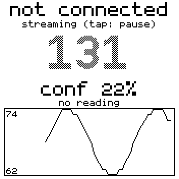
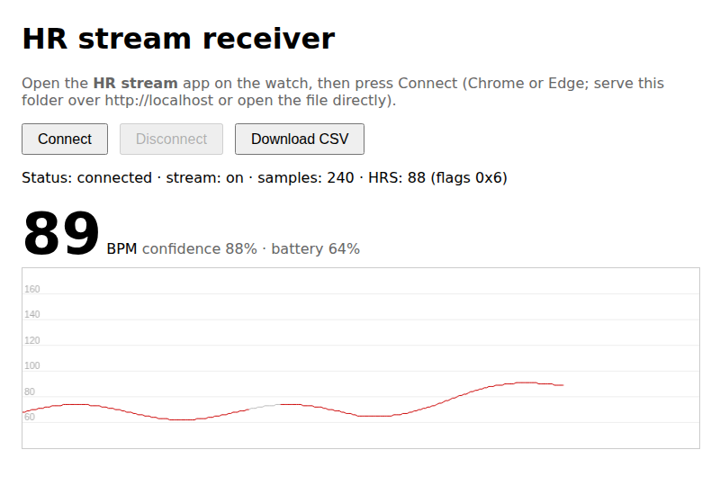

# 05 — Streaming heart rate to your computer

Bangle.js 2 has an optical heart-rate sensor. In this tutorial you read it,
learn what its confidence value means, and stream it live over Bluetooth LE in
two ways at once: as the standard Heart Rate Service that phone fitness apps
already understand, and as simple JSON lines that a small web page turns into
a chart and a CSV file. Along the way you make the encoding testable without a
radio, so the emulator can check every byte.


## What you need

- A Bangle.js 2, or just the [Espruino Web IDE](https://www.espruino.com/ide/) with its Bangle.js 2 emulator.
- Parts that need a real watch: the heart-rate sensor itself (the emulator has none) and Bluetooth to a phone or PC.
  For the receiver page: desktop Chrome or Edge (Web Bluetooth).
- Earlier tutorials this one reuses: none.

The finished app is in [`apps/hrstream`](../apps/hrstream): `hrstream.lib.js` holds the logic,
`hrstream.app.js` the UI and Bluetooth, `receiver.html` the web page.

## 1. Turning on the HRM

The sensor is off until an app asks for it. `Bangle.setHRMPower(on, appId)`
takes an **app id**: the firmware keeps the sensor on while *any* app id still
wants it, so your app only ever switches off its own request and never another
app's (a widget may be using the HRM too).

```js
Bangle.setHRMPower(1, "hrdemo");
Bangle.on("HRM", function (h) {
  print(h.bpm, "bpm, confidence", h.confidence);
});
E.on("kill", function () { Bangle.setHRMPower(0, "hrdemo"); });
```

The `HRM` event arrives about once a second with `{bpm, confidence, raw}`;
`confidence` is 0–100. Note that `kill` is an event on `E`, not `Bangle`: it
runs just before `load()`, `reset()` or a reboot, but not after a hard reset
or a watchdog reset.

In the emulator `setHRMPower` returns `false` and no events arrive. You can
still try the handler by faking an event:

```js
Bangle.emit("HRM", { bpm: 72, confidence: 85 });
```

For the raw optical signal there is also `Bangle.on("HRM-raw", r)` with
`{raw, filt, bpm, confidence}` (checked against the Espruino reference); this
app doesn't stream it.

**You learned:** sensors are switched on per app id and switched off again in a `kill` handler.

## 2. What confidence means

An optical sensor shines green light into your skin and watches the reflection
change with each pulse. Movement, a loose strap, cold hands or tattoos all
make that signal noisy, and the algorithm then still produces a BPM, but with
low confidence. Off the wrist it reports junk.

So the app treats a reading as real only when `confidence >= 50`, and draws
the number grey otherwise. The Bangle.js 2 screen has 3-bit colour, so a grey
`setColor` is drawn as a dithered checkerboard, which reads well as "greyed out":

```js
function show(h) {
  var ok = h.confidence >= 50 && h.bpm > 0;
  g.clear().setFontAlign(0, 0).setFont("Vector", 44);
  if (!ok) g.setColor(0.5, 0.5, 0.5);
  g.drawString(h.bpm, 88, 70);
  g.setColor(g.theme.fg).setFont("6x8", 2).drawString(ok ? "conf " + h.confidence + "%" : "no reading", 88, 110);
}
show({ bpm: 131, confidence: 22 });
```



Wear tips for good readings: strap snug, one finger above the wrist bone, keep
still for 10–20 s after putting it on.

**You learned:** a BPM without its confidence is not a measurement; show the difference.

## 3. The easy way: UART + JSON

Every Bangle advertises the **Nordic UART** service. It is a serial line over
Bluetooth, and it is also where the Espruino console (REPL) lives. Anything you
`Bluetooth.println()` goes to the connected client, mixed with console output.
That is why every data line carries a prefix:

```
HR {"t":1732000000123,"bpm":72,"conf":85,"bat":64}
ST {"t":1732000000123,"evt":"stream","on":true}
```

One JSON object per line, `\n` terminated, always under 100 bytes. The
receiver ignores any line without `HR ` or `ST `.

```js
function formatLine(s) {
  return "HR " + JSON.stringify({ t: Math.round(s.t), bpm: s.bpm, conf: s.conf, bat: s.bat });
}
Bangle.on("HRM", function (h) {
  Bluetooth.println(formatLine({ t: Date.now(), bpm: h.bpm, conf: h.confidence, bat: E.getBattery() }));
});
```

The real `formatLine` in `hrstream.lib.js` also clamps every number (BPM 0–255,
confidence and battery 0–100) so that no input can make the line invalid or too long.

On the PC side, a few lines of Web Bluetooth subscribe to the UART's
"RX" characteristic (the watch → PC direction):

```js
// in a page served from localhost, after a button click:
var NUS = "6e400001-b5a3-f393-e0a9-e50e24dcca9e";
navigator.bluetooth.requestDevice({ filters: [{ namePrefix: "Bangle" }], optionalServices: [NUS] })
  .then(function (d) { return d.gatt.connect(); })
  .then(function (s) { return s.getPrimaryService(NUS); })
  .then(function (svc) { return svc.getCharacteristic("6e400003-b5a3-f393-e0a9-e50e24dcca9e"); })
  .then(function (ch) {
    ch.addEventListener("characteristicvaluechanged", function (e) {
      console.log(new TextDecoder().decode(e.target.value));
    });
    return ch.startNotifications();
  });
```

Notifications arrive in chunks of about 20 bytes, so the page has to glue them
back together into lines (step 6).

**You learned:** the UART is a shared text channel; frame your data with a prefix and one line per message.

## 4. The standard way: Heart Rate Service

Bluetooth SIG defines a Heart Rate Service (`0x180D`) whose Heart Rate
Measurement characteristic (`0x2A37`) any fitness app can read. Its value is a
flags byte followed by the BPM:

| Byte | Meaning |
|---|---|
| 0 | flags: bit 0 = 0 means "BPM is uint8"; bits 1–2 = sensor contact (`0x04` supported but no contact, `0x06` contact detected) |
| 1 | BPM, 0–255 |

```js
function encodeHRS(bpm, contact) {
  var flags = contact === true ? 0x06 : (contact === false ? 0x04 : 0x00);
  bpm = Math.round(bpm);
  return [flags, bpm > 255 ? 255 : (bpm > 0 ? bpm : 0)];
}

NRF.setServices({
  0x180D: {
    0x2A37: { value: [0, 0], maxLen: 2, readable: true, notify: true },
    0x2A38: { value: 2, readable: true } // body sensor location: wrist
  }
}, { advertise: ["180D"], uart: true });

Bangle.on("HRM", function (h) {
  NRF.updateServices({ 0x180D: { 0x2A37: { value: encodeHRS(h.bpm, h.confidence >= 50), notify: true } } });
});
```

Two rules from the Espruino reference matter here:

- Services can only change while **nothing is connected** (the Bluetooth stack
  restarts). If the Web IDE is connected when the app starts, the new service
  appears after you disconnect. So the app calls `setServices` once, at start.
- `uart: true` keeps the console. Without it you lock yourself out of the IDE.

When the confidence is low the app keeps sending the **last confident** BPM
(0 if there was none yet) and clears the "contact detected" bit, so a phone
app's display doesn't jump to junk values. On exit the app calls
`NRF.setServices({}, {uart: true})` in its `kill` handler to remove the
service again.

Phones cache the GATT table of a device. If your phone app doesn't see the
Heart Rate Service, **forget the device** in the phone's Bluetooth settings
and connect again.

**You learned:** a standard GATT service makes your watch work with apps you didn't write.

## 5. Connection handling

When no client is connected there is nobody to write to. The app keeps the
last 60 samples in a small ring buffer and sends them, oldest first and with
their original `t`, once a client connects. It waits 1.5 s after `connect`
because the client still has to subscribe to notifications:

```js
var buffer = [], ready = false;
function onSample(s) {
  if (ready) Bluetooth.println(formatLine(s));
  else { buffer.push(s); if (buffer.length > 60) buffer.shift(); }
}
NRF.on("connect", function () {
  setTimeout(function () {
    ready = true;
    buffer.forEach(function (s) { Bluetooth.println(formatLine(s)); });
    buffer = [];
  }, 1500);
});
NRF.on("disconnect", function () { ready = false; });
```

In the app this logic lives in `HR.create({send: fn})`: `onHRM(h, t, bat)`,
`connect()`, `flush()`, `disconnect()` and `setStreaming(on, t)`. It takes
plain values and a `send` function, so tests can drive it without Bluetooth.
Tapping the screen calls `setStreaming`, which pauses both channels and sends
an `ST` line so the receiver knows why data stopped.


**You learned:** buffer while disconnected, and give the client a moment before you flush.

## 6. A receiver page

[`receiver.html`](../apps/hrstream/receiver.html) connects, subscribes to the
UART and the Heart Rate Service, draws a chart and offers a CSV download with
the columns `watch_ms,host_ms,bpm,conf`. It loads `hrstream.lib.js` with a tiny
`exports` shim, so it parses lines with exactly the code the watch tests use:

```html
<script>var exports = {};</script>
<script src="hrstream.lib.js"></script>
<script>
var HR = exports, partial = "", rows = [];
function onText(text) {               // called with each notification's text
  partial += text;
  var lines = partial.split("\n");
  partial = lines.pop();              // keep the unfinished line for later
  lines.forEach(function (line) {
    var m = HR.parseLine(line);       // null for console output
    if (m && m.type === "HR") rows.push({ t: m.data.t, host: Date.now(), bpm: m.data.bpm, conf: m.data.conf });
  });
}
</script>
```

`parseLine` also copes with a `>` console prompt stuck in front of a line. The
page drops samples whose `t` it has already seen, so a flush after a reconnect
never creates duplicate rows. Serve the folder with `python3 -m http.server`
and open `http://localhost:8000/receiver.html` (Web Bluetooth needs a secure
context; `localhost` counts).



**You learned:** Web Bluetooth notifications come in small chunks; rebuild lines before parsing.

## 7. Testing the encoding without radio

The emulator has no HRM and no Bluetooth: `NRF.updateServices` and
`Bluetooth.println` don't even exist there. That is fine, because the app only
talks to them through two small functions. The tests in
[`apps/hrstream/tests/`](../apps/hrstream/tests) check:

- `encodeHRS` against a table of exact byte arrays (72 → `[0x00, 72]`, 400 → `[0x00, 255]`, contact bits);
- `formatLine` for normal and silly inputs (NaN, negative, huge): always a prefix, valid JSON, under 100 bytes;
- 75 synthetic `HRM` events with no connection fill the buffer to exactly 60, and a simulated
  `NRF.emit("connect")` flushes all 60 in order;
- low-confidence samples are drawn grey (the test reads the screen pixels: dithered digits have no two
  dark pixels side by side) and leave the HRS BPM unchanged;
- a real tap on the emulated touchscreen toggles streaming and sends `ST` lines with the right state;
- `kill` calls `setHRMPower(0, "hrstream")` and `Bangle.isHRMOn()` is false.

```js
eval(require("Storage").read("hrstream.app.js"));
DEBUG = true;
var println;
T.beforeEach(function () {
  T.capture();
  println = T.spy(Bluetooth, "println", function () {});   // missing in the emulator: spy it
  T.spy(E, "getBattery", function () { return 64; });     // the emulator reports 0 %
});

T.test("simulated connect flushes the buffered lines in order", function (done) {
  for (var i = 0; i < 75; i++) S.onHRM({ bpm: 70, confidence: 90 }, 1000 * i, 64);
  T.emit(NRF, "connect", "aa:bb:cc:dd:ee:ff", function () {
    setTimeout(function () {
      T.eq(println.calls.length, 60);
      T.eq(HR.parseLine(println.calls[0][0]).data.t, 15000);
      done();
    }, FLUSH_MS + 100);
  });
});
```

Run them with `npm test -- hrstream`. Virtual time makes the 75-second feed
take milliseconds.

## Test it in the emulator

Upload the app in the Web IDE emulator, then paste into the console:

```js
E.getBattery = function () { return 64; };
for (var i = 0; i < 30; i++) Bangle.emit("HRM", { bpm: 70 + Math.round(5 * Math.sin(i / 3)), confidence: 90 });
Bangle.emit("HRM", { bpm: 120, confidence: 20 });   // greyed out, "no reading"
```

Tap the screen to pause and resume. For automated checks run `npm test -- hrstream`.

## Try it on the watch

[`apps/hrstream/HW-TESTS.md`](../apps/hrstream/HW-TESTS.md) lists what only a
real watch can show: a generic phone heart-rate app seeing the BPM, a 5-minute
receiver session with under 2 % missing rows, accuracy within ±5 BPM against a
chest strap or a manual pulse count, reconnecting without restarting the app,
and whether `kill` really removes the Heart Rate Service. These need a real
watch and have not been confirmed yet: the 1.5 s flush delay being long
enough, how dropped writes behave when a client connects without subscribing to
the UART, and how the dithered grey looks on the real screen.

## Going further

- Stream `HRM-raw` (`raw`, `filt`) at 25–50 Hz in an "advanced mode" and plot the pulse wave; mind the 100-byte line limit and BLE throughput.
- Add the optional RR-interval field of `0x2A37` (flag bit 4) for heart-rate variability apps.
- Send the battery level as the standard Battery Service (`0x180F`/`0x2A19`).
- Write a Python receiver with [`bleak`](https://github.com/hbldh/bleak) that logs the same CSV.
