# 06 — Recording sensor data on your wrist

A watch full of sensors is only half useful if you can't keep what they
measure. In this tutorial you build a small, reusable data logger: it records
the accelerometer, heart rate, pressure, compass and steps to flash in a
compact format, keeps going with the screen locked, survives crashes, and
hands recordings to your PC as CSV over Bluetooth. Tutorials 07 and 08 use the
recordings it makes.

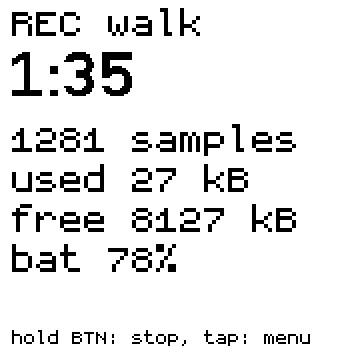

## What you need

- A Bangle.js 2, or just the [Espruino Web IDE](https://www.espruino.com/ide/) with its Bangle.js 2 emulator.
- Parts that need a real watch: real sensor data (the emulator has none), long recordings with the
  screen locked, battery drain, and the export over Bluetooth.
- Earlier tutorials this one reuses: [05 — Streaming heart rate](05-hr-ble-streaming.md) for the
  Nordic UART and line framing.

The finished app is in [`apps/datalog`](../apps/datalog): `datalog.lib.js` holds the logic,
`datalog.app.js` the menus and sensors, `export.html` and `export.py` the PC side.

### How the checkpoints work

Each step ends with **Your app so far**: the code of a single-file app, `logdemo.app.js`, at that
point. It is a simplified version of the finished app that grows step by step; after step 6 you
see what the real app adds, and the files exactly as in `apps/datalog`. Up to step 3 the
checkpoint is the complete file; after that it gets long, so you get a diff against the previous
checkpoint plus the complete file in a fold-out.

To run a checkpoint, paste it into the right-hand editor of the Web IDE and either click
**Send to RAM**, or save it to Storage as `logdemo.app.js` (the upload button's menu) and type
`load("logdemo.app.js")` in the console. The emulator has no sensors, so feed it fake
accelerometer data from the console after you start a recording:

```js
var fake = setInterval(function () { Bangle.emit("accel", { x: 0.01, y: -0.02, z: -0.98 }); }, 80);
```

Every checkpoint was run this way in the emulator, and the screenshots show what it drew or printed.

## 1. Storage basics

Bangle.js 2 has 8 MB of flash, managed by `require("Storage")`. It has two kinds of file:

- **Files** (`Storage.write`, `Storage.read`): written in one go, ideal for code and settings
  (`Storage.writeJSON`/`readJSON`).
- **StorageFiles** (`Storage.open(name, mode)`): made for logs. In append mode (`"a"`) every
  `.write(str)` adds to the end; in read mode (`"r"`) `.readLine()` reads them back line by line.

```js
var ST = require("Storage");
var f = ST.open("log.demo", "a");
f.write("hello\n");
f.write("world\n");
var r = ST.open("log.demo", "r"), l;
while ((l = r.readLine()) !== undefined) print(JSON.stringify(l)); // "hello\n", "world\n"
print(ST.list(/^log\./, { sf: true }), ST.getFree());
ST.open("log.demo", "r").erase();
```

Things worth knowing (checked in the emulator on firmware 2v29):

- `list(re, {sf: true})` lists StorageFiles. StorageFile names up to 27 characters work, 28 fail
  silently; this app keeps them at 20 at most.
- `readLine()` returns the line *with* its `"\n"`; a line without one is the unfinished end of the file.
- `getFree()` is the free flash in bytes.
- Espruino's regular expressions have no `{n}` quantifier, so `/^log\.\d{8}/` silently matches
  nothing. The app checks names with a small function instead.

Flash is slow to write and wears out with every erase, so the logger never writes single samples.
It collects lines in a RAM string and writes about 1 KB at a time: 60 s of 12.5 Hz accelerometer data
(~17 KB) is 17 `write()` calls instead of 750.

```js
var buf = "";
function add(line) {
  buf += line + "\n";
  if (buf.length >= 1024) { f.write(buf); buf = ""; }
}
```

### Your app so far

Tap to start, tap again to stop. Each accelerometer event becomes one `x,y,z` line in `log.demo`,
and the screen shows how few `write()` calls that takes.

```js
// logdemo.app.js, checkpoint 1: accelerometer lines to a StorageFile,
// written through a 1 KB RAM buffer. Tap: start/stop, button: exit.
var ST = require("Storage");
var NAME = "log.demo";
var f, buf = "", lines = 0, writes = 0, logging = false;

function add(line) {
  buf += line + "\n";
  lines++;
  if (buf.length >= 1024) { f.write(buf); writes++; buf = ""; }
}

function onAccel(a) { add(a.x.toFixed(2) + "," + a.y.toFixed(2) + "," + a.z.toFixed(2)); }

function draw() {
  var r = Bangle.appRect, x = r.x + 6;
  g.reset().clearRect(r).setFont("6x8", 2).setFontAlign(-1, -1);
  g.drawString(logging ? "REC " + NAME : "stopped", x, r.y + 4);
  g.drawString(lines + " lines", x, r.y + 30);
  g.drawString(writes + " writes", x, r.y + 50);
  g.drawString("in RAM " + buf.length + " B", x, r.y + 70);
  g.drawString("free " + Math.round(ST.getFree() / 1024) + " kB", x, r.y + 90);
  g.setFont("6x8").drawString("tap: " + (logging ? "stop" : "start") + ", BTN: exit", x, r.y2 - 10);
}

function start() {
  ST.open(NAME, "r").erase(); // a fresh file every time
  f = ST.open(NAME, "a");
  buf = ""; lines = 0; writes = 0; logging = true;
  Bangle.on("accel", onAccel);
  draw();
}

function stop() {
  logging = false;
  Bangle.removeListener("accel", onAccel);
  if (buf.length) { f.write(buf); writes++; buf = ""; }
  draw();
}

Bangle.setUI({ mode: "custom", touch: function () { if (logging) stop(); else start(); }, btn: function () { load(); } });
Bangle.loadWidgets();
Bangle.drawWidgets();
setInterval(draw, 1000);
draw();
```

Until step 4 there is no `kill` handler, so stop with a tap before you press the button, or the
last bytes in RAM are lost.

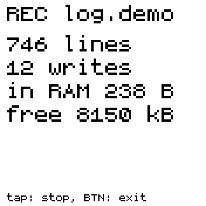 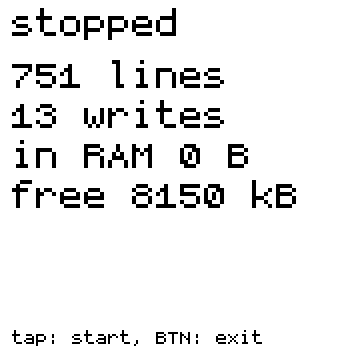

*Left: after 60 s of fake 12.5 Hz data, 750 lines but only 12 writes; the rest waits in RAM. Right: after the stop tap the RAM buffer is written too (13 writes, 0 B in RAM).*

**You learned:** append-mode StorageFiles plus a RAM buffer give you cheap, wear-friendly logging.

## 2. A logging format

The format is chosen for small flash and easy parsing. The first line is a JSON header that says
what follows; every other line is five comma-separated fields:

```
{"v":1,"start":1732000000000,"label":"walk","src":{"a":80,"h":1000,"p":1000}}
120,a,-0.02,0.98,0.11
1003,h,71,88,
1010,p,1009.41,31.2,
```

`<ms since start>,<type>,<v1>,<v2>,<v3>`, with type codes `a` accel (x, y, z in g, 2 decimals),
`h` heart rate (bpm, confidence), `p` pressure (hPa, °C), `m` compass heading (degrees) and
`s` steps since the previous `s` line. Unused fields stay empty, so every line has exactly five.
An accel line is about 22 bytes; the same sample as JSON would be three times that.

```js
var D = require("datalog");
print(D.sampleLine("a", 120.4, { x: -0.0249, y: 0.9812, z: 0.1101 })); // 120,a,-0.02,0.98,0.11
print(D.sampleLine("h", 1003, { bpm: 71, confidence: 88 }));         // 1003,h,71,88,
print(D.header(Date.now(), "walk", { a: 80, h: 1000 }));
```

Files are named `log.<yyyymmdd>-<hhmm>`; a second recording in the same minute gets `-2`.

### Your app so far

The checkpoint writes this format for the accelerometer. It needs no library yet, so `fileName`,
`fmt` and `sampleLine` are small local versions of the library functions above.

```js
// logdemo.app.js, checkpoint 2: a JSON header, then "<ms>,a,x,y,z" lines
// in a log.<yyyymmdd>-<hhmm> file. Tap: start/stop, button: exit.
var ST = require("Storage");
var f, name, t0, buf = "", count = 0, writes = 0, logging = false;

function p2(n) { return (n < 10 ? "0" : "") + n; }
function exists(n) { return ST.list(undefined, { sf: true }).filter(function (x) { return x === n; }).length > 0; }
function fileName(d) {
  var b = "log." + d.getFullYear() + p2(d.getMonth() + 1) + p2(d.getDate()) + "-" + p2(d.getHours()) + p2(d.getMinutes());
  var n = b, i = 2;
  while (exists(n)) n = b + "-" + (i++); // same minute twice: -2, -3, ...
  return n;
}

function fmt(v, d) { return typeof v === "number" && isFinite(v) ? v.toFixed(d) : ""; }
function sampleLine(t, a) { return Math.round(t) + ",a," + fmt(a.x, 2) + "," + fmt(a.y, 2) + "," + fmt(a.z, 2); }

function add(line) {
  buf += line + "\n";
  count++;
  if (buf.length >= 1024) { f.write(buf); writes++; buf = ""; }
}

function onAccel(a) { add(sampleLine(getTime() * 1000 - t0, a)); }

function draw() {
  var r = Bangle.appRect, x = r.x + 6;
  g.reset().clearRect(r).setFont("6x8", 2).setFontAlign(-1, -1);
  g.drawString(logging ? "REC" : "stopped", x, r.y + 4);
  g.setFont("6x8").drawString(name || "", x, r.y + 24);
  g.setFont("6x8", 2).drawString(count + " samples", x, r.y + 40);
  g.drawString(writes + " writes", x, r.y + 60);
  g.drawString("free " + Math.round(ST.getFree() / 1024) + " kB", x, r.y + 80);
  g.setFont("6x8").drawString("tap: " + (logging ? "stop" : "start") + ", BTN: exit", x, r.y2 - 10);
}

function start() {
  name = fileName(new Date());
  f = ST.open(name, "a");
  t0 = getTime() * 1000;
  buf = JSON.stringify({ v: 1, start: Date.now(), label: "", src: { a: 80 } }) + "\n";
  count = 0; writes = 0; logging = true;
  Bangle.on("accel", onAccel);
  draw();
}

function stop() {
  logging = false;
  Bangle.removeListener("accel", onAccel);
  if (buf.length) { f.write(buf); writes++; buf = ""; }
  draw();
}

Bangle.setUI({ mode: "custom", touch: function () { if (logging) stop(); else start(); }, btn: function () { load(); } });
Bangle.loadWidgets();
Bangle.drawWidgets();
setInterval(draw, 1000);
draw();
```

After a recording, read the file back in the console (`name` is the app's variable for the current file):

```js
var f = require("Storage").open(name, "r");
for (var i = 0; i < 4; i++) print(f.readLine().trim());
```

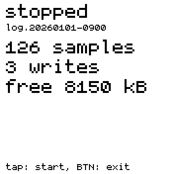 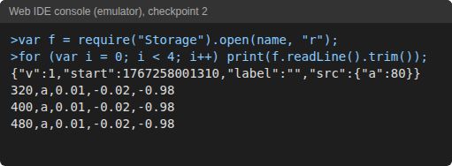

*Left: the recording's file name follows the `log.<yyyymmdd>-<hhmm>` pattern. Right: the file starts with the JSON header, then `<ms>,a,x,y,z` lines 80 ms apart.*

**You learned:** a self-describing header plus fixed-width CSV is compact and trivial to parse anywhere.

## 3. Many sensors, one timeline

Each sensor has its own event: `accel` (`{x,y,z,diff,mag}`), `HRM` (`{bpm,confidence,raw}`),
`pressure` (`{pressure,temperature,altitude}`), `mag` (`{x,y,z,dx,dy,dz,heading}`) and `step`
(the step count since boot, so the app logs differences). All of them go through one function
that takes a plain object, which is also what the tests call:

```js
function onSample(type, o) {
  if (!logger) return;
  logger.sample(type, o, getTime() * 1000);
}
Bangle.on("accel", function (a) { onSample("a", a); });
Bangle.on("HRM", function (h) { onSample("h", h); });
Bangle.setHRMPower(1, "datalog");          // power with the app id, off again on stop
Bangle.setPollInterval(80);                 // accelerometer rate: 80 ms = 12.5 Hz
```

`logger.sample` turns the absolute time into **ms since the start** using `getTime()` differences,
and limits each source to its chosen rate on a fixed grid (a heart-rate event arriving a bit early
still counts, but the average rate is exactly one per second). If the clock is set back during a
recording, time stands still for a moment instead of running backwards, so the time column never
decreases.

About the accelerometer rate: the Espruino reference says `powerSave` (on by default) drops the
poll interval to 800 ms after a minute without movement, and that calling `Bangle.setPollInterval`
switches `powerSave` off. So the app calls `setPollInterval` when it starts and restores
`setPollInterval(80)` plus `setOptions({powerSave: true})` when it stops. Whether the rate really
holds on a still, locked watch is a hardware check (HW-4).

### Your app so far

New: a rate per source in `SRC`, the grid limiter `due`, one `onSample` for all sensors and
`sensors(on)`, which powers HRM and barometer with the app id. The checkpoint covers `a`, `h` and
`p`; compass and steps follow the same pattern in the finished app.

```js
// logdemo.app.js, checkpoint 3: accelerometer, heart rate and pressure on
// one timeline, each at its own rate. Tap: start/stop, button: exit.
var ST = require("Storage");
var APP = "logdemo";
var SRC = { a: 80, h: 1000, p: 1000 }; // ms between samples per source
var f, name, t0, next, counts, buf = "", count = 0, writes = 0, logging = false;

function p2(n) { return (n < 10 ? "0" : "") + n; }
function exists(n) { return ST.list(undefined, { sf: true }).filter(function (x) { return x === n; }).length > 0; }
function fileName(d) {
  var b = "log." + d.getFullYear() + p2(d.getMonth() + 1) + p2(d.getDate()) + "-" + p2(d.getHours()) + p2(d.getMinutes());
  var n = b, i = 2;
  while (exists(n)) n = b + "-" + (i++); // same minute twice: -2, -3, ...
  return n;
}

function fmt(v, d) { return typeof v === "number" && isFinite(v) ? v.toFixed(d) : ""; }
function sampleLine(type, t, o) {
  var v = type === "a" ? [fmt(o.x, 2), fmt(o.y, 2), fmt(o.z, 2)]
    : type === "h" ? [fmt(o.bpm, 0), fmt(o.confidence, 0), ""]
    : [fmt(o.pressure, 2), fmt(o.temperature, 1), ""];
  return Math.round(t) + "," + type + "," + v.join(",");
}

// Rate limit on a fixed grid: an event up to a quarter interval early still counts.
function due(type, t) {
  var iv = SRC[type], n = next[type];
  if (n !== undefined && t < n - iv / 4) return false;
  next[type] = (n === undefined || t >= n + iv) ? t + iv : n + iv;
  return true;
}

function add(type, line) {
  buf += line + "\n";
  count++;
  counts[type]++;
  if (buf.length >= 1024) { f.write(buf); writes++; buf = ""; }
}

function onSample(type, o) {
  var t = getTime() * 1000 - t0;
  if (logging && due(type, t)) add(type, sampleLine(type, t, o));
}
function onAccel(a) { onSample("a", a); }
function onHRM(h) { onSample("h", h); }
function onPressure(p) { onSample("p", p); }

function sensors(on) {
  Bangle[on ? "on" : "removeListener"]("accel", onAccel);
  Bangle[on ? "on" : "removeListener"]("HRM", onHRM);
  Bangle[on ? "on" : "removeListener"]("pressure", onPressure);
  Bangle.setHRMPower(on, APP);
  Bangle.setBarometerPower(on, APP);
  Bangle.setPollInterval(SRC.a); // also switches powerSave off
  if (!on) Bangle.setOptions({ powerSave: true });
}

function draw() {
  var r = Bangle.appRect, x = r.x + 6;
  g.reset().clearRect(r).setFont("6x8", 2).setFontAlign(-1, -1);
  g.drawString(logging ? "REC" : "stopped", x, r.y + 4);
  g.setFont("6x8").drawString(name || "", x, r.y + 24);
  g.setFont("6x8", 2).drawString(count + " samples", x, r.y + 40);
  if (counts) g.drawString("a " + counts.a + " h " + counts.h + " p " + counts.p, x, r.y + 60);
  g.drawString(writes + " writes", x, r.y + 80);
  g.drawString("free " + Math.round(ST.getFree() / 1024) + " kB", x, r.y + 100);
  g.setFont("6x8").drawString("tap: " + (logging ? "stop" : "start") + ", BTN: exit", x, r.y2 - 10);
}

function start() {
  name = fileName(new Date());
  f = ST.open(name, "a");
  t0 = getTime() * 1000;
  buf = JSON.stringify({ v: 1, start: Date.now(), label: "", src: SRC }) + "\n";
  next = {}; counts = { a: 0, h: 0, p: 0 }; count = 0; writes = 0; logging = true;
  sensors(true);
  draw();
}

function stop() {
  logging = false;
  sensors(false);
  if (buf.length) { f.write(buf); writes++; buf = ""; }
  draw();
}

Bangle.setUI({ mode: "custom", touch: function () { if (logging) stop(); else start(); }, btn: function () { load(); } });
Bangle.loadWidgets();
Bangle.drawWidgets();
setInterval(draw, 1000);
draw();
```

For heart rate and pressure, add a second fake feed:

```js
var fake2 = setInterval(function () {
  Bangle.emit("HRM", { bpm: 72, confidence: 90 });
  Bangle.emit("pressure", { pressure: 1009.41, temperature: 31.2, altitude: 30 });
}, 1000);
```

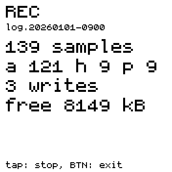 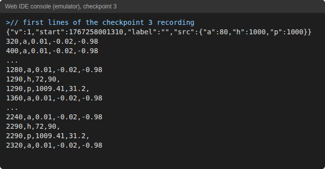

*Left: counts per type after 10 s with both fake feeds: about 12.5 `a` per `h` and `p`. Right: the file has one timeline; `h` and `p` lines appear once a second between the `a` lines, and `t` never decreases.*

**You learned:** one timeline with relative timestamps and type codes keeps several sensors in step.

## 4. Surviving crashes

Three things can end a recording:

- **You stop it** (hold the button 1 s, or tap → Stop): flush, write the index, show the list.
- **The app is closed** (`load()`, a reboot from the IDE, the 1.5 s button hold that loads the
  clock): `E.on("kill", …)` runs first, so the handler flushes the buffer and switches the sensors off.
- **A hard reset** (watchdog, flat battery): nothing runs. The RAM buffer (at most ~1 KB, about 4 s
  of accel data) is lost, and a flash write may stop half-way through a line.

So the reader treats a last line without a newline as unfinished and ignores it:

```js
exports.eachLine = function (st, name, fn) {
  var f = st.open(name, "r"), l, n = 0;
  while ((l = f.readLine()) !== undefined) {
    if (l.charAt(l.length - 1) !== "\n") break; // cut off by a reset
    fn(l.substr(0, l.length - 1));
    n++;
  }
  return n;
};
```

The logger also protects the flash: it notes `getFree()` at the start and stops with
**storage full** once the file would pass 95 % of that, after writing what it has. Below 10 %
battery it stops with **battery low**. If flash writes ever fail, it keeps at most 4 KB in RAM and
counts what it had to drop; then the file ends with a trailer line like `{"dropped":12}`.

### Your app so far

New: `eachLine`, a `flush` that counts bytes, the 95 % limit in `add`, the battery check (at start
and every second) and the `kill` handler. After a stop the app reads the file back with `eachLine`.

The whole file is now too long to repeat, so here is a **diff against checkpoint 3** (lines starting with `+` are new, `-` removed), followed by the complete file to copy.

```diff
--- checkpoint 3
+++ checkpoint 4
@@ -1,9 +1,10 @@
-// logdemo.app.js, checkpoint 3: accelerometer, heart rate and pressure on
-// one timeline, each at its own rate. Tap: start/stop, button: exit.
+// logdemo.app.js, checkpoint 4: survives exit and crashes, stops itself when
+// flash or battery run low. Tap: start/stop, button: exit.
 var ST = require("Storage");
 var APP = "logdemo";
 var SRC = { a: 80, h: 1000, p: 1000 }; // ms between samples per source
-var f, name, t0, next, counts, buf = "", count = 0, writes = 0, logging = false;
+var FULL_RATIO = 0.95, LOW_BATTERY = 10;
+var f, name, t0, next, counts, limit, reason, readBack, buf = "", count = 0, writes = 0, written = 0, logging = false;
 
 function p2(n) { return (n < 10 ? "0" : "") + n; }
 function exists(n) { return ST.list(undefined, { sf: true }).filter(function (x) { return x === n; }).length > 0; }
@@ -22,6 +23,17 @@
   return Math.round(t) + "," + type + "," + v.join(",");
 }
 
+// Calls fn(line) for every complete line; a last line without "\n" was cut off by a reset.
+function eachLine(n, fn) {
+  var r = ST.open(n, "r"), l, k = 0;
+  while ((l = r.readLine()) !== undefined) {
+    if (l.charAt(l.length - 1) !== "\n") break;
+    fn(l.substr(0, l.length - 1));
+    k++;
+  }
+  return k;
+}
+
 // Rate limit on a fixed grid: an event up to a quarter interval early still counts.
 function due(type, t) {
   var iv = SRC[type], n = next[type];
@@ -30,11 +42,18 @@
   return true;
 }
 
+function flush() {
+  if (!buf.length) return;
+  f.write(buf);
+  written += buf.length; writes++; buf = "";
+}
+
 function add(type, line) {
+  if (written + buf.length + line.length + 1 > limit) return stop("storage full");
   buf += line + "\n";
   count++;
   counts[type]++;
-  if (buf.length >= 1024) { f.write(buf); writes++; buf = ""; }
+  if (buf.length >= 1024) flush();
 }
 
 function onSample(type, o) {
@@ -58,34 +77,45 @@
 function draw() {
   var r = Bangle.appRect, x = r.x + 6;
   g.reset().clearRect(r).setFont("6x8", 2).setFontAlign(-1, -1);
-  g.drawString(logging ? "REC" : "stopped", x, r.y + 4);
+  g.drawString(logging ? "REC" : (reason || "stopped"), x, r.y + 4);
   g.setFont("6x8").drawString(name || "", x, r.y + 24);
   g.setFont("6x8", 2).drawString(count + " samples", x, r.y + 40);
   if (counts) g.drawString("a " + counts.a + " h " + counts.h + " p " + counts.p, x, r.y + 60);
   g.drawString(writes + " writes", x, r.y + 80);
-  g.drawString("free " + Math.round(ST.getFree() / 1024) + " kB", x, r.y + 100);
+  g.drawString(logging ? "free " + Math.round(ST.getFree() / 1024) + " kB" : (readBack === undefined ? "" : "read back " + readBack), x, r.y + 100);
   g.setFont("6x8").drawString("tap: " + (logging ? "stop" : "start") + ", BTN: exit", x, r.y2 - 10);
 }
 
 function start() {
+  if (E.getBattery() < LOW_BATTERY) { reason = "battery low"; return draw(); }
   name = fileName(new Date());
   f = ST.open(name, "a");
+  limit = Math.floor(ST.getFree() * FULL_RATIO);
   t0 = getTime() * 1000;
   buf = JSON.stringify({ v: 1, start: Date.now(), label: "", src: SRC }) + "\n";
-  next = {}; counts = { a: 0, h: 0, p: 0 }; count = 0; writes = 0; logging = true;
+  next = {}; counts = { a: 0, h: 0, p: 0 }; count = 0; writes = 0; written = 0;
+  reason = readBack = undefined; logging = true;
   sensors(true);
   draw();
 }
 
-function stop() {
+function stop(why) {
+  if (!logging) return;
   logging = false;
+  reason = why;
   sensors(false);
-  if (buf.length) { f.write(buf); writes++; buf = ""; }
+  flush();
+  if (why === "kill") return;
+  readBack = eachLine(name, function () {}); // header + samples
   draw();
 }
 
-Bangle.setUI({ mode: "custom", touch: function () { if (logging) stop(); else start(); }, btn: function () { load(); } });
+E.on("kill", function () { stop("kill"); }); // runs on load(), reset() and reboot
+Bangle.setUI({ mode: "custom", touch: function () { if (logging) stop("stopped"); else start(); }, btn: function () { load(); } });
 Bangle.loadWidgets();
 Bangle.drawWidgets();
-setInterval(draw, 1000);
+setInterval(function () {
+  if (logging && E.getBattery() < LOW_BATTERY) stop("battery low");
+  draw();
+}, 1000);
 draw();
```

<details>
<summary>Complete <code>logdemo.app.js</code> at checkpoint 4</summary>

```js
// logdemo.app.js, checkpoint 4: survives exit and crashes, stops itself when
// flash or battery run low. Tap: start/stop, button: exit.
var ST = require("Storage");
var APP = "logdemo";
var SRC = { a: 80, h: 1000, p: 1000 }; // ms between samples per source
var FULL_RATIO = 0.95, LOW_BATTERY = 10;
var f, name, t0, next, counts, limit, reason, readBack, buf = "", count = 0, writes = 0, written = 0, logging = false;

function p2(n) { return (n < 10 ? "0" : "") + n; }
function exists(n) { return ST.list(undefined, { sf: true }).filter(function (x) { return x === n; }).length > 0; }
function fileName(d) {
  var b = "log." + d.getFullYear() + p2(d.getMonth() + 1) + p2(d.getDate()) + "-" + p2(d.getHours()) + p2(d.getMinutes());
  var n = b, i = 2;
  while (exists(n)) n = b + "-" + (i++); // same minute twice: -2, -3, ...
  return n;
}

function fmt(v, d) { return typeof v === "number" && isFinite(v) ? v.toFixed(d) : ""; }
function sampleLine(type, t, o) {
  var v = type === "a" ? [fmt(o.x, 2), fmt(o.y, 2), fmt(o.z, 2)]
    : type === "h" ? [fmt(o.bpm, 0), fmt(o.confidence, 0), ""]
    : [fmt(o.pressure, 2), fmt(o.temperature, 1), ""];
  return Math.round(t) + "," + type + "," + v.join(",");
}

// Calls fn(line) for every complete line; a last line without "\n" was cut off by a reset.
function eachLine(n, fn) {
  var r = ST.open(n, "r"), l, k = 0;
  while ((l = r.readLine()) !== undefined) {
    if (l.charAt(l.length - 1) !== "\n") break;
    fn(l.substr(0, l.length - 1));
    k++;
  }
  return k;
}

// Rate limit on a fixed grid: an event up to a quarter interval early still counts.
function due(type, t) {
  var iv = SRC[type], n = next[type];
  if (n !== undefined && t < n - iv / 4) return false;
  next[type] = (n === undefined || t >= n + iv) ? t + iv : n + iv;
  return true;
}

function flush() {
  if (!buf.length) return;
  f.write(buf);
  written += buf.length; writes++; buf = "";
}

function add(type, line) {
  if (written + buf.length + line.length + 1 > limit) return stop("storage full");
  buf += line + "\n";
  count++;
  counts[type]++;
  if (buf.length >= 1024) flush();
}

function onSample(type, o) {
  var t = getTime() * 1000 - t0;
  if (logging && due(type, t)) add(type, sampleLine(type, t, o));
}
function onAccel(a) { onSample("a", a); }
function onHRM(h) { onSample("h", h); }
function onPressure(p) { onSample("p", p); }

function sensors(on) {
  Bangle[on ? "on" : "removeListener"]("accel", onAccel);
  Bangle[on ? "on" : "removeListener"]("HRM", onHRM);
  Bangle[on ? "on" : "removeListener"]("pressure", onPressure);
  Bangle.setHRMPower(on, APP);
  Bangle.setBarometerPower(on, APP);
  Bangle.setPollInterval(SRC.a); // also switches powerSave off
  if (!on) Bangle.setOptions({ powerSave: true });
}

function draw() {
  var r = Bangle.appRect, x = r.x + 6;
  g.reset().clearRect(r).setFont("6x8", 2).setFontAlign(-1, -1);
  g.drawString(logging ? "REC" : (reason || "stopped"), x, r.y + 4);
  g.setFont("6x8").drawString(name || "", x, r.y + 24);
  g.setFont("6x8", 2).drawString(count + " samples", x, r.y + 40);
  if (counts) g.drawString("a " + counts.a + " h " + counts.h + " p " + counts.p, x, r.y + 60);
  g.drawString(writes + " writes", x, r.y + 80);
  g.drawString(logging ? "free " + Math.round(ST.getFree() / 1024) + " kB" : (readBack === undefined ? "" : "read back " + readBack), x, r.y + 100);
  g.setFont("6x8").drawString("tap: " + (logging ? "stop" : "start") + ", BTN: exit", x, r.y2 - 10);
}

function start() {
  if (E.getBattery() < LOW_BATTERY) { reason = "battery low"; return draw(); }
  name = fileName(new Date());
  f = ST.open(name, "a");
  limit = Math.floor(ST.getFree() * FULL_RATIO);
  t0 = getTime() * 1000;
  buf = JSON.stringify({ v: 1, start: Date.now(), label: "", src: SRC }) + "\n";
  next = {}; counts = { a: 0, h: 0, p: 0 }; count = 0; writes = 0; written = 0;
  reason = readBack = undefined; logging = true;
  sensors(true);
  draw();
}

function stop(why) {
  if (!logging) return;
  logging = false;
  reason = why;
  sensors(false);
  flush();
  if (why === "kill") return;
  readBack = eachLine(name, function () {}); // header + samples
  draw();
}

E.on("kill", function () { stop("kill"); }); // runs on load(), reset() and reboot
Bangle.setUI({ mode: "custom", touch: function () { if (logging) stop("stopped"); else start(); }, btn: function () { load(); } });
Bangle.loadWidgets();
Bangle.drawWidgets();
setInterval(function () {
  if (logging && E.getBattery() < LOW_BATTERY) stop("battery low");
  draw();
}, 1000);
draw();
```

</details>

The emulator reports 0 % battery, so the first tap shows **battery low**. Fake a battery and a
nearly full flash, then tap to start and feed accelerometer data:

```js
E.getBattery = function () { return 80; };
ST.getFree = function () { return 3000; };   // only for this test
```

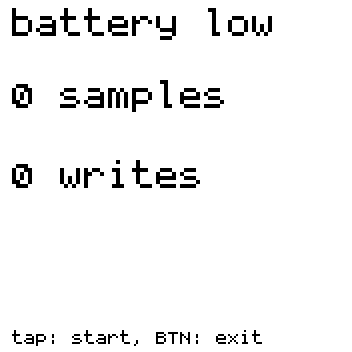 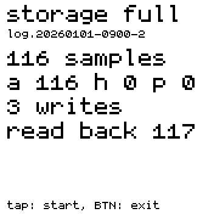

*Left: with the emulator's 0 % battery the recording doesn't start. Right: with 3000 bytes "free" it stops by itself at 95 % (2850 bytes); "read back 117" is the header plus all 116 samples, so nothing was lost.*

To try the crash rules, start a recording, wait a few seconds and run `load("logdemo.app.js")`: the
`kill` handler flushes first, and the file contains every sample counted on screen. Then append
half a line, as a reset during a write would leave it; `eachLine` still counts only the complete
lines:

```js
ST.open(name, "a").write("5120,a,0.0");
print(eachLine(name, function () {}));
```

**You learned:** design the file so that any prefix of it is valid, and flush in a `kill` handler.

## 5. Getting data off the watch

The simplest way: the Web IDE's Storage view lists the StorageFile and downloads it. For anything
regular you want a protocol. It reuses the idea from tutorial 05, a prefix and one JSON object per
line, plus an `END` line so the PC knows when an answer is complete:

```
PC → watch:  LIST
watch → PC:  F {"name":"log.20261123-1015","bytes":48210}   (one per file), then END
PC → watch:  GET log.20261123-1015
watch → PC:  the file's lines verbatim, then END
```

There is a catch: the UART is the Espruino console. Anything the PC sends is run as JavaScript, so
`LIST` would just give `ReferenceError: "LIST" is not defined`. The
[Espruino BLE UART docs](https://www.espruino.com/BLE+UART) suggest moving the console away and
handling the data yourself. That's what **Export (PC)** does:

```js
var prev = E.getConsole();
E.setConsole("LoopbackA", { force: true });     // the REPL no longer sees UART input
var srv = D.createServer({ storage: ST, write: function (s) { Bluetooth.write(s); } });
Bluetooth.on("data", srv.feed);                  // raw chunks; srv splits them into lines
// leaving the screen:
Bluetooth.removeListener("data", srv.feed);
E.setConsole(prev);
```

`createServer` buffers partial lines (BLE delivers 20-byte chunks), ignores control characters
such as the `\x10` some tools put in front of commands, and sends a `GET` answer in batches of 32
lines so the radio buffer can drain. Only complete lines are sent, so an unfinished last line never
glues itself to `END`.

On the PC, [`export.html`](../apps/datalog/export.html) connects with Web Bluetooth, writes the
commands to the UART's TX characteristic and collects the answer until `END`:

```js
function onText(text) {           // every notification from the RX characteristic
  partial += text;
  var lines = partial.split("\n");
  partial = lines.pop();
  lines.forEach(function (l) {
    if (l === "END") finish(collected); else collected.push(l);
  });
}
```

It loads `datalog.lib.js` through a tiny `exports` shim and converts with the same `toCSV` the
watch tests use, expanding the type codes into named columns:

```
t_ms,type,accel_x,accel_y,accel_z,hr_bpm,hr_conf,pressure_hpa,temp_c,heading_deg,steps,label
120,a,-0.02,0.98,0.11,,,,,,,walk
1003,h,,,,71,88,,,,,walk
```

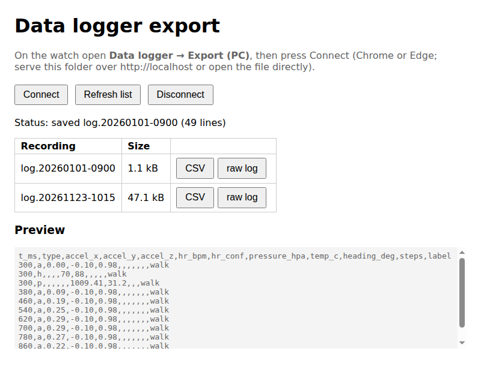

If you prefer Python, [`export.py`](../apps/datalog/export.py) does the same with
[`bleak`](https://github.com/hbldh/bleak): `python3 export.py list`,
`python3 export.py get log.20261123-1015`, and `python3 export.py convert file.txt` for a raw file
you downloaded with the IDE. Its CSV output is byte-for-byte the same as the page's.

### Your app so far

New: a start menu, `logScreen`, and `exportMode`, which moves the console to `LoopbackA`, answers
`LIST` and `GET <name>` with `END` after each, and puts everything back when you leave with the
button. It serves the device the console was on: `Bluetooth` on the watch, `USB` in the emulator.

The whole file is now too long to repeat, so here is a **diff against checkpoint 4** (lines starting with `+` are new, `-` removed), followed by the complete file to copy.

```diff
--- checkpoint 4
+++ checkpoint 5
@@ -1,10 +1,11 @@
-// logdemo.app.js, checkpoint 4: survives exit and crashes, stops itself when
-// flash or battery run low. Tap: start/stop, button: exit.
+// logdemo.app.js, checkpoint 5: a start menu, and an export mode that
+// answers LIST and GET over the UART instead of the console.
 var ST = require("Storage");
 var APP = "logdemo";
 var SRC = { a: 80, h: 1000, p: 1000 }; // ms between samples per source
 var FULL_RATIO = 0.95, LOW_BATTERY = 10;
 var f, name, t0, next, counts, limit, reason, readBack, buf = "", count = 0, writes = 0, written = 0, logging = false;
+var screen, exportOff;
 
 function p2(n) { return (n < 10 ? "0" : "") + n; }
 function exists(n) { return ST.list(undefined, { sf: true }).filter(function (x) { return x === n; }).length > 0; }
@@ -83,11 +84,17 @@
   if (counts) g.drawString("a " + counts.a + " h " + counts.h + " p " + counts.p, x, r.y + 60);
   g.drawString(writes + " writes", x, r.y + 80);
   g.drawString(logging ? "free " + Math.round(ST.getFree() / 1024) + " kB" : (readBack === undefined ? "" : "read back " + readBack), x, r.y + 100);
-  g.setFont("6x8").drawString("tap: " + (logging ? "stop" : "start") + ", BTN: exit", x, r.y2 - 10);
+  g.setFont("6x8").drawString(logging ? "tap: stop" : "tap: menu", x, r.y2 - 10);
+}
+
+function logScreen() {
+  screen = "log";
+  Bangle.setUI({ mode: "custom", touch: function () { if (logging) stop("stopped"); else mainMenu(); } });
+  draw();
 }
 
 function start() {
-  if (E.getBattery() < LOW_BATTERY) { reason = "battery low"; return draw(); }
+  if (E.getBattery() < LOW_BATTERY) { reason = "battery low"; return logScreen(); }
   name = fileName(new Date());
   f = ST.open(name, "a");
   limit = Math.floor(ST.getFree() * FULL_RATIO);
@@ -96,7 +103,7 @@
   next = {}; counts = { a: 0, h: 0, p: 0 }; count = 0; writes = 0; written = 0;
   reason = readBack = undefined; logging = true;
   sensors(true);
-  draw();
+  logScreen();
 }
 
 function stop(why) {
@@ -110,12 +117,54 @@
   draw();
 }
 
-E.on("kill", function () { stop("kill"); }); // runs on load(), reset() and reboot
-Bangle.setUI({ mode: "custom", touch: function () { if (logging) stop("stopped"); else start(); }, btn: function () { load(); } });
+function mainMenu() {
+  screen = "menu";
+  E.showMenu({ "": { title: "Logger", back: function () { load(); } }, "Start": start, "Export (PC)": exportMode });
+}
+
+function clean(c) { // drop control characters such as the \x10 IDE tools send
+  var o = "";
+  for (var i = 0; i < c.length; i++) if (c.charCodeAt(i) >= 32) o += c.charAt(i);
+  return o.trim();
+}
+
+// The console owns the UART input, so move it away and read the commands ourselves.
+function exportMode() {
+  screen = "export";
+  var prev = E.getConsole(), dev = prev === "USB" ? USB : Bluetooth, partial = "";
+  function onData(d) {
+    partial += d;
+    var cmds = partial.split("\n");
+    partial = cmds.pop(); // BLE delivers 20-byte chunks: keep the unfinished command
+    cmds.map(clean).forEach(function (c) {
+      if (c === "LIST") ST.list(/^log\./, { sf: true }).forEach(function (n) {
+        dev.write("F " + JSON.stringify({ name: n, bytes: ST.open(n, "r").getLength() }) + "\n");
+      });
+      else if (c.substr(0, 4) === "GET ") eachLine(c.substr(4), function (l) { dev.write(l + "\n"); });
+      if (c) dev.write("END\n");
+    });
+  }
+  exportOff = function () {
+    exportOff = undefined;
+    dev.removeListener("data", onData);
+    E.setConsole(prev);
+  };
+  dev.on("data", onData);
+  E.setConsole("LoopbackA", { force: true });
+  Bangle.setUI({ mode: "custom", back: mainMenu, remove: function () { if (exportOff) exportOff(); } });
+  var r = Bangle.appRect;
+  g.reset().clearRect(r).setFontAlign(0, -1).setFont("6x8", 2).drawString("Export mode", r.x + r.w / 2, r.y + 10);
+  g.setFont("6x8").drawString("Send LIST or GET <name>\nover the UART.\n\nIDE console is off here.\nBTN: back", r.x + r.w / 2, r.y + 40);
+}
+
+E.on("kill", function () { // runs on load(), reset() and reboot
+  if (exportOff) exportOff();
+  stop("kill");
+});
 Bangle.loadWidgets();
 Bangle.drawWidgets();
 setInterval(function () {
   if (logging && E.getBattery() < LOW_BATTERY) stop("battery low");
-  draw();
+  if (screen === "log") draw();
 }, 1000);
-draw();
+mainMenu();
```

<details>
<summary>Complete <code>logdemo.app.js</code> at checkpoint 5</summary>

```js
// logdemo.app.js, checkpoint 5: a start menu, and an export mode that
// answers LIST and GET over the UART instead of the console.
var ST = require("Storage");
var APP = "logdemo";
var SRC = { a: 80, h: 1000, p: 1000 }; // ms between samples per source
var FULL_RATIO = 0.95, LOW_BATTERY = 10;
var f, name, t0, next, counts, limit, reason, readBack, buf = "", count = 0, writes = 0, written = 0, logging = false;
var screen, exportOff;

function p2(n) { return (n < 10 ? "0" : "") + n; }
function exists(n) { return ST.list(undefined, { sf: true }).filter(function (x) { return x === n; }).length > 0; }
function fileName(d) {
  var b = "log." + d.getFullYear() + p2(d.getMonth() + 1) + p2(d.getDate()) + "-" + p2(d.getHours()) + p2(d.getMinutes());
  var n = b, i = 2;
  while (exists(n)) n = b + "-" + (i++); // same minute twice: -2, -3, ...
  return n;
}

function fmt(v, d) { return typeof v === "number" && isFinite(v) ? v.toFixed(d) : ""; }
function sampleLine(type, t, o) {
  var v = type === "a" ? [fmt(o.x, 2), fmt(o.y, 2), fmt(o.z, 2)]
    : type === "h" ? [fmt(o.bpm, 0), fmt(o.confidence, 0), ""]
    : [fmt(o.pressure, 2), fmt(o.temperature, 1), ""];
  return Math.round(t) + "," + type + "," + v.join(",");
}

// Calls fn(line) for every complete line; a last line without "\n" was cut off by a reset.
function eachLine(n, fn) {
  var r = ST.open(n, "r"), l, k = 0;
  while ((l = r.readLine()) !== undefined) {
    if (l.charAt(l.length - 1) !== "\n") break;
    fn(l.substr(0, l.length - 1));
    k++;
  }
  return k;
}

// Rate limit on a fixed grid: an event up to a quarter interval early still counts.
function due(type, t) {
  var iv = SRC[type], n = next[type];
  if (n !== undefined && t < n - iv / 4) return false;
  next[type] = (n === undefined || t >= n + iv) ? t + iv : n + iv;
  return true;
}

function flush() {
  if (!buf.length) return;
  f.write(buf);
  written += buf.length; writes++; buf = "";
}

function add(type, line) {
  if (written + buf.length + line.length + 1 > limit) return stop("storage full");
  buf += line + "\n";
  count++;
  counts[type]++;
  if (buf.length >= 1024) flush();
}

function onSample(type, o) {
  var t = getTime() * 1000 - t0;
  if (logging && due(type, t)) add(type, sampleLine(type, t, o));
}
function onAccel(a) { onSample("a", a); }
function onHRM(h) { onSample("h", h); }
function onPressure(p) { onSample("p", p); }

function sensors(on) {
  Bangle[on ? "on" : "removeListener"]("accel", onAccel);
  Bangle[on ? "on" : "removeListener"]("HRM", onHRM);
  Bangle[on ? "on" : "removeListener"]("pressure", onPressure);
  Bangle.setHRMPower(on, APP);
  Bangle.setBarometerPower(on, APP);
  Bangle.setPollInterval(SRC.a); // also switches powerSave off
  if (!on) Bangle.setOptions({ powerSave: true });
}

function draw() {
  var r = Bangle.appRect, x = r.x + 6;
  g.reset().clearRect(r).setFont("6x8", 2).setFontAlign(-1, -1);
  g.drawString(logging ? "REC" : (reason || "stopped"), x, r.y + 4);
  g.setFont("6x8").drawString(name || "", x, r.y + 24);
  g.setFont("6x8", 2).drawString(count + " samples", x, r.y + 40);
  if (counts) g.drawString("a " + counts.a + " h " + counts.h + " p " + counts.p, x, r.y + 60);
  g.drawString(writes + " writes", x, r.y + 80);
  g.drawString(logging ? "free " + Math.round(ST.getFree() / 1024) + " kB" : (readBack === undefined ? "" : "read back " + readBack), x, r.y + 100);
  g.setFont("6x8").drawString(logging ? "tap: stop" : "tap: menu", x, r.y2 - 10);
}

function logScreen() {
  screen = "log";
  Bangle.setUI({ mode: "custom", touch: function () { if (logging) stop("stopped"); else mainMenu(); } });
  draw();
}

function start() {
  if (E.getBattery() < LOW_BATTERY) { reason = "battery low"; return logScreen(); }
  name = fileName(new Date());
  f = ST.open(name, "a");
  limit = Math.floor(ST.getFree() * FULL_RATIO);
  t0 = getTime() * 1000;
  buf = JSON.stringify({ v: 1, start: Date.now(), label: "", src: SRC }) + "\n";
  next = {}; counts = { a: 0, h: 0, p: 0 }; count = 0; writes = 0; written = 0;
  reason = readBack = undefined; logging = true;
  sensors(true);
  logScreen();
}

function stop(why) {
  if (!logging) return;
  logging = false;
  reason = why;
  sensors(false);
  flush();
  if (why === "kill") return;
  readBack = eachLine(name, function () {}); // header + samples
  draw();
}

function mainMenu() {
  screen = "menu";
  E.showMenu({ "": { title: "Logger", back: function () { load(); } }, "Start": start, "Export (PC)": exportMode });
}

function clean(c) { // drop control characters such as the \x10 IDE tools send
  var o = "";
  for (var i = 0; i < c.length; i++) if (c.charCodeAt(i) >= 32) o += c.charAt(i);
  return o.trim();
}

// The console owns the UART input, so move it away and read the commands ourselves.
function exportMode() {
  screen = "export";
  var prev = E.getConsole(), dev = prev === "USB" ? USB : Bluetooth, partial = "";
  function onData(d) {
    partial += d;
    var cmds = partial.split("\n");
    partial = cmds.pop(); // BLE delivers 20-byte chunks: keep the unfinished command
    cmds.map(clean).forEach(function (c) {
      if (c === "LIST") ST.list(/^log\./, { sf: true }).forEach(function (n) {
        dev.write("F " + JSON.stringify({ name: n, bytes: ST.open(n, "r").getLength() }) + "\n");
      });
      else if (c.substr(0, 4) === "GET ") eachLine(c.substr(4), function (l) { dev.write(l + "\n"); });
      if (c) dev.write("END\n");
    });
  }
  exportOff = function () {
    exportOff = undefined;
    dev.removeListener("data", onData);
    E.setConsole(prev);
  };
  dev.on("data", onData);
  E.setConsole("LoopbackA", { force: true });
  Bangle.setUI({ mode: "custom", back: mainMenu, remove: function () { if (exportOff) exportOff(); } });
  var r = Bangle.appRect;
  g.reset().clearRect(r).setFontAlign(0, -1).setFont("6x8", 2).drawString("Export mode", r.x + r.w / 2, r.y + 10);
  g.setFont("6x8").drawString("Send LIST or GET <name>\nover the UART.\n\nIDE console is off here.\nBTN: back", r.x + r.w / 2, r.y + 40);
}

E.on("kill", function () { // runs on load(), reset() and reboot
  if (exportOff) exportOff();
  stop("kill");
});
Bangle.loadWidgets();
Bangle.drawWidgets();
setInterval(function () {
  if (logging && E.getBattery() < LOW_BATTERY) stop("battery low");
  if (screen === "log") draw();
}, 1000);
mainMenu();
```

</details>

In the emulator, choose **Export (PC)** and type the commands straight into the console; the app
answers instead of the REPL:

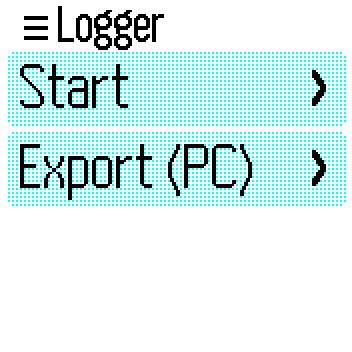 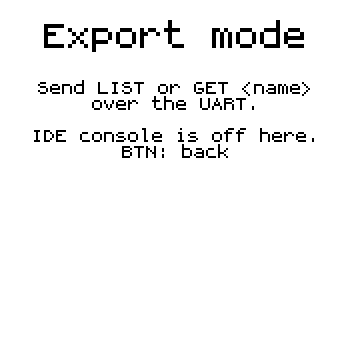

*Left: the new start menu. Right: in export mode the console is off; the button brings it back.*

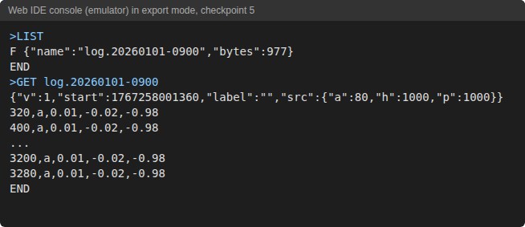

*Typed in the emulator's console while in export mode (sent in 7-byte pieces, like BLE chunks): `LIST` answers one `F` line per recording, `GET` the file's lines verbatim, and each answer ends with `END`.*

**You learned:** to run your own protocol over the UART, take it away from the console, and frame every answer.

## 6. Labelled recordings for machine learning

Tutorials 07 and 08 learn from recordings, and a learner needs to know what you were doing. Pick a
**Label** before you press Start; it goes into the header and into the `label` column of the CSV.
The list comes from **Settings → Apps → Data logger** (stored in `datalog.json` as
`{"labels":[...]}`, so you can add your own in the IDE).

Tips for a useful dataset:

- One activity per recording; start and stop a few seconds outside it, and trim later using `t_ms`.
- Record each label several times, on different days, and keep some recordings aside for testing.
- 12.5 Hz accelerometer data is enough for walking/sitting; gestures (08) benefit from 25 Hz.
- On the watch, `D.eachLine` and `D.parseSample` read recordings back without the PC.

The recordings list shows size, duration and sample count; tap one to delete it (with a Yes/No prompt).

### Your app so far

New: a `Label` item in the menu that goes into the header, and a **Recordings** list where a tap
asks before it deletes. Labels are a fixed list here; the finished app reads them from settings.

The whole file is now too long to repeat, so here is a **diff against checkpoint 5** (lines starting with `+` are new, `-` removed), followed by the complete file to copy.

```diff
--- checkpoint 5
+++ checkpoint 6
@@ -1,11 +1,12 @@
-// logdemo.app.js, checkpoint 5: a start menu, and an export mode that
-// answers LIST and GET over the UART instead of the console.
+// logdemo.app.js, checkpoint 6: a label for every recording, and a list
+// of recordings that can be deleted.
 var ST = require("Storage");
 var APP = "logdemo";
 var SRC = { a: 80, h: 1000, p: 1000 }; // ms between samples per source
 var FULL_RATIO = 0.95, LOW_BATTERY = 10;
 var f, name, t0, next, counts, limit, reason, readBack, buf = "", count = 0, writes = 0, written = 0, logging = false;
 var screen, exportOff;
+var LABELS = ["", "walk", "run", "sit", "stand", "other"], label = "";
 
 function p2(n) { return (n < 10 ? "0" : "") + n; }
 function exists(n) { return ST.list(undefined, { sf: true }).filter(function (x) { return x === n; }).length > 0; }
@@ -78,7 +79,7 @@
 function draw() {
   var r = Bangle.appRect, x = r.x + 6;
   g.reset().clearRect(r).setFont("6x8", 2).setFontAlign(-1, -1);
-  g.drawString(logging ? "REC" : (reason || "stopped"), x, r.y + 4);
+  g.drawString(logging ? "REC " + (label || "no label") : (reason || "stopped"), x, r.y + 4);
   g.setFont("6x8").drawString(name || "", x, r.y + 24);
   g.setFont("6x8", 2).drawString(count + " samples", x, r.y + 40);
   if (counts) g.drawString("a " + counts.a + " h " + counts.h + " p " + counts.p, x, r.y + 60);
@@ -99,7 +100,7 @@
   f = ST.open(name, "a");
   limit = Math.floor(ST.getFree() * FULL_RATIO);
   t0 = getTime() * 1000;
-  buf = JSON.stringify({ v: 1, start: Date.now(), label: "", src: SRC }) + "\n";
+  buf = JSON.stringify({ v: 1, start: Date.now(), label: label, src: SRC }) + "\n";
   next = {}; counts = { a: 0, h: 0, p: 0 }; count = 0; writes = 0; written = 0;
   reason = readBack = undefined; logging = true;
   sensors(true);
@@ -119,7 +120,34 @@
 
 function mainMenu() {
   screen = "menu";
-  E.showMenu({ "": { title: "Logger", back: function () { load(); } }, "Start": start, "Export (PC)": exportMode });
+  E.showMenu({
+    "": { title: "Logger", back: function () { load(); } },
+    "Label": {
+      value: LABELS.indexOf(label), min: 0, max: LABELS.length - 1,
+      format: function (v) { return LABELS[v] || "none"; },
+      onchange: function (v) { label = LABELS[v]; }
+    },
+    "Start": start,
+    "Recordings": recMenu,
+    "Export (PC)": exportMode
+  });
+}
+
+function recMenu() {
+  screen = "recs";
+  var m = { "": { title: "Recordings", back: mainMenu } };
+  ST.list(/^log\./, { sf: true }).forEach(function (n) {
+    m[n.substr(4) + " " + Math.round(ST.open(n, "r").getLength() / 1024) + "k"] = function () { confirmDelete(n); };
+  });
+  E.showMenu(m);
+}
+
+function confirmDelete(n) {
+  screen = "confirm";
+  E.showPrompt("Delete " + n.substr(4) + "?", { title: "Delete", buttons: { "Yes": true, "No": false } }).then(function (yes) {
+    if (yes) ST.open(n, "r").erase();
+    recMenu();
+  });
 }
 
 function clean(c) { // drop control characters such as the \x10 IDE tools send
```

<details>
<summary>Complete <code>logdemo.app.js</code> at checkpoint 6</summary>

```js
// logdemo.app.js, checkpoint 6: a label for every recording, and a list
// of recordings that can be deleted.
var ST = require("Storage");
var APP = "logdemo";
var SRC = { a: 80, h: 1000, p: 1000 }; // ms between samples per source
var FULL_RATIO = 0.95, LOW_BATTERY = 10;
var f, name, t0, next, counts, limit, reason, readBack, buf = "", count = 0, writes = 0, written = 0, logging = false;
var screen, exportOff;
var LABELS = ["", "walk", "run", "sit", "stand", "other"], label = "";

function p2(n) { return (n < 10 ? "0" : "") + n; }
function exists(n) { return ST.list(undefined, { sf: true }).filter(function (x) { return x === n; }).length > 0; }
function fileName(d) {
  var b = "log." + d.getFullYear() + p2(d.getMonth() + 1) + p2(d.getDate()) + "-" + p2(d.getHours()) + p2(d.getMinutes());
  var n = b, i = 2;
  while (exists(n)) n = b + "-" + (i++); // same minute twice: -2, -3, ...
  return n;
}

function fmt(v, d) { return typeof v === "number" && isFinite(v) ? v.toFixed(d) : ""; }
function sampleLine(type, t, o) {
  var v = type === "a" ? [fmt(o.x, 2), fmt(o.y, 2), fmt(o.z, 2)]
    : type === "h" ? [fmt(o.bpm, 0), fmt(o.confidence, 0), ""]
    : [fmt(o.pressure, 2), fmt(o.temperature, 1), ""];
  return Math.round(t) + "," + type + "," + v.join(",");
}

// Calls fn(line) for every complete line; a last line without "\n" was cut off by a reset.
function eachLine(n, fn) {
  var r = ST.open(n, "r"), l, k = 0;
  while ((l = r.readLine()) !== undefined) {
    if (l.charAt(l.length - 1) !== "\n") break;
    fn(l.substr(0, l.length - 1));
    k++;
  }
  return k;
}

// Rate limit on a fixed grid: an event up to a quarter interval early still counts.
function due(type, t) {
  var iv = SRC[type], n = next[type];
  if (n !== undefined && t < n - iv / 4) return false;
  next[type] = (n === undefined || t >= n + iv) ? t + iv : n + iv;
  return true;
}

function flush() {
  if (!buf.length) return;
  f.write(buf);
  written += buf.length; writes++; buf = "";
}

function add(type, line) {
  if (written + buf.length + line.length + 1 > limit) return stop("storage full");
  buf += line + "\n";
  count++;
  counts[type]++;
  if (buf.length >= 1024) flush();
}

function onSample(type, o) {
  var t = getTime() * 1000 - t0;
  if (logging && due(type, t)) add(type, sampleLine(type, t, o));
}
function onAccel(a) { onSample("a", a); }
function onHRM(h) { onSample("h", h); }
function onPressure(p) { onSample("p", p); }

function sensors(on) {
  Bangle[on ? "on" : "removeListener"]("accel", onAccel);
  Bangle[on ? "on" : "removeListener"]("HRM", onHRM);
  Bangle[on ? "on" : "removeListener"]("pressure", onPressure);
  Bangle.setHRMPower(on, APP);
  Bangle.setBarometerPower(on, APP);
  Bangle.setPollInterval(SRC.a); // also switches powerSave off
  if (!on) Bangle.setOptions({ powerSave: true });
}

function draw() {
  var r = Bangle.appRect, x = r.x + 6;
  g.reset().clearRect(r).setFont("6x8", 2).setFontAlign(-1, -1);
  g.drawString(logging ? "REC " + (label || "no label") : (reason || "stopped"), x, r.y + 4);
  g.setFont("6x8").drawString(name || "", x, r.y + 24);
  g.setFont("6x8", 2).drawString(count + " samples", x, r.y + 40);
  if (counts) g.drawString("a " + counts.a + " h " + counts.h + " p " + counts.p, x, r.y + 60);
  g.drawString(writes + " writes", x, r.y + 80);
  g.drawString(logging ? "free " + Math.round(ST.getFree() / 1024) + " kB" : (readBack === undefined ? "" : "read back " + readBack), x, r.y + 100);
  g.setFont("6x8").drawString(logging ? "tap: stop" : "tap: menu", x, r.y2 - 10);
}

function logScreen() {
  screen = "log";
  Bangle.setUI({ mode: "custom", touch: function () { if (logging) stop("stopped"); else mainMenu(); } });
  draw();
}

function start() {
  if (E.getBattery() < LOW_BATTERY) { reason = "battery low"; return logScreen(); }
  name = fileName(new Date());
  f = ST.open(name, "a");
  limit = Math.floor(ST.getFree() * FULL_RATIO);
  t0 = getTime() * 1000;
  buf = JSON.stringify({ v: 1, start: Date.now(), label: label, src: SRC }) + "\n";
  next = {}; counts = { a: 0, h: 0, p: 0 }; count = 0; writes = 0; written = 0;
  reason = readBack = undefined; logging = true;
  sensors(true);
  logScreen();
}

function stop(why) {
  if (!logging) return;
  logging = false;
  reason = why;
  sensors(false);
  flush();
  if (why === "kill") return;
  readBack = eachLine(name, function () {}); // header + samples
  draw();
}

function mainMenu() {
  screen = "menu";
  E.showMenu({
    "": { title: "Logger", back: function () { load(); } },
    "Label": {
      value: LABELS.indexOf(label), min: 0, max: LABELS.length - 1,
      format: function (v) { return LABELS[v] || "none"; },
      onchange: function (v) { label = LABELS[v]; }
    },
    "Start": start,
    "Recordings": recMenu,
    "Export (PC)": exportMode
  });
}

function recMenu() {
  screen = "recs";
  var m = { "": { title: "Recordings", back: mainMenu } };
  ST.list(/^log\./, { sf: true }).forEach(function (n) {
    m[n.substr(4) + " " + Math.round(ST.open(n, "r").getLength() / 1024) + "k"] = function () { confirmDelete(n); };
  });
  E.showMenu(m);
}

function confirmDelete(n) {
  screen = "confirm";
  E.showPrompt("Delete " + n.substr(4) + "?", { title: "Delete", buttons: { "Yes": true, "No": false } }).then(function (yes) {
    if (yes) ST.open(n, "r").erase();
    recMenu();
  });
}

function clean(c) { // drop control characters such as the \x10 IDE tools send
  var o = "";
  for (var i = 0; i < c.length; i++) if (c.charCodeAt(i) >= 32) o += c.charAt(i);
  return o.trim();
}

// The console owns the UART input, so move it away and read the commands ourselves.
function exportMode() {
  screen = "export";
  var prev = E.getConsole(), dev = prev === "USB" ? USB : Bluetooth, partial = "";
  function onData(d) {
    partial += d;
    var cmds = partial.split("\n");
    partial = cmds.pop(); // BLE delivers 20-byte chunks: keep the unfinished command
    cmds.map(clean).forEach(function (c) {
      if (c === "LIST") ST.list(/^log\./, { sf: true }).forEach(function (n) {
        dev.write("F " + JSON.stringify({ name: n, bytes: ST.open(n, "r").getLength() }) + "\n");
      });
      else if (c.substr(0, 4) === "GET ") eachLine(c.substr(4), function (l) { dev.write(l + "\n"); });
      if (c) dev.write("END\n");
    });
  }
  exportOff = function () {
    exportOff = undefined;
    dev.removeListener("data", onData);
    E.setConsole(prev);
  };
  dev.on("data", onData);
  E.setConsole("LoopbackA", { force: true });
  Bangle.setUI({ mode: "custom", back: mainMenu, remove: function () { if (exportOff) exportOff(); } });
  var r = Bangle.appRect;
  g.reset().clearRect(r).setFontAlign(0, -1).setFont("6x8", 2).drawString("Export mode", r.x + r.w / 2, r.y + 10);
  g.setFont("6x8").drawString("Send LIST or GET <name>\nover the UART.\n\nIDE console is off here.\nBTN: back", r.x + r.w / 2, r.y + 40);
}

E.on("kill", function () { // runs on load(), reset() and reboot
  if (exportOff) exportOff();
  stop("kill");
});
Bangle.loadWidgets();
Bangle.drawWidgets();
setInterval(function () {
  if (logging && E.getBattery() < LOW_BATTERY) stop("battery low");
  if (screen === "log") draw();
}, 1000);
mainMenu();
```

</details>

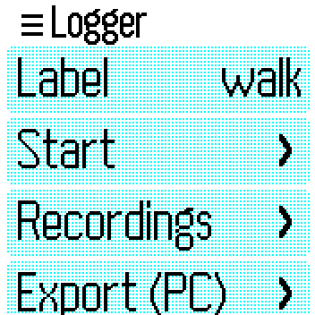 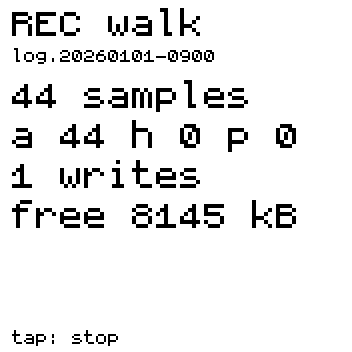

*Left: Label set to "walk" before Start. Right: the recording screen shows the label; the header line of the file has `"label":"walk"`.*

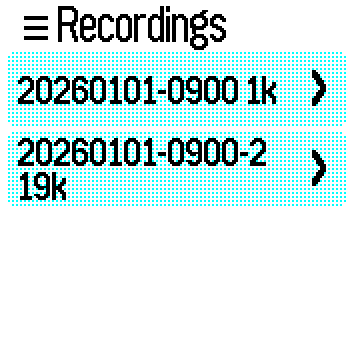 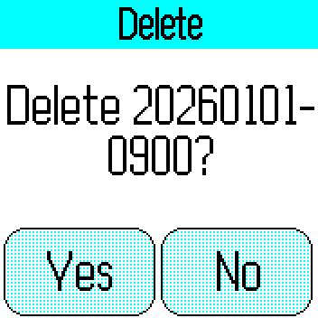

*Left: two recordings with their size; a second one in the same minute got `-2`. Right: tapping one asks first; No keeps the file, Yes erases it and returns to the list.*

**You learned:** a label in the header turns a log into training data.

### From checkpoint 6 to the finished app

| Checkpoint 6 | Finished app |
|---|---|
| everything in `logdemo.app.js` | the logic is in `datalog.lib.js`, stored as the module `datalog` (`createLogger`, `eachLine`, `toCSV`, `createServer`), so the tests drive it directly |
| accel, HR and pressure at fixed rates | a rate menu per source, plus compass (`m`) and steps (`s`); the last choice is remembered in `datalog.json` |
| a fixed label list | labels from **Settings → Apps → Data logger** (`datalog.settings.js`) |
| time from `getTime()` differences | time that never runs backwards when the clock is set back, and no `-0.00` values |
| a failed write throws | at most 4 KB in RAM if writes fail, and a `{"dropped":n}` trailer |
| tap stops | hold the button 1 s to stop; a tap opens Stop/Continue; alerts for storage full and battery low |
| a list with sizes | an index (`datalog.idx.json`) with duration and sample count, a detail screen per recording |
| export on one device, whole file at once | export on Bluetooth and USB, `GET` in batches of 32 lines, `ERR` lines, plus [`export.html`](../apps/datalog/export.html) and [`export.py`](../apps/datalog/export.py) for CSV |

Upload `datalog.lib.js` to Storage as `datalog`, plus `datalog.app.js` and `datalog.settings.js`
under their own names (or install the app from the repository's app loader), then
`load("datalog.app.js")`. The three files, exactly as in `apps/datalog`:

<details>
<summary><code>datalog.lib.js</code></summary>

```js
// Data logger logic: file names, the log format, a chunked append-only
// writer, a crash-tolerant reader, CSV conversion and the UART export
// protocol. Storage and time are injected, so tests drive it directly.
exports.VERSION = 1;
exports.CHUNK = 1024;      // bytes per flash write
exports.MAX_BUF = 4096;    // RAM buffer cap if writes keep failing
exports.FULL_RATIO = 0.95; // stop at 95 % of the free space seen at start
exports.LOW_BATTERY = 10;

exports.ALL_LABELS = ["walk", "run", "sit", "stand", "stairs", "cycle", "sleep", "desk", "gesture-A", "gesture-B", "gesture-C", "gesture-D", "other"];
exports.DEFAULT_LABELS = ["walk", "run", "sit", "stand", "stairs", "gesture-A", "gesture-B", "gesture-C"];
// Per source: [interval ms (0 = off), menu text]
exports.RATES = {
  a: [[0, "off"], [80, "12.5Hz"], [40, "25Hz"], [160, "6.25Hz"]],
  h: [[0, "off"], [1000, "1s"], [5000, "5s"]],
  p: [[0, "off"], [1000, "1s"], [10000, "10s"]],
  m: [[0, "off"], [200, "5Hz"], [1000, "1s"]],
  s: [[0, "off"], [10000, "10s"], [60000, "1min"]]
};

function p2(n) { return (n < 10 ? "0" : "") + n; }
exports.baseName = function (d) {
  return "log." + d.getFullYear() + p2(d.getMonth() + 1) + p2(d.getDate()) + "-" + p2(d.getHours()) + p2(d.getMinutes());
};
// exists(name) -> bool. Same minute twice gives -2, -3, ...
exports.fileName = function (d, exists) {
  var b = exports.baseName(d), n = b, i = 2;
  while (exists(n)) n = b + "-" + (i++);
  return n;
};

// log.<8 digits>-<4 digits>[-n]. (Espruino regexes have no {n} quantifier.)
exports.isLogName = function (n) {
  if (n.length < 17 || n.substr(0, 4) !== "log." || n.charAt(12) !== "-") return false;
  var d = n.substr(4, 8) + n.substr(13, 4);
  for (var i = 0; i < d.length; i++) if (d.charAt(i) < "0" || d.charAt(i) > "9") return false;
  return n.length === 17 || n.charAt(17) === "-";
};
exports.list = function (st) {
  return st.list(/^log\./, { sf: true }).filter(exports.isLogName).sort();
};
exports.has = function (arr, x) {
  for (var i = 0; i < arr.length; i++) if (arr[i] === x) return true;
  return false;
};

exports.fmt = function (v, d) {
  if (typeof v !== "number" || !isFinite(v)) return "";
  var s = v.toFixed(d);
  return (+s === 0) ? (0).toFixed(d) : s; // no "-0.00"
};
exports.line = function (t, type, a, b, c) {
  return Math.round(t) + "," + type + "," + (a === undefined ? "" : a) + "," + (b === undefined ? "" : b) + "," + (c === undefined ? "" : c);
};
// Plain-object sample -> CSV line. o is the sensor event (or {n} for steps).
exports.sampleLine = function (type, t, o) {
  var f = exports.fmt;
  if (type === "a") return exports.line(t, "a", f(o.x, 2), f(o.y, 2), f(o.z, 2));
  if (type === "h") return exports.line(t, "h", f(o.bpm, 0), f(o.confidence, 0));
  if (type === "p") return exports.line(t, "p", f(o.pressure, 2), f(o.temperature, 1));
  if (type === "m") return exports.line(t, "m", f(o.heading, 1));
  if (type === "s") return exports.line(t, "s", f(o.n, 0));
};
exports.header = function (start, label, src) {
  return JSON.stringify({ v: exports.VERSION, start: start, label: label || "", src: src });
};

// opts: {storage, name, start (epoch ms), label, src {a:80,...}, now() -> ms
// from getTime(), chunk, maxBuf, ratio}
exports.createLogger = function (opts) {
  var st = opts.storage, src = opts.src || {};
  var chunk = opts.chunk || exports.CHUNK, maxBuf = opts.maxBuf || exports.MAX_BUF;
  var ratio = opts.ratio || exports.FULL_RATIO;
  var f, buf = "", limit = 0, t0 = 0, prev = 0, offset = 0, last = {};
  var L = { name: opts.name, state: "idle", reason: null, count: 0, counts: {}, written: 0, writes: 0, dropped: 0, errors: 0, lastT: 0, free0: 0 };

  L.start = function () {
    L.free0 = st.getFree();
    limit = Math.floor(L.free0 * ratio);
    f = st.open(L.name, "a");
    t0 = prev = opts.now();
    buf = exports.header(opts.start, opts.label, src) + "\n";
    L.state = "logging";
    return L;
  };
  // Monotonic ms since start: if the clock is set back, time stands still
  // instead of going backwards.
  L.elapsed = function (raw) {
    if (raw === undefined) raw = opts.now();
    if (raw < prev) offset += prev - raw;
    prev = raw;
    return raw + offset - t0;
  };
  // Rate limit per source on a fixed grid, so the average rate is exact;
  // slack (default 25 % of the interval) absorbs poll jitter.
  L.due = function (type, t, slack) {
    var iv = src[type], next = last[type];
    if (!iv || L.state !== "logging") return false;
    if (slack === undefined) slack = iv / 4;
    if (next !== undefined && t < next - slack) return false;
    last[type] = (next === undefined || t >= next + iv) ? t + iv : next + iv;
    return true;
  };
  L.flush = function () {
    if (!buf.length || !f) return true;
    try {
      f.write(buf);
      L.written += buf.length;
      L.writes++;
      buf = "";
      return true;
    } catch (e) { L.errors++; return false; }
  };
  L.add = function (type, line, t) {
    if (L.state !== "logging") return false;
    var s = line + "\n";
    if (L.written + buf.length + s.length > limit) { L.stop("full"); return false; }
    if (buf.length + s.length > maxBuf) { L.dropped++; return false; }
    buf += s;
    L.count++;
    L.counts[type] = (L.counts[type] || 0) + 1;
    if (t !== undefined) L.lastT = t;
    if (buf.length >= chunk) L.flush();
    return true;
  };
  L.sample = function (type, o, raw) {
    var t = L.elapsed(raw);
    if (!L.due(type, t)) return false;
    return L.add(type, exports.sampleLine(type, t, o), t);
  };
  L.pending = function () { return buf.length; };
  L.stop = function (reason) {
    if (L.state !== "logging") return L;
    L.state = "stopped";
    L.reason = reason || "user";
    L.flush();
    if (L.dropped) { buf = JSON.stringify({ dropped: L.dropped }) + "\n"; L.flush(); }
    return L;
  };
  return L;
};

// Calls fn(line) for every complete line (without "\n"). A last line with
// no newline was cut off by a reset during a write and is skipped.
exports.eachLine = function (st, name, fn) {
  var f = st.open(name, "r"), l, n = 0;
  while ((l = f.readLine()) !== undefined) {
    if (l.charAt(l.length - 1) !== "\n") break;
    if (fn(l.substr(0, l.length - 1)) === false) break;
    n++;
  }
  return n;
};
exports.parseSample = function (line) {
  var p = line.split(",");
  if (p.length !== 5 || line.charAt(0) === "{") return null;
  return { t: +p[0], type: p[1], v: [p[2], p[3], p[4]] };
};
exports.info = function (st, name) {
  var o = { name: name, bytes: st.open(name, "r").getLength(), header: null, ms: 0, n: 0 };
  exports.eachLine(st, name, function (l) {
    if (l.charAt(0) === "{") { if (!o.header) o.header = JSON.parse(l); return; }
    var s = exports.parseSample(l);
    if (s) { o.n++; o.ms = s.t; }
  });
  return o;
};

exports.CSV_HEADER = "t_ms,type,accel_x,accel_y,accel_z,hr_bpm,hr_conf,pressure_hpa,temp_c,heading_deg,steps,label";
var COLS = { a: [2, 3, 4], h: [5, 6], p: [7, 8], m: [9], s: [10] };
// One log line -> CSV row, or null for the header/trailer/unknown lines.
exports.toCSV = function (line, label) {
  var s = exports.parseSample(line);
  if (!s || !COLS[s.type]) return null;
  var row = [s.t, s.type, "", "", "", "", "", "", "", "", "", label || ""], c = COLS[s.type];
  for (var i = 0; i < c.length; i++) row[c[i]] = s.v[i];
  return row.join(",");
};

// UART export. opts: {storage, write(str), defer(fn)}. feed() takes raw
// input chunks; commands are LIST and GET <name>, answers end with END.
// Drops control characters: \r, Ctrl-C, \x10 (echo off) from IDE-style clients.
function clean(c) {
  var o = "";
  for (var i = 0; i < c.length; i++) if (c.charCodeAt(i) >= 32) o += c.charAt(i);
  return o.trim();
}
exports.createServer = function (opts) {
  var st = opts.storage, write = opts.write;
  var defer = opts.defer || function (fn) { fn(); };
  var partial = "", queue = [], busy = false;
  var S = { batch: opts.batch || 32 };
  function done() { write("END\n"); busy = false; next(); }
  function get(name) {
    if (!exports.has(exports.list(st), name)) { write('ERR {"msg":"no such file"}\n'); return done(); }
    var f = st.open(name, "r");
    (function step() {
      for (var i = 0; i < S.batch; i++) {
        var l = f.readLine();
        if (l === undefined || l.charAt(l.length - 1) !== "\n") return done();
        write(l);
      }
      defer(step);
    })();
  }
  function run(c) {
    busy = true;
    if (c === "LIST") {
      exports.list(st).forEach(function (n) {
        write("F " + JSON.stringify({ name: n, bytes: st.open(n, "r").getLength() }) + "\n");
      });
      return done();
    }
    if (c.substr(0, 4) === "GET ") return get(c.substr(4).trim());
    write('ERR {"msg":"unknown command"}\n');
    done();
  }
  function next() { if (!busy && queue.length) run(queue.shift()); }
  S.feed = function (data) {
    partial += data;
    var lines = partial.split("\n");
    partial = lines.pop();
    if (partial.length > 200) partial = "";
    lines.forEach(function (c) {
      c = clean(c);
      if (c.length) queue.push(c);
    });
    next();
  };
  S.busy = function () { return busy; };
  return S;
};
```

</details>

<details>
<summary><code>datalog.app.js</code></summary>

```js
// Data logger: records chosen sensors to a StorageFile (header + compact
// CSV), shows progress while logging, lists/deletes recordings and serves
// them to a PC over the UART (LIST / GET).
var DEBUG = false;
var APP = "datalog";
var D = require("datalog");
var ST = require("Storage");
var SETTINGS = "datalog.json", INDEX = "datalog.idx.json";
var LONG_MS = 1000; // button hold that stops a recording
var SRC = ["a", "h", "p", "m", "s"];
var NAMES = { a: "Accel", h: "Heart rate", p: "Pressure", m: "Compass", s: "Steps" };
var settings = ST.readJSON(SETTINGS, 1) || {};
var cfg = settings.cfg || { a: 80, h: 0, p: 0, m: 0, s: 0, label: "" };
var logger, tick, btnWatch, holdTimer, screen, steps = { up: undefined, n: 0 }, exportState;

function log(o) { if (DEBUG) console.log(JSON.stringify(o)); }
function labels() { return settings.labels || D.DEFAULT_LABELS; }
function index() { return ST.readJSON(INDEX, 1) || {}; }
function kb(n) { return n < 1000 ? n + " B" : (n / 1024).toFixed(n < 10240 ? 1 : 0) + " kB"; }
function hms(ms) {
  var s = Math.floor(ms / 1000), h = Math.floor(s / 3600), m = Math.floor(s / 60) % 60;
  return (h ? h + ":" + ("0" + m).substr(-2) : m) + ":" + ("0" + s % 60).substr(-2);
}

// ---- sensor input: every handler forwards a plain object here ----
function onSample(type, o) {
  if (!logger) return;
  logger.sample(type, o, getTime() * 1000);
  if (logger.state !== "logging") stopLog(logger.reason);
}
function onAccel(a) { onSample("a", a); }
function onHRM(h) { onSample("h", h); }
function onPressure(p) { onSample("p", p); }
function onMag(m) { onSample("m", m); }
function onStep(up) {
  if (steps.up !== undefined) steps.n += up - steps.up;
  steps.up = up;
}

function sensors(on) {
  var src = logger.src;
  if (src.a) {
    if (on) { Bangle.setPollInterval(src.a < 80 ? src.a : 80); Bangle.on("accel", onAccel); }
    else { Bangle.removeListener("accel", onAccel); Bangle.setPollInterval(80); Bangle.setOptions({ powerSave: true }); }
  }
  if (src.h) { if (on) Bangle.on("HRM", onHRM); else Bangle.removeListener("HRM", onHRM); Bangle.setHRMPower(on, APP); }
  if (src.p) { if (on) Bangle.on("pressure", onPressure); else Bangle.removeListener("pressure", onPressure); Bangle.setBarometerPower(on, APP); }
  if (src.m) { if (on) Bangle.on("mag", onMag); else Bangle.removeListener("mag", onMag); Bangle.setCompassPower(on, APP); }
  if (src.s) { steps = { up: undefined, n: 0 }; if (on) Bangle.on("step", onStep); else Bangle.removeListener("step", onStep); }
}

function exists(n) { return D.has(ST.list(undefined, { sf: true }), n); }

function startLog() {
  var src = {}, any = false;
  SRC.forEach(function (k) { if (cfg[k]) { src[k] = cfg[k]; any = true; } });
  if (!any) return E.showAlert("Choose at least one source").then(mainMenu);
  if (E.getBattery() < D.LOW_BATTERY) return E.showAlert("Battery low").then(mainMenu);
  settings.cfg = cfg;
  ST.writeJSON(SETTINGS, settings);
  var name = D.fileName(new Date(), exists);
  logger = D.createLogger({ storage: ST, name: name, start: Date.now(), label: cfg.label, src: src, now: function () { return getTime() * 1000; } });
  logger.src = src;
  logger.start();
  sensors(true);
  tick = setInterval(onTick, 1000);
  log({ evt: "start", name: name, src: src, label: cfg.label, free: logger.free0 });
  logScreen();
}

function onTick() {
  if (!logger) return;
  var t = logger.elapsed(getTime() * 1000);
  if (logger.due("s", t, 500)) { logger.add("s", D.sampleLine("s", t, { n: steps.n }), t); steps.n = 0; }
  if (E.getBattery() < D.LOW_BATTERY) return stopLog("battery");
  if (logger.state !== "logging") return stopLog(logger.reason);
  if (screen === "log" && !Bangle.isLocked()) drawLog();
}

// reason: user | full | battery | kill
function stopLog(reason) {
  if (!logger) return;
  var L = logger;
  logger = undefined;
  if (tick) clearInterval(tick);
  tick = undefined;
  if (holdTimer) clearTimeout(holdTimer);
  holdTimer = undefined;
  if (L.src.s && steps.n && L.state === "logging") { var t = L.elapsed(getTime() * 1000); L.add("s", D.sampleLine("s", t, { n: steps.n }), t); }
  logger = L; sensors(false); logger = undefined;
  L.stop(reason);
  var idx = index();
  idx[L.name] = { ms: Math.round(L.lastT), n: L.count };
  ST.writeJSON(INDEX, idx);
  log({ evt: "stop", reason: L.reason, name: L.name, n: L.count, counts: L.counts, bytes: L.written, writes: L.writes, dropped: L.dropped });
  if (reason === "kill") return;
  if (L.reason === "full") E.showAlert("storage full", "Logging stopped").then(recMenu);
  else if (L.reason === "battery") E.showAlert("battery low", "Logging stopped").then(recMenu);
  else recMenu();
}

// ---- screens ----
function drawLog() {
  var r = Bangle.appRect, x = r.x + 6, y = r.y + 4, L = logger;
  if (!L) return;
  var free = ST.getFree();
  g.reset().clearRect(r).setFont("6x8", 2).setFontAlign(-1, -1);
  g.drawString("REC " + (cfg.label || "no label"), x, y);
  g.setFont("Vector", 30).drawString(hms(L.elapsed(getTime() * 1000)), x, y + 20);
  g.setFont("6x8", 2);
  g.drawString(L.count + " samples", x, y + 58);
  g.drawString("used " + kb(L.written + L.pending()), x, y + 78);
  g.drawString("free " + kb(free), x, y + 98);
  g.drawString("bat " + E.getBattery() + "%", x, y + 118);
  g.setFont("6x8").drawString("hold BTN: stop, tap: menu", x, r.y2 - 10);
  log({ evt: "draw", screen: "log", n: L.count, used: L.written + L.pending(), free: free });
}

function logScreen() {
  screen = "log";
  Bangle.setUI({
    mode: "custom",
    touch: function () { if (logger) stopMenu(); },
    remove: function () { if (btnWatch) clearWatch(btnWatch); btnWatch = undefined; }
  });
  btnWatch = setWatch(function (e) {
    log({ evt: "btn", state: e.state });
    if (holdTimer) clearTimeout(holdTimer);
    holdTimer = undefined;
    if (e.state) holdTimer = setTimeout(function () { holdTimer = undefined; stopLog("user"); }, LONG_MS);
  }, BTN1, { repeat: true, edge: "both", debounce: 25 });
  g.clear();
  Bangle.drawWidgets();
  drawLog();
}

function stopMenu() {
  screen = "menu";
  E.showMenu({
    "": { title: "Recording", back: logScreen },
    "Stop": function () { stopLog("user"); },
    "Continue": logScreen
  });
}

function choice(k) {
  var opts = D.RATES[k], i = 0;
  for (var j = 0; j < opts.length; j++) if (opts[j][0] === cfg[k]) i = j;
  return {
    value: i, min: 0, max: opts.length - 1,
    format: function (v) { return opts[v][1]; },
    onchange: function (v) { cfg[k] = opts[v][0]; }
  };
}

function mainMenu() {
  screen = "main";
  var ls = [""].concat(labels()), li = 0;
  for (var j = 0; j < ls.length; j++) if (ls[j] === cfg.label) li = j;
  var m = { "": { title: "Data logger", back: function () { load(); } } };
  SRC.forEach(function (k) { m[NAMES[k]] = choice(k); });
  m.Label = {
    value: li, min: 0, max: ls.length - 1,
    format: function (v) { return ls[v] || "none"; },
    onchange: function (v) { cfg.label = ls[v]; }
  };
  m.Start = startLog;
  m.Recordings = recMenu;
  m["Export (PC)"] = exportScreen;
  E.showMenu(m);
}

function recMenu() {
  screen = "recs";
  var names = D.list(ST).reverse(), idx = index();
  if (!names.length) return E.showMenu({ "": { title: "Recordings", back: mainMenu }, "(none)": mainMenu });
  E.showScroller({
    h: 40, c: names.length,
    draw: function (i, r) {
      var n = names[i], e = idx[n], bytes = ST.open(n, "r").getLength();
      g.setFont("6x8", 2).setFontAlign(-1, -1).drawString(n.substr(4), r.x + 4, r.y + 3);
      g.setFont("6x8").drawString(kb(bytes) + "  " + (e ? hms(e.ms) : "?:??") + (e ? "  " + e.n + " samples" : ""), r.x + 4, r.y + 25);
      g.drawLine(r.x, r.y + r.h - 1, r.x + r.w - 1, r.y + r.h - 1);
    },
    select: function (i) { recDetail(names[i]); },
    back: mainMenu
  });
  log({ evt: "recs", names: names });
}

function recDetail(n) {
  screen = "detail";
  var e = index()[n];
  if (!e) { var inf = D.info(ST, n); e = { ms: inf.ms, n: inf.n }; }
  var m = { "": { title: n.substr(4), back: recMenu } };
  m[kb(ST.open(n, "r").getLength())] = function () {};
  m[hms(e.ms) + ", " + e.n + " samples"] = function () {};
  m.Delete = function () { confirmDelete(n); };
  E.showMenu(m);
}

function confirmDelete(n) {
  screen = "confirm";
  E.showPrompt("Delete " + n.substr(4) + "?", { title: "Delete", buttons: { "Yes": true, "No": false } }).then(function (yes) {
    if (yes) {
      ST.open(n, "r").erase();
      var idx = index();
      delete idx[n];
      ST.writeJSON(INDEX, idx);
    }
    log({ evt: yes ? "delete" : "keep", name: n });
    recMenu();
  });
}

// The console normally owns the UART input, so export mode moves it to
// LoopbackA and handles the raw lines itself; leaving export restores it.
function exportScreen() {
  screen = "export";
  var st = { prev: E.getConsole(), devs: [] };
  [typeof Bluetooth === "undefined" ? undefined : Bluetooth, typeof USB === "undefined" ? undefined : USB].forEach(function (dev) {
    if (!dev || typeof dev.on !== "function" || typeof dev.write !== "function") return;
    var srv = D.createServer({
      storage: ST,
      write: function (s) { dev.write(s); },
      defer: function (fn) { setTimeout(fn, 20); }
    });
    var h = function (d) { log({ evt: "cmd", data: d }); srv.feed(d); };
    dev.on("data", h);
    st.devs.push({ dev: dev, h: h, srv: srv });
  });
  exportState = st;
  E.setConsole("LoopbackA", { force: true });
  log({ evt: "export", on: true, prev: st.prev });
  Bangle.setUI({ mode: "custom", back: function () { exportStop(); mainMenu(); }, remove: exportStop });
  var r = Bangle.appRect;
  g.reset().clearRect(r).setFontAlign(0, -1).setFont("6x8", 2);
  g.drawString("Export mode", r.x + r.w / 2, r.y + 10);
  g.setFont("6x8").drawString("Connect from the PC page\nand choose a recording.\n\n" + D.list(ST).length + " recording(s)\n\nIDE console is off here.\nBTN: back", r.x + r.w / 2, r.y + 40);
}

function exportStop() {
  var st = exportState;
  if (!st) return;
  exportState = undefined;
  st.devs.forEach(function (d) { d.dev.removeListener("data", d.h); });
  E.setConsole(st.prev);
  log({ evt: "export", on: false });
}

E.on("kill", function () {
  exportStop();
  stopLog("kill");
  log({ evt: "kill" });
});

Bangle.loadWidgets();
Bangle.drawWidgets();
mainMenu();
```

</details>

<details>
<summary><code>datalog.settings.js</code></summary>

```js
// Settings > Apps > Data logger: choose which labels the app offers.
(function (back) {
  var ST = require("Storage"), D = require("datalog");
  var s = ST.readJSON("datalog.json", 1) || {};
  var on = (s.labels || D.DEFAULT_LABELS).slice();
  var all = D.ALL_LABELS.slice();
  on.forEach(function (l) { if (!D.has(all, l)) all.push(l); }); // keep labels added by hand
  var m = { "": { title: "Logger labels", back: back } };
  all.forEach(function (l) {
    m[l] = {
      value: D.has(on, l),
      onchange: function (v) {
        on = all.filter(function (x) { return x === l ? v : D.has(on, x); });
        s.labels = on;
        ST.writeJSON("datalog.json", s);
      }
    };
  });
  E.showMenu(m);
})
```

</details>

The finished app in the emulator:

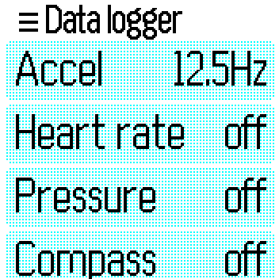  

*The main menu with a rate per source; the recordings list with size, duration and sample count; the delete prompt.*

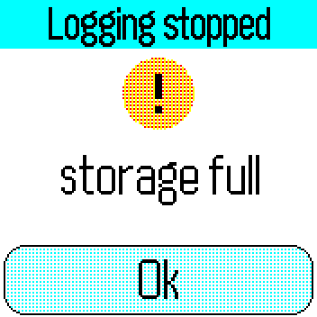 

*Left: the "storage full" alert after a recording stopped itself. Right: export mode, waiting for the PC page.*

## Test it in the emulator

The emulator has no sensors, so the tests emit the sensor events themselves, with virtual time
making a 60 s recording take milliseconds. They live in [`apps/datalog/tests/`](../apps/datalog/tests):

| File | What it checks |
|---|---|
| `logic.test.js` | names and `-2` suffixes, the exact line format, 1 KB chunks, rate grid, clock set back, 95 % limit, failed writes and the `dropped` trailer, partial last line, CSV columns, LIST/GET |
| `record.test.js` | 60 s of 12.5 Hz accel → header parses, 750 ± 2 `a` lines, `write()` calls ≤ size ÷ 512; long press stops, short press doesn't |
| `crash.test.js` | `kill` mid-recording keeps every sample; a cut-off line from a reset is ignored |
| `full.test.js` | `getFree()` mocked to 3000 bytes → "storage full", file readable; battery below 10 % stops |
| `export.test.js` | LIST and GET arriving in pieces on the console device answer the documented lines and `END` |
| `delete.test.js` | real taps: Delete → No keeps the file, Delete → Yes removes it |
| `misc.test.js` | all five sources on one timeline, sensor power with the app id on and off, settings labels |

```js
eval(require("Storage").read("datalog.app.js"));
T.test("60 s of 12.5 Hz accel gives 750 +/- 2 'a' lines", function (done) {
  T.spy(E, "getBattery", function () { return 80; });   // the emulator reports 0 %
  cfg = { a: 80, h: 0, p: 0, m: 0, s: 0, label: "walk" };
  startLog();
  var name = logger.name, n = 0;
  var iv = setInterval(function () {
    Bangle.emit("accel", { x: 0, y: -0.02, z: 0.98 });
    if (++n >= 750) clearInterval(iv);
  }, 80);
  setTimeout(function () {
    stopLog("user");
    var a = 0;
    D.eachLine(ST, name, function (l) { var s = D.parseSample(l); if (s && s.type === "a") a++; });
    T.ok(Math.abs(a - 750) <= 2, "a lines: " + a);
    done();
  }, 60100);
}, { timeout: 120000 });
```

Run them with `npm test -- datalog`. In the Web IDE emulator you can try export mode by hand: open
**Export (PC)** and type `LIST` into the console; the app answers instead of the REPL (press the
button to get the console back).

## Try it on the watch

[`apps/datalog/HW-TESTS.md`](../apps/datalog/HW-TESTS.md) covers what needs a real watch: a
30-minute recording at 12.5 Hz accel + 1 Hz HR with the screen locked, the CSV opening in a
spreadsheet, the real accelerometer rate while the watch is still, a watchdog reset mid-recording,
export with the page and with Python, and the long press while locked.

### Battery

Battery drain of the 30-minute recording (HW-1/HW-3), to be filled in from real-watch runs:

| Date | Firmware | Sources | Battery start → end | Drain per 30 min |
|---|---|---|---|---|
| — | — | Accel 12.5 Hz + HR 1 s | not measured yet | not measured yet |

## Going further

- Compress chunks with `require("heatshrink")` before writing, and decompress on the PC.
- Add a GPS source (`Bangle.setGPSPower(1, "datalog")`, `GPS` events) with its own type code.
- Start and stop recordings from the PC with two more commands (`START <label>`, `STOP`).
- Stream samples live with tutorial 05's `HR`-style lines while recording.
