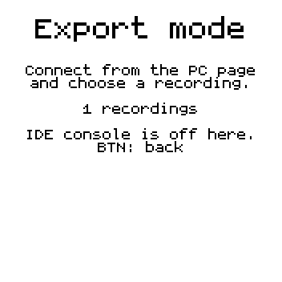
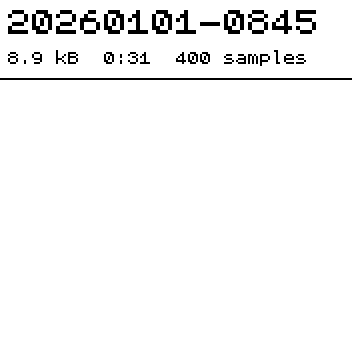
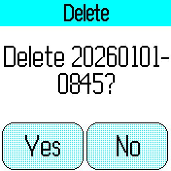

# 06 — Recording sensor data on your wrist

A watch full of sensors is only half useful if you can't keep what they
measure. In this tutorial you build a small, reusable data logger: it records
the accelerometer, heart rate, pressure, compass and steps to flash in a
compact format, keeps going with the screen locked, survives crashes, and
hands recordings to your PC as CSV over Bluetooth. Tutorials 07 and 08 use the
recordings it makes.


## What you need

- A Bangle.js 2, or just the [Espruino Web IDE](https://www.espruino.com/ide/) with its Bangle.js 2 emulator.
- Parts that need a real watch: real sensor data (the emulator has none), long recordings with the
  screen locked, battery drain, and the export over Bluetooth.
- Earlier tutorials this one reuses: [05 — Streaming heart rate](05-hr-ble-streaming.md) for the
  Nordic UART and line framing.

The finished app is in [`apps/datalog`](../apps/datalog): `datalog.lib.js` holds the logic,
`datalog.app.js` the menus and sensors, `export.html` and `export.py` the PC side.

## 1. Storage basics

Bangle.js 2 has 8 MB of flash, managed by `require("Storage")`. It has two kinds of file:

- **Files** (`Storage.write`, `Storage.read`): written in one go, ideal for code and settings
  (`Storage.writeJSON`/`readJSON`).
- **StorageFiles** (`Storage.open(name, mode)`): made for logs. In append mode (`"a"`) every
  `.write(str)` adds to the end; in read mode (`"r"`) `.readLine()` reads them back line by line.

```js
var ST = require("Storage");
var f = ST.open("log.demo", "a");
f.write("hello\n");
f.write("world\n");
var r = ST.open("log.demo", "r"), l;
while ((l = r.readLine()) !== undefined) print(JSON.stringify(l)); // "hello\n", "world\n"
print(ST.list(/^log\./, { sf: true }), ST.getFree());
ST.open("log.demo", "r").erase();
```

Things worth knowing (checked in the emulator on firmware 2v29):

- `list(re, {sf: true})` lists StorageFiles. StorageFile names up to 27 characters work, 28 fail
  silently; this app keeps them at 20 at most.
- `readLine()` returns the line *with* its `"\n"`; a line without one is the unfinished end of the file.
- `getFree()` is the free flash in bytes.
- Espruino's regular expressions have no `{n}` quantifier, so `/^log\.\d{8}/` silently matches
  nothing. The app checks names with a small function instead.

Flash is slow to write and wears out with every erase, so the logger never writes single samples.
It collects lines in a RAM string and writes about 1 KB at a time: 60 s of 12.5 Hz accelerometer data
(~17 KB) is 17 `write()` calls instead of 750.

```js
var buf = "";
function add(line) {
  buf += line + "\n";
  if (buf.length >= 1024) { f.write(buf); buf = ""; }
}
```

**You learned:** append-mode StorageFiles plus a RAM buffer give you cheap, wear-friendly logging.

## 2. A logging format

The format is chosen for small flash and easy parsing. The first line is a JSON header that says
what follows; every other line is five comma-separated fields:

```
{"v":1,"start":1732000000000,"label":"walk","src":{"a":80,"h":1000,"p":1000}}
120,a,-0.02,0.98,0.11
1003,h,71,88,
1010,p,1009.41,31.2,
```

`<ms since start>,<type>,<v1>,<v2>,<v3>`, with type codes `a` accel (x, y, z in g, 2 decimals),
`h` heart rate (bpm, confidence), `p` pressure (hPa, °C), `m` compass heading (degrees) and
`s` steps since the previous `s` line. Unused fields stay empty, so every line has exactly five.
An accel line is about 22 bytes; the same sample as JSON would be three times that.

```js
var D = require("datalog");
print(D.sampleLine("a", 120.4, { x: -0.0249, y: 0.9812, z: 0.1101 })); // 120,a,-0.02,0.98,0.11
print(D.sampleLine("h", 1003, { bpm: 71, confidence: 88 }));         // 1003,h,71,88,
print(D.header(Date.now(), "walk", { a: 80, h: 1000 }));
```

Files are named `log.<yyyymmdd>-<hhmm>`; a second recording in the same minute gets `-2`.

**You learned:** a self-describing header plus fixed-width CSV is compact and trivial to parse anywhere.

## 3. Many sensors, one timeline

Each sensor has its own event: `accel` (`{x,y,z,diff,mag}`), `HRM` (`{bpm,confidence,raw}`),
`pressure` (`{pressure,temperature,altitude}`), `mag` (`{x,y,z,dx,dy,dz,heading}`) and `step`
(the step count since boot, so the app logs differences). All of them go through one function
that takes a plain object, which is also what the tests call:

```js
function onSample(type, o) {
  if (!logger) return;
  logger.sample(type, o, getTime() * 1000);
}
Bangle.on("accel", function (a) { onSample("a", a); });
Bangle.on("HRM", function (h) { onSample("h", h); });
Bangle.setHRMPower(1, "datalog");          // power with the app id, off again on stop
Bangle.setPollInterval(80);                 // accelerometer rate: 80 ms = 12.5 Hz
```

`logger.sample` turns the absolute time into **ms since the start** using `getTime()` differences,
and limits each source to its chosen rate on a fixed grid (a heart-rate event arriving a bit early
still counts, but the average rate is exactly one per second). If the clock is set back during a
recording, time stands still for a moment instead of running backwards, so the time column never
decreases.

About the accelerometer rate: the Espruino reference says `powerSave` (on by default) drops the
poll interval to 800 ms after a minute without movement, and that calling `Bangle.setPollInterval`
switches `powerSave` off. So the app calls `setPollInterval` when it starts and restores
`setPollInterval(80)` plus `setOptions({powerSave: true})` when it stops. Whether the rate really
holds on a still, locked watch is a hardware check (HW-4).

**You learned:** one timeline with relative timestamps and type codes keeps several sensors in step.

## 4. Surviving crashes

Three things can end a recording:

- **You stop it** (hold the button 1 s, or tap → Stop): flush, write the index, show the list.
- **The app is closed** (`load()`, a reboot from the IDE, the 1.5 s button hold that loads the
  clock): `E.on("kill", …)` runs first, so the handler flushes the buffer and switches the sensors off.
- **A hard reset** (watchdog, flat battery): nothing runs. The RAM buffer (at most ~1 KB, about 4 s
  of accel data) is lost, and a flash write may stop half-way through a line.

So the reader treats a last line without a newline as unfinished and ignores it:

```js
exports.eachLine = function (st, name, fn) {
  var f = st.open(name, "r"), l, n = 0;
  while ((l = f.readLine()) !== undefined) {
    if (l.charAt(l.length - 1) !== "\n") break; // cut off by a reset
    fn(l.substr(0, l.length - 1));
    n++;
  }
  return n;
};
```

The logger also protects the flash: it notes `getFree()` at the start and stops with
**storage full** once the file would pass 95 % of that, after writing what it has. Below 10 %
battery it stops with **battery low**. If flash writes ever fail, it keeps at most 4 KB in RAM and
counts what it had to drop; then the file ends with a trailer line like `{"dropped":12}`.


**You learned:** design the file so that any prefix of it is valid, and flush in a `kill` handler.

## 5. Getting data off the watch

The simplest way: the Web IDE's Storage view lists the StorageFile and downloads it. For anything
regular you want a protocol. It reuses the idea from tutorial 05, a prefix and one JSON object per
line, plus an `END` line so the PC knows when an answer is complete:

```
PC → watch:  LIST
watch → PC:  F {"name":"log.20261123-1015","bytes":48210}   (one per file), then END
PC → watch:  GET log.20261123-1015
watch → PC:  the file's lines verbatim, then END
```

There is a catch: the UART is the Espruino console. Anything the PC sends is run as JavaScript, so
`LIST` would just give `ReferenceError: "LIST" is not defined`. The
[Espruino BLE UART docs](https://www.espruino.com/BLE+UART) suggest moving the console away and
handling the data yourself. That's what **Export (PC)** does:

```js
var prev = E.getConsole();
E.setConsole("LoopbackA", { force: true });     // the REPL no longer sees UART input
var srv = D.createServer({ storage: ST, write: function (s) { Bluetooth.write(s); } });
Bluetooth.on("data", srv.feed);                  // raw chunks; srv splits them into lines
// leaving the screen:
Bluetooth.removeListener("data", srv.feed);
E.setConsole(prev);
```

`createServer` buffers partial lines (BLE delivers 20-byte chunks), ignores control characters
such as the `\x10` some tools put in front of commands, and sends a `GET` answer in batches of 32
lines so the radio buffer can drain. Only complete lines are sent, so an unfinished last line never
glues itself to `END`.



On the PC, [`export.html`](../apps/datalog/export.html) connects with Web Bluetooth, writes the
commands to the UART's TX characteristic and collects the answer until `END`:

```js
function onText(text) {           // every notification from the RX characteristic
  partial += text;
  var lines = partial.split("\n");
  partial = lines.pop();
  lines.forEach(function (l) {
    if (l === "END") finish(collected); else collected.push(l);
  });
}
```

It loads `datalog.lib.js` through a tiny `exports` shim and converts with the same `toCSV` the
watch tests use, expanding the type codes into named columns:

```
t_ms,type,accel_x,accel_y,accel_z,hr_bpm,hr_conf,pressure_hpa,temp_c,heading_deg,steps,label
120,a,-0.02,0.98,0.11,,,,,,,walk
1003,h,,,,71,88,,,,,walk
```


If you prefer Python, [`export.py`](../apps/datalog/export.py) does the same with
[`bleak`](https://github.com/hbldh/bleak): `python3 export.py list`,
`python3 export.py get log.20261123-1015`, and `python3 export.py convert file.txt` for a raw file
you downloaded with the IDE. Its CSV output is byte-for-byte the same as the page's.

**You learned:** to run your own protocol over the UART, take it away from the console, and frame every answer.

## 6. Labelled recordings for machine learning

Tutorials 07 and 08 learn from recordings, and a learner needs to know what you were doing. Pick a
**Label** before you press Start; it goes into the header and into the `label` column of the CSV.
The list comes from **Settings → Apps → Data logger** (stored in `datalog.json` as
`{"labels":[...]}`, so you can add your own in the IDE).


Tips for a useful dataset:

- One activity per recording; start and stop a few seconds outside it, and trim later using `t_ms`.
- Record each label several times, on different days, and keep some recordings aside for testing.
- 12.5 Hz accelerometer data is enough for walking/sitting; gestures (08) benefit from 25 Hz.
- On the watch, `D.eachLine` and `D.parseSample` read recordings back without the PC.

The recordings list shows size, duration and sample count; tap one to delete it (with a Yes/No prompt).

 

**You learned:** a label in the header turns a log into training data.

## Test it in the emulator

The emulator has no sensors, so the tests emit the sensor events themselves, with virtual time
making a 60 s recording take milliseconds. They live in [`apps/datalog/tests/`](../apps/datalog/tests):

| File | What it checks |
|---|---|
| `logic.test.js` | names and `-2` suffixes, the exact line format, 1 KB chunks, rate grid, clock set back, 95 % limit, failed writes and the `dropped` trailer, partial last line, CSV columns, LIST/GET |
| `record.test.js` | 60 s of 12.5 Hz accel → header parses, 750 ± 2 `a` lines, `write()` calls ≤ size ÷ 512; long press stops, short press doesn't |
| `crash.test.js` | `kill` mid-recording keeps every sample; a cut-off line from a reset is ignored |
| `full.test.js` | `getFree()` mocked to 3000 bytes → "storage full", file readable; battery below 10 % stops |
| `export.test.js` | LIST and GET arriving in pieces on the console device answer the documented lines and `END` |
| `delete.test.js` | real taps: Delete → No keeps the file, Delete → Yes removes it |
| `misc.test.js` | all five sources on one timeline, sensor power with the app id on and off, settings labels |

```js
eval(require("Storage").read("datalog.app.js"));
T.test("60 s of 12.5 Hz accel gives 750 +/- 2 'a' lines", function (done) {
  T.spy(E, "getBattery", function () { return 80; });   // the emulator reports 0 %
  cfg = { a: 80, h: 0, p: 0, m: 0, s: 0, label: "walk" };
  startLog();
  var name = logger.name, n = 0;
  var iv = setInterval(function () {
    Bangle.emit("accel", { x: 0, y: -0.02, z: 0.98 });
    if (++n >= 750) clearInterval(iv);
  }, 80);
  setTimeout(function () {
    stopLog("user");
    var a = 0;
    D.eachLine(ST, name, function (l) { var s = D.parseSample(l); if (s && s.type === "a") a++; });
    T.ok(Math.abs(a - 750) <= 2, "a lines: " + a);
    done();
  }, 60100);
}, { timeout: 120000 });
```

Run them with `npm test -- datalog`. In the Web IDE emulator you can try export mode by hand: open
**Export (PC)** and type `LIST` into the console; the app answers instead of the REPL (press the
button to get the console back).

## Try it on the watch

[`apps/datalog/HW-TESTS.md`](../apps/datalog/HW-TESTS.md) covers what needs a real watch: a
30-minute recording at 12.5 Hz accel + 1 Hz HR with the screen locked, the CSV opening in a
spreadsheet, the real accelerometer rate while the watch is still, a watchdog reset mid-recording,
export with the page and with Python, and the long press while locked.

### Battery

Battery drain of the 30-minute recording (HW-1/HW-3), to be filled in from real-watch runs:

| Date | Firmware | Sources | Battery start → end | Drain per 30 min |
|---|---|---|---|---|
| — | — | Accel 12.5 Hz + HR 1 s | not measured yet | not measured yet |

## Going further

- Compress chunks with `require("heatshrink")` before writing, and decompress on the PC.
- Add a GPS source (`Bangle.setGPSPower(1, "datalog")`, `GPS` events) with its own type code.
- Start and stop recordings from the PC with two more commands (`START <label>`, `STOP`).
- Stream samples live with tutorial 05's `HR`-style lines while recording.
