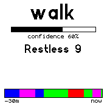
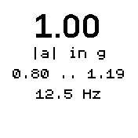
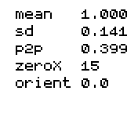
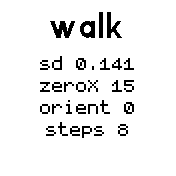
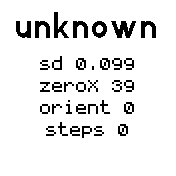
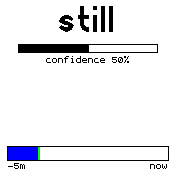
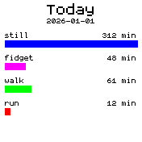
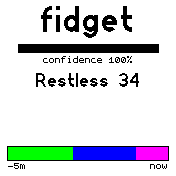
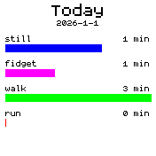

# 07 — What am I doing? Activity from an accelerometer

Your watch feels every step, every fidget and every time you put your arm
down. In this tutorial you turn that raw accelerometer stream into a label,
**still**, **fidget**, **walk** or **run**, using a handful of numbers and
rules you can read and tune yourself, plus a restlessness score for when
you sit or lie down. No machine learning yet: the point is to see how far
simple features get, and to measure it honestly, before tutorial 08 trains a
neural network.



## What you need

- A Bangle.js 2, or just the [Espruino Web IDE](https://www.espruino.com/ide/) with its Bangle.js 2 emulator.
- Parts that need a real watch: real accelerometer data (the emulator sends
  none), accuracy on real recordings, battery use.
- Earlier tutorials this one reuses: 06 (recordings in its log format, so
  you can replay them through the classifier).

The finished app is [`apps/actcls`](../apps/actcls). Its logic lives in the
module `actcls.lib.js`; the snippets below are simplified versions of it.

## How to follow along

You build a single app file, `act.app.js`, one step at a time. Every step
ends with **Your app so far**: the whole file at that point (or, for the
longer step 5, a diff against the step before). Each checkpoint is also in
[`tutorials/code/07/`](code/07), so you can copy it in one go.

To run a checkpoint in the Web IDE:

1. Paste it into the editor on the right, set the upload target (the icon
   next to the upload button) to **Storage**, file name `act.app.js`, and
   click upload. Sending it to **RAM** also works.
2. The emulator has no accelerometer, so paste
   [`fake.js`](code/07/fake.js) into the console on the left. It defines
   `fake(kind)`, which emits `accel` events at 12.5 Hz like the real sensor
   would. Then type `fake("walk")` (or `still`, `fidget`, `run`, `type`;
   `fake()` stops it).

```js
// fake.js, in short: 12.5 Hz accel events with a chosen |a| pattern
fakeIv = setInterval(function () {
  t += 0.08;
  var m = 1 + 0.2 * Math.sin(2 * Math.PI * 2 * t);     // "walk": 0.2 g at 2 Hz
  Bangle.emit("accel", { x: 0, y: 0, z: -m, mag: m, diff: 0 });
}, 80);
```

On a real watch you skip step 2 and just move. The screenshots below were
made from these exact checkpoint files with `tools/screenshot.js`; run
`sh tutorials/code/07/make-shots.sh` from the repo root to make them again.
## 1. The accelerometer signal

The accelerometer measures acceleration in g along three axes. At rest it
measures gravity: whichever way the watch is turned, the length of the
vector, `mag` = √(x² + y² + z²), is about **1 g**. Movement adds to and
subtracts from that, so `mag` is a good orientation-independent signal.

The firmware polls the sensor every 80 ms (12.5 Hz) by default, but it
slows down to 800 ms after a minute without movement to save power. Asking
for a fixed rate with `setPollInterval` also turns that power saving off
(documented on the `Bangle.setPollInterval` reference entry).

```js
Bangle.setPollInterval(80);           // 12.5 Hz, fixed
var n = 0, t0 = getTime();
Bangle.on('accel', function (a) {     // a = {x, y, z, diff, mag}, in g
  if (++n % 25 == 0) print((n / (getTime() - t0)).toFixed(1) + " Hz", a.mag.toFixed(3));
});
```

On a watch this prints the measured rate (about 12.5) and the magnitude
every 2 s. In the emulator nothing happens: it has no accelerometer data,
which is why everything below is written so it can be fed synthetic samples.

### Your app so far

[`code/07/step1.app.js`](code/07/step1.app.js), 28 lines: the app shows the
latest |a|, its range over the last 2 s and the sample rate measured from
the first sample on.

```js
// act.app.js, step 1: show |a| and the measured sample rate
Bangle.setPollInterval(80); // 12.5 Hz, fixed; also turns off the power-save slowdown
var n = 0, t0, mag = 0, mn = 9, mx = 0;

function draw() {
  var r = Bangle.appRect, cx = r.x + r.w / 2;
  var hz = n > 1 ? (n - 1) / ((Date.now() - t0) / 1000) : 0;
  g.reset().clearRect(r).setFontAlign(0, -1);
  g.setFont("Vector", 40).drawString(mag.toFixed(2), cx, r.y + 16);
  g.setFont("6x8", 2).drawString("|a| in g", cx, r.y + 60);
  g.drawString(mn.toFixed(2) + " .. " + mx.toFixed(2), cx, r.y + 86); // range in the last 2 s
  g.drawString(hz.toFixed(1) + " Hz", cx, r.y + 112);
}

function onAccel(a) { // a = {x, y, z, diff, mag}, in g
  if (!n) t0 = Date.now();
  n++;
  mag = a.mag;
  mn = Math.min(mn, mag);
  mx = Math.max(mx, mag);
  if (n % 25 == 0) { draw(); mn = 9; mx = 0; } // every 25 samples = 2 s
}

Bangle.on("accel", onAccel);
Bangle.setUI({ mode: "custom", btn: function () { load(); } });
Bangle.loadWidgets();
Bangle.drawWidgets();
draw();
```

Upload it, paste `fake.js` and run `fake("walk")`:



*Look for:* the rate settles at **12.5 Hz**, and the range is 1 ± 0.2 g,
the 0.2 g "walking" wave on top of gravity. The big number is just the
latest sample, so it jumps around. With `fake("still")` the range shrinks
to about 0.99 .. 1.01. The button returns to the launcher.

**You learned:** the `accel` event, what `mag` means, and how to fix the sample rate.

## 2. Windows and features

A single sample says almost nothing. We look at **windows** of 4 s (50
samples) and start a new one every 2 s (50 % overlap), and reduce each
window to a few numbers:

- `meanMag`: mean of |a|, about 1 g.
- `sdMag`: standard deviation of |a|: how much it moves.
- `p2p`: max − min of |a|.
- `zeroX`: how often |a| crosses its own mean: a rough rhythm rate. Walking
  at 2 steps/s gives about 16 crossings in 4 s.
- `orient`: angle between this window's average gravity vector and the
  previous one's: posture changes.
- `steps`: the firmware's own `step` events in the window, as a cross-check.

```js
function features(m) {               // m: array of |a| values
  var n = m.length, sum = 0, mn = 1e9, mx = -1e9, i;
  for (i = 0; i < n; i++) { sum += m[i]; mn = Math.min(mn, m[i]); mx = Math.max(mx, m[i]); }
  var mean = sum / n, ss = 0, zx = 0, s = 0;
  for (i = 0; i < n; i++) {
    var d = m[i] - mean;
    ss += d * d;
    if (d > 0.01) { if (s < 0) zx++; s = 1; }          // a small band stops
    else if (d < -0.01) { if (s > 0) zx++; s = -1; }   // noise counting as crossings
  }
  return { meanMag: mean, sdMag: Math.sqrt(ss / n), p2p: mx - mn, zeroX: zx };
}
// a 2 Hz sine of 0.2 g at 12.5 Hz for 4 s
var m = [];
for (var i = 0; i < 50; i++) m.push(1 + 0.2 * Math.sin(2 * Math.PI * 2 * i * 0.08 + 0.3));
print(features(m));
```

Paste it into the emulator: `sdMag` is 0.141 (0.2/√2, the standard deviation
of a sine), `p2p` about 0.4 and `zeroX` 15. Eight full cycles have 16
crossings, but one of them falls before the first sample. A constant 1 g
gives `sdMag` 0 and `zeroX` 0. Those two cases are the first tests in
[`tests/features.test.js`](../apps/actcls/tests/features.test.js).

In the app the samples go into preallocated `Float32Array` ring buffers, so
nothing is allocated per sample, and the window is computed when a sample
arrives past the window's end.

### Your app so far

[`code/07/step2.app.js`](code/07/step2.app.js), 56 lines. The `mag`
display is gone. The app now keeps the last 50 samples (with x, y, z, so
`orient` can compare mean gravity vectors) and computes the features of a
window every 25 samples.

```js
// act.app.js, step 2: 4 s windows every 2 s, and their features
Bangle.setPollInterval(80); // 12.5 Hz, fixed; also turns off the power-save slowdown
var WIN = 50, HOP = 25;     // in samples: 4 s windows, a new one every 2 s
var buf = [], n = 0, f, prev;

function features(s) { // s: [{x, y, z, mag}, ...]
  var len = s.length, sum = 0, mn = 1e9, mx = -1e9, gx = 0, gy = 0, gz = 0, i;
  for (i = 0; i < len; i++) {
    var v = s[i].mag;
    sum += v; mn = Math.min(mn, v); mx = Math.max(mx, v);
    gx += s[i].x; gy += s[i].y; gz += s[i].z;
  }
  var mean = sum / len, ss = 0, zx = 0, sg = 0;
  for (i = 0; i < len; i++) {
    var d = s[i].mag - mean;
    ss += d * d;
    if (d > 0.01) { if (sg < 0) zx++; sg = 1; }          // a small band stops
    else if (d < -0.01) { if (sg > 0) zx++; sg = -1; }   // noise counting as crossings
  }
  return { meanMag: mean, sdMag: Math.sqrt(ss / len), p2p: mx - mn, zeroX: zx,
    gx: gx / len, gy: gy / len, gz: gz / len };
}

function angle(a, b) { // degrees between two mean gravity vectors
  var l = Math.sqrt((a.gx * a.gx + a.gy * a.gy + a.gz * a.gz) * (b.gx * b.gx + b.gy * b.gy + b.gz * b.gz));
  if (!l) return 0;
  var c = (a.gx * b.gx + a.gy * b.gy + a.gz * b.gz) / l;
  return Math.acos(Math.max(-1, Math.min(1, c))) * 180 / Math.PI;
}

function draw() {
  var r = Bangle.appRect, x = r.x + 20, y = r.y + 10;
  g.reset().clearRect(r).setFont("6x8", 2).setFontAlign(-1, -1);
  if (!f) return g.drawString("waiting...", x, y);
  g.drawString("mean   " + f.meanMag.toFixed(3), x, y);
  g.drawString("sd     " + f.sdMag.toFixed(3), x, y + 22);
  g.drawString("p2p    " + f.p2p.toFixed(3), x, y + 44);
  g.drawString("zeroX  " + f.zeroX, x, y + 66);
  g.drawString("orient " + f.orient.toFixed(1), x, y + 88);
}

function onAccel(a) {
  buf.push({ x: a.x, y: a.y, z: a.z, mag: a.mag });
  if (buf.length > WIN) buf.shift();
  if (++n % HOP || buf.length < WIN) return;
  f = features(buf);
  f.orient = prev ? angle(f, prev) : 0;
  prev = f;
  draw();
}

Bangle.on("accel", onAccel);
Bangle.setUI({ mode: "custom", btn: function () { load(); } });
Bangle.loadWidgets();
Bangle.drawWidgets();
draw();
```

With `fake("walk")`, after 4 s:



*Look for:* the same numbers as the pasted `features()` snippet above:
`sd` **0.141** and `zeroX` **15** for a 2 Hz, 0.2 g wave. `orient` stays
0 because the fake signal never turns the watch. `buf.push` and
`buf.shift` allocate memory for every sample. That is fine here, and the
real app uses preallocated `Float32Array` ring buffers instead.

**You learned:** how to turn a stream into a few numbers per window.

## 3. Writing rules

Before writing a rule, look at the data. These are 20 s of |a| from four
labelled recordings (the synthetic fixtures in
[`apps/actcls/tests/fixtures`](../apps/actcls/tests/fixtures), stored in the
prototype-06 log format):


Still is flat (the steps are the 0.01 g rounding of the log format). Fidget
is mostly flat with short bursts. Walking and running are regular waves;
running is bigger and faster. That suggests:

| Class | Rule (checked in this order) |
|---|---|
| still | `sdMag < 0.01` and `orient < 5°` |
| run | `sdMag ≥ 0.35` and `zeroX ≥ 10` |
| walk | `0.08 ≤ sdMag < 0.35` and `zeroX` 6–20, or `steps ≥ 3` |
| fidget | `sdMag < 0.08` and `steps == 0` |
| unknown | anything else |

```js
function classify(f) {
  if (f.sdMag < 0.01 && f.orient < 5) return "still";
  if (f.sdMag >= 0.35 && f.zeroX >= 10) return "run";
  if ((f.sdMag >= 0.08 && f.sdMag < 0.35 && f.zeroX >= 6 && f.zeroX <= 20) || f.steps >= 3) return "walk";
  if (f.sdMag < 0.08 && f.steps == 0) return "fidget";
  return "unknown";
}
print(classify({sdMag: 0.004, zeroX: 3, orient: 1, steps: 0}));   // still
print(classify({sdMag: 0.2, zeroX: 15, orient: 1, steps: 0}));    // walk
print(classify({sdMag: 0.1, zeroX: 40, orient: 2, steps: 0}));    // unknown: typing, not walking
```

The last line is why `zeroX` matters: typing or gesturing while sitting can
move the wrist as much as walking (`sdMag` 0.1), but much faster and without
steps, so it stays out of `walk`.

Two more checks make a window `unknown`: fewer than 80 % of the expected
samples (a gap in the data), measured from the median interval between
samples. That also gives the real sample rate, so if another app changes the
poll interval, `zeroX` is scaled to crossings per 4 s of covered time and
the rules still apply.

### Your app so far

[`code/07/step3.app.js`](code/07/step3.app.js), 69 lines. New:
`classify()` from above, a `step` listener whose count is added to each
window (`steps` covers the last two hops, that is 4 s), and the class drawn
large.

```js
// act.app.js, step 3: classify each window with rules
Bangle.setPollInterval(80); // 12.5 Hz, fixed; also turns off the power-save slowdown
var WIN = 50, HOP = 25;     // in samples: 4 s windows, a new one every 2 s
var buf = [], n = 0, f, prev, cls = "...", steps = 0, lastSteps = 0;

function features(s) { // s: [{x, y, z, mag}, ...]
  var len = s.length, sum = 0, mn = 1e9, mx = -1e9, gx = 0, gy = 0, gz = 0, i;
  for (i = 0; i < len; i++) {
    var v = s[i].mag;
    sum += v; mn = Math.min(mn, v); mx = Math.max(mx, v);
    gx += s[i].x; gy += s[i].y; gz += s[i].z;
  }
  var mean = sum / len, ss = 0, zx = 0, sg = 0;
  for (i = 0; i < len; i++) {
    var d = s[i].mag - mean;
    ss += d * d;
    if (d > 0.01) { if (sg < 0) zx++; sg = 1; }          // a small band stops
    else if (d < -0.01) { if (sg > 0) zx++; sg = -1; }   // noise counting as crossings
  }
  return { meanMag: mean, sdMag: Math.sqrt(ss / len), p2p: mx - mn, zeroX: zx,
    gx: gx / len, gy: gy / len, gz: gz / len };
}

function angle(a, b) { // degrees between two mean gravity vectors
  var l = Math.sqrt((a.gx * a.gx + a.gy * a.gy + a.gz * a.gz) * (b.gx * b.gx + b.gy * b.gy + b.gz * b.gz));
  if (!l) return 0;
  var c = (a.gx * b.gx + a.gy * b.gy + a.gz * b.gz) / l;
  return Math.acos(Math.max(-1, Math.min(1, c))) * 180 / Math.PI;
}

function classify(f) {
  if (f.sdMag < 0.01 && f.orient < 5) return "still";
  if (f.sdMag >= 0.35 && f.zeroX >= 10) return "run";
  if ((f.sdMag >= 0.08 && f.sdMag < 0.35 && f.zeroX >= 6 && f.zeroX <= 20) || f.steps >= 3) return "walk";
  if (f.sdMag < 0.08 && f.steps == 0) return "fidget";
  return "unknown";
}

function draw() {
  var r = Bangle.appRect, cx = r.x + r.w / 2, y = r.y + 70;
  g.reset().clearRect(r).setFontAlign(0, -1).setFont("Vector", 34).drawString(cls, cx, r.y + 10);
  if (!f) return;
  g.setFont("6x8", 2);
  g.drawString("sd " + f.sdMag.toFixed(3), cx, y - 14);
  g.drawString("zeroX " + f.zeroX, cx, y + 8);
  g.drawString("orient " + f.orient.toFixed(0), cx, y + 30);
  g.drawString("steps " + f.steps, cx, y + 52);
}

function onAccel(a) {
  buf.push({ x: a.x, y: a.y, z: a.z, mag: a.mag });
  if (buf.length > WIN) buf.shift();
  if (++n % HOP || buf.length < WIN) return;
  f = features(buf);
  f.orient = prev ? angle(f, prev) : 0;
  f.steps = steps + lastSteps; // steps in the last 4 s
  lastSteps = steps;
  steps = 0;
  prev = f;
  cls = classify(f);
  draw();
}

Bangle.on("accel", onAccel);
Bangle.on("step", function () { steps++; });
Bangle.setUI({ mode: "custom", btn: function () { load(); } });
Bangle.loadWidgets();
Bangle.drawWidgets();
draw();
```

`fake("walk")` (left) and `fake("type")` (right, 0.14 g at 5 Hz):

 

*Look for:* walking gives `walk`, with 8 fake steps in 4 s. "Typing" moves
the wrist about as much (`sd` 0.099) but crosses the mean **39** times in
4 s and has no steps, so no rule matches and it is `unknown`, not `walk`.

**You learned:** to plot recordings before writing thresholds, and to keep
the rules in one readable table.

## 4. Debouncing and confidence

Classifying every 2 s gives a jittery display: a window whose features sit
right at a threshold flips between two classes from one window to the next.
The app only **shows** a new class after it was seen in 2 windows in a row:

```js
function debounce(n) {
  var cand = "", count = 0, shown = "";
  return function (cls) {
    if (cls === cand) count++; else { cand = cls; count = 1; }
    if (count >= n) shown = cand;
    return shown;
  };
}
var d = debounce(2);
["still", "still", "walk", "still", "walk", "walk"].forEach(function (c) { print(c, "->", d(c)); });
// the single "walk" is ignored, two in a row are shown
```

This is hysteresis: it costs 2–4 s of delay and buys a calm display. The
timeline strip at the bottom still shows every window's raw class, so you
can see the blips.

Mind the overlap: with 4 s windows every 2 s, every sample is in **two**
windows. A short burst, such as scratching your nose, therefore changes two
windows in a row and gets through a 2-window debounce. (In the emulator, a
0.5 s burst in the middle of `still` gave `unknown, unknown` and showed
`unknown` for about 4 s.) The debounce removes single odd windows. To hide
short bursts as well, require 3 windows, at the cost of 2 s more delay.

**Confidence** answers "how close was that call?". For the matching rule,
take each condition's relative distance to its threshold (for still,
`(0.01 − sdMag) / 0.01` and `(5 − orient) / 5`), use the smallest, and scale
so that 50 % away from the boundary counts as fully confident. A window at
`sdMag` 0.009 is "still" with confidence 0.2; one at 0.004 gets 1.

### Your app so far

[`code/07/step4.app.js`](code/07/step4.app.js), 90 lines. `classify()`
now returns `{cls, conf}`. The big label is the debounced class, the bar
shows the latest window's confidence, and a timeline at the bottom has one
coloured column per window (blue still, magenta fidget, green walk, red
run, black unknown) for the last 5 min.

```js
// act.app.js, step 4: debounce, confidence and a timeline
Bangle.setPollInterval(80); // 12.5 Hz, fixed; also turns off the power-save slowdown
var WIN = 50, HOP = 25;     // in samples: 4 s windows, a new one every 2 s
var buf = [], n = 0, f, prev, c, steps = 0, lastSteps = 0;
var COLORS = { still: "#00f", fidget: "#f0f", walk: "#0f0", run: "#f00", unknown: "#000" };
var hist = []; // raw class of the last 150 windows (5 min), oldest first

function features(s) { // s: [{x, y, z, mag}, ...]
  var len = s.length, sum = 0, mn = 1e9, mx = -1e9, gx = 0, gy = 0, gz = 0, i;
  for (i = 0; i < len; i++) {
    var v = s[i].mag;
    sum += v; mn = Math.min(mn, v); mx = Math.max(mx, v);
    gx += s[i].x; gy += s[i].y; gz += s[i].z;
  }
  var mean = sum / len, ss = 0, zx = 0, sg = 0;
  for (i = 0; i < len; i++) {
    var d = s[i].mag - mean;
    ss += d * d;
    if (d > 0.01) { if (sg < 0) zx++; sg = 1; }          // a small band stops
    else if (d < -0.01) { if (sg > 0) zx++; sg = -1; }   // noise counting as crossings
  }
  return { meanMag: mean, sdMag: Math.sqrt(ss / len), p2p: mx - mn, zeroX: zx,
    gx: gx / len, gy: gy / len, gz: gz / len };
}

function angle(a, b) { // degrees between two mean gravity vectors
  var l = Math.sqrt((a.gx * a.gx + a.gy * a.gy + a.gz * a.gz) * (b.gx * b.gx + b.gy * b.gy + b.gz * b.gz));
  if (!l) return 0;
  var c = (a.gx * b.gx + a.gy * b.gy + a.gz * b.gz) / l;
  return Math.acos(Math.max(-1, Math.min(1, c))) * 180 / Math.PI;
}

function classify(f) { // returns {cls, conf}
  var sd = f.sdMag, zx = f.zeroX, o = f.orient, m = Math.min;
  function res(cls, margin) { return { cls: cls, conf: Math.max(0, m(1, margin / 0.5)) }; }
  if (sd < 0.01 && o < 5) return res("still", m((0.01 - sd) / 0.01, (5 - o) / 5));
  if (sd >= 0.35 && zx >= 10) return res("run", m((sd - 0.35) / 0.35, (zx - 9) / 10));
  if (sd >= 0.08 && sd < 0.35 && zx >= 6 && zx <= 20)
    return res("walk", m((sd - 0.08) / 0.08, (0.35 - sd) / 0.35, (zx - 5) / 6, (21 - zx) / 20));
  if (f.steps >= 3) return res("walk", (f.steps - 2) / 3);
  if (sd < 0.08 && f.steps == 0) return res("fidget", m((0.08 - sd) / 0.08, Math.max((sd - 0.01) / 0.01, (o - 5) / 5)));
  return { cls: "unknown", conf: 0 };
}

function debounce(need) { // a new class is shown after `need` windows in a row
  var cand = "", count = 0, shown = "...";
  return function (cls) {
    if (cls === cand) count++; else { cand = cls; count = 1; }
    if (count >= need) shown = cand;
    return shown;
  };
}
var deb = debounce(2), shown = "...";

function draw() {
  var r = Bangle.appRect, cx = r.x + r.w / 2, y = r.y, conf = c ? c.conf : 0;
  g.reset().clearRect(r).setFontAlign(0, -1).setFont("Vector", 34).drawString(shown, cx, y + 4);
  g.drawRect(r.x + 18, y + 44, r.x2 - 18, y + 52);
  g.fillRect(r.x + 18, y + 44, r.x + 18 + Math.round((r.w - 36) * conf), y + 52);
  g.setFont("6x8").drawString("confidence " + Math.round(conf * 100) + "%", cx, y + 56);
  var x0 = r.x + 8, w = r.w - 16, ty = r.y2 - 28; // timeline: one column per window
  for (var i = 0; i < hist.length; i++)
    g.setColor(COLORS[hist[i]]).fillRect(x0 + Math.floor(i * w / 150), ty, x0 + Math.floor((i + 1) * w / 150) - 1, ty + 12);
  g.setColor(g.theme.fg).drawRect(x0 - 1, ty - 1, x0 + w, ty + 13);
  g.setFontAlign(-1, -1).drawString("-5m", x0, ty + 15).setFontAlign(1, -1).drawString("now", x0 + w, ty + 15);
}

function onAccel(a) {
  buf.push({ x: a.x, y: a.y, z: a.z, mag: a.mag });
  if (buf.length > WIN) buf.shift();
  if (++n % HOP || buf.length < WIN) return;
  f = features(buf);
  f.orient = prev ? angle(f, prev) : 0;
  f.steps = steps + lastSteps; // steps in the last 4 s
  lastSteps = steps;
  steps = 0;
  prev = f;
  c = classify(f);
  shown = deb(c.cls);
  hist.push(c.cls);
  if (hist.length > 150) hist.shift();
  draw();
}

Bangle.on("accel", onAccel);
Bangle.on("step", function () { steps++; });
Bangle.setUI({ mode: "custom", btn: function () { load(); } });
Bangle.loadWidgets();
Bangle.drawWidgets();
draw();
```

Run `fake("still")` for a minute, then `fake("walk")`, and look at the
screen 2 s later:



*Look for:* the timeline already ends in a **green** column (the first walk
window, classed `walk` with confidence 50 %), but the label still says
`still`. It switches to `walk` with the next window, 2 s later.

**You learned:** hysteresis in classifiers, and a confidence measure you can explain.

## 5. A restlessness score

When you sit or lie down, how restless are you? Over the last 5 min (150
windows) take only the windows classed `still` or `fidget`:

```
restlessness = 100 × (fidget windows / rest windows) + 10 × (posture changes > 30°)
```

capped at 100, and `--` if there were no rest windows at all. Pure stillness
is 0; it rises steadily as the fidget share rises.

```js
function restlessness(classes, postureChanges) {
  var rest = 0, fid = 0;
  classes.forEach(function (c) { if (c == "still" || c == "fidget") { rest++; if (c == "fidget") fid++; } });
  if (!rest) return -1;
  return Math.min(100, Math.round(100 * fid / rest + 10 * postureChanges));
}
print(restlessness(["still", "still", "still", "fidget"], 0));  // 25
print(restlessness(["still", "fidget", "fidget", "walk"], 1));  // 77
```

Be honest about what this is: a **relative indicator** to compare your own
evenings or nights, not a sleep or medical measure. The weights are guesses,
and a watch on a table scores a perfect 0. The app flags that case: perfect
stillness (`sdMag < 0.002`) for more than 2 min shows `off wrist?`.

The summary page (swipe) adds up minutes per class for the day in
`actcls.json` and starts again after midnight:



### Your app so far

[`code/07/step5.app.js`](code/07/step5.app.js), 130 lines, too long to
repeat in full. The diff against step 4: a second array `post` remembers
posture changes, `restlessness()` is the function from above, `quiet`
counts perfectly still windows for the off-wrist hint, and `sum` holds the
seconds per class for today in `act.json`. The file is saved once a minute
and when the app closes (`E.on("kill", save)`), and starts again on a new
day. A swipe toggles the summary page.

```diff
--- step4.app.js
+++ step5.app.js
@@ -1,9 +1,23 @@
-// act.app.js, step 4: debounce, confidence and a timeline
+// act.app.js, step 5: restlessness, off-wrist hint and a summary page
 Bangle.setPollInterval(80); // 12.5 Hz, fixed; also turns off the power-save slowdown
 var WIN = 50, HOP = 25;     // in samples: 4 s windows, a new one every 2 s
 var buf = [], n = 0, f, prev, c, steps = 0, lastSteps = 0;
 var COLORS = { still: "#00f", fidget: "#f0f", walk: "#0f0", run: "#f00", unknown: "#000" };
-var hist = []; // raw class of the last 150 windows (5 min), oldest first
+var hist = [], post = []; // raw class and posture change (> 30°) of the last 150 windows (5 min)
+var FILE = "act.json", page = 0, quiet = 0, nWin = 0;
+
+function today() { var d = new Date(); return d.getFullYear() + "-" + (d.getMonth() + 1) + "-" + d.getDate(); }
+function fresh() { return { day: today(), sec: { still: 0, fidget: 0, walk: 0, run: 0 } }; }
+var sum = require("Storage").readJSON(FILE, true);
+if (!sum || sum.day != today()) sum = fresh();
+function save() { require("Storage").writeJSON(FILE, sum); }
+
+function restlessness() { // 0..100 over the rest windows, -1 if there were none
+  var rest = 0, fid = 0, pc = 0;
+  for (var i = 0; i < hist.length; i++)
+    if (hist[i] == "still" || hist[i] == "fidget") { rest++; if (hist[i] == "fidget") fid++; if (post[i]) pc++; }
+  return rest ? Math.min(100, Math.round(100 * fid / rest + 10 * pc)) : -1;
+}
 
 function features(s) { // s: [{x, y, z, mag}, ...]
   var len = s.length, sum = 0, mn = 1e9, mx = -1e9, gx = 0, gy = 0, gz = 0, i;
@@ -52,12 +66,31 @@
 }
 var deb = debounce(2), shown = "...";
 
+function drawSummary(r) {
+  var names = ["still", "fidget", "walk", "run"], max = 60, i;
+  for (i = 0; i < 4; i++) max = Math.max(max, sum.sec[names[i]]);
+  g.setFont("6x8", 2).setFontAlign(0, -1).drawString("Today", r.x + r.w / 2, r.y + 4);
+  g.setFont("6x8").drawString(sum.day, r.x + r.w / 2, r.y + 22);
+  for (i = 0; i < 4; i++) {
+    var y = r.y + 40 + i * 28, s = sum.sec[names[i]];
+    g.setColor(g.theme.fg).setFontAlign(-1, -1).drawString(names[i], r.x + 6, y);
+    g.setFontAlign(1, -1).drawString(Math.floor(s / 60) + " min", r.x2 - 6, y);
+    g.setColor(COLORS[names[i]]).fillRect(r.x + 6, y + 10, r.x + 6 + Math.round((r.w - 12) * s / max), y + 18);
+  }
+}
+
 function draw() {
   var r = Bangle.appRect, cx = r.x + r.w / 2, y = r.y, conf = c ? c.conf : 0;
-  g.reset().clearRect(r).setFontAlign(0, -1).setFont("Vector", 34).drawString(shown, cx, y + 4);
+  g.reset().clearRect(r);
+  if (page) return drawSummary(r);
+  g.setFontAlign(0, -1).setFont("Vector", 34).drawString(shown, cx, y + 4);
   g.drawRect(r.x + 18, y + 44, r.x2 - 18, y + 52);
   g.fillRect(r.x + 18, y + 44, r.x + 18 + Math.round((r.w - 36) * conf), y + 52);
   g.setFont("6x8").drawString("confidence " + Math.round(conf * 100) + "%", cx, y + 56);
+  var rs = restlessness();
+  g.setFont("Vector", 18).drawString("Restless " + (rs < 0 ? "--" : rs), cx, y + 72);
+  if (quiet > 60) g.setFont("6x8").drawString("off wrist?", cx, y + 94); // 60 windows = 2 min
+  g.setFont("6x8");
   var x0 = r.x + 8, w = r.w - 16, ty = r.y2 - 28; // timeline: one column per window
   for (var i = 0; i < hist.length; i++)
     g.setColor(COLORS[hist[i]]).fillRect(x0 + Math.floor(i * w / 150), ty, x0 + Math.floor((i + 1) * w / 150) - 1, ty + 12);
@@ -78,13 +111,20 @@
   c = classify(f);
   shown = deb(c.cls);
   hist.push(c.cls);
-  if (hist.length > 150) hist.shift();
+  post.push(f.orient > 30);
+  if (hist.length > 150) { hist.shift(); post.shift(); }
+  quiet = f.sdMag < 0.002 ? quiet + 1 : 0; // perfectly still: on a table?
+  if (sum.day != today()) { sum = fresh(); save(); }
+  if (sum.sec[c.cls] !== undefined) sum.sec[c.cls] += 2;
+  if (++nWin % 30 == 0) save(); // once a minute
   draw();
 }
 
 Bangle.on("accel", onAccel);
 Bangle.on("step", function () { steps++; });
-Bangle.setUI({ mode: "custom", btn: function () { load(); } });
+E.on("kill", save);
+Bangle.setUI({ mode: "custom", btn: function () { load(); },
+  swipe: function (dir) { if (dir) { page = page ? 0 : 1; draw(); } } });
 Bangle.loadWidgets();
 Bangle.drawWidgets();
 draw();
```

`fake("walk")` for 3 min, `fake("still")` for 2 min, then `fake("fidget")`
for 1 min, then swipe left:

 

*Look for:* **Restless 34**. Walking doesn't count, and of the rest
windows in the last 5 min, about a third were fidget. The timeline shows the
three phases in order. The summary page counts whole minutes, so 118 s of
still shows as 1 min. The date is today's, and the minutes start from 0
after midnight.

**You learned:** aggregating classes over time, and the limits of that measure.

## 6. Measuring accuracy

A classifier you haven't measured is a guess. Record labelled data with the
prototype-06 logger (one recording per activity, accelerometer at 80 ms, the
activity as the label), then replay the recordings through exactly the same
code. The module's `replay()` reads the 06 format, a JSON header and then
`<ms>,a,x,y,z` and `<ms>,s,steps` lines, either from a string or from a
StorageFile:

```js
var A = require("actcls");
var r = A.replay(require("Storage").open("log.20261123-1015", "r"));
var cm = A.confusion();
r.windows.forEach(function (w) { cm.add(r.label, w.cls); });
print(r.label, cm.m[r.label], (100 * cm.accuracy(r.label)).toFixed(0) + "%");
```

On a PC, `node apps/actcls/tools/evaluate.js <log files…>` does the same for
many files and prints a confusion matrix. Rows are the true label, columns
what the classifier said. For the four synthetic fixtures:

| true \ predicted | still | fidget | walk | run | unknown | accuracy |
|---|---:|---:|---:|---:|---:|---:|
| still | 58 | 0 | 0 | 0 | 0 | 100.0 % |
| fidget | 0 | 58 | 0 | 0 | 0 | 100.0 % |
| walk | 0 | 0 | 58 | 0 | 0 | 100.0 % |
| run | 0 | 0 | 0 | 58 | 0 | 100.0 % |

That table is too good to be true, and it is: the fixtures were generated
to match these rules. It proves the code works, not that the rules do.

### Accuracy on real recordings

*Needs a real watch.* Five minutes of each activity from at least two
people, replayed as above, should reach **≥ 80 %** of windows correct
([HW-1](../apps/actcls/HW-TESTS.md)). Paste your confusion matrix here:

| true \ predicted | still | fidget | walk | run | unknown | accuracy |
|---|---:|---:|---:|---:|---:|---:|
| *(not measured yet)* | | | | | | |

Expect the errors off the diagonal: `fidget` vs `still` (how much movement
is a fidget?) and slow `walk` vs `fidget`. Every threshold in the rules
table is a constant in `actcls.lib.js` (`RULES`); change one, replay again,
and compare the tables. When moving thresholds by hand stops helping, you
have reached the point where a learned model (tutorial 08) earns its cost.

### Your app so far

Your `act.app.js` doesn't change in this step. The replay runs as a separate
snippet, [`code/07/replay.js`](code/07/replay.js), using the real module,
because `replay()` drives exactly the classifier that the finished app
uses:

```js
// replay.js: run one prototype-06 recording through the real module, on the watch
var A = require("actcls");
var r = A.replay(require("Storage").open("log.20260101-1015", "r"));
var cm = A.confusion();
r.windows.forEach(function (w) { cm.add(r.label, w.cls); });
print(r.label, cm.m[r.label], (100 * cm.accuracy(r.label)).toFixed(0) + "%");
```

With the `run` fixture copied to the watch as a StorageFile, the console
prints:

```
run { "run": 58 } 100%
```

All 58 windows of the run recording were classed `run`. Run the same thing
on the PC for all four fixtures with `node apps/actcls/tools/evaluate.js
apps/actcls/tests/fixtures/log.*`. It prints one line per file and the
confusion matrix shown above:

```
log.20260101-1000  label=still  windows=58  correct=100.0 %
log.20260101-1005  label=fidget  windows=58  correct=100.0 %
log.20260101-1010  label=walk  windows=58  correct=100.0 %
log.20260101-1015  label=run  windows=58  correct=100.0 %
...
Overall window accuracy: 100.0 % (232/232)
```

### From your app to `apps/actcls`

Your `act.app.js` from step 5 is a complete, working, simplified version of
the app. The real [`apps/actcls`](../apps/actcls) uses the same rules and
screens, and adds:

| Your step-5 app | `apps/actcls` |
|---|---|
| Everything in one file | Logic in the module `actcls.lib.js` (`require("actcls")`), UI and sensors in `actcls.app.js`, so tests can drive the logic with timestamps |
| Windows every 25 samples | Windows by time (every 2 s of timestamps), with the rate measured from the median sample interval. Less than 80 % coverage gives `unknown`, and `zeroX` is scaled to a full 4 s window |
| `buf.push`/`shift` | Preallocated `Float32Array` ring buffers, timestamps relative to the first sample in an `Int32Array` |
| Steps over the last two hops | Step timestamps, counted inside each window |
| Timeline of the last 150 windows | 30 min timeline of 15 s slots, with gaps left blank |
| Seconds per class in `act.json` | Whole minutes in `actcls.json` (`{"v":1,"day":…,"min":{…}}`), date with leading zeros |
| `quiet > 60` windows | The same 2 min rule, inside the module |
| — | `DEBUG` JSON events, `replay()` and `confusion()` for recordings |

Load the real app (`load("actcls.app.js")`), paste `fake.js` and run
`fake("walk")`: you get the screen from the top of this tutorial, with its
30 min timeline.

**You learned:** honest evaluation: replay held-out recordings, read a confusion matrix.

## Test it in the emulator

The emulator has no accelerometer data, so the app's `accel` handler only
forwards to `feed(a, t)`, and the tests call that (or the module) with
synthetic samples and explicit timestamps. 34 tests in
[`apps/actcls/tests/`](../apps/actcls/tests) cover the features, the four
labelled replays (≥ 90 % correct windows), debounce, restlessness, missing
samples, a changed poll rate and the midnight rollover of the summary file:

```js
T.test("window with < 80 % of samples is unknown", function () {
  var k = collect(), t = T0;
  t = feed(k.c, t, 12000, still);
  feed(k.c, t + 1200, 8000, still);   // 1.2 s of samples missing
  var unk = k.ws.filter(function (w) { return w.cls === "unknown"; });
  T.ok(unk.length >= 1, "unknown windows");
});
```

Run them with `npm test -- actcls`. The replay tests load a RAM copy of the
module with `T.requireRAM("actcls")`: code that runs straight
from the emulator's flash is about 10× slower, which adds up over thousands
of samples.

## Try it on the watch

[`apps/actcls/HW-TESTS.md`](../apps/actcls/HW-TESTS.md) lists the checks:
accuracy on real recordings (HW-1), battery (HW-2), debounce and typing
while sitting, the measured sample rate, steps and the midnight rollover.

**Battery:** the app keeps the accelerometer at 12.5 Hz, runs a small
JavaScript handler for every sample and redraws every 2 s. Our estimate is
**at most 1 % of battery per hour**; this has not been measured yet. HW-2
measures it over 4 h; replace this paragraph with the measured figure.

## Going further

- Tune `RULES` on your own recordings and keep the confusion matrix next to each change.
- Add a class, such as `cycle` (low `sdMag`, regular `zeroX`, no steps).
- Use the HRM to confirm `off wrist` (low confidence readings).
- Tutorial 08 records gestures and trains a TensorFlow Lite model, using the same windows-and-evaluation approach.
