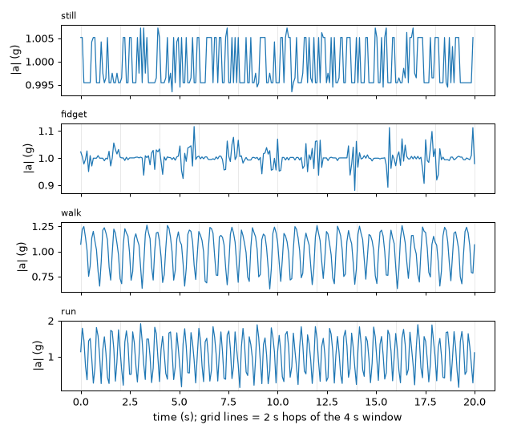

# 07 — What am I doing? Activity from an accelerometer

Your watch feels every step, every fidget and every time you put your arm
down. In this tutorial you turn that raw accelerometer stream into a label,
**still**, **fidget**, **walk** or **run**, using a handful of numbers and
rules you can read and tune yourself, plus a restlessness score for when
you sit or lie down. No machine learning yet: the point is to see how far
simple features get, and to measure it honestly, before tutorial 08 trains a
neural network.


## What you need

- A Bangle.js 2, or just the [Espruino Web IDE](https://www.espruino.com/ide/) with its Bangle.js 2 emulator.
- Parts that need a real watch: real accelerometer data (the emulator sends
  none), accuracy on real recordings, battery use.
- Earlier tutorials this one reuses: 06 (recordings in its log format, so
  you can replay them through the classifier).

The finished app is [`apps/actcls`](../apps/actcls). Its logic lives in the
module `actcls.lib.js`; the snippets below are simplified versions of it.

## 1. The accelerometer signal

The accelerometer measures acceleration in g along three axes. At rest it
measures gravity: whichever way the watch is turned, the length of the
vector, `mag` = √(x² + y² + z²), is about **1 g**. Movement adds to and
subtracts from that, so `mag` is a good orientation-independent signal.

The firmware polls the sensor every 80 ms (12.5 Hz) by default, but it
slows down to 800 ms after a minute without movement to save power. Asking
for a fixed rate with `setPollInterval` also turns that power saving off
(documented on the `Bangle.setPollInterval` reference entry).

```js
Bangle.setPollInterval(80);           // 12.5 Hz, fixed
var n = 0, t0 = getTime();
Bangle.on('accel', function (a) {     // a = {x, y, z, diff, mag}, in g
  if (++n % 25 == 0) print((n / (getTime() - t0)).toFixed(1) + " Hz", a.mag.toFixed(3));
});
```

On a watch this prints the measured rate (about 12.5) and the magnitude
every 2 s. In the emulator nothing happens: it has no accelerometer data,
which is why everything below is written so it can be fed synthetic samples.

**You learned:** the `accel` event, what `mag` means, and how to fix the sample rate.

## 2. Windows and features

A single sample says almost nothing. We look at **windows** of 4 s (50
samples) and start a new one every 2 s (50 % overlap), and reduce each
window to a few numbers:

- `meanMag`: mean of |a|, about 1 g.
- `sdMag`: standard deviation of |a|: how much it moves.
- `p2p`: max − min of |a|.
- `zeroX`: how often |a| crosses its own mean: a rough rhythm rate. Walking
  at 2 steps/s gives about 16 crossings in 4 s.
- `orient`: angle between this window's average gravity vector and the
  previous one's: posture changes.
- `steps`: the firmware's own `step` events in the window, as a cross-check.

```js
function features(m) {               // m: array of |a| values
  var n = m.length, sum = 0, mn = 1e9, mx = -1e9, i;
  for (i = 0; i < n; i++) { sum += m[i]; mn = Math.min(mn, m[i]); mx = Math.max(mx, m[i]); }
  var mean = sum / n, ss = 0, zx = 0, s = 0;
  for (i = 0; i < n; i++) {
    var d = m[i] - mean;
    ss += d * d;
    if (d > 0.01) { if (s < 0) zx++; s = 1; }          // a small band stops
    else if (d < -0.01) { if (s > 0) zx++; s = -1; }   // noise counting as crossings
  }
  return { meanMag: mean, sdMag: Math.sqrt(ss / n), p2p: mx - mn, zeroX: zx };
}
// a 2 Hz sine of 0.2 g at 12.5 Hz for 4 s
var m = [];
for (var i = 0; i < 50; i++) m.push(1 + 0.2 * Math.sin(2 * Math.PI * 2 * i * 0.08 + 0.3));
print(features(m));
```

Paste it into the emulator: `sdMag` is 0.141 (0.2/√2, the standard deviation
of a sine), `p2p` about 0.4 and `zeroX` 15. Eight full cycles have 16
crossings, but one of them falls before the first sample. A constant 1 g
gives `sdMag` 0 and `zeroX` 0. Those two cases are the first tests in
[`tests/features.test.js`](../apps/actcls/tests/features.test.js).

In the app the samples go into preallocated `Float32Array` ring buffers, so
nothing is allocated per sample, and the window is computed when a sample
arrives past the window's end.

**You learned:** how to turn a stream into a few numbers per window.

## 3. Writing rules

Before writing a rule, look at the data. These are 20 s of |a| from four
labelled recordings (the synthetic fixtures in
[`apps/actcls/tests/fixtures`](../apps/actcls/tests/fixtures), stored in the
prototype-06 log format):



Still is flat (the steps are the 0.01 g rounding of the log format). Fidget
is mostly flat with short bursts. Walking and running are regular waves;
running is bigger and faster. That suggests:

| Class | Rule (checked in this order) |
|---|---|
| still | `sdMag < 0.01` and `orient < 5°` |
| run | `sdMag ≥ 0.35` and `zeroX ≥ 10` |
| walk | `0.08 ≤ sdMag < 0.35` and `zeroX` 6–20, or `steps ≥ 3` |
| fidget | `sdMag < 0.08` and `steps == 0` |
| unknown | anything else |

```js
function classify(f) {
  if (f.sdMag < 0.01 && f.orient < 5) return "still";
  if (f.sdMag >= 0.35 && f.zeroX >= 10) return "run";
  if ((f.sdMag >= 0.08 && f.sdMag < 0.35 && f.zeroX >= 6 && f.zeroX <= 20) || f.steps >= 3) return "walk";
  if (f.sdMag < 0.08 && f.steps == 0) return "fidget";
  return "unknown";
}
print(classify({sdMag: 0.004, zeroX: 3, orient: 1, steps: 0}));   // still
print(classify({sdMag: 0.2, zeroX: 15, orient: 1, steps: 0}));    // walk
print(classify({sdMag: 0.1, zeroX: 40, orient: 2, steps: 0}));    // unknown: typing, not walking
```

The last line is why `zeroX` matters: typing or gesturing while sitting can
move the wrist as much as walking (`sdMag` 0.1), but much faster and without
steps, so it stays out of `walk`.

Two more checks make a window `unknown`: fewer than 80 % of the expected
samples (a gap in the data), measured from the median interval between
samples. That also gives the real sample rate, so if another app changes the
poll interval, `zeroX` is scaled to crossings per 4 s of covered time and
the rules still apply.

**You learned:** to plot recordings before writing thresholds, and to keep
the rules in one readable table.

## 4. Debouncing and confidence

Classifying every 2 s gives a jittery display: one scratch of the nose in
the middle of reading turns a single window into `fidget` or `walk`. The app
only **shows** a new class after it was seen in 2 windows in a row:

```js
function debounce(n) {
  var cand = "", count = 0, shown = "";
  return function (cls) {
    if (cls === cand) count++; else { cand = cls; count = 1; }
    if (count >= n) shown = cand;
    return shown;
  };
}
var d = debounce(2);
["still", "still", "walk", "still", "walk", "walk"].forEach(function (c) { print(c, "->", d(c)); });
// the single "walk" is ignored, two in a row are shown
```

This is hysteresis: it costs 2–4 s of delay and buys a calm display. The
timeline strip at the bottom still shows every window's raw class, so you
can see the blips.

**Confidence** answers "how close was that call?". For the matching rule,
take each condition's relative distance to its threshold (for still,
`(0.01 − sdMag) / 0.01` and `(5 − orient) / 5`), use the smallest, and scale
so that 50 % away from the boundary counts as fully confident. A window at
`sdMag` 0.009 is "still" with confidence 0.2; one at 0.004 gets 1.

**You learned:** hysteresis in classifiers, and a confidence measure you can explain.

## 5. A restlessness score

When you sit or lie down, how restless are you? Over the last 5 min (150
windows) take only the windows classed `still` or `fidget`:

```
restlessness = 100 × (fidget windows / rest windows) + 10 × (posture changes > 30°)
```

capped at 100, and `--` if there were no rest windows at all. Pure stillness
is 0; it rises steadily as the fidget share rises.

```js
function restlessness(classes, postureChanges) {
  var rest = 0, fid = 0;
  classes.forEach(function (c) { if (c == "still" || c == "fidget") { rest++; if (c == "fidget") fid++; } });
  if (!rest) return -1;
  return Math.min(100, Math.round(100 * fid / rest + 10 * postureChanges));
}
print(restlessness(["still", "still", "still", "fidget"], 0));  // 25
print(restlessness(["still", "fidget", "fidget", "walk"], 1));  // 77
```

Be honest about what this is: a **relative indicator** to compare your own
evenings or nights, not a sleep or medical measure. The weights are guesses,
and a watch on a table scores a perfect 0. The app flags that case: perfect
stillness (`sdMag < 0.002`) for more than 2 min shows `off wrist?`.

The summary page (swipe) adds up minutes per class for the day in
`actcls.json` and starts again after midnight:


**You learned:** aggregating classes over time, and the limits of that measure.

## 6. Measuring accuracy

A classifier you haven't measured is a guess. Record labelled data with the
prototype-06 logger (one recording per activity, accelerometer at 80 ms, the
activity as the label), then replay the recordings through exactly the same
code. The module's `replay()` reads the 06 format, a JSON header and then
`<ms>,a,x,y,z` and `<ms>,s,steps` lines, either from a string or from a
StorageFile:

```js
var A = require("actcls");
var r = A.replay(require("Storage").open("log.20261123-1015", "r"));
var cm = A.confusion();
r.windows.forEach(function (w) { cm.add(r.label, w.cls); });
print(r.label, cm.m[r.label], (100 * cm.accuracy(r.label)).toFixed(0) + "%");
```

On a PC, `node apps/actcls/tools/evaluate.js <log files…>` does the same for
many files and prints a confusion matrix. Rows are the true label, columns
what the classifier said. For the four synthetic fixtures:

| true \ predicted | still | fidget | walk | run | unknown | accuracy |
|---|---:|---:|---:|---:|---:|---:|
| still | 58 | 0 | 0 | 0 | 0 | 100.0 % |
| fidget | 0 | 58 | 0 | 0 | 0 | 100.0 % |
| walk | 0 | 0 | 58 | 0 | 0 | 100.0 % |
| run | 0 | 0 | 0 | 58 | 0 | 100.0 % |

That table is too good to be true, and it is: the fixtures were generated
to match these rules. It proves the code works, not that the rules do.

### Accuracy on real recordings

*Needs a real watch.* Five minutes of each activity from at least two
people, replayed as above, should reach **≥ 80 %** of windows correct
([HW-1](../apps/actcls/HW-TESTS.md)). Paste your confusion matrix here:

| true \ predicted | still | fidget | walk | run | unknown | accuracy |
|---|---:|---:|---:|---:|---:|---:|
| *(not measured yet)* | | | | | | |

Expect the errors off the diagonal: `fidget` vs `still` (how much movement
is a fidget?) and slow `walk` vs `fidget`. Every threshold in the rules
table is a constant in `actcls.lib.js` (`RULES`); change one, replay again,
and compare the tables. When moving thresholds by hand stops helping, you
have reached the point where a learned model (tutorial 08) earns its cost.

**You learned:** honest evaluation: replay held-out recordings, read a confusion matrix.

## Test it in the emulator

The emulator has no accelerometer data, so the app's `accel` handler only
forwards to `feed(a, t)`, and the tests call that (or the module) with
synthetic samples and explicit timestamps. 34 tests in
[`apps/actcls/tests/`](../apps/actcls/tests) cover the features, the four
labelled replays (≥ 90 % correct windows), debounce, restlessness, missing
samples, a changed poll rate and the midnight rollover of the summary file:

```js
T.test("window with < 80 % of samples is unknown", function () {
  var k = collect(), t = T0;
  t = feed(k.c, t, 12000, still);
  feed(k.c, t + 1200, 8000, still);   // 1.2 s of samples missing
  var unk = k.ws.filter(function (w) { return w.cls === "unknown"; });
  T.ok(unk.length >= 1, "unknown windows");
});
```

Run them with `npm test -- actcls`. The replay tests load a RAM copy of the
module with `T.requireRAM("actcls")`: code that runs straight
from the emulator's flash is about 10× slower, which adds up over thousands
of samples.

## Try it on the watch

[`apps/actcls/HW-TESTS.md`](../apps/actcls/HW-TESTS.md) lists the checks:
accuracy on real recordings (HW-1), battery (HW-2), debounce and typing
while sitting, the measured sample rate, steps and the midnight rollover.

**Battery:** the app keeps the accelerometer at 12.5 Hz, runs a small
JavaScript handler for every sample and redraws every 2 s. Our estimate is
**at most 1 % of battery per hour**; this has not been measured yet. HW-2
measures it over 4 h; replace this paragraph with the measured figure.

## Going further

- Tune `RULES` on your own recordings and keep the confusion matrix next to each change.
- Add a class, such as `cycle` (low `sdMag`, regular `zeroX`, no steps).
- Use the HRM to confirm `off wrist` (low confidence readings).
- Tutorial 08 records gestures and trains a TensorFlow Lite model, using the same windows-and-evaluation approach.
