# 08 — Machine learning on your wrist with TensorFlow Lite

In tutorial 07 you wrote rules by hand. Here the watch learns them: you
record a few hundred wrist gestures (`flick-left`, `flick-right`, `twist`,
`raise`, `shake` and `none`), train a tiny neural network on your PC,
convert it to TensorFlow Lite, and run it on the watch with the TensorFlow
Lite Micro interpreter that is built into the Bangle.js 2 firmware. Along the
way you'll see what fits in a watch, why a model that trains fine may not
load, and how to turn probabilities into events you can rely on.

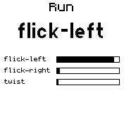

## What you need

- A Bangle.js 2, or just the [Espruino Web IDE](https://www.espruino.com/ide/) with its Bangle.js 2 emulator.
- A PC with Python 3 and `pip install -r apps/tfgest/pc/requirements.txt`
  (TensorFlow 2, NumPy).
- Parts that need a real watch: real accelerometer data, **everything that
  runs the model** (the emulator has no `require("tensorflow")`), inference
  time, live gestures.
- Earlier tutorials this one reuses: 06 (recording and getting files off
  the watch), 07 (windows, features, honest evaluation), 02 (haptic
  feedback, optional).

The finished app is [`apps/tfgest`](../apps/tfgest); the PC side is in
[`apps/tfgest/pc`](../apps/tfgest/pc).

## How to follow along

You build a single app file, `gest.app.js`, one step at a time. Every step
ends with **Your app so far**: the whole file (steps 1 and 2) or a diff
against the step before (later steps, once the file gets long). Each
checkpoint is also in [`tutorials/code/08/`](code/08), complete and ready to
copy. The app uses the same Storage files as the finished app (`gest.*`,
`.tfmodel`, `gestmodel.json`), so recordings and models work with both.

To run a checkpoint in the Web IDE, paste it into the editor, upload it to
**Storage** as `gest.app.js` (or send it to RAM), then paste
[`fake.js`](code/08/fake.js) into the console on the left. The emulator has
neither an accelerometer nor TensorFlow, so `fake.js` stands in for both:

| Call | What it does |
|---|---|
| `fake()` | `accel` events at 12.5 Hz for a resting wrist: 1 g plus a little noise. `fake(false)` stops them |
| `gesture()` | adds one 0.7 s flick along x (up to 2.5 g) to the stream |
| `fakeTF(scores)` | makes `require("tensorflow")` return a stand-in interpreter whose `invoke()` always outputs `scores` |

The stand-in interpreter can't tell you anything about the model. It only
lets you check the code around it. On a real watch you skip `fake.js`.
The screenshots below were made from the checkpoint files with
`tools/screenshot.js`; `node tutorials/code/08/make-shots.js` makes them
again.
## 1. The plan

```
watch: record windows ──► PC: train ──► convert to .tflite ──► watch: run
```

What has to fit:

| Budget | Limit | This tutorial's model |
|---|---|---|
| Model file (`.tflite`) | ≤ 20 KB | 4888 bytes (int8) |
| Interpreter memory (arena) | ≤ 20 KB | 8000 bytes requested |
| Inference time | ≤ 100 ms | *to be measured on a watch* |

The Bangle.js 2 has 256 KB of RAM shared with everything else, and only
some TensorFlow operations are compiled into the firmware. That list decides
which layers you may use; step 5 shows it.

### Your app so far

[`code/08/step1.app.js`](code/08/step1.app.js) is the skeleton: it fixes the
sample rate the model will be trained at, lists the labels, and has a menu
with one entry per part of the plan. **Exit** goes back to the launcher.

```js
// gest.app.js, step 1: the skeleton, one menu entry per part of the plan
Bangle.setPollInterval(80); // 12.5 Hz, the rate the model will be trained at
var LABELS = ["none", "flick-left", "flick-right", "twist", "raise", "shake"];

function showMenu() {
  Bangle.setUI();
  E.showMenu({
    "": { title: "Gestures" },
    "Record": function () { E.showAlert("comes in step 2").then(showMenu); },
    "Run": function () { E.showAlert("comes in step 6").then(showMenu); },
    "Exit": function () { load(); }
  });
}

Bangle.loadWidgets();
Bangle.drawWidgets();
showMenu();
```

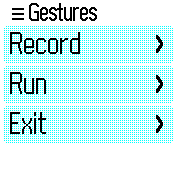

*Look for:* the title **Gestures** and three entries. Record and Run only
show a placeholder for now.

**You learned:** the embedded ML workflow and its constraints.

## 2. Recording a dataset

A gesture is short, so a window is **1.5 s at 12.5 Hz = 19 samples** of
x, y, z. Each recording is one JSON line in a StorageFile per label,
`gest.<label>`, with accel in g × 100 rounded to int8 to save space:

```
{"v":1,"label":"twist","hz":12.5,"n":19,"t":1767258012828,"xyz":[-48,-9,-91,-50,-2,-85,...]}
```

The sample rate is stored with every recording, because a model trained at
12.5 Hz sees a different signal at 25 Hz; the app refuses to run a model
recorded at another rate.

When does a window start? If it starts when you press the button, the
gesture lands at a random place in it. Instead the app waits for the
movement: a **motion-onset detector** starts the window when |a| leaves
1 g ± 0.3 g, and keeps 3 samples from before. Run mode uses the same
detector, so training and live windows line up.

```js
function detector(onWindow) {
  var pre = [], win = null;
  return function (a) {
    var s = [Math.round(a.x * 100), Math.round(a.y * 100), Math.round(a.z * 100)];
    if (!win && Math.abs(a.mag - 1) > 0.3) win = pre.slice();      // onset
    if (win) { win.push(s); if (win.length == 19) { onWindow(win); win = null; pre = []; } }
    else { pre.push(s); if (pre.length > 3) pre.shift(); }
  };
}
var d = detector(function (w) { print("window of", w.length, "samples, onset x =", w[3][0]); });
for (var i = 0; i < 30; i++) {                  // still, then a flick along x
  var x = (i >= 10 && i < 13) ? 0.9 : 0;
  d({x: x, y: 0, z: -1, mag: Math.sqrt(x * x + 1)});
}
```

In the emulator this prints `window of 19 samples, onset x = 90`. With a
real watch, `Bangle.on('accel', d)` feeds it live.

In the app, **Record** → pick a label → **tap**: one buzz (armed), make the
gesture, two buzzes (saved). For `none`, record whatever should *not* count:
resting, walking, scratching your nose.

Good data matters more than a big model: record each gesture 20+ times, in
**several sittings** (put the watch on again, sit differently), and keep
the `none` class varied. Here is one synthetic example per label from the
sample dataset:

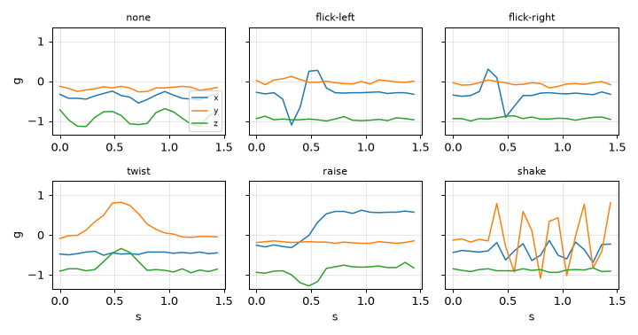

### Your app so far

[`code/08/step2.app.js`](code/08/step2.app.js), 78 lines. The detector
from above gets two switches. `armed` says whether a new window may start,
and `now` starts one at once without waiting for an onset (for `none`).
Values are clamped to int8, because 2.5 g × 100 doesn't fit in −128..127.
Record mode arms on a tap, buzzes once, and when the window is full it
appends one JSON line to `gest.<label>` and buzzes twice.

```js
// gest.app.js, step 2: record gesture windows
Bangle.setPollInterval(80); // 12.5 Hz, the rate the model will be trained at
var LABELS = ["none", "flick-left", "flick-right", "twist", "raise", "shake"];
var N = 19, det, rec;

function i8(g) { var v = Math.round(g * 100); return v < -128 ? -128 : v > 127 ? 127 : v; } // g x 100 as int8

// Motion-onset detector: while armed, a window starts when |a| leaves 1 g +/- 0.3 g
// (or at once if d.now), and keeps the 3 samples from before the onset.
function detector(onWindow) {
  var pre = [], win = null, d = { armed: true, now: false };
  d.feed = function (a) {
    var s = [i8(a.x), i8(a.y), i8(a.z)];
    if (!win && d.armed && (d.now || Math.abs(a.mag - 1) > 0.3)) win = pre.slice();
    if (win) {
      win.push(s);
      if (win.length == N) { var w = win; win = null; pre = []; onWindow(w); }
    } else { pre.push(s); if (pre.length > 3) pre.shift(); }
  };
  return d;
}

function onAccel(a) { if (det) det.feed(a); }
Bangle.on("accel", onAccel);

function drawRec(msg) {
  var r = Bangle.appRect, cx = r.x + r.w / 2;
  g.reset().clearRect(r).setFontAlign(0, -1).setFont("6x8", 2).drawString("Record", cx, r.y + 2);
  g.setFont("Vector", 26).drawString(rec.label, cx, r.y + 30);
  g.setFont("6x8", 2).drawString(rec.count + " saved", cx, r.y + 66);
  g.setFont("6x8").drawString(msg, cx, r.y + 96).drawString("tap: arm  btn: back", cx, r.y2 - 12);
}

function onRecWindow(w) {
  det.armed = false;
  var xyz = [];
  w.forEach(function (s) { xyz.push(s[0], s[1], s[2]); });
  var line = JSON.stringify({ v: 1, label: rec.label, hz: 12.5, n: N, t: Date.now(), xyz: xyz });
  require("Storage").open("gest." + rec.label, "a").write(line + "\n");
  rec.count++;
  Bangle.buzz(60).then(function () { setTimeout(function () { Bangle.buzz(60); }, 150); }); // two buzzes: saved
  drawRec("saved");
}

function startRec(label) {
  rec = { label: label, count: 0 };
  det = detector(onRecWindow);
  det.armed = false;
  Bangle.setUI({ mode: "custom", btn: showMenu, touch: function () {
    if (det.armed) return;
    det.armed = true;
    det.now = label == "none"; // "none" records whatever happens next
    Bangle.buzz(60);           // one buzz: armed
    drawRec("armed: move now");
  } });
  drawRec("");
}

function recMenu() {
  var m = { "": { title: "Record" }, "< Back": showMenu };
  LABELS.forEach(function (l) { m[l] = function () { startRec(l); }; });
  E.showMenu(m);
}

function showMenu() {
  det = undefined;
  Bangle.setUI();
  E.showMenu({
    "": { title: "Gestures" },
    "Record": recMenu,
    "Run": function () { E.showAlert("comes in step 6").then(showMenu); },
    "Exit": function () { load(); }
  });
}

Bangle.loadWidgets();
Bangle.drawWidgets();
showMenu();
```

**Record → twist**, then tap (left), then `gesture()` in the console
(right):

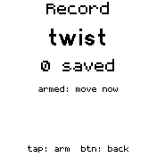 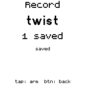

*Look for:* `armed: move now` after the tap, and `1 saved` once the
flick has filled 19 samples. In the console,
`require("Storage").open("gest.twist","r").readLine()` shows the line
that was written. It starts with 3 resting samples (0, 0, −100), then the
flick, clamped at 127 and −128:

```
{"v":1,"label":"twist","hz":12.5,"n":19,"t":1767258002420,"xyz":[1,0,-100,0,0,-100,0,0,-100,90,20,-100,127,20,-100,127,20,-100,-80,20,-100,-128,20,-100,40,20,-100,120,20,-100,-60,20,-100,30,20,-100,0,0,-100,0,0,-100,-1,0,-100,1,-1,-100,1,0,-100,0,-1,-100,-1,0,-100]}
```

**You learned:** fixed windows aligned on motion onset, labels, a consistent sample rate.

## 3. Getting data to the PC

Recordings are plain text lines, so the Web IDE's storage view is enough:
open it, find the `gest.*` StorageFiles and save each into one folder on the
PC. (The prototype-06 export page works too.) If the watch was reset while
saving, the last line may be cut off; the training script skips lines that
don't parse or have the wrong length.

No watch yet? Generate the synthetic sample dataset (6 sessions × 12
recordings × 6 labels):

```sh
python3 apps/tfgest/pc/make_dataset.py      # writes apps/tfgest/pc/sample-data/gest.*
```

### Your app so far

[`code/08/step3.app.js`](code/08/step3.app.js), 84 lines. To know when you
have enough data, the app now counts the complete lines in each file.
Like the training script, it ignores a cut-off last line:

```diff
--- step2.app.js
+++ step3.app.js
@@ -1,4 +1,4 @@
-// gest.app.js, step 2: record gesture windows
+// gest.app.js, step 3: count the recordings
 Bangle.setPollInterval(80); // 12.5 Hz, the rate the model will be trained at
 var LABELS = ["none", "flick-left", "flick-right", "twist", "raise", "shake"];
 var N = 19, det, rec;
@@ -20,6 +20,12 @@
   return d;
 }
 
+function countRecs(label) { // complete lines only: a cut-off last line doesn't count
+  var f = require("Storage").open("gest." + label, "r"), n = 0, l;
+  while ((l = f.readLine()) !== undefined) if (l.charAt(l.length - 1) == "\n") n++;
+  return n;
+}
+
 function onAccel(a) { if (det) det.feed(a); }
 Bangle.on("accel", onAccel);
 
@@ -43,7 +49,7 @@
 }
 
 function startRec(label) {
-  rec = { label: label, count: 0 };
+  rec = { label: label, count: countRecs(label) };
   det = detector(onRecWindow);
   det.armed = false;
   Bangle.setUI({ mode: "custom", btn: showMenu, touch: function () {
@@ -58,7 +64,7 @@
 
 function recMenu() {
   var m = { "": { title: "Record" }, "< Back": showMenu };
-  LABELS.forEach(function (l) { m[l] = function () { startRec(l); }; });
+  LABELS.forEach(function (l) { m[l + " (" + countRecs(l) + ")"] = function () { startRec(l); }; });
   E.showMenu(m);
 }
 
```

After two `twist` recordings and one `none`, **Record** shows:

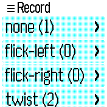

*Look for:* the count after each label, read from the files on every
visit. On the PC, `make_dataset.py` prints the same kind of count for the
synthetic dataset:

```
gest.none: 72 recordings
gest.flick-left: 72 recordings
gest.flick-right: 72 recordings
gest.twist: 72 recordings
gest.raise: 72 recordings
gest.shake: 72 recordings
```

**You learned:** export and parse; never trust the last line.

## 4. Training a tiny model

The reference model is a small 1D convolutional network: two convolutions
slide 3-sample filters along time, a pooling layer averages over the whole
window, and a dense layer gives one probability per label.

```python
inp = tf.keras.Input((19, 1, 3))                       # 19 samples x 3 axes
h = tf.keras.layers.Conv2D(8, (3, 1), activation="relu")(inp)
h = tf.keras.layers.MaxPooling2D((2, 1))(h)
h = tf.keras.layers.Conv2D(16, (3, 1), activation="relu")(h)
h = tf.keras.layers.AveragePooling2D((h.shape[1], 1))(h)  # average over time
h = tf.keras.layers.Reshape((16,))(h)
out = tf.keras.layers.Dense(6, activation="softmax")(h)
```

That is 582 parameters. It is written with `Conv2D` and `(3, 1)` kernels
instead of `Conv1D`, for a reason that appears in step 5.

Two habits keep the result honest:

- **Split by session, not by sample.** Recordings from one sitting look
  alike; if some go to training and some to testing, the test is too easy.
  `train.py` starts a new session when two recordings are more than 10 min
  apart and keeps the last session for testing and the one before for
  validation.
- **Augment the training set**, not the test set: small time shifts
  (±2 samples), amplitude ±10 %, noise, and rotations of ±20° (the watch
  sits differently on every wrist). On the sample data, with 5 augmented
  copies and no rotations the test accuracy over 5 random seeds ranged from
  67 % to 93 %; with rotations and 8 copies it was 100 % for every seed.

```sh
python3 apps/tfgest/pc/train.py             # or --data <folder with your gest.* files>
```

It prints a confusion matrix (rows: true label, columns: predicted) and
precision/recall per class. On the sample dataset:

```
TFLite int8, test sessions: accuracy 100.0 % (72/72)
confusion matrix (rows = true, columns = predicted)
                 0    1    2    3    4    5
0 none          12    0    0    0    0    0
1 flick-left     0   12    0    0    0    0
2 flick-right    0    0   12    0    0    0
3 twist          0    0    0   12    0    0
4 raise          0    0    0    0   12    0
5 shake          0    0    0    0    0   12
```

As in tutorial 07, perfect scores on synthetic data prove the pipeline,
not the model. Your own recordings will put numbers off the diagonal;
`flick-left`/`flick-right` vs `none` is the usual suspect.

### Your app so far

This step happens on the PC, so `gest.app.js` doesn't change (it is still
[`code/08/step3.app.js`](code/08/step3.app.js)). `train.py` writes its
results to [`apps/tfgest/model/`](../apps/tfgest/model). Besides the
confusion matrices for Keras, TFLite float and TFLite int8, it prints how
it split the data and how training went. The start of the output, from
[`model/train-report.txt`](../apps/tfgest/model/train-report.txt):

```
432 recordings (0 bad lines skipped), 6 labels, n=19, hz=12.5, 6 sessions
  train: 288 recordings, sessions [0, 1, 2, 3]
  val: 72 recordings, sessions [4]
  test: 72 recordings, sessions [5]
trained 80 epochs: train accuracy 100.0 %, validation accuracy 100.0 % (best)
model: 582 parameters
```

*Look for:* the test session isn't used for training, and `0 bad lines
skipped`. With your own recordings, check that you got at least 3 sessions.

**You learned:** 1D convolutions, augmentation, a session-based split, reading a confusion matrix.

## 5. Converting and quantizing

`TFLiteConverter` turns the Keras model into a `.tflite` flatbuffer.
With a **representative dataset** it quantizes weights and activations to
int8, about 4× smaller than float. `train.py` keeps the input and output
float32: the converter adds a `QUANTIZE` and a `DEQUANTIZE` op, and the
watch code fills plain numbers in g.

```python
conv = tf.lite.TFLiteConverter.from_keras_model(model)   # model built with batch_size=1
conv.optimizations = [tf.lite.Optimize.DEFAULT]
conv.representative_dataset = lambda: ([s[None]] for s in x_train[:300])
conv.target_spec.supported_ops = [tf.lite.OpsSet.TFLITE_BUILTINS_INT8]
tflite_int8 = conv.convert()
```

Then the op list. Espruino's Bangle.js 2 build doesn't include all of
TensorFlow Lite Micro; its resolver (`libs/tensorflow/tensorflow.cc` in the
Espruino source) registers exactly these ops:

| Supported on Bangle.js 2 |
|---|
| `CONV_2D`, `DEPTHWISE_CONV_2D`, `AVERAGE_POOL_2D`, `MAX_POOL_2D`, `FULLY_CONNECTED`, `SOFTMAX`, `RESHAPE`, `QUANTIZE`, `DEQUANTIZE` |

A model with any other op converts fine and trains fine, and then fails to
load on the watch. That is why the model avoids the obvious layers:

- `Conv1D` converts to `EXPAND_DIMS` + `CONV_2D` (+ `RESHAPE`), and
  `EXPAND_DIMS` isn't in the list. So the input is shaped `(19, 1, 3)` and
  the layers are `Conv2D` with `(3, 1)` kernels.
- `GlobalAveragePooling` converts to `MEAN`, which isn't in the list. An
  `AveragePooling2D` over the whole length does the same job.
- A dynamic batch size can add `SHAPE`/`STRIDED_SLICE`/`PACK` around
  reshapes, so the model is built with `batch_size=1` for conversion.

`train.py` lists the ops with the TFLite interpreter (with the XNNPACK
delegate turned off, or it reports `DELEGATE` instead of the real ops),
checks them against the table, checks the 20 KB budget, and exits with an
error if anything is off:

```
int8 model: 4888 bytes, ops ['AVERAGE_POOL_2D', 'CONV_2D', 'DEQUANTIZE', 'FULLY_CONNECTED', 'MAX_POOL_2D', 'QUANTIZE', 'SOFTMAX']  (all supported)
```

It writes `apps/tfgest/model/tfgest-model.js`. Sending that file from the
Web IDE stores the model as `.tfmodel`, the metadata as `gestmodel.json`
and 5 test windows with the PC's answers as `tfgest.tw.json`:

```json
{"v":1,"labels":["none","flick-left","flick-right","twist","raise","shake"],"n":19,"hz":12.5,
 "scale":0.01,"quant":"int8","io":"float32","thresh":0.7,"arena":8000,"bytes":4888}
```

The normalisation constants (`scale`, and `n`, `hz`) travel with the model,
so the PC and the watch can't drift apart.

*Needs a real watch:* Espruino's TFLM copy is from around 2020, and the
converter here is TensorFlow 2.21. Whether the int8 model (per-channel
quantised convolutions) loads is checked in HW-1/HW-3; a float model,
`tfgest-model-float.js` (5108 bytes, no quantize ops), is written as a
fallback.

### Your app so far

[`code/08/step5.app.js`](code/08/step5.app.js), 98 lines. First get the
model onto the watch: open `apps/tfgest/model/tfgest-model.js` in the Web
IDE and send it. The console prints `tfgest model stored`. Then add a
**Manage** page that shows what arrived:

```diff
--- step3.app.js
+++ step5.app.js
@@ -1,4 +1,4 @@
-// gest.app.js, step 3: count the recordings
+// gest.app.js, step 5: a Manage page for the uploaded model
 Bangle.setPollInterval(80); // 12.5 Hz, the rate the model will be trained at
 var LABELS = ["none", "flick-left", "flick-right", "twist", "raise", "shake"];
 var N = 19, det, rec;
@@ -68,6 +68,19 @@
   E.showMenu(m);
 }
 
+function manageMenu() {
+  var S = require("Storage"), md = S.readJSON("gestmodel.json", true), raw = S.read(".tfmodel"), n = 0;
+  LABELS.forEach(function (l) { n += countRecs(l); });
+  var m = { "": { title: "Manage" }, "< Back": showMenu };
+  m["Model " + (raw ? raw.length + " B" : "none")] = function () {};
+  if (md) {
+    m["Input " + md.n + "x3 " + md.quant] = function () {};
+    m[md.labels.length + " labels"] = function () { E.showAlert(md.labels.join("\n")).then(manageMenu); };
+  }
+  m["Recordings " + n] = function () {};
+  E.showMenu(m);
+}
+
 function showMenu() {
   det = undefined;
   Bangle.setUI();
@@ -75,6 +88,7 @@
     "": { title: "Gestures" },
     "Record": recMenu,
     "Run": function () { E.showAlert("comes in step 6").then(showMenu); },
+    "Manage": manageMenu,
     "Exit": function () { load(); }
   });
 }
```

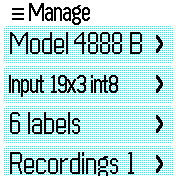

*Look for:* **4888 B**, the same size `train.py` printed, and
`19x3 int8` from `gestmodel.json`. Tap **6 labels** to see them in the
order of the model's outputs.

**You learned:** TFLite conversion, int8 quantization, and why a model that trains fine may not load.

## 6. Running it on the watch

The firmware's API is small: `require("tensorflow").create(arenaSize,
model)` returns an interpreter with `getInput()`, `invoke()` and
`getOutput()`, where input and output are typed arrays over the
interpreter's memory (from `libs/tensorflow/jswrap_tensorflow.c`). Two
details matter:

- `create()` needs the model as a **flat string in RAM**. `Storage.read()`
  returns a string that points into flash, so copy it with `E.toString()`.
- The input must be filled **exactly like the PC did**: int8 value × 0.01
  = g, clamped to ±1.27 g, in x, y, z order.

```js
var S = require("Storage"), meta = S.readJSON("gestmodel.json");
var tf = require("tensorflow").create(meta.arena, E.toString(S.read(".tfmodel")));
var inp = tf.getInput(), out = tf.getOutput();
print("input", inp.length, "output", out.length);        // 57, 6
var w = S.readJSON("tfgest.tw.json").windows[0];          // a test window from the PC
for (var i = 0; i < 57; i++) inp[i] = Math.max(-1.27, Math.min(1.27, w.xyz[i] * meta.scale));
var t0 = getTime();
tf.invoke();
print("took", Math.round((getTime() - t0) * 1000), "ms");
var best = 0;
for (i = 1; i < out.length; i++) if (out[i] > out[best]) best = i;
print("watch:", meta.labels[best], " PC:", w.pcInt8);
```

On a watch this prints the label, the PC's answer and the inference time.
(In the emulator it stops at `require("tensorflow")`: `Module "tensorflow"
not found`.) The app wraps this in checks that never throw: no model,
`create()` errors (a too-small arena shows its size), and a **label count
that doesn't match the output size**, which happens when you upload a new
model but an old `gestmodel.json`. The checkpoint below shows each case.

In the finished app, **Manage → Test windows** runs all 5 stored windows
and compares them with the PC's answers: the int8 model should agree on at
least 4 of 5.

### Your app so far

[`code/08/step6.app.js`](code/08/step6.app.js), 141 lines. `loadModel()`
does the checks from above and never throws. Run mode feeds every movement
window through the model and shows the top class, its score and the
inference time. Leaving Run sets `model = undefined`, which frees the
interpreter's arena.

```diff
--- step5.app.js
+++ step6.app.js
@@ -1,7 +1,7 @@
-// gest.app.js, step 5: a Manage page for the uploaded model
+// gest.app.js, step 6: run the model on every movement window
 Bangle.setPollInterval(80); // 12.5 Hz, the rate the model will be trained at
 var LABELS = ["none", "flick-left", "flick-right", "twist", "raise", "shake"];
-var N = 19, det, rec;
+var N = 19, det, rec, model;
 
 function i8(g) { var v = Math.round(g * 100); return v < -128 ? -128 : v > 127 ? 127 : v; } // g x 100 as int8
 
@@ -68,6 +68,48 @@
   E.showMenu(m);
 }
 
+function loadModel() { // returns {tf, inp, out, meta} or {err}; never throws
+  var S = require("Storage"), meta = S.readJSON("gestmodel.json", true), raw = S.read(".tfmodel"), tf;
+  if (!raw || !meta) return { err: "no model" };
+  try {
+    tf = require("tensorflow").create(meta.arena, E.toString(raw)); // needs a flat string in RAM
+  } catch (e) { return { err: String(e.message || e) }; }
+  var inp = tf.getInput(), out = tf.getOutput();
+  if (out.length != meta.labels.length)
+    return { err: "model has " + out.length + " outputs, gestmodel.json " + meta.labels.length + " labels" };
+  if (inp.length != meta.n * 3) return { err: "model input " + inp.length + ", expected " + meta.n * 3 };
+  return { tf: tf, inp: inp, out: out, meta: meta };
+}
+
+function drawRun(big, small) {
+  var r = Bangle.appRect, cx = r.x + r.w / 2;
+  g.reset().clearRect(r).setFontAlign(0, -1).setFont("6x8", 2).drawString("Run", cx, r.y + 2);
+  g.setFont("Vector", 26).drawString(big, cx, r.y + 30);
+  if (small) g.setFont("6x8").drawString(g.wrapString(small, r.w - 8).join("\n"), cx, r.y + 70);
+}
+
+function onRunWindow(w) {
+  var m = model, k = 0, best = 0, i;
+  w.forEach(function (s) { // the same normalisation as on the PC
+    for (var j = 0; j < 3; j++) m.inp[k++] = Math.max(-1.27, Math.min(1.27, s[j] * m.meta.scale));
+  });
+  var t0 = getTime();
+  m.tf.invoke();
+  var ms = Math.round((getTime() - t0) * 1000);
+  for (i = 1; i < m.out.length; i++) if (m.out[i] > m.out[best]) best = i;
+  drawRun(m.meta.labels[best], "p " + Math.round(m.out[best] * 100) + " %, " + ms + " ms");
+}
+
+function startRun() {
+  var m = loadModel();
+  Bangle.setUI({ mode: "custom", btn: showMenu });
+  if (m.err == "no model") return drawRun("no model", "train one on the PC, upload tfgest-model.js");
+  if (m.err) return drawRun("error", m.err);
+  model = m;
+  det = detector(onRunWindow);
+  drawRun("...", "waiting for a movement");
+}
+
 function manageMenu() {
   var S = require("Storage"), md = S.readJSON("gestmodel.json", true), raw = S.read(".tfmodel"), n = 0;
   LABELS.forEach(function (l) { n += countRecs(l); });
@@ -83,11 +125,12 @@
 
 function showMenu() {
   det = undefined;
+  model = undefined; // drops the interpreter, which frees its arena
   Bangle.setUI();
   E.showMenu({
     "": { title: "Gestures" },
     "Record": recMenu,
-    "Run": function () { E.showAlert("comes in step 6").then(showMenu); },
+    "Run": startRun,
     "Manage": manageMenu,
     "Exit": function () { load(); }
   });
```

Before uploading the model (left), and with the model in the emulator,
which has no TensorFlow (right):

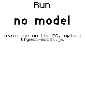 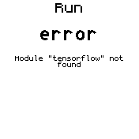

*Look for:* a message instead of an exception in both cases. On a watch
the right-hand screen shows `...` and waits for a movement. To exercise
the rest of the code in the emulator, `fakeTF([0.1,0.2,0.3,0.2,0.2])`
returns 5 outputs for 6 labels (left). `fakeTF([0.02,0.9,0.03,0.02,0.02,0.01])`
followed by `gesture()` runs a window through (right):

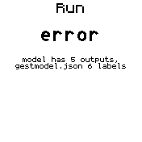 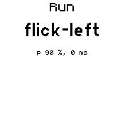

*Look for:* the mismatch is refused with both numbers, which tells you to
upload a matching `gestmodel.json`. With 6 outputs, the window goes
through and the top label is shown. The 0 ms is the stand-in's time. On a
watch this is the real inference time (HW-2), and the label is the model's
own answer.

**You learned:** `tensorflow.create`, matching preprocessing on both sides, arena size.

## 7. Making it usable

A softmax always picks *something*. Three rules turn probabilities into
events you can trust:

1. **A `none` class**: trained on everything that isn't a gesture. It is
   never reported.
2. **A threshold**: the top probability must be above `thresh` (0.7, from
   `gestmodel.json`).
3. **A refractory period**: after a detection, ignore movement for 1 s, so
   one shake isn't three detections.

```js
function decide(best, t, state) {          // best = {name, p}
  if (best.name == "none" || best.p <= 0.7) return "";
  if (state.last !== undefined && t - state.last < 1000) return "";
  state.last = t;
  return best.name;
}
var st = {};
print(decide({name: "twist", p: 0.9}, 0, st));      // twist
print(decide({name: "twist", p: 0.9}, 500, st));    // "" (refractory)
print(decide({name: "none", p: 0.99}, 2000, st));   // "" (none)
print(decide({name: "shake", p: 0.6}, 3000, st));   // "" (below threshold)
```

On a detection the app shows the name large, buzzes once and keeps the
top-3 probabilities on screen, which is the best way to see what the model
is unsure about. Walking for 2 minutes should give at most 2 false
detections ([HW-5](../apps/tfgest/HW-TESTS.md)); if it gives more, record
more walking as `none`, or raise `thresh`.

### Your app so far

[`code/08/step7.app.js`](code/08/step7.app.js), 171 lines: the complete
tutorial app. `decide()` is the function from above. After a detection,
the detector is disarmed for 1 s, which is what enforces the refractory
period here: a window takes 1.5 s to fill, so two windows are never less
than 1 s apart, and `decide()`'s own time check is only a second line of
defence. The screen shows the last detection and the top 3 scores. The
inference time moves to the console.

```diff
--- step6.app.js
+++ step7.app.js
@@ -1,7 +1,7 @@
-// gest.app.js, step 6: run the model on every movement window
+// gest.app.js, step 7: none, threshold and refractory time turn scores into events
 Bangle.setPollInterval(80); // 12.5 Hz, the rate the model will be trained at
 var LABELS = ["none", "flick-left", "flick-right", "twist", "raise", "shake"];
-var N = 19, det, rec, model;
+var N = 19, det, rec, model, shown, top = [], state = {};
 
 function i8(g) { var v = Math.round(g * 100); return v < -128 ? -128 : v > 127 ? 127 : v; } // g x 100 as int8
 
@@ -88,16 +88,45 @@
   if (small) g.setFont("6x8").drawString(g.wrapString(small, r.w - 8).join("\n"), cx, r.y + 70);
 }
 
+function decide(best, t, state) { // best = {name, p}
+  if (best.name == "none" || best.p <= model.meta.thresh) return "";
+  if (state.last !== undefined && t - state.last < 1000) return ""; // refractory: 1 s
+  state.last = t;
+  return best.name;
+}
+
+function drawTop() { // the detected gesture, and the top 3 scores of the last window
+  var r = Bangle.appRect, cx = r.x + r.w / 2;
+  g.reset().clearRect(r).setFontAlign(0, -1).setFont("6x8", 2).drawString("Run", cx, r.y + 2);
+  g.setFont("Vector", 30).drawString(shown || "...", cx, r.y + 30);
+  g.setFont("6x8").setFontAlign(-1, -1);
+  top.forEach(function (e, i) {
+    var y = r.y + 80 + i * 16;
+    g.drawString(e.name, r.x + 6, y);
+    g.drawRect(r.x + 80, y, r.x2 - 6, y + 8).fillRect(r.x + 80, y, r.x + 80 + Math.round((r.w - 86) * e.p), y + 8);
+  });
+}
+
 function onRunWindow(w) {
-  var m = model, k = 0, best = 0, i;
+  var m = model, k = 0, i;
   w.forEach(function (s) { // the same normalisation as on the PC
     for (var j = 0; j < 3; j++) m.inp[k++] = Math.max(-1.27, Math.min(1.27, s[j] * m.meta.scale));
   });
   var t0 = getTime();
   m.tf.invoke();
-  var ms = Math.round((getTime() - t0) * 1000);
-  for (i = 1; i < m.out.length; i++) if (m.out[i] > m.out[best]) best = i;
-  drawRun(m.meta.labels[best], "p " + Math.round(m.out[best] * 100) + " %, " + ms + " ms");
+  console.log("inference", Math.round((getTime() - t0) * 1000), "ms");
+  top = [];
+  for (i = 0; i < m.out.length; i++) top.push({ name: m.meta.labels[i], p: m.out[i] });
+  top.sort(function (a, b) { return b.p - a.p; });
+  top = top.slice(0, 3);
+  var name = decide(top[0], Date.now(), state);
+  if (name) {
+    shown = name;
+    Bangle.buzz(80);
+    det.armed = false; // refractory: ignore movement for 1 s
+    setTimeout(function () { if (det) det.armed = true; }, 1000);
+  }
+  drawTop();
 }
 
 function startRun() {
@@ -106,8 +135,9 @@
   if (m.err == "no model") return drawRun("no model", "train one on the PC, upload tfgest-model.js");
   if (m.err) return drawRun("error", m.err);
   model = m;
+  shown = undefined; top = []; state = {};
   det = detector(onRunWindow);
-  drawRun("...", "waiting for a movement");
+  drawTop();
 }
 
 function manageMenu() {
```

`fakeTF([0.02,0.9,0.03,0.02,0.02,0.01])` with `gesture()` (left), and
`fakeTF([0.05,0.55,0.3,0.05,0.03,0.02])` with `gesture()` (right):

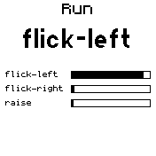 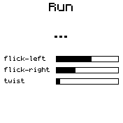

*Look for:* on the left, 0.9 is above `thresh`, so `flick-left` is shown
and the watch buzzes. On the right, the model leans towards `flick-left`
with 0.55, which is below 0.7, so nothing is reported, but the bars show
how unsure it was. In the emulator, six `gesture()` calls in a row (4.3 s
of shaking) gave 2 detections, not 6. With `none` on top, nothing is
reported.

### From your app to `apps/tfgest`

Your `gest.app.js` is a complete, working, simplified version of the app.
It records, runs and manages the same files. The real
[`apps/tfgest`](../apps/tfgest) adds:

| Your step-7 app | `apps/tfgest` |
|---|---|
| Everything in one file | Logic in the module `tfgest.lib.js` (format, detector, checks, normalisation, top-3, decisions), UI in `tfgest.app.js`, so tests can drive each part |
| Arrays of arrays for windows | `Int8Array` ring buffer and window |
| An armed recording waits for movement forever | Records anyway after 3 s without movement |
| Labels from `LABELS` | Labels from `gestmodel.json` when there is one |
| Checks outputs and input size | Also refuses a model recorded at another sample rate, and names the arena size when `create()` runs out of memory |
| Manage shows model and counts | Also **Test windows** (the 5 stored windows against the PC's answers, with the slowest inference time) and **Delete recordings** (with a prompt) |
| `console.log` of the inference time | `DEBUG` JSON events (`arm`, `rec`, `run`, `infer`, `detect`, `selftest`, `deleted`) |

 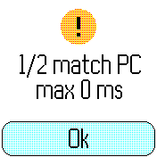 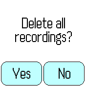

**You learned:** turning probabilities into reliable events.

## Test it in the emulator

The emulator has neither accelerometer data nor TensorFlow, so the tests
in [`apps/tfgest/tests/`](../apps/tfgest/tests) (24 tests) feed synthetic
samples to `feed(a, t)` and replace `require("tensorflow")` with a fake
interpreter whose output the test chooses. They check that Record writes
lines with exactly 19 × 3 int8 values, that the onset detector fires on a
burst but not on 10 minutes of 1 g ± 0.02 g noise, that Run shows
`no model` without errors, that a label/output mismatch is refused, the
threshold, `none` and refractory rules, and that the uploaded
`tfgest-model.js` stores a valid model.

```js
T.test("detector does not fire on 1 g with +/-0.02 g noise (10 min)", function () {
  var n = 0, d = G.detector({ onWindow: function () { n++; } });
  for (var t = T0; t < T0 + 600000; t += 80) d.feed(rest(), t);
  T.eq(n, 0);
});
```

Run them with `npm test -- tfgest`. The PC side is its own check:
`python3 apps/tfgest/pc/train.py` exits 0 only if test accuracy ≥ 85 %,
the model is ≤ 20 KB and every op is supported.

## Try it on the watch

[`apps/tfgest/HW-TESTS.md`](../apps/tfgest/HW-TESTS.md): the stored test
windows give the PC's answer (HW-1), inference time ≤ 100 ms (HW-2), the
smallest working arena (HW-3), live gestures ≥ 8/10 each and ≤ 2 false
detections while walking (HW-4, HW-5), and the full loop with your own
recordings (HW-7). The bundled model was trained on synthetic data; train
on your own recordings before judging live accuracy.

## Going further

- **The firmware gesture path.** The firmware has its own detector (tuned
  with `Bangle.setOptions({gestureStartThresh, gestureEndThresh,
  gestureInactiveCount, gestureMinLength})`), fires `Bangle.on('gesture',
  xyz)` with an `Int8Array`, and, if `.tfmodel` exists, runs it and fires
  `Bangle.on('aiGesture', name, weights)`, with names from a comma-separated
  `.tfnames` file. Its windows have a variable length (10–49 samples) and
  raw units of about 64 per g, and it uses a fixed 4000-byte arena, so a
  model for it must be trained on its own `gesture` events.
- **More gestures**: add a label, record it, retrain; `gestmodel.json` carries the new label list.
- **Haptic feedback**: give each gesture its own vibration pattern with the
  pattern player from tutorial 02 instead of a single buzz.
- **Compare with rules**: run tutorial 07's features on the same windows. Where do hand-written rules stop working?
