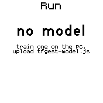
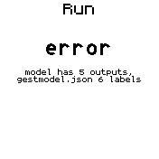
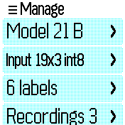

# 08 — Machine learning on your wrist with TensorFlow Lite

In tutorial 07 you wrote rules by hand. Here the watch learns them: you
record a few hundred wrist gestures (`flick-left`, `flick-right`, `twist`,
`raise`, `shake` and `none`), train a tiny neural network on your PC,
convert it to TensorFlow Lite, and run it on the watch with the TensorFlow
Lite Micro interpreter that is built into the Bangle.js 2 firmware. Along the
way you'll see what fits in a watch, why a model that trains fine may not
load, and how to turn probabilities into events you can rely on.


## What you need

- A Bangle.js 2, or just the [Espruino Web IDE](https://www.espruino.com/ide/) with its Bangle.js 2 emulator.
- A PC with Python 3 and `pip install -r apps/tfgest/pc/requirements.txt`
  (TensorFlow 2, NumPy).
- Parts that need a real watch: real accelerometer data, **everything that
  runs the model** (the emulator has no `require("tensorflow")`), inference
  time, live gestures.
- Earlier tutorials this one reuses: 06 (recording and getting files off
  the watch), 07 (windows, features, honest evaluation), 02 (haptic
  feedback, optional).

The finished app is [`apps/tfgest`](../apps/tfgest); the PC side is in
[`apps/tfgest/pc`](../apps/tfgest/pc).

## 1. The plan

```
watch: record windows ──► PC: train ──► convert to .tflite ──► watch: run
```

What has to fit:

| Budget | Limit | This tutorial's model |
|---|---|---|
| Model file (`.tflite`) | ≤ 20 KB | 4888 bytes (int8) |
| Interpreter memory (arena) | ≤ 20 KB | 8000 bytes requested |
| Inference time | ≤ 100 ms | *to be measured on a watch* |

The Bangle.js 2 has 256 KB of RAM shared with everything else, and only
some TensorFlow operations are compiled into the firmware. That list decides
which layers you may use; step 5 shows it.

**You learned:** the embedded ML workflow and its constraints.

## 2. Recording a dataset

A gesture is short, so a window is **1.5 s at 12.5 Hz = 19 samples** of
x, y, z. Each recording is one JSON line in a StorageFile per label,
`gest.<label>`, with accel in g × 100 rounded to int8 to save space:

```
{"v":1,"label":"twist","hz":12.5,"n":19,"t":1767258012828,"xyz":[-48,-9,-91,-50,-2,-85,...]}
```

The sample rate is stored with every recording, because a model trained at
12.5 Hz sees a different signal at 25 Hz; the app refuses to run a model
recorded at another rate.

When does a window start? If it starts when you press the button, the
gesture lands at a random place in it. Instead the app waits for the
movement: a **motion-onset detector** starts the window when |a| leaves
1 g ± 0.3 g, and keeps 3 samples from before. Run mode uses the same
detector, so training and live windows line up.

```js
function detector(onWindow) {
  var pre = [], win = null;
  return function (a) {
    var s = [Math.round(a.x * 100), Math.round(a.y * 100), Math.round(a.z * 100)];
    if (!win && Math.abs(a.mag - 1) > 0.3) win = pre.slice();      // onset
    if (win) { win.push(s); if (win.length == 19) { onWindow(win); win = null; pre = []; } }
    else { pre.push(s); if (pre.length > 3) pre.shift(); }
  };
}
var d = detector(function (w) { print("window of", w.length, "samples, onset x =", w[3][0]); });
for (var i = 0; i < 30; i++) {                  // still, then a flick along x
  var x = (i >= 10 && i < 13) ? 0.9 : 0;
  d({x: x, y: 0, z: -1, mag: Math.sqrt(x * x + 1)});
}
```

In the emulator this prints `window of 19 samples, onset x = 90`. With a
real watch, `Bangle.on('accel', d)` feeds it live.

In the app, **Record** → pick a label → **tap**: one buzz (armed), make the
gesture, two buzzes (saved). For `none`, record whatever should *not* count:
resting, walking, scratching your nose.


Good data matters more than a big model: record each gesture 20+ times, in
**several sittings** (put the watch on again, sit differently), and keep
the `none` class varied. Here is one synthetic example per label from the
sample dataset:


**You learned:** fixed windows aligned on motion onset, labels, a consistent sample rate.

## 3. Getting data to the PC

Recordings are plain text lines, so the Web IDE's storage view is enough:
open it, find the `gest.*` StorageFiles and save each into one folder on the
PC. (The prototype-06 export page works too.) If the watch was reset while
saving, the last line may be cut off; the training script skips lines that
don't parse or have the wrong length.

No watch yet? Generate the synthetic sample dataset (6 sessions × 12
recordings × 6 labels):

```sh
python3 apps/tfgest/pc/make_dataset.py      # writes apps/tfgest/pc/sample-data/gest.*
```

**You learned:** export and parse; never trust the last line.

## 4. Training a tiny model

The reference model is a small 1D convolutional network: two convolutions
slide 3-sample filters along time, a pooling layer averages over the whole
window, and a dense layer gives one probability per label.

```python
inp = tf.keras.Input((19, 1, 3))                       # 19 samples x 3 axes
h = tf.keras.layers.Conv2D(8, (3, 1), activation="relu")(inp)
h = tf.keras.layers.MaxPooling2D((2, 1))(h)
h = tf.keras.layers.Conv2D(16, (3, 1), activation="relu")(h)
h = tf.keras.layers.AveragePooling2D((h.shape[1], 1))(h)  # average over time
h = tf.keras.layers.Reshape((16,))(h)
out = tf.keras.layers.Dense(6, activation="softmax")(h)
```

That is 582 parameters. It is written with `Conv2D` and `(3, 1)` kernels
instead of `Conv1D`, for a reason that appears in step 5.

Two habits keep the result honest:

- **Split by session, not by sample.** Recordings from one sitting look
  alike; if some go to training and some to testing, the test is too easy.
  `train.py` starts a new session when two recordings are more than 10 min
  apart and keeps the last session for testing and the one before for
  validation.
- **Augment the training set**, not the test set: small time shifts
  (±2 samples), amplitude ±10 %, noise, and rotations of ±20° (the watch
  sits differently on every wrist). On the sample data, with 5 augmented
  copies and no rotations the test accuracy over 5 random seeds ranged from
  67 % to 93 %; with rotations and 8 copies it was 100 % for every seed.

```sh
python3 apps/tfgest/pc/train.py             # or --data <folder with your gest.* files>
```

It prints a confusion matrix (rows: true label, columns: predicted) and
precision/recall per class. On the sample dataset:

```
TFLite int8, test sessions: accuracy 100.0 % (72/72)
confusion matrix (rows = true, columns = predicted)
                 0    1    2    3    4    5
0 none          12    0    0    0    0    0
1 flick-left     0   12    0    0    0    0
2 flick-right    0    0   12    0    0    0
3 twist          0    0    0   12    0    0
4 raise          0    0    0    0   12    0
5 shake          0    0    0    0    0   12
```

As in tutorial 07, perfect scores on synthetic data prove the pipeline,
not the model. Your own recordings will put numbers off the diagonal;
`flick-left`/`flick-right` vs `none` is the usual suspect.

**You learned:** 1D convolutions, augmentation, a session-based split, reading a confusion matrix.

## 5. Converting and quantizing

`TFLiteConverter` turns the Keras model into a `.tflite` flatbuffer.
With a **representative dataset** it quantizes weights and activations to
int8, about 4× smaller than float. `train.py` keeps the input and output
float32: the converter adds a `QUANTIZE` and a `DEQUANTIZE` op, and the
watch code fills plain numbers in g.

```python
conv = tf.lite.TFLiteConverter.from_keras_model(model)   # model built with batch_size=1
conv.optimizations = [tf.lite.Optimize.DEFAULT]
conv.representative_dataset = lambda: ([s[None]] for s in x_train[:300])
conv.target_spec.supported_ops = [tf.lite.OpsSet.TFLITE_BUILTINS_INT8]
tflite_int8 = conv.convert()
```

Then the op list. Espruino's Bangle.js 2 build doesn't include all of
TensorFlow Lite Micro; its resolver (`libs/tensorflow/tensorflow.cc` in the
Espruino source) registers exactly these ops:

| Supported on Bangle.js 2 |
|---|
| `CONV_2D`, `DEPTHWISE_CONV_2D`, `AVERAGE_POOL_2D`, `MAX_POOL_2D`, `FULLY_CONNECTED`, `SOFTMAX`, `RESHAPE`, `QUANTIZE`, `DEQUANTIZE` |

A model with any other op converts fine and trains fine, and then fails to
load on the watch. That is why the model avoids the obvious layers:

- `Conv1D` converts to `EXPAND_DIMS` + `CONV_2D` (+ `RESHAPE`), and
  `EXPAND_DIMS` isn't in the list. So the input is shaped `(19, 1, 3)` and
  the layers are `Conv2D` with `(3, 1)` kernels.
- `GlobalAveragePooling` converts to `MEAN`, which isn't in the list. An
  `AveragePooling2D` over the whole length does the same job.
- A dynamic batch size can add `SHAPE`/`STRIDED_SLICE`/`PACK` around
  reshapes, so the model is built with `batch_size=1` for conversion.

`train.py` lists the ops with the TFLite interpreter (with the XNNPACK
delegate turned off, or it reports `DELEGATE` instead of the real ops),
checks them against the table, checks the 20 KB budget, and exits with an
error if anything is off:

```
int8 model: 4888 bytes, ops ['AVERAGE_POOL_2D', 'CONV_2D', 'DEQUANTIZE', 'FULLY_CONNECTED', 'MAX_POOL_2D', 'QUANTIZE', 'SOFTMAX']  (all supported)
```

It writes `apps/tfgest/model/tfgest-model.js`. Sending that file from the
Web IDE stores the model as `.tfmodel`, the metadata as `gestmodel.json`
and 5 test windows with the PC's answers as `tfgest.tw.json`:

```json
{"v":1,"labels":["none","flick-left","flick-right","twist","raise","shake"],"n":19,"hz":12.5,
 "scale":0.01,"quant":"int8","io":"float32","thresh":0.7,"arena":8000,"bytes":4888}
```

The normalisation constants (`scale`, and `n`, `hz`) travel with the model,
so the PC and the watch can't drift apart.

*Needs a real watch:* Espruino's TFLM copy is from around 2020, and the
converter here is TensorFlow 2.21. Whether the int8 model (per-channel
quantised convolutions) loads is checked in HW-1/HW-3; a float model,
`tfgest-model-float.js` (5108 bytes, no quantize ops), is written as a
fallback.

**You learned:** TFLite conversion, int8 quantization, and why a model that trains fine may not load.

## 6. Running it on the watch

The firmware's API is small: `require("tensorflow").create(arenaSize,
model)` returns an interpreter with `getInput()`, `invoke()` and
`getOutput()`, where input and output are typed arrays over the
interpreter's memory (from `libs/tensorflow/jswrap_tensorflow.c`). Two
details matter:

- `create()` needs the model as a **flat string in RAM**. `Storage.read()`
  returns a string that points into flash, so copy it with `E.toString()`.
- The input must be filled **exactly like the PC did**: int8 value × 0.01
  = g, clamped to ±1.27 g, in x, y, z order.

```js
var S = require("Storage"), meta = S.readJSON("gestmodel.json");
var tf = require("tensorflow").create(meta.arena, E.toString(S.read(".tfmodel")));
var inp = tf.getInput(), out = tf.getOutput();
print("input", inp.length, "output", out.length);        // 57, 6
var w = S.readJSON("tfgest.tw.json").windows[0];          // a test window from the PC
for (var i = 0; i < 57; i++) inp[i] = Math.max(-1.27, Math.min(1.27, w.xyz[i] * meta.scale));
var t0 = getTime();
tf.invoke();
print("took", Math.round((getTime() - t0) * 1000), "ms");
var best = 0;
for (i = 1; i < out.length; i++) if (out[i] > out[best]) best = i;
print("watch:", meta.labels[best], " PC:", w.pcInt8);
```

On a watch this prints the label, the PC's answer and the inference time.
(In the emulator it stops at `require("tensorflow")`: `Module "tensorflow"
not found`.) The app wraps this in checks that never throw: no model,
`create()` errors (a too-small arena shows its size), and a **label count
that doesn't match the output size**, which happens when you upload a new
model but an old `gestmodel.json`:

 

**Manage → Test windows** runs all 5 stored windows and compares with the
PC: the int8 model should agree on at least 4 of 5. Leaving Run mode drops
the interpreter (`model = undefined`), which frees its arena.



**You learned:** `tensorflow.create`, matching preprocessing on both sides, arena size.

## 7. Making it usable

A softmax always picks *something*. Three rules turn probabilities into
events you can trust:

1. **A `none` class**: trained on everything that isn't a gesture. It is
   never reported.
2. **A threshold**: the top probability must be above `thresh` (0.7, from
   `gestmodel.json`).
3. **A refractory period**: after a detection, ignore movement for 1 s, so
   one shake isn't three detections.

```js
function decide(best, t, state) {          // best = {name, p}
  if (best.name == "none" || best.p <= 0.7) return "";
  if (state.last !== undefined && t - state.last < 1000) return "";
  state.last = t;
  return best.name;
}
var st = {};
print(decide({name: "twist", p: 0.9}, 0, st));      // twist
print(decide({name: "twist", p: 0.9}, 500, st));    // "" (refractory)
print(decide({name: "none", p: 0.99}, 2000, st));   // "" (none)
print(decide({name: "shake", p: 0.6}, 3000, st));   // "" (below threshold)
```

On a detection the app shows the name large, buzzes once and keeps the
top-3 probabilities on screen, which is the best way to see what the model
is unsure about. Walking for 2 minutes should give at most 2 false
detections ([HW-5](../apps/tfgest/HW-TESTS.md)); if it gives more, record
more walking as `none`, or raise `thresh`.

**You learned:** turning probabilities into reliable events.

## Test it in the emulator

The emulator has neither accelerometer data nor TensorFlow, so the tests
in [`apps/tfgest/tests/`](../apps/tfgest/tests) (24 tests) feed synthetic
samples to `feed(a, t)` and replace `require("tensorflow")` with a fake
interpreter whose output the test chooses. They check that Record writes
lines with exactly 19 × 3 int8 values, that the onset detector fires on a
burst but not on 10 minutes of 1 g ± 0.02 g noise, that Run shows
`no model` without errors, that a label/output mismatch is refused, the
threshold, `none` and refractory rules, and that the uploaded
`tfgest-model.js` stores a valid model.

```js
T.test("detector does not fire on 1 g with +/-0.02 g noise (10 min)", function () {
  var n = 0, d = G.detector({ onWindow: function () { n++; } });
  for (var t = T0; t < T0 + 600000; t += 80) d.feed(rest(), t);
  T.eq(n, 0);
});
```

Run them with `npm test -- tfgest`. The PC side is its own check:
`python3 apps/tfgest/pc/train.py` exits 0 only if test accuracy ≥ 85 %,
the model is ≤ 20 KB and every op is supported.

## Try it on the watch

[`apps/tfgest/HW-TESTS.md`](../apps/tfgest/HW-TESTS.md): the stored test
windows give the PC's answer (HW-1), inference time ≤ 100 ms (HW-2), the
smallest working arena (HW-3), live gestures ≥ 8/10 each and ≤ 2 false
detections while walking (HW-4, HW-5), and the full loop with your own
recordings (HW-7). The bundled model was trained on synthetic data; train
on your own recordings before judging live accuracy.

## Going further

- **The firmware gesture path.** The firmware has its own detector (tuned
  with `Bangle.setOptions({gestureStartThresh, gestureEndThresh,
  gestureInactiveCount, gestureMinLength})`), fires `Bangle.on('gesture',
  xyz)` with an `Int8Array`, and, if `.tfmodel` exists, runs it and fires
  `Bangle.on('aiGesture', name, weights)`, with names from a comma-separated
  `.tfnames` file. Its windows have a variable length (10–49 samples) and
  raw units of about 64 per g, and it uses a fixed 4000-byte arena, so a
  model for it must be trained on its own `gesture` events.
- **More gestures**: add a label, record it, retrain; `gestmodel.json` carries the new label list.
- **Haptic feedback**: give each gesture its own vibration pattern with the
  pattern player from tutorial 02 instead of a single buzz.
- **Compare with rules**: run tutorial 07's features on the same windows. Where do hand-written rules stop working?
